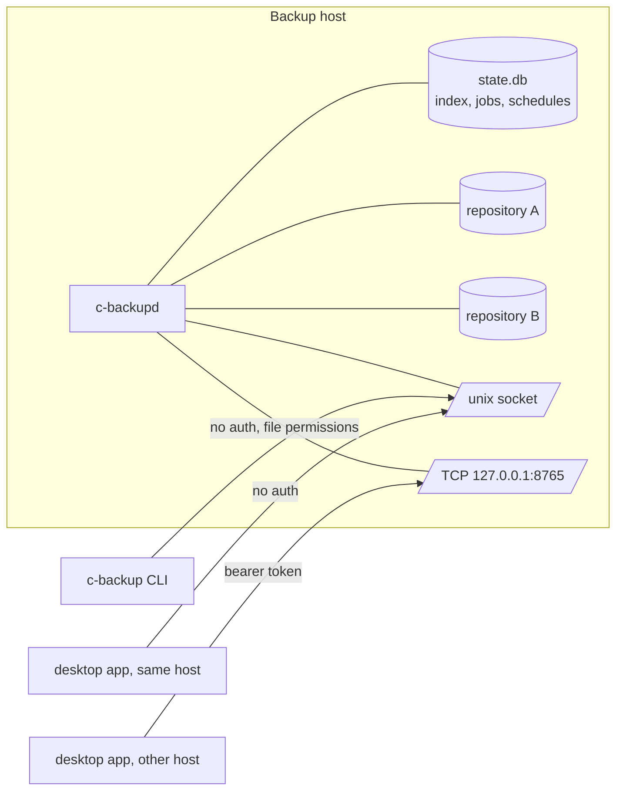
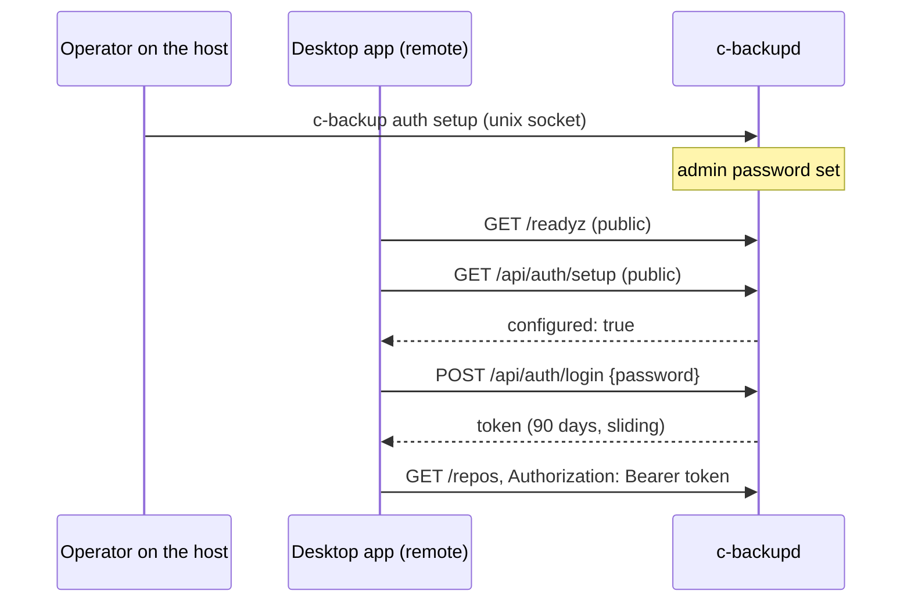
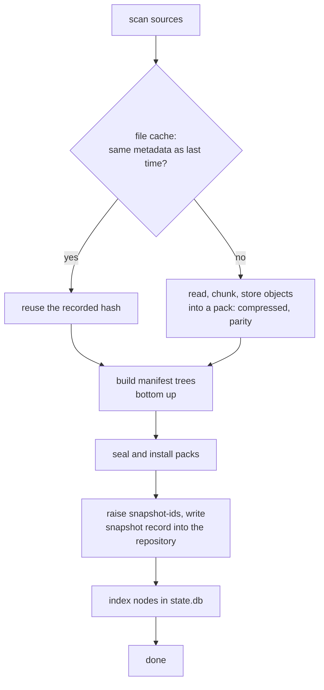
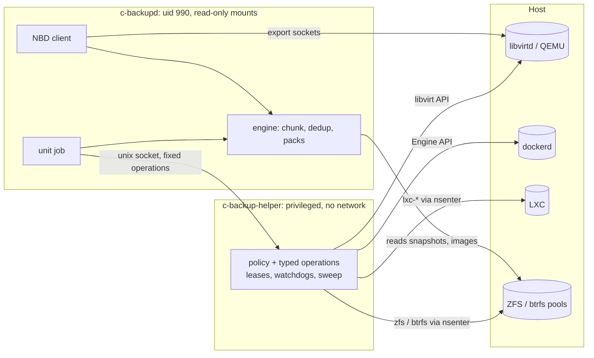
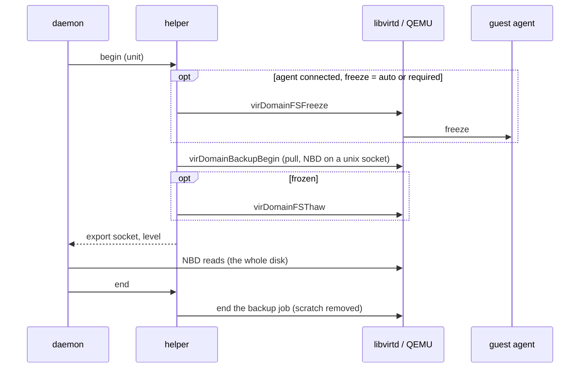
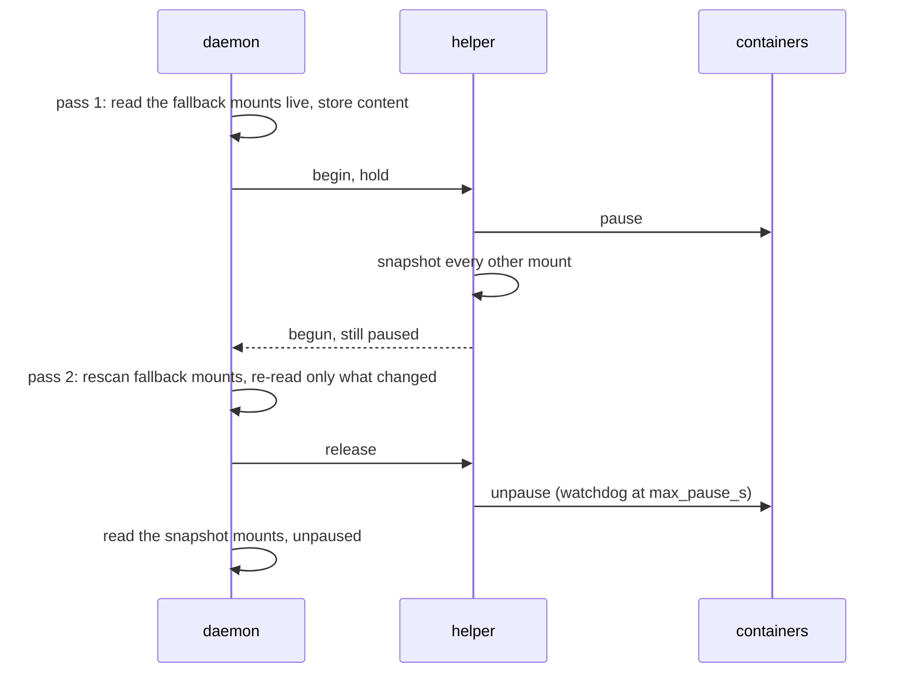

# c-backup Manual

Version 1.0. This is the operator's reference: what the system is, how to
install and configure it, how every operation behaves, what it guarantees,
what it costs, and how to recover when something is lost. `docs/api.md` is
the endpoint reference and `docs/data-paths.md` follows bytes through the
engine; this manual points at both rather than repeating them.

Contents

1. [What c-backup is](#1-what-c-backup-is)
2. [Installation](#2-installation)
3. [Configuration](#3-configuration)
4. [Access and security](#4-access-and-security)
5. [Repositories](#5-repositories)
6. [Backing up](#6-backing-up)
7. [Browsing, searching, comparing](#7-browsing-searching-comparing)
8. [Restoring](#8-restoring)
9. [Retention](#9-retention)
10. [Scheduling](#10-scheduling)
11. [Integrity: verify and repair](#11-integrity-verify-and-repair)
12. [Maintenance](#12-maintenance)
13. [Encryption](#13-encryption)
14. [Replication](#14-replication)
15. [The desktop app](#15-the-desktop-app)
16. [Monitoring and alerting](#16-monitoring-and-alerting)
17. [Disaster recovery](#17-disaster-recovery)
18. [Capacity planning and performance](#18-capacity-planning-and-performance)
19. [Troubleshooting](#19-troubleshooting)
20. [Limits and what is not in 1.0](#20-limits-and-what-is-not-in-10)
21. [Command reference](#21-command-reference)
22. [Units: virtual machines and containers](#22-units-virtual-machines-and-containers)

---

## 1. What c-backup is

A content-addressed backup system built as one daemon per machine.

- **`c-backupd`** owns every repository on its host and is the only process
  that writes to them. It runs backups, restores, retention, verification,
  replication and schedules as jobs on a small worker pool, and serves an
  HTTP API.
- **`c-backup`** is a thin command-line client. Every command is one or a few
  HTTP requests to the daemon over its unix socket. There is no standalone
  mode: if the daemon is not running, the CLI says so and exits.
- **The desktop app** (Electron) is a second client of the same API. It
  connects to the local daemon over the unix socket, and to daemons on other
  machines over TCP with a session token.



### 1.1 The storage model

Every file's content is stored once, as objects named by the SHA-256 of
their type and bytes. A second copy of the same bytes anywhere, in any
snapshot, costs nothing. No object is larger than 16 MiB: a larger file is
cut at content-defined boundaries into chunks of 512 KiB to 8 MiB, listed by
a chunk-list object, so an edit, an insert or an append stores only the
chunks it touched rather than the whole file again. Objects are compressed
with LZ4 when a 64 KiB probe says it is worthwhile and left alone when it is
not, so video, audio and database files do not burn CPU. Every object is
written once, straight into a pack file, and every pack entry carries
Reed-Solomon parity, so bit rot can be repaired, not just detected. Holes
in sparse files are gaps in the chunk list, so a 1 TiB disk image holding
40 GiB costs 40 GiB and restores sparse.

The on-disk layout is repository format 3 (`docs/repo-format.md`). This
build reads and writes no other format (section 17.4).

A snapshot's metadata (names, modes, owners, times, links, extended
attributes, ACLs) is one content-addressed **manifest tree** object per
directory. A directory that did not change has the same tree hash and costs
nothing in the next snapshot; measured, an incremental snapshot writes about
3.3% new tree objects.

### 1.2 The repository is the source of truth

A repository is a directory that describes itself: objects, packs, manifest
trees and snapshot records. The daemon's database (`state.db`) is an index
over it, built for fast browsing and search. Lose the database and
`c-backup reindex` rebuilds it from the repository. What a database loss
costs is daemon-only state, listed exactly in section 17.5 - schedules,
sources, retention policy, notes, the journal, job history, sessions -
never backups. Section 17 covers recovery.

### 1.3 Design constraints

These hold everywhere and decide many of the behaviours below.

1. **No size limit.** No limit on file or repository size; nothing assumes
   data fits in memory.
2. **Files exceed RAM.** A file is never buffered whole. Every object is at
   most 16 MiB and handled whole, so a file larger than that is a list of
   chunks, and memory per file is bounded by the chunker's window, not by
   the file.
3. **Millions of inodes.** Traversal and change detection are linear in the
   number of entries.
4. **Fast incompressible bailout.** At most 128 KiB of LZ4 samples, spread
   across each chunk, decide its compression, chunk by chunk.

Section 20 records the one place 1.0 falls short of constraint 3 on small
hosts: the scan's memory.

---

## 2. Installation

### 2.1 From source

**OpenSSL 3.2 or newer is required.** Repository encryption derives keys with
Argon2id through OpenSSL's KDF interface, which first shipped in 3.2. An older
OpenSSL stops the build at once with a message naming the version it found.

| Distribution | OpenSSL | Builds as is |
|---|---|---|
| Debian 13 (trixie), the Docker image's base | 3.5 | yes |
| Arch Linux | current 3.x | yes |
| Ubuntu 24.04 LTS | 3.0 | no: build against a newer OpenSSL, or use the Docker image |
| Debian 12 (bookworm) | 3.0 | no, as Ubuntu 24.04 |

On a distribution that ships an older OpenSSL, the Docker image (section 2.3)
is the supported install; a newer release of the distribution (Ubuntu 25.04
ships 3.4) also builds. Replacing the system OpenSSL on an LTS host is not
something to do for one program, and building against a private copy is not
a configuration the Makefile or CI supports.

Build dependencies on Debian/Ubuntu:

```sh
apt-get install build-essential pkg-config libssl-dev liblz4-dev \
                libacl1-dev libsqlite3-dev libmicrohttpd-dev \
                libcurl4-openssl-dev libcmocka-dev
```

The build needs [c-utils](https://git.airies.net/vifair22/c-utils) checked out
at `../c-utils`, or `CUTILS_DIR` pointing at it, at the version in
`cutils_version`. The JSON parser comes from there too: c-utils carries cJSON
and `libc-utils.a` holds it, so the daemon and CLI run on the cJSON the pinned
release was tested with, and moving the pin moves cJSON with it.
To fetch and build it:

```sh
git clone https://git.airies.net/vifair22/c-utils.git ../c-utils
git -C ../c-utils checkout "$(cat cutils_version)"
make -C ../c-utils
make                                   # build/bins/c-backupd, build/bins/c-backup
```

The default build targets the development CPU (`-march=znver3`). For another
machine pass `MARCH=x86-64-v2 MTUNE=generic` (what the Docker image uses) or
the target's own architecture level.

Install:

```sh
sudo install -m 0755 build/bins/c-backupd build/bins/c-backup /usr/local/bin/
sudo install -d -m 0700 /etc/c-backupd
sudo install -m 0600 packaging/config.yaml /etc/c-backupd/config.yaml
sudo install -m 0644 packaging/systemd/c-backupd.service /etc/systemd/system/
sudo systemctl daemon-reload
sudo systemctl enable --now c-backupd
```

The unit runs the daemon as root, because reading arbitrary source paths and
restoring ownership both need it. systemd creates `/run/c-backupd` (the
socket directory) and `/var/lib/c-backupd` (the database directory, mode
0700) on start.

The unit is `Type=notify`: the daemon tells systemd it is ready only once its
unix socket and TCP listener are bound, so `systemctl start` (and
`enable --now`) returns when the CLI can connect, and a unit ordered
`After=c-backupd.service` starts no earlier. Startup applies any schema
migrations first; the unit allows ten minutes for that (`TimeoutStartSec`).
It then repairs whatever a crash or power cut left in the index, before the
API binds, and logs one `start-up:` line per step with the time it took
(`start-up: pack presence: 0.055 s`), so a slow start names the step that
was slow. Each step is linear in the size of the index; at 300,000 objects
they take well under a second together.
On stop it reports `deactivating` while running jobs are cancelled. The
daemon implements the notification protocol itself and does not link
libsystemd; run outside systemd it simply skips it.

Check it:

```sh
sudo c-backup health          # the daemon's health, as JSON
sudo c-backup version
```

### 2.2 Stopping and restarting

`systemctl stop c-backupd` (SIGTERM) shuts the daemon down in order: it stops
accepting requests, stops firing schedules, then cancels running jobs, which
are recorded as `cancelled` in `c-backup jobs` and the journal. Jobs still
waiting in the queue are never started: they are recorded `cancelled` with no
start time, and journalled as "cancelled before it started". A job checks
for cancellation between files and inside one: storing and restoring a file
both stop within one object of at most 16 MiB, so a multi-gigabyte file in
progress does not hold up the shutdown. This takes
about a second, well inside `docker stop`'s 10 second grace. A second SIGTERM
or SIGINT forces an immediate exit. Run the cancelled job again after the
restart; a backup skips what it already stored, a restore skips the files it
finished and redoes the one it was inside (a stop renames every file the
restore has verified into place before the job ends, so finished means
verified). `c-backup jobs cancel <id>` is the
same cancellation for one job, and prints the job record with `"cancel_requested":true`. A job still
waiting in the queue never starts: it is `cancelled` in that record already,
and in the journal as "cancelled before it started".

A daemon that dies without stopping (a crash, `kill -9`, `docker kill`,
power loss) marks whatever was running as `failed: interrupted by daemon
restart` on its next start, and journals each such job then, since the
killed process could not. A power cut can also cost the database about its
last second of the daemon's own writes (never an edit the API had answered);
the next start puts back any snapshot or tag that went with them on its own
(section 17.5). Either way the repository is consistent: a backup's partial
pack and the index rows staged into it are discarded, and the next backup
stores those files again. Staging files a killed writer left in the
repository's `tmp/`, or in `packs/.staging/` where packs are staged, are
removed by the next backup, gc or reindex, by registering the repository,
and in a replica by the next replicate into it. Each of these first takes an
exclusive lock on `tmp/.lock`, which every process staging a pack also
holds. Getting it means no other writer of pack, snapshot record,
snapshot-id or deletion-marker staging can be live (those are written only
under that lock or the repository's write lock), so all of those go whatever
their age; when another process holds it, only staging an hour old goes. The
tag mirror's staging (`tags.*`) is written by tag commands, which hold
neither and may run during a backup or gc, so it is only ever removed once
it is an hour old. Opening a repository also removes any staging an hour
old. Installed packs, in `packs/`, are never touched.

A restore killed this way redoes more than the file it was inside. Verified
files wait under temporary names (`.c-backup-partial.XXXXXX`) until one
`syncfs` makes a batch of them durable and they are renamed into place, a
batch being up to 512 files or 256 MiB; a kill before that leaves the batch
under its temporary names. The rerun removes them and restores those files
again, so it can redo up to a whole batch of files that had finished. What
it never does is leave a right-named file with the wrong contents.

### 2.3 Docker

CI publishes an image built from `Dockerfile`: Debian trixie, binaries built
for `x86-64-v2`.

```sh
docker run -d --name c-backupd \
  -v cbackup-state:/var/lib/c-backupd \
  -v /srv/backup:/srv/backup \
  -v /home:/source/home:ro \
  -p 127.0.0.1:8765:8765 \
  -e TZ=America/Chicago \
  <registry>/vifair22/c-backup:<tag>
```

- `/var/lib/c-backupd` holds `state.db` and, in `keys/`, the encryption key
  of every encrypted repository. Put it on fast storage (section 18).
- **The keys are the one thing on that volume a reindex cannot rebuild.**
  The image sets `C_BACKUP_SECURITY_KEY_DIR=/var/lib/c-backupd/keys`, so they
  survive replacing the container, but lose the volume and every `system`
  repository is unreadable. Back up `/var/lib/c-backupd/keys` somewhere other
  than this host, or keep each key from `repo key export` (section 13). The
  environment variable overrides `security.key_dir` in any config file you
  mount; to move the keys, pass `-e C_BACKUP_SECURITY_KEY_DIR=...` and keep
  the directory on a volume.
- Mount the repositories and the sources at whatever paths you will register
  and back up. Paths are always the container's view.
- The image binds TCP on every interface inside the container, because a
  published port cannot reach the container's loopback. What is exposed is
  decided by `-p`. TCP serves only the health probes until an admin password
  is set.
- **Set the time zone.** The image runs in UTC unless told otherwise, and
  calendar schedules (section 10) fire in the daemon's local time, so on a
  host in US Central `--at 03:00` would fire at 03:00 UTC, 21:00 the evening
  before. Pass `-e TZ=America/Chicago` (any zone name from the tz database;
  the image carries `tzdata`), or mount the host's zone read-only with
  `-v /etc/localtime:/etc/localtime:ro`; `TZ` wins if both are given.
  `c-backup schedule list` reports the zone in use (`timezone`) and each
  schedule's next fire with its offset (`next_due_iso`), so a wrong zone is
  visible before anything fires at the wrong hour. The daemon also logs
  the zone at start (`time zone: America/Chicago`). With the bind mount
  there is no name in the file itself, so the zone is reported by its
  abbreviation (`CST`) unless `/etc/timezone` names the same zone. A `TZ`
  the system has no zone for, such as a misspelt `America/Chicgo`, makes
  the C library run in UTC: the daemon warns at start and `timezone` reads
  `UTC`. Changing the zone takes effect at the next daemon start.
- Run the CLI inside the container: `docker exec c-backupd c-backup ...`.
- Override configuration by mounting a file over
  `/etc/c-backupd/config.yaml`; a read-only mount (`:ro`) is fine. Keep the
  file 0600: the daemon warns at start if it is not and cannot fix it.

**Privileges.** The daemon runs as root inside the container, because it
has to read every source file whatever its owner and restore ownership,
modes and device nodes. It does not need root's full capability set. This
set covers backup and restore:

```sh
docker run -d --name c-backupd \
  --cap-drop ALL \
  --cap-add DAC_READ_SEARCH --cap-add DAC_OVERRIDE \
  --cap-add CHOWN --cap-add FOWNER --cap-add FSETID --cap-add MKNOD \
  --read-only --tmpfs /run/c-backupd \
  -v cbackup-state:/var/lib/c-backupd ... \
  <image>
```

| Capability | Needed for |
|---|---|
| `DAC_READ_SEARCH` | reading source files and directories regardless of their permissions |
| `DAC_OVERRIDE` | writing restored files into directories owned by others |
| `CHOWN` | restoring ownership |
| `FOWNER` | restoring modes and times on files owned by others |
| `FSETID` | keeping setuid and setgid bits on restored files |
| `MKNOD` | restoring device nodes (without it they are skipped and counted) |

With `--read-only`, the root filesystem is not written: state goes to the
`/var/lib/c-backupd` volume, the socket to the `/run/c-backupd` tmpfs, and
staging files into each repository's own `tmp/`.

**No writable `/tmp` is needed**, and none is used. Every temporary file
the engine makes goes into the repository it is working on: packs being
written, snapshot records, `snapshot-ids` and the tag mirror. A replication
target's staging goes into the target's own `tmp/`. The `tmp/` directory is recreated when a repository is opened if
someone removed it. SQLite's own temporary files (large sorts, temporary
indices) go beside `state.db`, in the state volume, unless `SQLITE_TMPDIR`
names somewhere else; set it only to a directory the daemon can write. The
daemon logs the location at start (`sqlite temporary files: ...`).

### 2.4 The desktop app

The app lives in `ui/`. It needs Node.js 22.12 or newer, as `engines` in
`ui/package.json` says: Vite 7 needs that to build, and `npm test` runs the
TypeScript tests directly with `node --experimental-strip-types`. CI uses
Node 24. To build and run it from a checkout:

```sh
cd ui
npm ci
npm run build
npx electron .
```

There is no packaged installer in 1.0.

### 2.5 The Debian package

`packaging/deb` holds control files for a package, but nothing builds one in
1.0. Use the source install or the image.

---

## 3. Configuration

All configuration is in one YAML file, read once at start. The daemon finds
it at `$C_BACKUP_CONFIG_PATH`, or `config.yaml` in its working directory. The
systemd unit sets `/etc/c-backupd/config.yaml`. Keep the file 0600: it holds
the Pushover credentials.

There is no API that changes configuration. Edit the file and restart:
`systemctl restart c-backupd`. Per-repository settings (retention)
are different: they live in the database and change through the policy API
(section 9).

| Key | Default | Meaning |
|---|---|---|
| `db.path` | none, required | The daemon database. The shipped config sets `/var/lib/c-backupd/state.db`; a file without it stops the daemon |
| `db.synchronous` | `normal` | When a database commit reaches the disk. `normal`: the durable API edits (tags, registering or removing a repository, every delete) are synced before the API answers, and everything else - other API edits such as notes, sources, policy and schedules, and the daemon's own writes (backup index rows, job records, the journal) - once a second, so a power cut can lose about their last second, never corrupt them (sections 6.4 and 17.5); `full`: every commit is synced before it returns, as SQLite does by default, at a large cost on many small files (section 18.2). `normal` or `full` |
| `db.cache_mb` | `64` | MiB of page cache for the database. 2 to 65536 |
| `db.wal_autocheckpoint` | `16384` | Database pages (4 KiB) waiting in its log that start a checkpoint, each of which costs two syncs. Checkpoints run on a background thread with a connection of its own, never inside a commit, so no request waits for one; the log is restarted about once per this many pages and held under 16 times it, and its file is trimmed back to 4 times it. 1000 to 1048576 |
| `http.socket` | `/run/c-backupd/c-backupd.sock` | Unix socket for the CLI and local clients. Must fit in 107 bytes |
| `http.port` | `8765` | TCP port for remote clients, 0 to 65535. `0` disables TCP |
| `http.bind` | `127.0.0.1` | TCP bind address, an IPv4 address (not a hostname). `0.0.0.0` for every interface |
| `security.key_dir` | `/etc/c-backupd/keys` | Where per-repository encryption keys live, one 0600 file each. The container image sets `/var/lib/c-backupd/keys` (section 2.3) |
| `auth.cookie_secure` | `0` | `1` sets `Secure` on session cookies. Only behind HTTPS |
| `log.level` | `info` | `debug`, `info`, `warn` (or `warning`), `error`. Anything else stops the daemon at start |
| `pushover.token`, `pushover.user` | empty | Pushover credentials for failure alerts. Empty disables them |
| `scheduler.enabled` | `1` | `0` stops schedules firing. Manual jobs still run. `0` or `1` |
| `jobs.max_parallel` | `2` | Jobs running at once, across all repositories. 1 to 256 |
| `vm.export_max_conns` | `4` | NBD export connections open at once across every export (`c-backup vm export`); 0 turns exports off. Each may hold one object, up to 16 MiB, of `jobs.read_budget_mb` while it reads, so the daemon refuses to start unless `jobs.read_budget_mb` >= this x 16 MiB + 48 MiB (112 MiB at the default); the message names both keys. 0 to 64 |
| `vm.incremental` | `0` | `1` reads the qcow2 disks of running VMs incrementally through libvirt checkpoints (section 6.5). Off until the incremental path has been through UAT; with `0` every VM disk is read in full and no checkpoint is made. `0` or `1` |
| `vm.delta_full_pct` | `75` | A disk is read in full, not incrementally, when an incremental would read more than this share of what a full read reads (section 6.5). `0` never reads incrementally; `100` only when the incremental would read everything. 0 to 100 |
| `vm.audit_days` | `30` | Days between audit reads per VM: a full read checked against the dirty bitmap (section 6.5). `0` never audits (not recommended). 0 to 3650 |
| `jobs.read_budget_mb` | `256` | MiB of object and pack-writer buffers every job together may hold. Each object is read whole and its authentication tag checked before any of it is used, a chunk at most 8 MiB and any object at most 16 MiB, and each backup pack writer holds about 26.3 MiB while its pack is open (section 18.3), so this caps that memory whatever runs at once. 48 to 1048576; under 48 stops the daemon at start, since one object and one writer must fit |
| `backup.file_cache_match` | `auto` | How a backup recognises a file it need not read again: `auto`, `strict` or `relaxed` (section 6.3). Any other value stops the daemon at start |
| `backup.unsettled` | `store` | A file still changing on the backup's second read of it: `store` keeps that read and flags it as possibly torn, `skip` leaves it out of the snapshot (section 6.3). Applies on every store path. Any other value stops the daemon at start |
| `backup.store_workers` | `0` | Threads the chunks of one large file (over 16 MiB) are named and compressed on, 0 to 64. `0` picks two thirds of the CPUs the daemon may use, fewer when an eighth of RAM, or of the container's cgroup memory limit if that is smaller, cannot give each 40 MiB; `1` stores every chunk on the backup thread. Files of 1 MiB or less are read and prepared, many to a batch, on up to four of them. The snapshot is identical either way: chunk boundaries are found by one sequential scan |
| `index.missing_brake_pct` | `5` | Missing packs, as a percentage of a repository's, above which none is marked lost without `repo repair --accept-missing`; counts only from two missing (section 17.6). 0 to 100 |
| `index.missing_brake_packs` | `10` | Missing packs above which none is marked lost without `repo repair --accept-missing` (section 17.6). 0 to 1000000 |
| `retention.keep_snaps` | `1` | Newest snapshots always kept |
| `retention.keep_daily` | `7` | Daily snapshots kept |
| `retention.keep_weekly` | `4` | Weekly snapshots kept |
| `retention.keep_monthly` | `12` | Monthly snapshots kept |
| `retention.keep_yearly` | `3` | Yearly snapshots kept |

The `retention.*` keys are defaults for repositories that have not set their
own (section 9). Each is a whole number, 0 or more.

The other keys for virtual machines and containers (`security.run_as_uid`,
`units.*`, the remaining `vm.*`, `containers.*`) are in section 22.3, which
repeats the four `vm.*` keys above.

The daemon refuses to start on a file it cannot honour, rather than running
on defaults nobody chose. Each problem is printed with the file and line,
all of them in one run, and the daemon exits with status 1 before it opens
the database or binds a socket:

```
/etc/c-backupd/config.yaml:12: error: unknown key 'security.key_dri' (did you mean 'security.key_dir'?)
appguard: config init failed; the problems are listed above
```

What stops it:

| Problem | Example |
|---|---|
| A line the parser does not understand | `log: [debug]`, a nested key, a top-level `verbose: true`, an unclosed `"`, a single-quoted value, a key indented differently from the rest of its section |
| An unknown key, or one in an unknown section | `security.key_dri`, `mystery.thing` |
| A key set twice | |
| A number that is not one | `jobs.max_parallel: eighty`, or one too large for an integer |
| A number outside the range in the table above | `http.port: 99999`, `jobs.max_parallel: 0`, `retention.keep_daily: -1`, `auth.cookie_secure: 2`, `backup.store_workers: 65` |
| An `http.bind` that is not an IPv4 address | `localhost`, `not-an-ip` |
| A missing `db.path` | `<file>: error: required config key 'db.path' is missing or empty; it has no default` |
| A tab in the indentation | YAML indents with spaces |
| A `log.level` that is not a level | `log.level: chatty` |
| A `backup.file_cache_match` that is not a mode | `fast` |
| An empty value for a key whose values are named or numbered: `log.level`, `db.synchronous`, `backup.file_cache_match`, `backup.unsettled` and every number, in the file or the environment. Leave the key out for its default. `http.bind` (empty is the loopback default) and the paths and Pushover credentials are exempt | `backup.unsettled: ""`, `http.port:` |

The file format is a small subset of YAML: sections at the left margin, each
holding `key: value` lines indented the same way with spaces, `#` comments,
and double quotes around a value that contains ` #`. Nothing else: no lists,
no nesting, no single quotes, no anchors. Windows line endings (CRLF) and a
UTF-8 byte order mark are accepted. The c-utils Manual (section 5) lists the subset
exactly.

Every key can also be set from the environment: `C_BACKUP_` followed by the
key in capitals with dots as underscores, so `security.key_dir` is
`C_BACKUP_SECURITY_KEY_DIR`. The environment wins over the file. The
container image uses this for the key directory (section 2.3). A number set
this way is checked like one in the file, and the error names the variable.

Logs go to stdout, which systemd sends to the journal
(`journalctl -u c-backupd`). The daemon also keeps 30 days of log lines in its
database.

---

## 4. Access and security

### 4.1 Two ways in

**The unix socket** carries no authentication. Whoever can open it is
authorised, so file permissions on it are the access control. The daemon sets
its umask to 0077 at start, so the socket is created mode 0700, owned by the
user the daemon runs as: under the shipped unit, only root can connect, and
the CLI is run with `sudo`. There is no setting to widen it in 1.0, by design:
anyone who can open the socket controls every repository and can read any
file the daemon can.

**TCP** is for the desktop app on another machine. It binds loopback by
default, so nothing off the host can reach it until `http.bind` is changed.
Every request except the public routes needs a session token.



### 4.2 Turning on remote access

1. On the daemon's host, set the admin password. It prompts, twice when on a
   terminal, and is at least 8 characters:

   ```sh
   sudo c-backup auth setup
   ```

   This is the only way to set the first password. Over TCP the setup
   request is refused, because a port that accepted it would belong to
   whoever reached it first. Until a password exists, TCP answers everything
   but the public routes with `403` and a message saying how to set one.

2. Widen the bind in `config.yaml` and restart:

   ```yaml
   http:
     bind: 0.0.0.0        # or one interface's address
   ```

3. In the desktop app, add a remote connection with the host and port, and
   sign in with the admin password (section 15).

The transport is plain HTTP and carries the token. On any network you do not
trust, put a TLS-terminating reverse proxy or a tunnel (WireGuard, SSH port
forwarding) in front, and set `auth.cookie_secure: 1` when the proxy serves
HTTPS.

### 4.3 Sessions and passwords

- A login returns a token valid for 90 days. Every authenticated request
  slides the expiry forward, so a connection in regular use does not expire.
- `c-backup auth password` changes the password; it always asks for the
  current one. A change revokes every other session at once: a client that
  signed in with the old password is signed out, not left holding a token
  that works for another 90 days. Over TCP the session that made the change
  survives; from the CLI, which has no session, every session goes.
- Sign out in the app, or `POST /api/auth/logout` with the token, revokes it.
- `sudo c-backup auth logout --all` (or `POST /api/auth/logout-all` with a
  token) revokes every session any client holds, including the caller's.
  Use it when a machine that was signed in is lost or no longer trusted and
  the password itself is not in doubt. `--all` is required: the CLI has no
  session of its own to sign out, so `auth logout` without it fails and
  says so rather than succeeding at nothing.
- Failed logins over TCP are throttled. Each client address gets 5 free
  failures; after that every failure locks it out for twice as long as the
  last (1 s, 2 s, 4 s, ... up to 5 minutes), and the lockout refuses the
  correct password too, with `429` and a `Retry-After` header. An address is
  forgotten after 15 minutes without a failure, or at once when it logs in.
  Across all addresses, a burst of 60 failures, or a sustained rate above
  one every 2 seconds, refuses every TCP login until the rate falls; that caps an attacker who
  rotates addresses - and can lock you out while one is trying. The socket is
  never throttled: `sudo c-backup ...` on the host always works. Behind a
  reverse proxy every client is the proxy's address and shares one budget.
  Details are in `docs/api.md`.
- The CLI never needs a password: it uses the socket. Sessions exist only
  for TCP clients, so there is no `auth login`: it fails with an
  explanation, and the daemon refuses a login over the socket with `400`.
  A token minted there would be a live 90-day credential nothing uses. To
  get a token for a script, log in over TCP (`POST /api/auth/login`).
- The app stores the session token, never the password (section 15.2).

### 4.4 Public routes

`/healthz`, `/readyz`, `/metrics` and `GET /api/auth/setup` answer without a
credential, on both transports. A health probe that needs a login cannot
report a daemon too unhealthy to authenticate. Metrics carry counts and ages,
and name at most the stalest repository by id and label; never paths or file
content.

### 4.5 What is protected, and what is not

- A repository can be encrypted (section 13). That protects it wherever it
  travels: a replica on a NAS, a disk in a drawer.
- The host running the daemon holds every key it uses and a plaintext index
  of every path backed up, in `state.db` (mode 0600). Protecting that machine
  is the operating system's job: full-disk encryption and ordinary access
  control.
- The daemon runs as root. A client with access to it can read any file the
  daemon can, by backing it up and restoring it somewhere else. Treat API
  access as root access.

---

## 5. Repositories

A repository is a directory the daemon registers and then owns.

```
<repo>/
  .cbackup                          identity marker: format 3, UUID, chunker, encryption
  snapshot-ids                      highest snapshot id ever issued
  snapshots/<id>                    snapshot records: root tree name and metadata
  tags                              the tag list, kept so a reindex can restore it
  packs/XXXXXX/pack-NNNNNNNNNN.dat  every object, manifest trees included
  packs/.staging/                   staging for packs, created on first use
  tmp/                              staging for every other atomic write
```

There is no `objects/` directory: every object lives in a pack. Packs are
filed 256 to a directory, the directory named by six hex digits and the pack
by ten decimal ones. `docs/repo-format.md` describes the format.

### 5.1 Creating and registering

```sh
sudo c-backup repo add /srv/backup/main "Main"                     # unencrypted
sudo c-backup repo add /srv/backup/main "Main" --encrypt system      # see section 13
```

- A path that does not exist, or an empty directory, becomes a new
  repository. Missing parent directories are created as `mkdir -p` would,
  mode 0755; the repository directory itself is mode 0700. A path that
  cannot be created (a parent is a regular file, a read-only filesystem, no
  permission) is refused with HTTP 400 and the reason; only a failure of the
  host itself, such as a full disk, is a 500.
- A directory with a `.cbackup` marker is an existing repository and is
  re-registered, keeping its history. The UUID in the marker is its identity,
  not the path: move a repository, register the new location, and it links
  back to its snapshots.
- A repository of another format is refused with HTTP 400, naming its
  format: `<path> is repository format 2; this build reads only format 3
  ...`, or `... written by a newer c-backup` for a newer one. Nothing in it
  is read or written. See section 17.4.
- **Registering a repository whose snapshots the index does not hold
  starts a reindex.** That is the case on a new host, after `state.db` is
  lost (section 17.1), for a replica, or for a repository removed and added
  back: the repository holds the snapshot records, and the database is an
  index built from them. Until the reindex runs, `snapshots` lists nothing
  and a `verify` passes having checked nothing, so registration counts the
  records under `<repo>/snapshots` against the index and, when some are
  missing, queues a `reindex` job itself. The reply says so,
  `"snapshots_unindexed":3,"reindex_job":17`; the log reads `repo 4 holds
  3 snapshot(s) the index does not; reindex job 17 queued`; the job and its
  journal entry carry origin `register`. Wait for that job before trusting
  a listing or a verify. An encrypted repository registered without its
  key cannot be read yet: the reply carries `snapshots_unindexed` and the
  key warning, nothing is queued, and `reindex` is for after the key is
  loaded (registering it again with the passphrase queues it then).
- Adding a repository that is already registered succeeds and says so
  (`"already_registered":true`, HTTP 200 rather than 201). A label given
  that differs from the stored one replaces it; leaving the label out keeps
  the old one. Asking for an encryption mode the repository does not have is
  refused: encryption is fixed when a repository is created.
- A label is at most 256 bytes of UTF-8 text with no control characters,
  the same rule as a snapshot label; anything else is refused with HTTP 400
  before anything is created.
- Paths are stored normalised: `/srv/backup/main/` and
  `/srv/backup//main` are both `/srv/backup/main`.
- A non-empty directory without a marker is refused. Writing objects into
  somebody else's data is the failure this prevents.
- A path inside a registered repository, or one containing a registered
  repository, is refused with HTTP 400 naming that repository. One
  repository's objects would otherwise sit in a directory the other owns, so
  its garbage collection and verify would see them as strays, and deleting
  either directory would take data from both. The comparison is on resolved
  paths, so a symlink or `..` does not get around it.

### 5.2 Removing

```sh
sudo c-backup repo remove <id>
```

This deregisters the repository and drops its index rows. **The repository
directory is never touched.** Deleting backup data is the operator's act:
remove the directory yourself once you are sure. Registering it again later
restores everything, with a reindex.

The registration goes at once; the index rows (snapshots, nodes, objects,
schedules, jobs, journal, search and verify results) are deleted afterwards
by a background thread in short batches, so a large repository does not hold
the database while it goes. The log says `removed repo <id>: index rows
deleted` when it is done, and a purge cut short by a restart resumes at the
next start. Rows earlier builds left behind for removed repositories are
deleted the same way on the first start of this one.

Removal is refused with `409` while a job is running against the
repository; cancel it or wait for it first.

A removed repository's id is never handed out again; registering it again
gives it a new one. Ids used to be reused, so the next repository added
could take over the removed one's schedules and history.

The same holds for every other id the daemon hands out: jobs, schedules,
search and verify runs, and snapshots within a repository. Removing a
repository deletes its jobs, and the next job on another repository used
to take the removed one's newest job id, so a script or log line holding
it named an unrelated job; deleting the newest snapshot likewise gave its
number to the next backup. Neither happens since 1.0.0, though ids already
reused by an earlier build stay as they are. Snapshot numbering survives
losing the database too: the repository records the highest snapshot id it
ever issued in `snapshot-ids`, raised before each snapshot record is
written, and a reindex continues above that mark, not above the highest
snapshot still present. Pruning the newest snapshots and then rebuilding
the index never hands their numbers out again (section 17).

### 5.3 Where to put a repository

Anywhere the daemon can write with ordinary POSIX semantics: `rename` within
the repository must be atomic, so its staging lives inside it. Local disks,
ZFS, XFS, ext4 and NFS mounts all work.

`packs/` may be a filesystem of its own: a dataset, a share or a disk
mounted at `<repo>/packs`, with the rest of the repository elsewhere. Packs
are staged in `packs/.staging/`, on the same filesystem as the packs, so
installing one never crosses a mount; everything else is staged in `tmp/`,
beside the root. Before 1.0.0 packs were staged in `tmp/`, and with
`packs/` mounted every backup failed at its first pack with `Invalid
cross-device link`. Only `packs/` may be split off this way: the root,
`snapshots/` and `tmp/` must share one filesystem, and a `snapshots/`
mounted on its own fails every backup at its snapshot record.

A separate `packs/` is what the daemon's availability checks are built
around (section 17.6): unmounted, it is an empty directory, and the daemon
reports the repository unavailable rather than reading that as every pack
lost. Mount it before the daemon starts, or expect the repository to be
unavailable until it is; nothing is written into an unmounted `packs/`.

Which disk is fastest for a repository depends on the hardware, not on the
kind of storage, so measure before assuming. On one Unraid server a
repository on the parity array (an 18 TB HDD with parity) was faster than on
a SATA SSD cache pool: a first backup took 295 s against 391 s, and a backup
with nothing changed 2.0 s against 6.6 s, with `state.db` on the cache both
times. What does matter is where `state.db` lives: it belongs on fast
storage and never on a parity array. See section 18.2.

---

## 6. Backing up

### 6.1 Running one

```sh
sudo c-backup sources set 1 /home/me /etc --exclude node_modules --exclude '*.iso'
sudo c-backup backup 1                     # uses the configured sources
sudo c-backup backup 1 /home/me/projects   # or name paths for this run
```

A backup is a job. The CLI submits it and waits, printing the finished job;
`--no-wait` returns the job id at once. `c-backup jobs <id>` and
`c-backup jobs watch <id>` follow it. `watch` prints a line with the job's
state as soon as it connects, then one per change and at least every 5
seconds, and exits when the job ends. Each line is one JSON document and
nothing else (NDJSON), so `jq` reads the output as it arrives:

```
{"id":7,"state":"running","phase":"store","current":3,"total":4,"bytes_done":1350565888,"bytes_total":2291249496,"error":""}
```

`current` counts entries, so it sits still while one large file is stored;
`bytes_done` moves through the file as it is read, a few times a second, and
each move is a new line. A finished job keeps its last report, and each
phase ends with `current` equal to `total`. A restore counts the entries it
restores: with `--subpath` that is the subtree, so restoring one file ends
at 1 of 1 rather than at the size of the snapshot.

`watch` exits 0 once it has printed the job's final state, whatever that
state is: read `state` for the outcome. It exits 1 with a message on stderr
when there is no such job, and when the daemon stops following a job that is
still running after an hour; watch it again to go on following.

`sources set` replaces the whole list. Each source must be an absolute path
(empty or relative ones are refused, and nothing is changed). A path that
does not exist on the daemon's host is stored with a warning in the reply,
not refused, since it may be a share or disk that is mounted only at backup
time. A backup does not skip it: while it is missing every backup of the
repository fails, naming it (below).

Sources belong to the repository so that a schedule, the app's Run Backup
button and the CLI all back up the same thing. A backup that names paths
overrides them for that run. Exclusions are inherited only when the request
gives none.

Options:

| Option | Effect |
|---|---|
| `--exclude PAT` | Repeatable. See 6.2 |
| `--one-filesystem` | Do not cross into other mounts below a source |
| `--label TEXT` | A label on the snapshot: at most 256 bytes of UTF-8 text with no control characters (tabs and newlines included). Anything else is refused before the backup starts |

### 6.2 Exclusion patterns

How a pattern matches follows from what it contains:

| Pattern | Matches |
|---|---|
| `/var/cache` | that directory and everything under it, on component boundaries, so not `/var/cache-manager` |
| `/home/*/Downloads` | absolute with wildcards; `*` stops at `/` |
| `build/tmp` | that tail of a path, at any depth, component-aligned |
| `node_modules`, `*.iso` | the basename, at any depth |
| anything containing `**` | as above, with wildcards crossing `/` |

A trailing slash is ignored. An excluded directory is never descended into.

### 6.3 What happens during a backup



1. **Scan.** The sources are walked and every entry recorded with its
   metadata. Paths are absolute, so a backup of `/a/b/c` also records `/a`
   and `/a/b`; a restore needs them to recreate the layout.
2. **Content.** For each regular file the file cache asks whether the path
   still has exactly the metadata it had last time; if so, the recorded hash
   is reused without opening the file. Otherwise the file is read, hashed and
   stored. A file whose content already exists in the repository costs one
   read and no write. Every object (a whole small file, a chunk of a large
   one, a chunk list, a manifest tree, an xattr or ACL blob) is written once,
   straight into the backup's pack, compressed if its probe says so. A file
   larger than one chunk is cut at content-defined boundaries, its holes left
   out, so after an edit only the chunks that changed are new.

   "Exactly the metadata" is size, mtime, ctime, and the device and inode
   numbers, on a local filesystem. On a network or FUSE filesystem (NFS,
   SMB/CIFS, an Unraid user share, mergerfs, sshfs, 9p, Ceph) device and
   inode numbers are not stable: shfs hands out new inode numbers, and a
   container volume can remount on another device. There the cache compares
   size, mtime and ctime only, and the daemon logs once per device that it
   is doing so. Without this every incremental over such a share re-read
   every file. `backup.file_cache_match` overrides the choice: `strict`
   compares every field everywhere, `relaxed` compares only size and mtime
   everywhere (for a filesystem whose ctime is not stable either). At
   `log.level: debug` each miss on a known path is logged with the fields
   that differed, which is the place to look when an incremental takes as
   long as the first backup did and `files_unchanged` in the job result is
   near zero.
3. **Trees.** One manifest tree per directory, bottom up. A very large
   directory is split by name into fragments of at most 1 MiB.
4. **Seal.** Every pack the backup wrote is sealed, synced and installed, so
   nothing the snapshot names is missing from the repository.
5. **Snapshot.** The repository's `snapshot-ids` mark is raised to the new
   snapshot's id, then the snapshot record goes into the repository, then
   the index rows go into the database. An interrupted backup leaves at most
   staging files and index rows that the next start and a reindex clean up.

There is no pack step afterwards and nothing to run by hand: a backup leaves
no loose objects because none exist. Merging the small trailing packs
backups leave is gc's job (section 12).

What is captured: regular files (holes included), directories, symlinks,
hardlinks (as groups), FIFOs, device nodes, modes, owner and group, times,
extended attributes and POSIX ACLs. A unix socket has no content and is
recorded without one; restore skips it.

A file inside a source that cannot be read is logged and skipped; the backup
continues. Skipped means left out: the file is not in the snapshot's trees
or its index, so the snapshot never lists a file it cannot restore. That
covers a file that vanished between the scan and the read, one the daemon
may not open, one replaced by a symlink, a directory or anything else that
is not a regular file, one whose path now runs through a symlink or (for a
one-filesystem backup) a mount point, one whose read fails partway (an I/O
error), and, with `backup.unsettled: skip`, one still changing on a second
read (below). A backup with skipped files still ends `completed`, but not
silently:

- each file is a `WARN` line naming it and the reason, `backup: skipping
  /data/x, it is not in this snapshot: cannot open: Permission denied`,
  and one closing line counts them;
- the job `result` carries `files_skipped` and the first 100 as `skipped`,
  each with its path and reason (`docs/api.md`);
- a warning alert goes out through the failure-alert path, the log line
  and Pushover when configured (section 16.3);
- the journal entry, the permanent record, reads `snapshot 12: 50 files, 1
  skipped (not in the snapshot); first: /data/x: ...`.

Skipping is for the source's faults only. A write to the repository that
fails - a full disk, an I/O error, a failed sync or close - fails the whole
backup, naming the file being stored and the error (`backup: storing
/data/x: pack: write to <staging>: No space left on device`). No snapshot
is recorded, the partly written pack is discarded, and nothing it held is
left for a later run to trust.

**A file that changes while it is backed up.** A live filesystem changes
under a backup, and a file can be a different size by the time it is read
than when the scan listed it. The backup stores the file as it is when it
is read, never as the scan saw it: its size, times and content all come
from that read, so it is not cut short when it grew and not padded with
zeros when it shrank. Change is detected by size, mtime, ctime and inode,
compared between the scan and the open, and again between the start and
end of the read. A file replaced by rename, as editors save, is a change
like any other:

- changed since the scan, steady while read: stored as read, logged at
  `info`, and counted;
- changed during the read: read once more from the start. If the second
  read is steady, that version is stored, logged at `warning`, and counted;
- changed during the second read too: the file never settled. What happens
  then is `backup.unsettled` (below): by default it is stored as the second
  read found it and flagged as possibly torn.

A file read whole between two identical looks is one real version of it.
The job `result` counts those in `files_changed` and lists the first 100
in `changed`; the snapshot holds them as they were a moment after the
scan, not at it.

**A file that never settles.** Bytes read while a file is being written
can mix two versions of it: the first half from before a write and the
second from after. That is not a file that ever existed, and for anything
with internal structure (a database, a VM disk image, an archive being
written) it may not open. `backup.unsettled` decides what to do:

| Value | What happens |
|---|---|
| `store` (default) | The second read is stored and the file **flagged as possibly torn** in its tree entry. It is in the snapshot, every byte of it a byte the file held |
| `skip` | The file is left out of the snapshot, as a skipped file with the reason `changed while it was being read, and again on a second read` |

A flagged file is reported everywhere it can be met:

- the backup logs a `WARN` line for it, counts it in the job `result` as
  `changed_unsettled` with the first 100 in `unsettled` (each
  `{"path"}`), journals `snapshot 12: 50 files, 1 stored while still
  changing (may be torn); first: /data/db.sqlite`, and sends a warning
  alert, the same way as for skipped files (section 16.3);
- browse and search show `"may_be_torn": true` on its entry, in the API and
  in `c-backup ls` and `c-backup search`;
- restore restores it and logs `restore: <path> was still changing when it
  was backed up; restored as stored, and it may not be internally
  consistent` for each one;
- verify reports it as a **notice**, a finding with status `notice: stored
  while still changing; may not be internally consistent` and the count in
  the job `result`'s `unsettled_files`. A notice never fails a verify.

The flag is part of the snapshot, not the database, so it survives losing
`state.db`: a reindex reads it back from the trees. A flagged file gets no
file cache row, so the next backup reads it again rather than keeping the
doubtful copy.

**Live databases and VM disks need more than this.** A flagged copy is the
bytes the file held, in no order that the program writing it promised. A
database (SQLite, PostgreSQL, MySQL data directories), a mail store, or a
running VM's disk image is consistent only at moments its program chooses,
and a backup that reads it while it runs, flagged or not, may restore to
something that will not open or that silently lost writes. Back these up
from a consistent point instead: the application's own dump (`sqlite3
.backup`, `pg_dump`, `mysqldump`) into a directory the backup covers, a
filesystem snapshot (btrfs, ZFS, LVM) taken first and backed up from, or a
VM snapshot. `backup.unsettled: skip` keeps such files out of snapshots
rather than holding a copy that may not work; it does not make them
consistent.

Every store path applies all of this the same way: the backup thread, the
chunk workers, the file workers that cut several large files at once, and
the small-file workers (`src/ops/settle.c`).

**Symlinks inside a source are never followed.** The daemon runs as root;
without this, anyone able to write inside a source could have `ln -s
/etc/shadow` put the host's shadow file into the snapshot. Each source is
opened once at the start of the store phase and must still be the
directory the scan saw (its own path may run through symlinks: it is
yours). Every file is then opened beneath it with `openat2`
`RESOLVE_BENEATH | RESOLVE_NO_SYMLINKS`, plus `RESOLVE_NO_XDEV` for a
one-filesystem backup, and `O_NOFOLLOW | O_NONBLOCK`; it must be a regular
file. A file swapped for a symlink is skipped with `no longer a regular
file (now a symlink)`; one whose directory became a symlink with `a
directory on its path is now a symlink; not followed`; one behind a mount
that appeared with `its path now crosses a mount point or leaves the
source; not followed`. The link's target is never opened. On a kernel
without `openat2` (before 5.6, or a container whose seccomp profile
predates it) the same rules are applied one path component at a time.
Files are opened beneath the source rather than from a descriptor held
for each directory, because that would hold one descriptor per directory
of the tree for the whole store phase. The scan walks the same way, each
directory opened from its parent's descriptor and refused if it has become
a symlink, and reads extended attributes and ACLs through a pinned
descriptor (via `/proc/self/fd`, so `/proc` must be mounted for that
guarantee).

The next backup tries every skipped file again. Before 1.0.0 a skipped
file stayed in the snapshot with no content: the backup
reported success, verify passed, and every full restore failed on it.
Verify now reports any such entry an older build left (section 11).

A source itself - a path named on the command line or configured
with `sources set` - that does not exist or cannot be opened fails the job
before anything is written, with an error naming it, even when the other
sources are fine:

```
c-backup: source /data/no-such-dir cannot be read (No such file or directory); no snapshot written
```

The difference is deliberate. A file vanishing between the scan and the read
is normal on a live filesystem; a whole source missing is a mount that did
not come up or a typo, and a snapshot without it would look like a backup of
everything that was asked for.

### 6.4 Concurrency

Jobs for one repository run one at a time, in the order they were submitted:
the dispatcher never starts a second job for a repository that has one
running, and queues it instead. Jobs for different repositories run in
parallel, up to `jobs.max_parallel`.

A few requests act on a repository directly rather than as a job: deleting a
snapshot and removing a repository. They hold the repository for the
milliseconds they take, and one that finds a job running against it is
refused (`503 repo is busy` for a snapshot delete, `409` for a removal). The
reverse never fails a job: a job whose turn comes while such a request holds
its repository stays `queued`, shows the phase `waiting for repository`, and
starts as soon as the request is done, retried within at most half a second.
It holds no worker while it waits, and it can be cancelled like any queued
job. So deleting snapshots by hand while a scheduled backup is due costs the
backup nothing more than the wait.

Metadata writes (tags, notes, policy, sources) during a running backup wait
briefly for the database rather than failing. A backup holds the database's
write lock across batches of up to 2,000 files, and lets it go as soon as
another write is queued for it: at the next file, the next read of the file
it is storing, the next directory tree, or the next row of the snapshot's
node index, which it writes last. A write that is waiting goes before the
backup's next batch. A backup nobody interrupts commits once per 2,000 files
and once per sealed pack, which matters on storage where each commit's sync
is slow.

What happens after the commit depends on the edit:

- **Durable when the answer returns**: setting or removing a tag,
  registering or removing a repository, and every delete (a snapshot, a
  schedule, an export), plus logging out and changing the admin password.
  Once the CLI or the app reports success, a power cut cannot undo them.
- **Committed when the answer returns, on disk within about a second**:
  notes, sources and excludes, retention policy, schedules added or
  changed, unit policy, and job submissions (backup, restore, verify, gc,
  retention and the rest). A power cut within about a second of the answer
  can lose that last edit. It never corrupts anything: the daemon starts,
  the repository and its index agree, and the edit is either wholly there
  or wholly absent, so making it again is all a lost edit costs.

A commit-only edit returns in well under a second however long the backup
runs. A durable edit also waits for the database's write-ahead log to be
synced (one `fdatasync`), and that sync costs whatever the disk under
`state.db` makes it cost, and it waits behind the backup's own writes. As
measured: about 25 ms at the median on an idle NVMe drive; during a 13 GiB
backup on the same kind of drive, a tag write took 0.15 s at the median and
0.9 s at the 99th percentile, and 0.6 s and 1.3 s with other programs
saturating the disk; on a saturated local disk the sync alone reached 2.7 s
at the 99th percentile, and tag writes took seconds.

On slower storage the same costs grow. Measured on a btrfs RAID10 pool on
dm-crypt over four Crucial BX500 SATA SSDs (Unraid, image M5), with
`state.db` on that pool:

| Condition | Tag write, median | 90th percentile | Worst |
|-----------|-------------------|-----------------|-------|
| Idle pool | 11-15 ms | - | 32 ms |
| During a 16 GiB first backup | 267 ms | 2.24 s | 9.1 s |
| Same, with other programs loading the pool | 334 ms | 10.2 s | 15.6 s |

One write-ahead-log sync on that pool took 0.9-3.8 s with a backup running,
and up to about 6 s with other load as well (57 and 53 tag writes sampled,
so the table gives the 90th percentile, not the 99th). Faster storage
scales these down roughly with its sync latency. Keep `state.db`
(`db.path`) off a disk that other work saturates if tag and delete latency
matters. Which class every API
route has is listed in `docs/api.md`.

A change to a repository's sources applies to backups submitted after it. A
backup takes its sources from the configuration when it is submitted, so a
backup already running, or already queued, keeps the sources it was
submitted with.

### 6.5 Virtual machine disks: incremental reads

With `vm.incremental: 1`, a running VM's qcow2 disks are read incrementally:
only around what the guest wrote since the last backup into this
repository. The design is `docs/vm-backup.md` section 5; this is what an
operator sees.

**What is stored does not change.** Every snapshot holds every disk as a
complete image, exactly the chunk list a full read of the same disk state
would produce. An incremental changes what is *read*, never what is stored,
so restore, export, verify, replication and retention treat it like any
other snapshot, and pruning any snapshot breaks nothing.

**How it works.** Every backup of a running VM creates a libvirt checkpoint
(a persistent dirty bitmap in each qcow2 disk, named `cbk-<daemon>-<job>-<n>`)
together with the backup, so the bitmap starts at the backup's point in
time. The next backup asks libvirt for the disk's changes since that
checkpoint, re-reads each changed range from a chunk boundary at least
64 KiB before it to the first boundary after it where the chunker is back in
step, and keeps the previous snapshot's chunks for the rest. When the
snapshot commits, the old checkpoint is deleted: each repository keeps one
checkpoint per VM. A shut-off VM has no bitmap to ask (its disks are read in
full) and its checkpoint is left as it is, still a valid base for the next
running backup. Raw disks have no bitmap through libvirt and are always read
in full.

**What each disk did** is in the snapshot's `unit.json` and in
`c-backup unit history <repo> --provider libvirt <vm>`: `read_mode` is
`full`, `incremental` or `unchanged` (nothing changed: nothing read), and
`reason` says why:

| Reason | Meaning |
|---|---|
| `incremental` | read against the previous snapshot's checkpoint |
| `first` | the VM's first backup into this repository |
| `no-base` | no checkpoint for this disk yet (incrementals were just turned on) |
| `no-incremental-support` | a raw disk, a shut-off VM, or a domain with snapshots |
| `base-pruned` | the snapshot the checkpoint describes is gone, or no longer holds what was recorded |
| `item-resized` | the disk's virtual size changed |
| `item-source-changed` | the image is another file (path, format or inode) |
| `item-new` | a disk added since the checkpoint |
| `token-invalid` | libvirt no longer has the checkpoint and it could not be put back, or refused it (an unclean QEMU stop leaves the bitmap inconsistent) |
| `delta-too-costly` | the incremental would read more than `vm.delta_full_pct` of the disk (scattered writes); read in full, with the audit's checks |
| `audit` | an audit read (below) |
| `forced` | incrementals are off for this VM after a failed audit, or were just reset |

Every one of the reasons other than `incremental` is a full read under a new
checkpoint, so the next backup is incremental again. Nothing in that list
needs an operator; the cost of each is one full read of that disk.

**Host reboots.** libvirt keeps checkpoint metadata on Unraid's RAM rootfs,
so a reboot loses all of it while the bitmaps survive in the images. The
helper stores every checkpoint's XML in its state directory when it makes
it, and puts back any that libvirt has lost (redefine, with libvirt checking
the bitmap is present and consistent) when it starts, when the daemon
starts, and before every backup. A checkpoint that cannot be put back costs
its disks one full read. If the helper's state directory is lost too, the
next backup of every VM reads in full.

**Audits.** Every `vm.audit_days`, and whenever an incremental would cost
too much, a disk is read in full while the dirty bitmap is still asked for:
every chunk of the previous snapshot that the bitmap says did not change
must hash the same in the new read. A mismatch means something wrote the
image without QEMU recording it (an image restored over itself, a tool
writing it while the VM was off). Then:

- the audit snapshot is kept: it is a full read and correct;
- the unit fails, so the job fails and alerts, with
  `bitmap audit failed: N bytes of chunks changed outside the dirty bitmap,
  the first at offset O (disk vdb)` and the snapshots read incrementally
  since the last full read, which are now suspect;
- `cbackup_vm_bitmap_audit_failures_total` increments;
- incrementals stay off for that VM (every backup is a full read, reason
  `forced`) until you have found the cause and run
  `c-backup vm reset-incremental <repo> <vm>`. A bitmap that lied once is a
  problem to find, not to retry.

`c-backup vm checkpoints <repo> <vm>` shows the chain: each disk's
checkpoint and the snapshot it describes, whether incrementals are on, why
not, and when the last audit ran.

**Cost.** Each changed range costs about one mean chunk (1 MiB) of reading
on either side of it, so a disk with a few scattered small writes reads a
few MiB, and one with writes in most chunks reads nearly everything (which
is when `vm.delta_full_pct` switches to a full read). Each checkpoint costs
QEMU a little work on the guest's write path and 2 MiB of bitmap per TiB of
disk; two repositories backing up one VM keep two.

**Turning it off.** With `vm.incremental: 0` no checkpoint is made, and the
next backup of each VM deletes the one it had.

---

## 7. Browsing, searching, comparing

```sh
sudo c-backup snapshots 1                  # newest first, paged
sudo c-backup ls 1 12                      # top level of snapshot 12
sudo c-backup ls 1 12 <node-id>            # one directory down
sudo c-backup search 1 invoice             # file names containing "invoice"
sudo c-backup grep 1 'swordfish'           # file contents, extended regex
sudo c-backup diff 1 11 12                 # what changed between two snapshots
```

- Every listing pages. No request returns a whole snapshot, which is what
  keeps browsing fast at any size (section 18.4).
- **Name search** uses a trigram index: substring matches in milliseconds.
  Across all snapshots, a file kept unchanged is one result with a count of
  the snapshots holding it and the newest one's id; a file that changed
  appears once per distinct content. `--snapshot N` searches one snapshot.
- **Content search** (`grep`) runs as a job, because it reads the
  repository. Matching is POSIX extended regular expressions, line by line,
  over every distinct object in the snapshot; a file present under several
  names is read once, and a match in it is reported under every one of
  those names in the snapshot (or under `--path-prefix`), each counted in
  `files_matched`. The counts are files, not objects, and each name counts
  against `--limit` and `--max-hits` like any other matching file; one left
  out for a cap makes the search `truncated`. A binary file that matches is one hit, `(binary file
  matches)`, however often it matches. `--snapshot N` picks the snapshot
  (newest by default; one that does not exist is an error), `--path-prefix`
  limits it to a subtree, `-i` ignores case, `--limit N` stops after N
  matching files. A file stops being read after `--max-hits-per-file`
  matches (default 100) and the whole search after `--max-hits` (default
  10,000). `truncated` says the search itself stopped early (`--limit` or
  `--max-hits`); `files_capped` counts files whose matching stopped at their
  cap, which may hold more matches than were recorded. Both are on the job's
  result and on the run in `grep runs`.
- **A match is recorded only from a file that read back whole and
  authentic.** Every object is checked against its name (and, in an
  encrypted repository, authenticated) whole before any of it is searched,
  and damage within parity is corrected on the way. A file's matches are
  kept only once all of its chunks have read back, so a capped or binary
  file of many chunks is still read to its end, just not matched further. A
  file that does not read back - damaged beyond its parity, failing its tag,
  or not file content - contributes no matches and is counted in
  `files_skipped`, with the first such file and the reason in the run's
  `skip_reason` and every one in the daemon log. The hits are kept: `c-backup grep runs <id>` lists past
  searches, newest first, and `c-backup grep show <id> <run>` prints one
  search's hits again, which is how a `--no-wait` search is read once it
  has finished.
- **Diff** walks manifest trees and skips any subtree whose hash did not
  change, so comparing two large snapshots costs what changed between them.

Snapshots carry notes and tags:

```sh
sudo c-backup snapshot note 1 12 "before the migration"
sudo c-backup tag set 1 pre-migration 12
sudo c-backup tag set 1 pre-migration 14 --move   # it is on 12; move it
sudo c-backup tag remove 1 pre-migration
```

- A note or tag needs a snapshot that exists; naming one that does not is
  an error, not a record attached to nothing.
- **A tag names one snapshot, and moving it must be asked for.** Setting a
  name that is already on another snapshot fails and says where the tag is.
  A tag is retention protection (section 9.1), so moving it unprotects the
  snapshot it was on; `--move` says that is intended. Setting a tag on the
  snapshot it is already on succeeds.
- Tag names are 1 to 64 letters, digits, `.`, `_` and `-`, starting with a
  letter or digit. A name is part of a URL path when it is removed, and one
  with a space or a slash could be set but never removed.
- Removing a tag that does not exist fails with "no such tag".
- Every tag change is also written into the repository's `tags` file, so
  tags survive losing the database (section 17.1). If that file cannot be
  written the change is refused, rather than leaving a tag that a recovery
  would silently drop.

---

## 8. Restoring

```sh
sudo c-backup restore 1 12 /mnt/restore
sudo c-backup restore 1 12 /mnt/restore --subpath /home/me/documents
```

- Paths are recreated under the destination as they were: restoring a
  backup of `/home/me` into `/mnt/restore` produces `/mnt/restore/home/me/...`.
- `--subpath` restores one file or directory. It matches on component
  boundaries and accepts the path with or without its leading slash.
- **A file appears at its path only once it is complete and verified.**
  Each regular file is written to a temporary file named
  `.c-backup-partial.` plus six random characters, in the directory it
  belongs in, with mode 0600. Each object is checked against its name (and,
  in an encrypted repository, authenticated) before any of it is written,
  and only once every object of the file has been written are its mode,
  ownership, times, extended attributes and ACLs
  applied, the data synced to disk, and the file renamed over its real
  name. A file whose object is damaged beyond its parity, or fails its tag,
  never appears; its temporary file is removed.
- **An interrupted restore leaves only temporary files.** A daemon killed
  mid-file (`kill -9`, a crash, power loss) leaves a `.c-backup-partial.*`
  file, never a file of the right name with the wrong content. The next
  restore into that directory removes them before it writes there. Do not
  run two restores into the same directory at the same time: each would
  remove the other's temporary files.
- **Existing files are not overwritten.** This makes an interrupted restore
  re-runnable: run it again and it continues. An existing regular file whose
  size matches the snapshot's and whose modification time is within two
  seconds of it (the slack is for filesystems with coarse timestamps) is
  taken as already restored and counted as **skipped**. Anything else at
  the path - a different size or time, a directory, a symlink - is the
  operator's and is left alone, logged, and counted as **kept**; the
  snapshot's version of that file is not in the destination. Neither fails
  the restore. `--overwrite` replaces existing files instead, by renaming
  the verified file over them; a symlink at the path is replaced, not
  followed.
- **Nothing in the destination is followed.** Every entry is created
  through its parent directory, opened beneath the destination with no
  symlink anywhere on the way, and its ownership, mode, times, extended
  attributes and ACLs are applied through that or through the entry's own
  descriptor. A symlink (or a file) standing where the snapshot has a
  directory fails that directory and everything under it, with
  `restore: <path> not restored: a symlink is there where the directory
  belongs; not followed or replaced`; the link's target is never chmod'd,
  chown'd or written into, with or without `--overwrite`. The rest of the
  tree restores. The destination path itself may run through symlinks;
  only what is below it is protected.
- Hardlinks are restored as hardlinks, including across a resumed restore.
- Sparse files come back sparse: holes of 64 KiB or more are recorded as
  holes and never written; shorter ones are stored as zeroes and come back
  as allocated zeroes.
- Modes, times (directories included), extended attributes and ACLs are
  restored. Ownership is restored when the daemon runs as root. ACLs come
  back exactly as recorded: an entry backed up without one has none after
  the restore, even inside a directory whose restored default ACL the
  kernel would otherwise have handed down to it, and its mode is the
  backed-up mode.
- Device nodes need root and a kernel that allows them; one that cannot be
  created is skipped and counted, not failed.
- Sockets are skipped: they have no content.

The job reports files, directories, links, specials, skipped, kept and
failed. Any failed entry makes the job fail with "restore incomplete", so a
restore that reports success restored everything restorable. Every failed
entry is logged with its path and the reason (`restore: <path> not
restored: <reason>`), and the job's error quotes the first:

```
restore incomplete: 2 entries could not be restored (51 written); see the log for each; first: /data/x: regular file has no content in the snapshot (...)
``` An object of a
type this build does not know fails its file with "object type N is not
known to this build; written by a newer c-backup?", and a file entry whose
object is not file content (a directory tree, say) fails rather than being
written out as bytes.

Verified files are made durable in batches - up to 4,096 files or 1 GiB,
one `syncfs` on the destination filesystem - and only then renamed, so a
power failure cannot leave a right-named file whose data never reached
the disk. Syncing each file on its own ran at 175 files/s on btrfs. A
`syncfs` costs much the same however much it flushes, so the batch is
large: 100,000 small files restore in 10.4 s on btrfs over NVMe, where
batches of 512 files took 12.4 s and spent 9 s of it in 196 calls to
`syncfs` (PERF.md). `syncfs` also flushes whatever else is dirty
on that filesystem, once per batch, and a crash redoes at most one batch:
its files are still under temporary names, which the next restore sweeps
and writes again.

A write the destination refuses - a full disk, a quota, a filesystem gone
read-only - fails that file with "cannot write it: <reason>", naming the
destination rather than the repository, and its temporary file is removed;
the restore goes on with the rest and fails at the end, as for any failed
file. Running it again once there is room writes what is missing.

---

## 9. Retention

Retention is grandfather-father-son (GFS) over calendar days, plus a minimum
of recent snapshots, plus tags.

### 9.1 What survives a retention pass

A snapshot is kept if any of these holds:

1. It is among the newest `keep_snaps` snapshots (at least the newest one,
   always).
2. It holds a tier and is within that tier's count. Each calendar day
   elects its last snapshot as that day's **daily**; the last daily of each
   week (Monday to Sunday) becomes the **weekly**, the last weekly of each
   month the **monthly**, the last monthly of each year the **yearly**. A
   snapshot can hold several tiers at once and counts against its highest
   only: `keep_daily` 7 keeps the newest seven snapshots whose highest tier
   is daily.
3. It is tagged. Any tag protects a snapshot from retention, whatever its age.

Everything else is pruned. A tier count of `0` keeps every snapshot of that
tier.

A day, week, month or year still in progress elects its latest snapshot so
far, so the newest snapshot always holds all four tiers (`gfs_flags` 15).
When a later backup lands in the same period, the next pass moves the tier
to it and the earlier snapshot loses it: every pass clears and recomputes
every snapshot's tiers.

Because the period in progress counts, every count includes it.
`keep_yearly` 3 keeps this year plus the two before it, not three finished
years; `keep_daily` 7 keeps today plus the six days before it (counting only
days that have a snapshot). This is how restic and borg count too.

Tiers are assigned only by a retention pass, and a
dry run assigns none, so a repository that has never had a real pass shows
`gfs_flags` 0 on every snapshot. A reindex keeps the tiers the last pass
assigned.

Tags and tiers are independent. A tag does not grant a tier and does not
hide one: a tagged snapshot holds the tiers it was elected for and counts
against them like any other, and a tagged snapshot that is not the last of
any period shows `gfs_flags` 0. The tag keeps it either way.

For example, with every tier count at 1 and `keep_snaps` 1, a pass over
eighteen daily snapshots, Sunday the 7th to Wednesday the 24th, with the
second one tagged, keeps four: the newest (all four tiers), the 23rd (the
newest whose highest tier is daily), Sunday the 21st (the newest whose
highest is weekly), and the tagged 8th (daily, kept by its tag). Taken all
on one day instead, the same eighteen leave two: the newest, with every
tier, and the tagged one, with none.

Days are local calendar days on the daemon's host, in its timezone.

### 9.2 Setting it

Daemon-wide defaults are in `config.yaml` (section 3). A repository overrides
any of them:

```sh
sudo c-backup policy list 1
sudo c-backup policy set 1 retention.keep_daily 14
sudo c-backup policy set 1 retention.keep_snaps 5
```

`policy list` shows the repository's own values and the defaults in force.

Only these keys are accepted; any other key, and any value of the wrong
kind, is refused with a message listing what is valid:

| Key | Accepts |
|---|---|
| `retention.keep_snaps`, `retention.keep_daily`, `retention.keep_weekly`, `retention.keep_monthly`, `retention.keep_yearly` | a whole number, 0 or more, digits only |

`maintenance.auto_pack` existed while backups ended with a pack pass; format
3 has none, and the key is refused like any other.

A database from before this check may hold a value that would now be
refused. A retention pass ignores it, logs a warning naming it, and uses the
default; `policy set` with a valid value replaces it.

### 9.3 Running it

**Retention does not run on its own.** A backup never deletes snapshots.
Run it by hand, or schedule it:

```sh
sudo c-backup gfs 1 --dry-run              # what would go
sudo c-backup gfs 1
sudo c-backup schedule add 1 gfs --every day --at 04:00
```

The finished job says what the pass did. A dry run lists the snapshots it
would remove, a real run the ones it removed, and both give the retention
values the pass applied (the repository's policy over the defaults):

```json
"result":{"dry_run":true,"would_remove":[3,4,9],"count":3,
          "retention":{"keep_snaps":1,"keep_daily":7,"keep_weekly":4,"keep_monthly":12,"keep_yearly":3}}
```

The journal entry for the pass says the same in one line, for example
`removed 3 snapshots: 3, 4, 9`, naming up to 20 ids and counting the rest.

Pruning a snapshot removes its record and index rows. The space its objects
held is reclaimed by garbage collection (section 12), which a schedule should
follow.

---

## 10. Scheduling

Schedules belong to a repository and submit jobs through the same job
manager as everything else.

```sh
sudo c-backup schedule add 1 backup 14400                          # every 4 hours
sudo c-backup schedule add 1 backup --every day --at 02:00
sudo c-backup schedule add 1 verify --every week --on sunday --at 03:00
sudo c-backup schedule add 1 gc --every month --on-day 1 --at 05:00
sudo c-backup schedule add 1 replicate --every day --at 03:30 --dest /mnt/nas/main
sudo c-backup schedule list 1
sudo c-backup schedule disable 1 <schedule-id>
```

Actions: `backup`, `units`, `verify`, `grep`, `gc`, `gfs`, `reindex`,
`replicate`. `units` backs up virtual machines or containers (section
22.6). A schedule whose action cannot run is refused when created, not when it first
fires. A `pack` schedule carried over from an earlier build is disabled at
start with a `disabled_reason`, since there is no pack job to run; delete
it.

A schedule has one trigger: an interval in seconds, or a calendar with
`--every`. Giving both, or `--at`, `--on`, `--on-day` or `--on-month`
without `--every`, is refused by the CLI rather than one half being dropped.
So is the reverse: `--every` always needs `--at`, `week` needs `--on`,
`month` needs `--on-day` and `year` needs `--on-day` and `--on-month`, and a
field the period does not use (`--on` with `--every day`) is refused rather
than ignored. Every option with a fixed set of values (`--every`, `--level`,
`--location`, `--encrypt`, `--on-overlap`, `--catchup`, `--scope`) refuses
anything else before a request is sent.

**Interval** triggers anchor to the schedule's last fire, not to wall-clock
multiples: a long backup does not make the next one due the moment it ends.
Before its first fire the anchor is the moment the schedule was created, so
`schedule add 1 backup 86400` first runs a day after it was added however
often the daemon restarts in between. The anchor is the fire, not the job's
outcome: a run that failed was still that window's run, the next one is due
one interval after it, and a restart does not retry it (only a window the
daemon was down for counts as missed, below).

**Calendar** triggers use the daemon's local time: the host's under systemd,
UTC in the Docker image unless `TZ` is set (section 2.3). `schedule list`
names the zone (`timezone`) and gives each next fire with its offset
(`next_due_iso`). `every` is `day`, `week`
(with `--on <weekday>`: the full name or its first three letters, in any
case, so `sunday`, `Sun` and `SUN` are one day, listed as `sunday`), `month`
(with `--on-day 1-31`) or `year` (with
`--on-month` and `--on-day`). The edge cases are handled: a time that does
not exist on a spring-forward day still fires once, a time that occurs twice
on a fall-back day fires once, the 31st clamps to the last day of shorter
months, and 29 February fires every year (on the 28th in common years). A day
no year has, such as 30 February, is refused when the schedule is created.

Two policies per schedule:

| Option | Values | Meaning |
|---|---|---|
| `--on-overlap` | `skip` (default), `queue`, `cancel_running` | The schedule comes due while its previous run is still going |
| `--catchup` | `skip` (default), `run_once` | Windows missed while the daemon was down: move to the next window on the schedule's own interval or calendar, or fire once at start and count on from that fire. Never once per missed window. Applies to a schedule's first window too. Only daemon downtime counts: a window skipped for an overlap, or passed while the schedule was disabled, is not caught up |

Any other value is refused when the schedule is created.

**Overlap.** A schedule overlaps when it comes due while a job for the same
repository and action is queued or running, whoever submitted it: a backup
started by hand counts. What each policy then does:

- `skip` does nothing for this window. The next fire is computed as usual.
- `queue` submits one run, which waits until the repository is free. A
  schedule never has more than one run waiting: a fire that finds one of its
  own runs still queued is folded into it, so a backup that runs across
  three intervals is followed by one more backup, not three.
- `cancel_running` cancels the running job exactly as `c-backup jobs cancel`
  does, then submits one replacement. The running job stops at its next
  check (section 2.2) and is recorded `cancelled`; the replacement waits in
  the queue meanwhile, because jobs for one repository never run together,
  and starts as soon as the cancelled job has let go of the repository. A
  fire that finds its replacement still waiting repeats the cancel and adds
  nothing, so it never cancels a replacement that has not started. Queued
  jobs are never cancelled by this policy, only a running one. If every run
  takes longer than the interval, every run is cancelled by the next one:
  use `skip` or a longer interval for work that cannot finish inside it.

A `backup` schedule uses the repository's sources unless it names
`--source` paths. A `replicate` schedule needs `--dest`, an absolute path. A
`grep` schedule needs `--pattern` (an extended regular expression, checked
when the schedule is created) and takes `--path-prefix` and `-i`; it searches
the newest snapshot each time it fires. An option that belongs to a
different action, such as `--dest` on a `gc` schedule, is refused rather than
stored and ignored.

`scheduler.enabled: 0` in `config.yaml` stops every schedule.

**Schedules from older builds.** Each rule above was added at some point, and
a schedule stored before its rule existed is still in the database after an
upgrade: an impossible day such as 30 February, an overlap or catchup value
outside the table, an action nothing runs. At every start the daemon holds
each enabled schedule to the rules a new one must pass and disables any that
fails, with a warning naming it:

```
schedules: disabled schedule 4 (repo 1, gc): catchup 'always' is not skip or run_once; delete it and create it again
```

It disables rather than repairs. Each of these has a nearest valid reading,
and running that under the old schedule's name would be a schedule nobody
chose. `schedule list` shows the schedule as `"enabled": false` with
`disabled_reason` saying why, and `schedule enable` refuses it with the same
reason until it is deleted and created again. The scheduler records a reason
the same way when it disables a schedule it cannot compute a next fire for.

A suggested set for one repository:

| What | When |
|---|---|
| `backup` | daily, or every few hours |
| `gfs` | daily, after the backup |
| `gc` | weekly, after retention |
| `verify` | weekly or monthly (deep verify reads everything) |
| `replicate` | daily, to another disk or machine |

---

## 11. Integrity: verify and repair

"Did the backup run" and "is the backup still good" are different questions.
Verify answers the second.

```sh
sudo c-backup verify 1                     # deep, repairing
sudo c-backup verify 1 --level index       # fast: every object still resolves
sudo c-backup verify 1 --level structure   # also parses every entry header
sudo c-backup verify 1 --no-repair         # check only, write nothing
sudo c-backup verify 1 --dry-run           # the same: still deep, repair off
sudo c-backup verify list 1                # past runs
```

| Level | Reads | Proves |
|---|---|---|
| `index` | no payloads | every registered object resolves to a location, and every pack file it names exists |
| `structure` | entry headers | every object's pack entry header is well formed |
| `deep` | everything | every payload matches its name (SHA-256 of type and payload) |

A deep verify repairs what it finds by default: every pack carries
Reed-Solomon parity over all of its bytes, and having already read the
damaged bytes, writing the correction costs almost nothing more. With
`--no-repair` it still tells recoverable damage from loss, applying parity
in memory. Every object is at most 16 MiB and read whole, and parity is
fetched only when its checksum disagrees: the groups of 15,296 bytes the
object overlaps, with 1,024 parity bytes each. Small objects share groups,
and a repair writes back only the object's own bytes. Entry headers, the
pack header and the trailer's tail are covered too, so a few damaged header
bytes never lose an object whose data and parity are intact.

`--dry-run` is exactly `--no-repair`, and wins over anything else on the
command line. It changes one thing: repair is off, so nothing in the
repository is written. It does **not** change the level. With no `--level`
a dry run is a deep verify, reads every payload, and takes as long as a
plain one; on a healthy repository the two print the same counts, because
the only count repair can change is `repaired`, and that is 0 when there is
nothing to repair. The differences show only when there is damage:

| | `verify` (default) | `verify --dry-run` or `--no-repair` |
|---|---|---|
| Level | deep | deep (or what `--level` says) |
| Reads | every payload | every payload |
| Damage within parity, any size | corrected on disk, counted `repaired` | corrected in memory only, counted `recoverable`; the disk stays wrong |
| Damage beyond parity | nothing written, counted `unrecoverable` | counted `unrecoverable` |
| Lock | write | read |
| Job `result` | `"repair":true,"dry_run":false` | `"repair":false`, and `"dry_run":true` for `--dry-run` |

For a quick look rather than a full read, combine it with a level:
`verify 1 --level index --dry-run`. The daemon records a dry run like any
other (`verify list`, `verify show`, the verify metrics), because the run
and its findings are the report. A dry run that finds loss fails like any
other verify.

What a run counts:

| Count | Meaning |
|---|---|
| `checked` | Everything examined: each indexed object, each regular-file entry that names no content, and each pack whose own header, tails or CRC table were damaged or whose headers were restored. Always the sum of the five counts below |
| `ok` | Intact. Never includes a failure, so a run with anything missing or unrecoverable shows `ok` below `checked` |
| `repaired` | Corrected from parity and written back, or moved by the index to an intact duplicate copy. Always 0 with `--no-repair` or `--dry-run` |
| `recoverable` | Readable only through parity and still wrong on disk, or damaged beyond parity with an intact duplicate copy elsewhere in the repository. Run a repairing verify |
| `unrecoverable` | Beyond what parity can rebuild. **Data loss** |
| `missing` | Indexed but absent, including every object in a pack file that has gone, and every index entry of a regular file that names no content at all. **Data loss** |

**Loss fails the verify.** Any `unrecoverable` or `missing` object ends the
job `failed`, with an error naming the run and the counts (`verify run 7
found data loss: 52 of 54 checked ok, 0 unrecoverable and 2 missing,
affecting 2 file(s) in 1 snapshot(s)`; the log line starts `verify (deep)
FAILED:`), and the job `result` carries the same counts with
`"failed":true`, and
`c-backup verify` exits 1, so a scheduler or script that checks the exit
status sees it. The run and its findings are still recorded and still
printed on stdout (the failed job goes to stderr); `verify show <id> <run>`
reads them back later. A missing pack is reported as missing, never as
damage to repair: its parity went with it.

Format 2 refused repair in packs large enough for their 32-bit parity
sizes to wrap, with findings reading `repair disabled pending format fix`.
Format 3 bounds every pack (at most 1,000,000 entries and about 313 MB per
file) so those sizes cannot wrap, and repair works on every entry.

Findings name files, not hashes: each object that is not intact is reported
with its status, how many distinct paths reference it (`affected_files`),
how many versions of them across snapshots (`affected_versions`), up to
three full paths, and up to ten snapshot ids beside the exact count
(`affected_snapshot_count`, with `snapshots_truncated` set when the list is
short). The run's `affected_files` and `affected_snapshots` are distinct
paths and snapshots across every lost object, counted the same way, so the
run and its findings agree. A lost tree names no file: its finding shows 0,
and it adds nothing to the run's totals, because a restore reads the
index's record of the snapshot rather than its trees and still restores
every file beneath it (section 17.6). The CLI prints the run and its
findings as one JSON document.

Every level also checks the index for regular files that name no content
object. A backup by a c-backup older than 1.0.0 recorded a file it skipped
that way: the snapshot listed the file, no restore could produce it, and
every object check passed because no object was damaged. These are one
finding, status `missing: file entry has no content` with an empty hash,
naming the files and snapshots; each counts once in `checked` and once in
`missing`, and fails the run. Such a snapshot restores everything else; delete it once a newer one
covers the files, or keep it and expect its restore to report them.

A checking verify takes the read lock; a repairing one takes the write lock.

---

## 12. Maintenance

| Command | What it does | When |
|---|---|---|
| `gc 1` | Mark from every live snapshot, sweep unreferenced objects, compact packs | After retention prunes |
| `gc 1 --dry-run` | Report what would be removed | Before the first real run |
| `reindex 1` | Rebuild the repository's index from its manifest trees | After a database loss, or if the index is suspect |
| `snapshot delete 1 12` | Delete one snapshot | By hand; GC reclaims its space |

`gc` and `reindex` are jobs. There is no `pack`: every object is written
into a pack when it is stored, so there is nothing loose to consolidate.
Finished jobs stay visible for 30 days (`c-backup jobs`); the
per-repository journal (`c-backup journal 1`) is the
permanent record of what ran and how it ended. A journal entry's `source`
says who asked: `api` for a job run by hand (the CLI and the app both go
through the API), `schedule` for one a schedule fired, with the message
starting `schedule <id>`. Its `result` is how a job ended (`success`,
`failed`, `cancelled`) or an advisory written beside one (`warning`, for an
unconfirmed key escrow, a plaintext replica or a unit definition that needs
attention; `alert`, for a missing pack). `journal --result` filters on
exactly those five and refuses anything else, so a misspelt filter is an
error rather than an empty history. The journal is newest first and pages
with `--limit` (default 100, at most 1000) and `--offset`.

**Deleting a snapshot** is not a job: it removes a few rows and one file and
answers at once, `{"removed":true,"id":12,"tags_removed":0}`. It is
journalled all the same, as operation `snapshot-delete`. A snapshot
carrying a tag is refused, and the error names the tags:

```
$ c-backup snapshot delete 1 12
{"error":"snapshot 12 is tagged (guard); a tag protects a snapshot from deletion. ..."}
c-backup: request failed with HTTP 409
```

Remove the tag first (`tag remove 1 guard`), or pass `--force` to delete the
snapshot and its tags together; the journal entry then names the tags it
took (`removed snapshot 12 and its tag guard (forced)`). A snapshot that
does not exist, or was already deleted, is an error (HTTP 404, exit 1)
rather than a silent success. Retention never deletes a tagged snapshot
(section 9.1).

`gc` reports what it did in the job's `result`, and `gc --dry-run` what it
would do:

```json
{"dry_run":false,"reachable":5210,"objects_swept":12,"bytes_freed":40960,
 "pack_entries_kept":5100,"pack_entries_dropped":12,"packs_rewritten":1,
 "packs_deleted":0,"packs_coalesced":20,"packs_removed_by_coalesce":17,
 "tmp_files_removed":0,"tmp_bytes_removed":0}
```

`objects_swept` and `bytes_freed` are what was swept, or on a dry run what
would be. `packs_rewritten` and `packs_deleted` are compaction, which a dry run
does not do. `packs_coalesced` is how many small packs the coalescing pass
after compaction merged, and `packs_removed_by_coalesce` how many fewer pack
files that left: 20 merged into 3 is 20 and 17. `tmp_files_removed` counts staging files an interrupted run left
behind (section 2.2). The journal entry carries the same in a line.

Compaction copies entries into packs whose parity is computed afresh, so it
corrects each entry from its old parity on the way. An entry damaged beyond
parity is copied as it is and compaction finishes, then the job **fails**
with `gc: N pack entr(ies) damaged beyond parity were copied as damaged` (`was`
for one),
the alert goes out and `c-backup gc` exits 1. The result adds
`pack_entries_damaged`, `damaged` (the first 100 hashes) and
`damaged_listed`.

A pack whose entry headers cannot be walked, even with parity, is not
rewritten: every later offset and the liveness of every entry depend on
those headers, and gc does not guess. It is left exactly as it is, and the
job **fails** with `gc: N pack(s) could not be walked and were left as they
are (first: pack-NNNNNNNNNN.dat, <reason>); run verify with repair`, so the
alert goes out like any other failure. The result adds `packs_unwalkable`
and `unwalkable` (pack number and reason, the first 16). Every verify level
reports such a pack as a finding (`pack-NNNNNNNNNN`, `unwalkable pack`) and
fails until it is repaired. A verify with repair rebuilds the damaged
headers from the index - names, types and sizes are index rows, and each
rebuilt header is written only once the pack's own header and entry CRCs
prove it - after which verify passes and gc compacts the pack normally.

When a damaged header has no index row to rebuild it from (it belonged to
an entry gc had already swept), the repairing verify **salvages** the pack
instead: every entry the index still names is copied, by its indexed offset,
into a new pack through the same path gc's rewrite uses, and the old pack is
removed. Nothing live is dropped. What is left behind is every byte no index
row covers - the swept, unreferenced entries - reported as
`unreferenced_dropped_bytes`, `unreferenced_dropped_ranges` and
`unreferenced_dropped` (pack, offset and length in the old pack, the first
16), with a `salvaged` finding for the pack. A live entry that is itself
damaged beyond parity is carried into the new pack as it is: the pack stops
being unwalkable, and verify goes on reporting that object as
`unrecoverable` with its files, exactly as for damage beyond parity
anywhere, so what remains on the report is the real loss and nothing else.
A pack with no usable trailer is salvaged too: without its CRCs each live
entry is checked the way a deep verify checks it - decrypted, so AEAD
authenticates its type and name, or decompressed and hashed against its
name - nothing corrected, and kept clean or carried as lost accordingly.
That costs a read of the pack's live payloads. An encrypted repository needs
its key loaded for it; without one the pack stays reported as unwalkable, and
the finding (`unwalkable pack: salvage needs the repository key`), the
verify error and the gc error all say so and give the step: `repo key
import` (or `repo add --passphrase`), then verify again.
A pack overwritten wholesale therefore ends as what it is: every object in
it `unrecoverable`, with its files, and no pack left that nothing can walk.
Checking every pack's headers costs index and structure verifies a read of
each entry header (8 bytes of CRC table each, no payloads).

**Compaction rewrites a pack without its dead entries.** A pack holding any
entry no snapshot names is copied, live entries only, into new packs that
seal at 256 MiB like a backup's, and the old pack is deleted once the new
ones are on disk and indexed. Every writer seals at 256 MiB (plus at most
one entry of 16 MiB), so a rewrite costs at most that much I/O and free
space. A pack with no dead entries is never rewritten. A gc interrupted
during compaction (cancelled, failed or killed)
leaves every object readable. Cancelled or failed while copying, it leaves
only staging files in `tmp/`; killed after installing the new packs but
before deleting the old one, it leaves the old pack beside copies of its
live entries, which wastes that space until the snapshots naming them are
pruned and loses nothing; killed while deleting, it is finished by the next
gc or reindex. Merging small packs (coalescing), which gc does after
compaction and nothing else does, follows the same steps and leaves the same
states.

**Large incompressible files.** Each chunk is probed on its own: if none
of four 32 KiB samples spread across it compresses (video, audio, encrypted
or already-compressed archives) it is stored as it is, having cost LZ4 on
128 KiB. A file whose head compresses and whose body does not (a
container header or a thumbnail in front of compressed media) costs
compression on the head's chunks only, and a disk image that alternates
compressible and incompressible regions is compressed wherever it pays:
no verdict is remembered from one chunk to the next or between backups. Nothing is ever left outside a pack, and nothing is
written twice.

**What `phys_size` counts.** The stored payload only, after compression and
encryption; the 51-byte entry header and the entry's parity are counted in
the pack's size, so `phys_size` against `orig_size` is an object's
compression ratio and nothing is counted twice. `object <id> <hash> layout`
reads the object itself: its `header_size` is always 51 and its
`physical_size` (header plus payload) is `phys_size` plus 51. docs/api.md
has the full definition.

---

## 13. Encryption

A repository is encrypted or not, decided when it is created. To change it,
create a new repository with the encryption you want and replicate into it
with `--reencrypt` (section 14.1).

```sh
sudo c-backup repo add /srv/backup/main "Main" --encrypt system
sudo c-backup repo add /srv/backup/main "Main" --encrypt passphrase --passphrase '...'
```

`--passphrase` on its own implies `--encrypt passphrase`. Giving one with
`--encrypt none` or `--encrypt system` is refused, because neither mode can
use it and silently dropping it would leave you believing a passphrase
protects the repository.

A new repository's passphrase must be at least 8 characters, the same floor
as the admin password. Argon2id makes each guess slow, but a one-character
passphrase is a handful of guesses, and a passphrase repository is meant to
be safe to carry offsite.

Objects are encrypted one at a time with ChaCha20-Poly1305 before they
reach disk, chosen over AES-GCM because it does not depend on AES-NI. The
cipher key is derived from the repository key with HKDF, every object gets
a fresh random nonce, and the object's type and name are bound in as
associated data, so stored bytes moved under another name fail to decrypt.
Names are of the plaintext, so deduplication still works within a
repository. The chunker's cut points are keyed by the repository key as
well, so the sizes of stored chunks do not give away known content.

| Mode | Key lives | To recover elsewhere you need |
|---|---|---|
| `system` | a 0600 file in `security.key_dir` on this host | that key |
| `passphrase` | wrapped (Argon2id) in the repository, cached on this host | the repository and the passphrase |

The daemon keeps the key on its host in both modes, because a scheduled
backup cannot stop to ask for a passphrase.

**A system key exists in exactly one place: the machine being backed up.**
Lose that machine and every copy of the repository, offsite replicas
included, is unreadable. So:

1. `repo add --encrypt system` prints the key once.
2. Store it somewhere that is not this machine.
3. Confirm you have:

   ```sh
   sudo c-backup repo key export 1     # again, if you missed it
   sudo c-backup repo key ack 1
   ```

Until acknowledged, every backup logs a warning, the journal records it, and
`cbackup_repos_key_unescrowed` counts the repository. This is deliberately
persistent.

To use the repository on a new host (section 17):

```sh
sudo c-backup repo key import <id> <key-hex>
```

The import is refused unless the key matches the fingerprint in the
repository's marker. The marker never contains the key.

An encrypted repository whose key is not on this host can be registered and
verified, but not read: backup, restore, reindex, grep, gc and
replicate are refused with 409 `no key loaded for repository <uuid>`, which
names the command that fixes it. A scheduled job fails with the same message.

A `passphrase` repository needs no import: registering it with its
passphrase (`repo add <path> --passphrase '...'`) unwraps the key and caches
it on this host, whether or not it is already registered. A wrong passphrase
is refused with `wrong passphrase`.

---

## 14. Replication

```sh
sudo c-backup replicate 1 /mnt/nas/main-replica
```

Copies the repository into another directory: a second disk, a NAS mount, a
USB dock. The replica is the same repository in another place, with the same
UUID and encryption identity, and can be registered by another daemon and
restored from.

- **Objects, not files.** Only objects the target lacks are sent. A tree hash
  covers everything beneath it, so an unchanged subtree is dismissed by one
  comparison and an unchanged repository replicates in one question.
- **As stored.** Objects travel compressed and encrypted, and the target
  writes them into packs of its own with fresh parity. The target never
  needs the key, so a replica can live somewhere less trusted than the
  source.
- **Format 3 at both ends.** A source or target of another format fails the
  job with the same refusal registration gives (section 5.1).
- **Snapshot ids stay ahead.** The target's `snapshot-ids` is raised before
  each snapshot record is written, and at the end of a run to at least the
  source's mark, so a replica never numbers below its source.
- **No deletion.** Retention at the target is the target's business. A
  compromised source cannot delete the offsite copy through replication.
- **Whole snapshots only.** Each snapshot's new objects are written into
  packs sealed at 256 MiB, the size a backup seals at, and every one of
  them is synced to disk before the snapshot's record is written, so a
  snapshot the replica lists is one it can restore. A large snapshot fills
  several packs, each installed as it fills. If installing any of them
  fails, the job fails naming the snapshot, and that snapshot and the ones
  after it are not recorded; the packs that did go in are reused by the
  next run rather than sent again. A run that is cancelled, fails or is killed
  part-way leaves the replica openable and verify-clean with the snapshots
  it finished; the next run skips those and carries on. Objects it had
  staged for an unfinished snapshot are either kept (reused by the next
  run) or left in the replica's `tmp/`, where the next replicate into it
  (or registering the replica, a reindex or a gc of it) removes them; see
  section 2.2.
- A destination already holding a different repository is refused, unless
  `--reencrypt` says that is the point (below).
- So is the source repository's own directory, anything inside it, and any
  directory containing it, even through a symlink: a replica there is not a
  second copy of anything.

### 14.1 Changing a repository's encryption

Encryption is fixed when a repository is created, so changing it - adding
it, removing it, or moving to a new key or passphrase - means copying into a
new repository with `--reencrypt`:

```sh
sudo c-backup repo add /srv/backup/main2 "Main" --encrypt passphrase --passphrase '...'
sudo c-backup replicate 1 /srv/backup/main2 --reencrypt
sudo c-backup reindex 2
```

The destination must already be a repository, created with the encryption
you want; `--reencrypt` will not create one, so its mode is always chosen on
purpose. It keeps its own UUID and key. Each object is decrypted with the
source key and encrypted under the destination's (or written plaintext into
an unencrypted destination) as it crosses, each object authenticated whole
under the source key first; compression is untouched, and names are of the
plaintext, so they, the trees and deduplication carry over unchanged. Snapshot ids carry over too, so the destination must hold no
backups of its own: a snapshot number it already uses for a different tree
fails the run rather than being overwritten.

**Removing encryption has to be asked for.** Copying an encrypted repository
into an unencrypted one writes every file out in plaintext, so it is refused
unless `--to-plaintext` is also given (`"allow_plaintext": true` over the
API):

```sh
sudo c-backup repo add /srv/backup/plain "Plain"
sudo c-backup replicate 1 /srv/backup/plain --reencrypt --to-plaintext
```

Without it the run is refused before anything is written, naming the flag.
With it, the daemon logs a warning and journals `replicated encrypted repo
N into plaintext at <path>` on the source repository, so the one place its
data leaves its encryption is on the record. Copying an unencrypted
repository into another unencrypted one drops nothing and needs no flag.
`--to-plaintext` without `--reencrypt` is refused, since a plain replica
keeps the source's encryption.

Unlike a plain replica, this is not for an untrusted target: the daemon
doing it holds both keys, and so must the host the destination is used on.
Refused when the destination is not a repository, is a replica of the source
(replicate without `--reencrypt`), or is encrypted and its key is not on this
host. If the destination is registered here, its write lock is held for the
run alongside the source's: the job starts only once both repositories are
free, waiting its turn on each like any queued job (section 6.4), and jobs
queued on the destination after it wait behind it. `reindex` it afterwards so its index sees the new snapshots. Run it
again after more backups and only the new snapshots are sent.

The job's `result` says what moved: `snapshots_sent`, `snapshots_skipped`
(already complete at the target), `objects_asked`, `objects_sent`,
`bytes_sent` (as stored, so what crossed to the target),
`subtrees_skipped` and `reencrypted`. A run with nothing to send reports
zeros and journals `target already up to date`, so a no-op and a full copy
are told apart at a glance.

Damage is corrected from parity before it is sent: the target computes
fresh parity over what it receives, so damage sent as it stood could never
be corrected there. An object damaged beyond parity is still sent, and the
run carries on and records its snapshots, so one lost object does not stop
replication for good. The job then **fails** with `replicated with N
object(s) damaged beyond parity; the replica holds them as damaged`, the
failure alert goes out, and `c-backup replicate` exits 1. The result adds
`objects_damaged` and `damaged`, the first 100 as `{"hash","snapshot"}`,
with `damaged_listed` saying how many are listed. Each is lost at the source
too; `verify` names the files.

The target is a path. Replicating to another machine means mounting it (NFS,
SMB, sshfs) or running a daemon there and replicating locally on that side.
A network transport is not in 1.0.

Replication is not exposed in the desktop app; use the CLI or a schedule.

---

## 15. The desktop app

### 15.1 Connections

The sidebar lists connections. Each is either:

- **This machine**: the local daemon's unix socket, default
  `/run/c-backupd/c-backupd.sock`. No password; the socket's permissions
  decide, so the app's user needs access to it (section 4.1).
- **Remote**: a host and port. The daemon's admin password is asked for once.

Add one with **+ Add**. A connection's status shows beside its name
(`local, connected`, `remote, signed out`, ...). Right-click a connection for
Connect or Sign in, Add Repository, Daemon status, Reconnect, Disconnect,
Sign out, Edit and Delete.

Connections are saved and restored when the app starts. Local connections,
and remote ones with a stored session, reconnect on their own.

**Edit** changes a connection's name, its address, or both. A rename alone
leaves the connection as it was: a connected one stays connected, signed in,
with the same repository open, and only the name in the sidebar changes. A
new address (socket path, host or port) is a different daemon, so the old
session is dropped and a connection that was connected reconnects to the new
address at once; for a remote daemon that means the sign-in dialog. A
connection that was not connected stays that way until you connect it.

### 15.2 Signing in

The sign-in dialog takes the admin password and exchanges it for a session
token. **Stay signed in** stores that token, never the password:

- encrypted with the operating system's keyring (Keychain, Windows DPAPI,
  libsecret) when one is available;
- otherwise as base64 in a file only your account can read
  (`credentials.json`, mode 0600, in the app's data directory). The dialog
  says which applies before you choose.

Without **Stay signed in**, the session lasts until the app closes. If the
daemon ends a session (a sign-out elsewhere, or expiry), the
app says so and asks again. **Sign out** revokes the token on the daemon and
forgets it locally.

Renaming a connection keeps its session, stored or not, and does not
disconnect it; changing its address drops the session, because a token
belongs to the daemon that issued it (section 15.1).

### 15.3 Paths are the daemon's

Every path typed into the app - a repository to add, sources, a restore
destination - is resolved by the daemon, on its host. For a remote connection
the dialogs say "on <host>".

### 15.4 Screens

For a repository: dashboard, snapshots and the snapshot browser (with file
preview and restore), name search, content search, snapshot diff, retention
policy, tags, journal, tasks (jobs), schedules, verify runs, encryption and
key, object and pack introspection. The daemon status screen covers the
daemon as a whole.

---

## 16. Monitoring and alerting

### 16.1 Probes

| Route | Meaning |
|---|---|
| `/healthz` | The process answers; says `storage_sync: failed` after a failed sync of `state.db`, and counts repositories whose own syncs failed (section 17.7) |
| `/readyz` | The database is open and its syncs have not failed; the daemon can do work. 200 with `"status":"degraded"` and a list when only repositories' syncs have failed (section 17.7) |

Both are public, on the socket and on TCP.

### 16.2 Metrics

`/metrics` is Prometheus text exposition, public, daemon-wide aggregates (no
per-repository series; see below for why, and for how an alert still names
the repository).

| Metric | Type | Meaning |
|---|---|---|
| `cbackup_repos_total` | gauge | Registered repositories |
| `cbackup_snapshots_total` | gauge | Snapshots across all repositories |
| `cbackup_objects_total` | gauge | Stored objects |
| `cbackup_objects_bytes` | gauge | Bytes stored by objects |
| `cbackup_nodes_total` | gauge | Indexed files and directories |
| `cbackup_jobs_running` | gauge | Jobs running |
| `cbackup_jobs_queued` | gauge | Jobs waiting |
| `cbackup_jobs_failed_total` | counter | Jobs that failed |
| `cbackup_jobs_completed_total` | counter | Jobs that completed |
| `cbackup_schedules_enabled` | gauge | Enabled schedules |
| `cbackup_last_snapshot_age_seconds` | gauge | Seconds since the stalest repository's newest snapshot, or since it was registered if it has none |
| `cbackup_stalest_snapshot_repo_info` | gauge | Always 1; its `repo_id` and `label` labels name the repository the age above measures |
| `cbackup_repos_never_backed_up` | gauge | Repositories with no snapshot |
| `cbackup_repos_key_unescrowed` | gauge | Encrypted repositories whose key is not acknowledged as stored elsewhere |
| `cbackup_repos_encrypted` | gauge | Encrypted repositories |
| `cbackup_last_verify_age_seconds` | gauge | Seconds since the stalest repository's last completed verify, or since it was registered if it has none |
| `cbackup_stalest_verify_repo_info` | gauge | Always 1; its `repo_id` and `label` labels name the repository the verify age measures |
| `cbackup_repos_never_verified` | gauge | Repositories with no completed verify |
| `cbackup_verify_unrecoverable_objects` | gauge | Objects the last verify found unrecoverable or missing |
| `cbackup_verify_repaired_objects` | gauge | Objects, and packs' own structures, the last verify repaired |
| `cbackup_verify_recoverable_objects` | gauge | Objects, and packs' own structures, the last verify found damaged but did not repair |
| `cbackup_verify_affected_files` | gauge | Distinct paths referencing lost objects |
| `cbackup_alerts_sent_total` | counter | Push notifications Pushover accepted |
| `cbackup_alerts_failed_total` | counter | Push notifications given up on: rejected by Pushover (bad token or user key), or expired after 24 hours of failed retries |
| `cbackup_alerts_pending` | gauge | Push notifications queued and not yet sent |
| `cbackup_storage_sync_failed` | gauge | 1 once a sync of `state.db` or the key directory has failed, until a restart (section 17.7) |
| `cbackup_repos_sync_failed` | gauge | Repositories whose own syncs failed and which refuse backups, gc and prune until repaired or restarted; which ones is in `/readyz` and `repo show` (section 17.7) |
| `cbackup_storage_sync_failed_timestamp_seconds` | gauge | Unix time of that first failure; 0 when none |
| `cbackup_vm_bitmap_audit_failures_total` | counter | Audit reads that found a VM disk changed outside its dirty bitmap (section 6.5) |
| `cbackup_vm_resync_bytes_total` | counter | Bytes incremental VM reads re-read past the changed ranges to bring the chunker back in step |

The `cbackup_alerts_*` and `cbackup_vm_*` series count from zero each time the
daemon starts; the alerts read zero when Pushover is not configured.

There are no per-repository series, by decision. A `repo` label on every
series multiplies the series count by the number of repositories, and the
gauges here are what an alert needs daemon-wide: the worst age, the summed
damage. The ages are the *stalest* repository's, so an alert on them fires
when any repository falls behind. To say which one, each age has an info
series: a single series, value 1, whose labels name that repository and
change when a different one becomes the stalest:

```
cbackup_last_snapshot_age_seconds 93784
cbackup_stalest_snapshot_repo_info{repo_id="3",label="nas"} 1
```

Ties go to the lowest repository id. The label is the repository's label
(empty when it has none), escaped as the exposition format requires; a
repository's path never appears. An alert rule templates the labels into its
message by joining the two; multiplying by the info series' 1 keeps the age
as the value and adds its labels:

```
(cbackup_last_snapshot_age_seconds > 90000)
  * on(instance) group_left(repo_id, label) cbackup_stalest_snapshot_repo_info
```

Only the stalest repository is named. When two have stopped, the alert names
the worse, and the other surfaces once that one is fixed; `c-backup repo list`
and each repository's summary give the full picture.

Alerts worth having:

- `cbackup_last_snapshot_age_seconds` above your backup interval plus margin:
  backups have stopped.
- `cbackup_last_verify_age_seconds` above your verify interval: nobody is
  checking what was written.
- `cbackup_verify_unrecoverable_objects > 0`: data is lost; the findings say
  which files.
- `cbackup_verify_recoverable_objects > 0`: damage parity still covers, left
  on disk by a checking-only verify; run a repairing one.
- `increase(cbackup_jobs_failed_total[1d]) > 0`.
- `cbackup_repos_key_unescrowed > 0`.
- `increase(cbackup_alerts_failed_total[1d]) > 0`: failure notifications are
  not arriving, so the alert above is the only one you will get.
- `increase(cbackup_vm_bitmap_audit_failures_total[1d]) > 0`: a VM image was
  written behind its bitmap (section 6.5).

### 16.3 Push notifications

With `pushover.token` and `pushover.user` set, every failed job sends a
notification naming the action, the repository and the error. A cancelled
job does not. The title names the action and the repository's label; the
body gives the label, id and path, the job id and the error:

```
c-backup: backup of photos failed

Repository photos (id 3) at /mnt/backup/photos
Job 118 (backup) failed: cannot read /data/photos/2024: Permission denied
```

A backup that completed but left files out (section 6.3: a file that
vanished, could not be opened or read, or stopped being a regular file)
sends a warning the same way. The job stays `completed`; the title says so,
and the body gives the count and the first file with its reason:

```
c-backup: backup of photos completed with a warning

Repository photos (id 3) at /mnt/backup/photos
Job 119 (backup) completed with a warning: 2 file(s) could not be read and are not in snapshot 41; first: /data/photos/locked.jpg: cannot open: Permission denied
```

A backup that kept a file which never settled while it was read (section
6.3, `backup.unsettled: store`) warns the same way, and when it did both
the two are joined in one alert:

```
Job 120 (backup) completed with a warning: 1 file(s) were still changing and are in snapshot 42 as read, flagged as possibly torn; first: /data/app/db.sqlite
```

A clean backup sends nothing.

A notification that cannot be delivered is retried for 24 hours unless
Pushover rejects it outright (a wrong token or user key), in which case it is
dropped at once. Either way the journal has a line naming the notification,
with Pushover's reason for a rejection:

```
push permanently failed (HTTP 400, {"user":"invalid",...}): c-backup: backup of photos failed
```

and `cbackup_alerts_failed_total` counts it (section 16.2). Watch that
counter: an alert path that has stopped working is otherwise silent.

The daemon log has one line per failed job either way: `sending failure
notification for job N: <title>: <body>` with credentials set, and
`failure notification for job N not sent, Pushover is not configured:
<title>: <body>` without them.
A backup that completed with skipped files logs the same pair at
`warning` level: `sending warning notification for job N: <title>: <body>`
with credentials, `warning notification for job N not sent, Pushover is not
configured: <title>: <body>` without.

---

## 17. Disaster recovery

### 17.1 The database is lost or corrupt

Backups are intact; the index is not. Start the daemon with an empty
database and register each repository again (its marker identifies it).
Registration sees snapshots the index does not hold and queues the reindex
itself (section 5.1); wait for the `reindex_job` it names:

```sh
sudo systemctl stop c-backupd
sudo mv /var/lib/c-backupd/state.db /var/lib/c-backupd/state.db.bad
sudo systemctl start c-backupd
sudo c-backup repo add /srv/backup/main "Main"     # {"id":1,...,"reindex_job":1}
sudo c-backup jobs 1                               # until "state":"completed"
```

`c-backup reindex 1` runs the same job by hand, for an encrypted repository
whose key was loaded after it was registered, or to rebuild again.

Reindex walks every snapshot's trees, at roughly 764,000 rows per second.
It fails, rather than completing, if any snapshot or pack cannot be read: the
readable snapshots are indexed, and anything unreadable keeps whatever index
rows it already had, so a reindex never replaces a populated index with an
empty or partial one. An encrypted repository is refused outright until its
key is on the host (section 13).
Snapshot numbering comes back: the repository records the highest snapshot
id it ever issued in `snapshot-ids`, and reindex restores the index's mark
from it, so an id pruned from the top is never handed to a new snapshot and
nothing outside the repository that names a snapshot by id (a tag, a note,
a script, a replica) ends up pointing at a different backup. The job's
result reports `snapshot_mark`, and `snapshot_ids_repaired` is true when the
file was missing, damaged, copied from another repository or behind, and
was rewritten. Pack numbering is kept the same way, in `pack-ids`: the
result reports `pack_mark` and `pack_ids_repaired`, and a pack dropped as
missing never has its number reused (section 17.6). Tags come back too: the repository keeps its own copy of the
tag list (a `tags` file beside `snapshots/`), and the reindex job's result
reports `tags_restored`. A reindex that cannot read that file fails rather than
leaving tagged snapshots silently unprotected. Lost for good: schedules,
sources, policy, notes, the journal, job history and sessions. Re-create the schedules and sources. Remote clients sign
in again; set the admin password again first with `auth setup`.

Keep a copy of `config.yaml` and a note of your schedules somewhere else, and
this is a short job.

### 17.2 The backup host is lost

On a new host with the daemon installed:

1. Make the repository available: the original disk, or a replica.
2. For a `system`-encrypted repository, import the escrowed key **before**
   anything reads it:

   ```sh
   sudo c-backup repo add /srv/backup/main "Main"
   sudo c-backup repo key import 1 <key-hex>
   ```

   For a `passphrase` repository, register it with its passphrase, which
   unwraps the key from the marker and caches it in `security.key_dir`:

   ```sh
   sudo c-backup repo add /srv/backup/main "Main" --passphrase '...'
   ```

   A wrong passphrase is refused and registers nothing. Registering without
   one succeeds but answers `"key_loaded":false` with a warning; run the
   same command again with the passphrase to unlock it.
3. `sudo c-backup reindex 1`, then restore.

Without the key, a `system`-encrypted repository cannot be read by anyone.
That is why section 13's escrow step is not optional.

### 17.3 Damage inside a repository

Run `c-backup verify <id>` (deep, repairing). Parity repairs what it can;
the findings list anything unrecoverable with the files and snapshots it
affects. Restore those files from a replica, or from an older snapshot if the
damaged object is not shared with it.

### 17.4 Repositories of another format

This build reads and writes repository format 3 only, and there is no
migration. A repository of any other format is refused wherever it would be
opened - registration, every job, and both ends of a replication - with
`<path> is repository format 2; this build reads only format 3 and has no
reader for older formats. Restore from it with the build that wrote it and
back up again into a new repository`, or `... written by a newer c-backup;
this build reads only format 3` for a newer one. Nothing in it is read or
written.

To move a format 2 repository forward, restore what you need with the last
format 2 build and back it up again into a new repository. For a repository
from before the daemon rewrite, the `pre-daemon-rewrite` tag builds a binary
that reads it.

The daemon's database starts again with format 3 too: its schema is one
baseline, and a `state.db` written by an earlier build does not open (the
daemon stops at start with a migration error naming a table that already
exists). Move it aside, start the daemon, register each repository again
(`c-backup repo add <path>`) and run `c-backup reindex <id>`. Snapshots,
tags and the snapshot-id mark come back from the repositories; schedules,
notes, job history and sessions do not.

### 17.5 A power cut

The repository is written so that a power cut cannot damage it: every file
in it is written to a temporary name, synced and renamed, and a backup's
snapshot record is the last thing it writes there. Nothing in this section
affects repository data.

`state.db` is a SQLite database in WAL mode with `db.synchronous: normal`
(section 3), which never corrupts it on a power cut. Two kinds of write
reach the disk at different times:

- **The durable API edits** - registering or removing a repository, a tag
  set or removed, every delete, a logout or password change - are synced to
  disk before the request is answered. Once the CLI or the app reports
  success, a power cut cannot take them. If the sync itself fails (a full
  or failing disk under `state.db`), the request fails with an error saying
  the change is committed but could not be made durable.
- **Every other write** - the other API edits (a note, sources, a policy
  value, a schedule added or changed, a job submitted), and the daemon's
  own writes (a backup's index rows, job records and progress, journal
  entries) - is synced by a once-a-second flush (and by checkpoints and a
  clean stop). A power cut can lose about the last second of them: an edit
  answered less than a second before the cut may be gone after it, whole,
  and has to be made again. Nothing is left half-written. Section 6.4 lists
  which edit is which.

`db.synchronous: full` syncs every commit instead, at the cost section 18.2
measures.

Where each kind of state lives decides what such a loss can cost:

| In the repository (survives; a reindex rebuilds the index from it) | Only in `state.db` |
|---|---|
| Objects, packs, manifest trees | Registered repositories: path, label, key escrow flag |
| Snapshot records | Schedules |
| The snapshot-id mark (`snapshot-ids`) | Sources and excludes (`sources`) |
| The tag list (`tags`) | Retention policy (`policy`) |
| | Snapshot notes |
| | The journal, and job history |
| | The admin password, API tokens and sessions |
| | Verify and search run records |
| | The file cache (the next backup reads those files again) |
| | Resumable retention state, and pending repository removals |
| | The daemon's own log lines (30 days) and queued push notifications |
| | Unit policy (per-unit retention, `capture.exclude`, `capture.group`) and NBD export records |
| | VM checkpoint bindings (section 6.5): losing them costs each VM disk one full read |

The index itself - snapshots, browse and search rows, the object and pack
tables - is in `state.db` too, and a backup's index rows are its last
commits, so they are what a power cut takes. **The daemon puts them back on
its own.** At every start it compares, for each registered repository, the
highest snapshot id in the index with the repository's snapshot-id mark,
and looks for snapshot records above the index's highest one; this costs a
query and a small file read per repository when nothing is missing. For a
repository with missing snapshots it logs a warning naming the repository
and the count:

```
reconcile: repo 1 (/srv/backup/main) has 1 snapshot(s) missing from the index, most likely lost with the last moments before a power cut or crash; reindexing it as job 41
```

and queues a reindex job, which runs like any other: under the repository's
lock, in `c-backup jobs` with origin `startup`, and in the journal with
source `startup`. Until it finishes the missing snapshots are not listed;
backups queued for that repository wait for it. An encrypted repository
whose key is not on the host cannot be reindexed; its warning says to load
the key and run `c-backup reindex <id>`. A repository that cannot be read
at start (an unmounted disk) is skipped with a warning and checked again at
the next start.

Tags are checked at every start too. The repository's tag list (`tags`,
mode 0600 like the rest of the repository) is written, synced and renamed
into place before a tag change is answered, so it holds every tag the
operator was told was set. Any tag in it that the index lacks is put back
at start, with a warning:

```
reconcile: repo 1 (/srv/backup/main): 1 tag(s) missing from the index were restored from the repository's tag list
```

A tag already in the index is never replaced from the list. An API request
still in flight when the power went - one whose answer never arrived - may
or may not have taken effect: check, and make it again if not.

---

### 17.6 A pack file is missing

The index records, for every object, the pack file that holds it. If that
file is gone - an operator deleted it, the repository was put back from an
older copy, or a power cut on a build before 1.0.0 lost a pack the index
had already recorded - the index would still vouch for its objects, and a
backup would deduplicate against them, store nothing and report success
over data that no longer exists.

So every pack the index names is checked against its file, one `stat` per
pack, at every start and at the start of every backup. A pack whose file is
missing is taken out of the index: the objects it held are marked
**absent**, which the next backup treats as not there, so it reads those
files again and stores whatever it still finds. Each such pack raises an
alert (an error in the log, a push notification, and a journal entry with
operation `missing-pack`):

```
repo 1 (/srv/backup/main): pack-0000000000.dat is missing; its 297 object(s) are now marked absent, the next backup stores again whatever it still finds, and verify reports the rest missing
```

Until a backup has stored them again, `c-backup verify <id>` reports
exactly those objects missing, with the files and snapshots they affect;
the run's totals count the same files its findings do. The objects a newer
backup did store again make every older snapshot that names them
restorable once more.

A snapshot whose own trees were in the missing pack still restores, and
exactly: a restore reads the index's record of the snapshot, not its trees.
verify reports those trees missing, as findings that name no file, and the
run's file and snapshot totals do not count them. They matter when the
index has to be rebuilt from the repository - a lost database
(section 17.1), a reindex - because that reads the trees; a snapshot whose
trees are gone then cannot be indexed again. The next backup of the same
unchanged directories stores the same trees again, since a tree's name is
its content.

A dropped pack keeps its number. Pack numbers are never issued twice: the
repository records the next free one in `pack-ids` (docs/repo-format.md),
raised before any pack takes a number, and the index keeps a tombstone for
every dropped pack. The mark is raised 64 numbers at a time, and numbers a
run took and did not use - a backup that failed, or one that wrote fewer
packs - are left as a gap: harmless, since a gap costs only numbers, and
there are enough for a failed backup every minute for over a century. So the
next backup writes its pack under a new number, never the dropped one's, and
if the missing pack comes back - a share remounted, a copy put back -
nothing collides. The next start or backup finds it, reads every entry and
checks each against its name, and takes it back into the index: objects
marked absent are present again, and where a later backup stored an object
again, whichever copy proves good is the one the index keeps. An entry that
fails the check is left out and the journal entry (operation
`pack-returned`) says how many.

Two things are never taken for missing packs:

- **An unavailable repository.** Nothing is checked or changed, the
  repository is reported unavailable (`state` is `unavailable` in
  `c-backup repo show` and `repo list`, with the reason in `unavailable`),
  and every job on it - backup, verify, reindex, retention, restore - is
  refused before the repository is touched, so a refused backup does not
  even create `tmp/` in an empty mountpoint. The alert says the job was
  refused because the repository is unavailable; it claims no data loss.
  A repository is unavailable when:

  - its root has no `.cbackup` marker: an empty mountpoint, or the wrong
    path;
  - its root's `.cbackup` marker is another repository's: two
    repositories' directories swapped, or the wrong disk or share mounted
    at the path. A repository's identity is the UUID in its marker, not its
    path, and the index's offsets into one repository's packs mean nothing
    in another's, even where the pack file names match. The reason names
    both:

    ```
    repository 1 is unavailable: /srv/backup/main holds repository 7c1e...e2, not 3f0a...91, the one registered at this path: swapped with another repository, or the wrong disk or share mounted there; nothing was read or written
    ```

    Nothing overrides this, `repo repair --accept-missing` included. Put the
    right repository back at the path; or, if it really did move, register
    its new path (section 5.1: the UUID links it back to its history). Tag
    changes are refused the same way (HTTP 409), and the start-up checks
    that read a repository by its path - reconcile, finishing an
    interrupted prune - pass it by with a warning;
  - its `packs/` directory is missing or cannot be read: a share that is
    not mounted;
  - `packs/` is not the directory it was - its device or inode changed,
    because something was mounted or unmounted over it - and a pack the
    index names is missing from it. `packs/` is itself a mountpoint in some
    deployments, and unmounted it is an empty directory, so existing proves
    nothing. A changed `packs/` that holds every pack (a device renumbered
    across a reboot) is simply recorded;
  - every pack the index names is missing, however many there are, one of
    one included.

  The last two yield to `repo repair --accept-missing`, for the operator
  who has checked. Every pack missing: they really are all gone. A
  replaced `packs/`: it really moved - the pool was rebuilt, the packs were
  restored to a new disk - and the packs the reason counts did not come
  with it. The reason says so and names the command:

  ```
  repository 1 is unavailable: /srv/backup/main/packs is not the directory it was (device:inode 66306:256, was 2049:131) and 1 of the 3 packs the index names are not in it; something was mounted or unmounted there. If packs/ really moved (a rebuilt pool, packs restored to a new disk), check that this is the right mount, then run 'c-backup repo repair 1 --accept-missing' to record its new identity and accept the missing packs as lost; nothing was read or written
  ```

  Check the mount first: the wrong share mounted at `packs/` reads exactly
  like this. Then:

  ```sh
  sudo c-backup repo repair 1 --accept-missing
  ```

  The repair acts only when the repository root's `.cbackup` marker is the
  one registered for that id, for a replaced `packs/` and for every pack
  missing alike; otherwise the repository stays unavailable with the
  reason above, naming the repository the path holds. It marks the
  missing packs' objects absent (section 17.6, above), records the new
  device:inode so later checks are ordinary, and the next backup stores
  again whatever its sources still hold. A `packs/` that moved with every
  pack in it needs nothing: its new device:inode is recorded on its own.

  Only a pack file that does not exist (`ENOENT`) in a readable `packs/`
  counts as missing; any other error leaves its pack as it is.
- **A mass disappearance.** Two or more missing packs that are more than
  `index.missing_brake_pct` percent of the repository's (default 5), or more
  than `index.missing_brake_packs` of them (default 10), looks far more like
  a wrong path, a half-mounted share or a mistake than real loss. Nothing is
  marked absent. The repository becomes **degraded** instead: an alert says
  so, `c-backup repo show <id>` shows why in `degraded`, and every backup
  into it is refused, because dedup cannot trust its index. Check the path
  and the mount first; when every pack is back, the next start or backup
  clears the degraded state on its own. If the packs really are gone, accept
  the loss explicitly:

  ```sh
  sudo c-backup repo repair 1 --accept-missing
  ```

  which marks their objects absent as above and takes backups again.

A single missing pack never trips the percentage, however small the
repository, as long as other packs are present: one of two heals on its
own, with its alert, while two out of three go through the repair. One out
of one is every pack, and that is an unavailable repository, above.

### 17.7 A sync to disk fails

When the kernel reports that a sync failed - an `fsync` or `fdatasync` -
c-backupd stops promising that what it covered is on disk. On Linux a failed
sync can mark the unwritten pages clean and report the error once: the next
sync of the same file succeeds while the bytes the first one covered are
gone, and carrying on would hand out success for writes that may not exist.
This is what PostgreSQL does with `data_sync_retry = off`. How far it
reaches depends on where the sync failed, because repositories sit on disks
of their own and one failing disk must not stop the rest.

**The daemon's own storage** - `state.db`'s write-ahead log or its
directory (the once-a-second flush, or the sync before a durable API
answer), or the key directory. Nothing works without it, so the whole
daemon latches until it is restarted:

- every durable API write (section 6.4) is refused with a `500` saying `a
  previous sync failed (<file>: <error>); restart the daemon to re-read
  from disk`, before anything is committed;
- every backup fails at its pack seal, and gc and prune refuse;
- `/readyz` answers 503, `/healthz` reports `storage_sync: failed` with the
  file and the time, and `cbackup_storage_sync_failed` is 1.

**A file in one repository** - a pack, a snapshot record, the
`snapshot-ids` or `pack-ids` file, the `.cbackup` marker, the tags file, or
a directory one of them was renamed into. That repository alone latches; its
state in `repo show` and `repo list` is `sync_failed`, with `sync_failed`
(the file and the error) and `sync_failed_at`, and until it is cleared:

- a backup into it, or a replication into it, fails, as does its pack seal;
- gc (except `--dry-run`), compaction and prune refuse, and a gc already
  running stops before deleting anything more: nothing is unlinked on the
  strength of a sync that cannot be trusted;
- its durable API writes (a tag, deleting a snapshot or the repository) are
  refused with a `500`;
- every other repository carries on as before. Browsing, restores and a
  verify of the latched one still work;
- `/readyz` stays 200 but says `"status":"degraded"` and lists each latched
  repository with its id, path, error and time. It is not a 503 because
  what acts on readiness - a container health check, an orchestrator -
  restarts or routes around the whole daemon: that would stop the healthy
  repositories' backups, and a restart clears the latch without the check
  below. `cbackup_repos_sync_failed` counts the latched repositories.

Either kind logs one `ERROR` line and sends one alert (Pushover, when
configured) naming the file and the error. A restore destination that fails
to sync fails that restore's files (section 8) and latches nothing.

What to do: find out why the disk failed (`dmesg`, `smartctl`, a full
filesystem, a target that was unplugged) and fix it. Then:

- for `state.db` or the key directory, restart the daemon. It reads
  everything back from disk, which is the only copy to trust;
- for a repository, either restart the daemon or run `c-backup repo repair
  <id>`. Repair drops the repository's files from the page cache, so what
  follows reads the disk and not what the failed sync left in memory, runs
  a deep verify that writes nothing, and clears the latch only if the
  verify finds nothing at all. If it finds damage it says how much and
  leaves the repository `sync_failed`: run `c-backup verify <id>` (deep and
  repairing) to fix what parity can, then `repo repair` again. After a
  restart, run that deep verify yourself before trusting the repository.

## 18. Capacity planning and performance

Figures here were measured: on a development workstation against 6.8 GB and
46 GB corpora, and on an Unraid 7.3.2 server (125 GB RAM, 27 containers
running). `docs/acceptance.md` has the full results.

### 18.1 Disk

- **gc needs free space for the pack it is rewriting.** Compaction copies a
  pack's live entries before deleting it, so it needs up to 256 MiB free per
  pack (section 12).
- **No transient headroom beyond one pack.** Every object is written once,
  compressed, into a pack, so a repository grows by what it keeps plus at
  most the pack being written (256 MiB). Format 2 wrote large objects loose
  and uncompressed first: a 46 GB backup peaked at 53 GB of repository and
  settled at 26 GB, which no longer happens.
- Deduplication is per repository, across every snapshot.
- Already-compressed data (media, archives, git objects) gains nothing from
  compression and is detected quickly; expect source size, less duplicates,
  **plus 6.7% for parity**.
- **Parity costs 6.7% of every stored payload, measured and by design.**
  Payloads are protected by Reed-Solomon RS(255,239): every 239 bytes of
  data carry 16 bytes of parity, 16/239 = 6.69%, which corrects up to 8
  damaged bytes per codeword, and codewords are interleaved 64 deep so a
  contiguous burst of up to 512 bytes per group of 15,296 bytes is
  repairable. Parity covers each pack as one stream, so the rate holds
  whatever the file sizes: a tree of 12,000 small files pays 7.1% (it paid
  116% before pack version 7, when every entry rounded up to a whole group
  of its own). On top of that every pack entry carries 51 bytes of header
  and 8 bytes of CRCs. For compressible data the 6.7% applies to the
  compressed size; for a large incompressible file it is essentially the
  whole difference between `phys_size` and `orig_size`, which is where the
  measured +6.7% comes from. The rate is not configurable in 1.0.

### 18.2 Where state.db goes

The index is on the hot path of every backup: about two queries per file,
small and random. **Put `state.db` on the fastest storage available, never on
a parity-protected array.** Measured on the same 60,875 files, with only the
index moving: 3.35 ms/file on an Unraid array disk against 1.05 ms/file on
the SSD cache, a 3.2x difference for byte-identical repositories.

The daemon's own settings for it matter as much. On 100,000 small files
on NVMe, SQLite's defaults (a sync on every commit, a 2 MB page cache, a
checkpoint every 4 MB) made a first backup take 12.5 s and write 1.49 GB for
390 MB of files. With the shipped `db.synchronous: normal`, `db.cache_mb: 64`
and `db.wal_autocheckpoint: 16384` it takes 8.5 s and writes 1.07 GB, and
an unchanged backup takes 3.4 s instead of 5.3 s (PERF.md; about 0.4 s of
the first backup's saving is a compression change in the same release). Section 17.5
says what `normal` trades for that.

That 3.2x was the index, not the repository. A repository is written in
large sequential pieces and is far less sensitive, and where it is fastest
depends on the hardware. Measured on one Unraid server with `state.db` on
the SSD cache both times, a repository on the parity array (18 TB HDD plus
parity) beat the same repository on a SATA SSD cache pool: first backup
295 s against 391 s, an unchanged backup 2.0 s against 6.6 s. Put the
repository wherever capacity and your own measurements say; keep `state.db`
on fast storage.

### 18.3 Memory

- **The scan holds every entry in memory: about 820 bytes per file.** 622,000
  files measured at 487 MB; 1.2 million is about 925 MB; 10 million about
  8 GB. Fine on a server; on a 2-4 GB NAS, split very large trees into
  several repositories or several sources backed up separately. Section 20.
- Every object is at most 16 MiB and is handled whole: a store holds one
  object's payload and an LZ4 buffer of about the same size, and nothing
  more per file however large the file is. A large file is read through
  the chunker's window, chunk by chunk.
- **Each backup pack writer holds about 26.3 MiB while it has a pack
  open**: parity for a pack at its bound, encoded as the pack is written
  (19.1 MiB, only the part written touched), nine groups of body in flight
  and an 8 MiB write buffer. A backup has one writer, plus one per large
  file stored at once. The writers' share comes out of the same
  `jobs.read_budget_mb` as object reads, taken when a writer opens and
  given back when its pack seals, and never past the 17 MiB always left
  for readers: a backup stores no more large files at once than the
  budget has writers for, and a writer that cannot get its share works
  without it, sealing by reading its pack back (slower, the same bytes).
  At the default 256 MiB that is up to nine writers across all jobs. The
  parity encoding itself runs on one process-wide pool of at most four
  threads (fewer on smaller machines), whatever the number of writers.
- Restore, grep, verify and replication likewise hold one object at a time.

So peak memory is the scan's share plus `jobs.read_budget_mb` of object and
writer buffers.
As a format 2 reference, a first backup of 66,218 entries and 417 GB of
mostly large media files peaked at 723 MiB resident (VmHWM) on a 12-core
host, most of it large-file and pack-pass buffers format 3 no longer has.
Plan by the scan's 820 bytes per file.

### 18.4 What to expect

| Operation | Measured |
|---|---|
| First backup, 5,722 files / 6.8 GB | 21.5 s |
| First backup, 225,240 files / 46 GB | 443 s |
| Incremental, nothing changed (5.7k files) | 1 s |
| Restore, 6.8 GB | 20 s |
| Snapshot list, any size | 5 ms |
| One directory, any size | 5 ms |
| Name search over 225k files | 22 ms |
| Dashboard over 225k files | 142 ms |
| Starting a job (handoff) | under 15 ms |
| Reindex | about 764k rows/s |

Interactive operations do not grow with repository size: listings page, and
search uses an index. The app adds roughly 20 ms over the CLI.

Reading through FUSE (Unraid's `/mnt/user` shares) costs about 7% against
the underlying disk.

---

## 19. Troubleshooting

| Symptom | Cause | Fix |
|---|---|---|
| `c-backup: daemon not running at /run/c-backupd/c-backupd.sock` | The daemon is stopped, or the socket path differs | `systemctl status c-backupd`, or in Docker `docker ps` (the daemon is the container's process: start the container, or `docker exec` into the right one); `--socket PATH` or `C_BACKUP_SOCKET`. The message itself says which applies: systemctl wherever systemd runs with the unit installed, a container included, and both commands in a container running systemd without it |
| `permission denied` on the socket | Not root, and the socket is root-only | `sudo`, or section 4.1 |
| `another daemon is serving <socket>` at start | A second instance | Stop the other one; only one daemon owns a host |
| App: `no daemon at host:port`, mentions `http.bind` | TCP not reachable: bound to loopback, firewalled, or the daemon is down | Set `http.bind`, open the port, check the daemon |
| App or API: 403 `not configured` | No admin password yet | `sudo c-backup auth setup` on the daemon's host |
| App: `login failed: check the admin password` | Wrong password | Retry; `c-backup auth password` on the host to change it |
| `429 too many failed logins` | The login throttle (section 4.3) locked out this address, or every address during an attack | Wait the `Retry-After` seconds; the socket is never throttled |
| App: `sign in again` mid-use | Session revoked or expired | Sign in |
| `repo is busy` | Another job holds the repository | Wait, or `c-backup jobs` to see what |
| Backup logs `key not escrowed` | System key not acknowledged | Section 13 |
| Job `cancelled` after a restart | `systemctl stop` cancels running jobs (section 2.2) | Run it again |
| Job `failed: interrupted by daemon restart` | The daemon died mid-job: crash, `kill -9`, power loss | Run it again; nothing partial is kept |
| `restore incomplete: N entries could not be restored` | Some entries failed | The error quotes the first, the log names each (`restore: <path> not restored: <reason>`); check permissions and space at the destination. `regular file has no content in the snapshot (written by a c-backup older than 1.0.0, ...)` is a file an older build recorded without being able to read it; verify reports the same entries |
| `purge is not supported` | `repo remove` never deletes data | Delete the directory yourself |
| Retention keeps everything | Retention is not scheduled, every snapshot is tagged, or tiers are 0 | `c-backup gfs <id> --dry-run`; section 9 |
| `<path> is repository format 2; this build reads only format 3 ...` | The repository was written by an earlier build | No migration: restore from it with the build that wrote it and back up again into a new repository (section 17.4) |
| Backups slow on Unraid | `state.db` on the parity array | Section 18.2 |
| Daemon exits at start with `config.yaml:N: error: ...` | The config file has a line, key or value the daemon cannot honour | Fix the line it names; every problem is listed (section 3) |
| No failure notifications arrive | Pushover credentials wrong, or Pushover unreachable for 24 hours | `cbackup_alerts_failed_total`; the journal's `push permanently failed` line says why (section 16.3) |

`journalctl -u c-backupd` has the daemon's log; `log.level: debug` for more.
`c-backup journal <id>` shows every operation on a repository and its outcome.

---

## 20. Limits and what is not in 1.0

Known limits:

- **Scan memory** is linear in the number of files, about 820 bytes each
  (section 18.3), so a tree of many millions of files needs gigabytes of RAM
  while it is scanned. This falls short of the "millions of inodes" design
  constraint on small hosts.
- **Plain HTTP.** No TLS in the daemon; use a reverse proxy or a tunnel.
- **IPv4 only** for `http.bind`.
- **One admin password.** No users or roles.
- **No configuration API.** Edit `config.yaml` and restart.
- **No resumable jobs.** A job interrupted by a restart is marked failed and
  run again. Backups skip what is unchanged; restores skip what they
  already finished (section 8).
- **Units (section 22).** Incremental VM reads (section 6.5) are off by
  default until they have been through UAT, and raw disks are always read
  in full; passthrough disks are not read; disks restore as raw images
  only. Database detection is coming.

Not in 1.0, by decision:

| Item | Notes |
|---|---|
| ARM64 builds | Not built, so not offered |
| Export and import (`xfer`) | Deferred, not dropped |
| Network replication | Replicate to a mounted path for now |
| Web UI served by the daemon | The desktop app is the UI |
| Debian package builds | Control files exist; nothing builds them |
| Schedule jitter | Jobs per repository already serialise |
| Table or YAML output from the CLI | JSON only |
| Per-repository metric labels | Daemon-wide aggregates only |

---

## 21. Command reference

Every command talks to the daemon over its socket: `--socket PATH` before the
command, or `C_BACKUP_SOCKET`, overrides the default. Output is the daemon's
JSON, one document per command, on stdout (a remove prints what it removed,
`{"removed":true,...}`); errors go to stderr. `jobs watch` is the one command
that prints several: one document per line until the job ends. The exit
status is 0 on success and 1 otherwise. Commands that start a job wait for
it unless given `--no-wait`.

Arguments follow one set of rules for every command, checked before
anything is sent to the daemon:

- Options may appear anywhere after the command. A value option is written
  `--name VALUE` or `--name=VALUE`.
- `--` ends the options: everything after it is a positional, even if it
  starts with `-`. That is how to pass a label, pattern or note that starts
  with a dash: `repo add /srv/backup/x -- -scratch`. A value that starts
  with a dash uses the `=` form: `backup 1 --label=-nightly`.
- A value option needs a value. One at the end of the line, one followed by
  another option (`--encrypt --passphrase ...`) and an empty one
  (`--encrypt=`) are all refused, naming the option. Before 1.0 a missing
  `--encrypt` value created an unencrypted repository labelled
  `--encrypt` (B127).
- An option the command does not take is refused with `unknown option`, and
  a positional past the ones it takes with `unexpected argument`:
  `grep runs 1 2` is an error, not repository 1's runs.
- Only `--exclude` and `--source` repeat. Any other option given twice is
  refused rather than one copy being picked.

Each refusal prints the reason and the command's usage to stderr and exits
1; nothing reaches the daemon. `c-backup <command> --help` (or `-h`, before
any `--`) prints the usage without running anything, and `c-backup help`
lists every command with all of its arguments.

| Command | Purpose |
|---|---|
| `repo list [--limit N] [--offset N]` | Registered repositories |
| `repo add <path> [label] [--encrypt system\|passphrase\|none] [--passphrase TEXT]` | Create or register |
| `repo show <id>` | One repository; `degraded` says why it takes no backups, when it does not |
| `repo repair <id> --accept-missing` | Accept a degraded repository's missing packs as lost (section 17.6) |
| `repo remove <id>` | Deregister; the directory is kept |
| `repo key export\|ack <id>`, `repo key import <id> <key-hex>` | Encryption key escrow and recovery |
| `sources list <id>`, `sources set <id> [path...] [--exclude PAT]...` | What a repository backs up; `set` with no paths clears the list |
| `backup <id> [path...] [--exclude PAT]... [--one-filesystem] [--label TEXT]` | Back up |
| `restore <id> <snapshot> <dest> [--subpath PATH] [--overwrite]` | Restore |
| `snapshots <id> [--limit N] [--offset N]` | List snapshots |
| `snapshot delete <id> <snapshot> [--force]` | Delete one; a tagged one only with `--force` (section 12) |
| `snapshot note <id> <snapshot> [text]` | Read or write a note |
| `ls <id> <snapshot> [node-id] [--limit N] [--offset N]`, `snapshot tree` (the same) | One directory level; the root when no node is given |
| `search <id> <text> [--snapshot N] [--limit N] [--offset N]` | File names, one result per path and content |
| `grep <id> <pattern> [--snapshot N] [--path-prefix PATH] [--limit N] [--max-hits-per-file N] [--max-hits N] [-i]` | File contents |
| `grep runs <id> [--limit N] [--offset N]`, `grep show <id> <run> [--limit N] [--offset N]` | Past content searches, and one search's hits |
| `diff <id> <from> <to> [--limit N] [--offset N]` | Compare two snapshots |
| `verify <id> [--level index\|structure\|deep] [--no-repair] [--dry-run]`, `verify list <id> [--limit N] [--offset N]`, `verify show <id> <run> [--limit N] [--offset N]` | Integrity |
| `gc <id> [--dry-run]` | Garbage collection |
| `gfs <id> [--dry-run]` | Retention |
| `reindex <id>` | Rebuild the index |
| `replicate <id> <dest> [--reencrypt] [--to-plaintext]` | Copy into another directory; `--reencrypt` into another repository under its own encryption; `--to-plaintext` to allow that repository to be unencrypted (section 14.1) |
| `stats <id> [--scope staged]`, `summary <id>`, `fanout <id>` | Repository statistics; `staged` is objects in packs a running backup has not sealed |
| `objects <id> [--location staged\|packed\|all] [--limit N] [--offset N]`, `object <id> <hash> [refs\|layout\|content] [--limit N] [--offset N]` | Objects; `--limit` and `--offset` page `refs` and are refused for the other views. `refcount` is as the last `gc` or `reindex` counted it: 0 for everything right after a first backup, and possibly high after a prune until the next `gc`. `object <id> <hash> refs` is the live answer |
| `packs <id> [pack-id] [--limit N] [--offset N]` | Packs, or one pack's entries |
| `policy list <id>`, `policy set <id> <key> <value>` | Per-repository settings |
| `tag list <id> [--limit N] [--offset N]`, `tag set <id> <name> <snapshot> [--move]`, `tag remove <id> <name>` | Tags |
| `journal <id> [--limit N] [--offset N] [--result success\|failed\|cancelled\|warning\|alert]` | Operation history, newest first; any other `--result` is refused |
| `schedule list <id> [--limit N] [--offset N]`, `schedule add\|remove\|enable\|disable <id> ...` | Schedules (section 10); `add <id> units ... --provider P (--all [--exclude GLOB]... \| --unit NAME...) [--require LEVEL] [--pause-scope unit\|group\|job]` for units (section 22.6) |
| `unit providers`, `unit list <provider> [--limit N] [--offset N]`, `unit show <provider> <unit>` | Providers and the helper link; live units; one unit's items (section 22) |
| `unit backup <id> --provider P (<unit>... \| --all [--exclude GLOB]...) [--require LEVEL] [--pause-scope unit\|group\|job]` | Back up units, one snapshot each; `--pause-scope` shares one capture across units (section 22.6.1) |
| `unit history <id> [--provider P <unit>] [--limit N] [--offset N]` | Units with history here, or one unit's snapshots |
| `unit restore <id> <snapshot> <dest> [--item ID] [--overwrite]` | A unit snapshot as files, or one disk as a sparse raw image |
| `unit restore <id> <snapshot> --define [--replace \| --name N --target-root DIR] [--pin-digest] [--start] [--keep-macs]` | Re-create the unit (section 22.7.3) |
| `unit policy show\|set <id> --provider P <unit> [key value]` | Per-unit retention, `capture.exclude`, `capture.group` |
| `vm export <id> <snapshot> <disk> [--ttl N[s\|m\|h\|d]]`, `vm exports`, `vm export-show <export-id>`, `vm unexport <export-id>` | Read-only NBD export of a VM disk (section 22.8) |
| `vm checkpoints <id> <vm>`, `vm reset-incremental <id> <vm>` | A VM's incremental chain; incrementals back on after a failed audit (section 6.5) |
| `jobs [--limit N] [--offset N]`, `jobs <job-id>`, `jobs cancel <job-id>`, `jobs watch <job-id>` | Jobs |
| `auth status` | Whether an admin password is set |
| `auth setup\|password` | Set or change the admin password (prompts) |
| `auth logout --all` | Revoke every remote session (section 4.3) |
| `health [live]`, `metrics`, `version` | The daemon |
| `help [command] [subcommand]` | This list, from the binary; with a command, its usage |

Policy keys: `retention.keep_snaps`, `retention.keep_daily`,
`retention.keep_weekly`, `retention.keep_monthly`, `retention.keep_yearly`.

---

## 22. Units: virtual machines and containers

A **unit** is something c-backup backs up as a whole that is not a plain
directory tree: a libvirt virtual machine, a Docker container or compose
project, an LXC container. Each run of a unit produces one snapshot of that
unit alone, taken at one point in time, with the unit's definition beside
its data, its own history and its own retention, and a restore that can put
the whole unit back. This chapter describes what this build does. The
designs behind it are `docs/source-providers.md`, `docs/vm-backup.md` and
`docs/container-backup.md`; `docs/helper.md` is the helper's reference and
`docs/api.md` ("Units") the routes.

Incremental reads of running VMs' qcow2 disks through libvirt checkpoints
are built and off by default (`vm.incremental: 0`); section 6.5 describes
them, and 22.4.3 says where they fit. **Coming, not in this build:**
database detection with suggested capture methods
(`docs/db-detection.md`).

### 22.1 Concepts

**Providers.** A provider knows one kind of workload:

| Provider | Units | Unit id | Allowed by |
|---|---|---|---|
| `libvirt` | persistent domains | the domain UUID (stable across `virsh domrename`) | id or name |
| `docker` | compose projects (`compose:<project>`, from the `com.docker.compose.project` label) and standalone containers (the container name) | as shown | id |
| `lxc` | containers under the LXC path | the container name | id |

Unraid and compose re-create a container, with a new container id, on every
update; the name is what persists, so the name is the identity. A compose
project is one unit because its containers are one application: GitLab with
its OpenSearch and Zoekt, Immich with its PostgreSQL and Valkey. Captured
together they are consistent with each other; captured one at a time they
are not.

**Items.** A unit is made of items: configuration blobs (domain XML, NVRAM,
`docker inspect` output, templates, compose files, an LXC config), disks
(read as a stream of data and zero extents) and directory trees (volumes,
bind mounts, a rootfs, TPM state).

**Consistency levels.** Every unit snapshot records the level its capture
achieved, as a fact about that run:

| Level | Produced by | A restore is like |
|---|---|---|
| `offline` | the VM was shut off, the container stopped, for the whole read | a clean stop |
| `application` | a container unit whose pre hooks all exited 0 | applications took part (a flush, a checkpoint) |
| `quiesced` | a running VM frozen by its guest agent across the backup start | filesystems clean, as after a sudden but orderly freeze |
| `crash` | one point in time with nothing flushed: a VM without a guest agent, a container captured by one atomic snapshot | a power cut at that instant; journalled filesystems and WAL databases recover |
| `inconsistent` | some data read live with no point in time | different files from different moments; flagged everywhere it is shown |

A request or schedule may say `require` (default `crash`): a unit whose
capture cannot reach that level fails before anything is read, with
`achieved X, below the required crash`. A unit with mounts that cannot be
snapshotted, or a `pause = never` unit with more than one snapshot instant,
needs `--require inconsistent` to be backed up at all.

**Reserved names.** Two top-level names belong to the daemon in every
snapshot root:

| Name | Holds |
|---|---|
| `.cbackup-unit/` | a unit snapshot's metadata: `unit.json` (provider, unit id, name, level, `consist_flags`, `freeze_ms`, `pause_ms`, every item with its `read_mode`, `reason` and `bytes_read`, warnings), `config/` (the definition), `disks/` (VM disks), `hooks/` (hook logs and dumps) |
| `.cbackup-captures/` | reserved for engine copies of databases in plain file sources (`docs/db-detection.md`, coming) |

A file backup refuses a source at or under either name (`POST /backup`,
`sources set` and backup schedules alike), and drops either name if a source
of `/` walks into it, so a file snapshot can never look like a unit's. Only
the unit job writes `.cbackup-unit`; reindex reads `unit.json` from each
snapshot to know which unit it belongs to. A snapshot whose `unit.json`
cannot be read is indexed as its own group `unknown:<id>` and never pruned.

Because the metadata is ordinary files, any format 3 build, unit support or
not, restores a unit snapshot as files: a VM disk becomes a sparse raw image,
container data comes back at its paths.



### 22.2 The helper sidecar

Everything root-equivalent on the host (the Docker and libvirt sockets,
`/dev/zfs`, `CAP_SYS_ADMIN`, the host's `zfs`, `btrfs`, `lxc-*`, `qemu-nbd`
and `docker` binaries) is held by **c-backup-helper**, a second container
from the same image with no network at all. The daemon, which serves the
API, holds none of it: it talks to the helper over a unix socket using a
fixed list of typed operations (`docs/helper.md`, "The protocol"), and the
helper refuses anything its policy does not allow. A compromised daemon can
pause allowed units for a bounded time, take and destroy its own snapshots,
and run the hooks the policy names; it cannot run a command of its choosing,
name a path or dataset for the helper to act on, or touch a unit outside the
policy (`docs/source-providers.md` 11.5).

#### 22.2.1 Deployment

On Unraid the root filesystem is RAM, so nothing installed on the host
survives a reboot; the sidecar is the install, and Docker starts it at boot.
Start order does not matter (22.2.4).

**FS1** (ZFS cache pool; VMs, Docker and LXC):

```sh
# The helper: privileged, no network, the host's pid namespace for nsenter.
docker run -d --name c-backup-helper --restart unless-stopped \
  --privileged --pid=host --network=none \
  --label net.cbackup.role=helper \
  -v /boot/config/c-backup-helper.ini:/etc/c-backup-helper.ini:ro \
  -v /mnt/cache/system/c-backup-helper:/mnt/cache/system/c-backup-helper \
  -v /run/c-backup-helper:/run/c-backup-helper \
  -v /var/run/docker.sock:/var/run/docker.sock \
  -v /var/run/libvirt/libvirt-sock:/var/run/libvirt/libvirt-sock \
  -v /mnt/cache:/mnt/cache:rshared \
  --entrypoint /usr/local/bin/c-backup-helper \
  <registry>/vifair22/c-backup:<tag> --policy /etc/c-backup-helper.ini

# The daemon: starts as root with nine capabilities, drops itself to uid 990.
docker run -d --name c-backupd --restart unless-stopped \
  --label net.cbackup.role=daemon \
  --cap-drop ALL \
  --cap-add DAC_READ_SEARCH --cap-add DAC_OVERRIDE --cap-add CHOWN \
  --cap-add FOWNER --cap-add FSETID --cap-add MKNOD \
  --cap-add SETUID --cap-add SETGID --cap-add SETPCAP \
  --read-only \
  -e TZ=America/Chicago \
  -e C_BACKUP_SECURITY_RUN_AS_UID=990 \
  -e C_BACKUP_UNITS_HELPER_SOCKET=/run/c-backup-helper/helper.sock \
  -e 'C_BACKUP_UNITS_ALLOW=docker:cbk-uat-*,docker:compose:cbk-uat-*,libvirt:cbk-uat-*,lxc:cbk-uat-*' \
  -v /run/c-backup-helper:/run/c-backup-helper \
  -v /run/c-backupd:/run/c-backupd \
  -v /mnt/cache:/mnt/cache:ro,rslave \
  -v /mnt/user/domains:/mnt/user/domains:ro \
  -v /etc/libvirt/qemu/nvram:/etc/libvirt/qemu/nvram:ro \
  -v /etc/libvirt/qemu/swtpm/tpm-states:/etc/libvirt/qemu/swtpm/tpm-states:ro \
  -v /mnt/cache/system/cbackup-vmstate:/mnt/cache/system/cbackup-vmstate \
  -v /mnt/cache/appdata/.cbackup-restore:/mnt/cache/appdata/.cbackup-restore \
  -v /mnt/cache/appdata/c-backupd:/var/lib/c-backupd \
  -v /mnt/disk3/cbackup:/mnt/disk3/cbackup \
  -p 127.0.0.1:8765:8765 \
  <registry>/vifair22/c-backup:<tag>
```

**FS2** (btrfs cache pool with no subvolumes; Docker only, no VMs): the
same two commands without the libvirt socket, `/mnt/user/domains`, the two
`/etc/libvirt` mounts and `cbackup-vmstate`, and with the restore staging
mount in the `system` share. On a pool with no subvolumes the snapshot
domain is the pool itself, and the helper never stages at a pool's top
level (22.7.3), so a whole-pool domain stages in
`<pool>/system/.cbackup-restore`, beside the snapshot directory:

```sh
  -v /mnt/cache/system/.cbackup-restore:/mnt/cache/system/.cbackup-restore \
```

Before the first start, as root on the host:

```sh
mkdir -p /mnt/cache/system/c-backup-helper /mnt/cache/appdata/c-backupd \
         /mnt/cache/appdata/.cbackup-restore /mnt/cache/system/cbackup-vmstate \
         /run/c-backup-helper /run/c-backupd
chown 990:990 /mnt/cache/appdata/c-backupd /mnt/cache/appdata/.cbackup-restore \
              /mnt/cache/system/cbackup-vmstate /run/c-backupd /mnt/disk3/cbackup
chown root:990 /run/c-backup-helper && chmod 0750 /run/c-backup-helper
```

On FS2 create `/mnt/cache/system/.cbackup-restore` (owned by 990) instead
of the appdata one. **Restore needs writable mounts the backup does not.**
The helper's pool mounts must be read-write (it stages and swaps); the
daemon needs read-write the staging directory of each domain it restores
into in place (above), for an in-place VM restore the `.cbackup-restore`
of each image directory (`-v /mnt/cache/domains/<vm>/.cbackup-restore:/mnt/cache/domains/<vm>/.cbackup-restore`,
created and owned by 990 first), and for a restore under a new name the
target root (`-v /mnt/cache/appdata/restore-test:/mnt/cache/appdata/restore-test`).
Without them a restore fails at its first write, naming the path. `/run` is RAM on Unraid too: recreate the two `/run` directories at boot
(the `go` file, or a User Scripts "at startup" script) before the containers
start. A bind source that does not exist makes `docker run` fail.

What each piece is for:

| Mount or setting | Container | Why |
|---|---|---|
| `--privileged --pid=host` | helper | `nsenter -t 1` runs the host's own `zfs`, `btrfs`, `lxc-*`, `qemu-nbd` and `docker`, so there is no version skew between the image's tools and the host's kernel modules (FS1 and FS2 run ZFS 2.4.4; Debian's userland is older). It also reads host paths through `/proc/1/root` |
| `--network=none` | helper | no listener of any kind; its only interface is the socket |
| `/var/run/docker.sock` | helper | inspect, pause, unpause, exec for hooks, create and pull for restore |
| `/var/run/libvirt/libvirt-sock` | helper (FS1) | the libvirt API, read-write (the read-only socket cannot start a backup) |
| `/mnt/cache:/mnt/cache:rshared` (read-write) | helper | restore staging and swap act on host paths in the helper's own namespace: it creates the staging directories and renames them into place, so this mount must not be `:ro`; add one per pool that holds unit data |
| `/mnt/cache/system/c-backup-helper` | helper | its state directory: `holds.json`, every hold it has taken, released at its next start after a crash. On a pool, never the RAM rootfs |
| `/boot/config/c-backup-helper.ini` | helper | the policy, on the flash, root-owned (22.2.3) |
| `/run/c-backup-helper` | both | the helper's socket (created `0660` with group `daemon_gid`, 22.2.3), and `nbd/` where VM exports and `qemu-nbd` sockets appear; the same path on both sides. The directory is `0750 root:990`, so the daemon can enter it after it drops to uid 990 |
| `/mnt/cache:ro,rslave` | daemon | reads container data from capture snapshots and VM images; `rslave` lets the `.zfs` snapshot automounts and new btrfs snapshots appear inside the daemon's view |
| `/mnt/user/domains:ro` | daemon (FS1) | domain XML names some images by their `/mnt/user/domains` path; on FS1 that is a symlink to `/mnt/cache/domains`, and binding it makes both spellings resolve |
| `/etc/libvirt/qemu/nvram`, `/etc/libvirt/qemu/swtpm/tpm-states`, read-only | daemon (FS1) | the TPM state of a VM is read by the daemon at its real path |
| `/mnt/cache/system/cbackup-vmstate` | daemon (FS1) | the helper policy's `staging_root`: NVRAM and TPM state staged for a VM restore |
| `<domain>/.cbackup-restore` (FS2: `/mnt/cache/system/.cbackup-restore`), read-write | daemon | where a container restore into place is staged before the helper swaps it in (22.7.3) |
| `<image directory>/.cbackup-restore`, read-write, one per directory of VM images (FS1, only to restore a VM in place) | daemon | where an in-place VM restore writes each disk before the swap; created and owned by 990 beforehand |
| the target root of a restore under a new name, read-write (only while restoring) | daemon | `--target-root DIR` (22.7.3): the daemon writes the unit's data there itself |
| `/run/c-backupd` | daemon | the API socket, and `exports/` for NBD exports, which the host must reach (22.8) |
| `--label net.cbackup.role=...` | both | a container carrying this label is never paused |
| `C_BACKUP_UNITS_ALLOW` | daemon | the safety rail (22.9) |

The image runs the CLI inside the daemon's container:
`docker exec c-backupd c-backup unit list docker`.

The helper logs to its console (stdout, errors to stderr), where `docker
logs c-backup-helper` and the journal find it; it keeps no log database. At
start it logs each provider it enabled, then the socket's owner, group and
mode, and a **WARNING** when the daemon could not reach the socket: a
directory on the way that no member of `daemon_gid` (nor `daemon_uid`) may
enter, or a socket the group may not write. It warns rather than refusing to
start, since it cannot know every group the daemon holds. Its last start-up
line is `helper: serving <socket> for uid 990, daemon <id>, policy <first
12 hex digits of the digest>`.

#### 22.2.2 The daemon's privileges

Docker gives a non-root `--user` none of the capabilities added with
`--cap-add`, so the daemon starts as root with the nine above and drops
itself at start (`security.run_as_uid`, 990 here):

| | After the drop |
|---|---|
| uid and gid | 990, not 0: a uid-0 process with no capabilities still owns every root-owned file, and in Unraid's Docker container root is host root |
| effective | `CAP_DAC_READ_SEARCH` only: read any file and search any directory in its mounts, which is all a backup needs |
| permitted | `CAP_DAC_OVERRIDE`, `CAP_CHOWN`, `CAP_FOWNER`, `CAP_FSETID`, `CAP_MKNOD`, raised only by restore threads for the job and dropped after |
| gone | `SETUID`, `SETGID` and `SETPCAP` are needed for the drop itself and are in no set once it returns; `no_new_privs` is set |
| devices, sockets | none: no Docker or libvirt socket, no `/dev/zfs` |

`GET /providers` reports `privileges_dropped`. The state volume and the
repositories must be owned by 990: the configuration and `state.db` are
opened before the drop, so a database created as root would be unwritable
after it. What the drop costs: `trusted.*` extended attributes cannot be
read without `CAP_SYS_ADMIN` and are skipped (appdata does not use them).

#### 22.2.3 The policy

The policy is read once at the helper's start. It is refused (the helper
does not start) when the file is writable by group or others, owned by
anyone but root, or has an unknown section or key, a duplicate hook name, or
a value out of range. Check one before installing it:

```sh
docker run --rm -v /boot/config/c-backup-helper.ini:/p.ini:ro \
  --entrypoint /usr/local/bin/c-backup-helper <image> --policy /p.ini --check
```

`--check` prints `{"ok":true,"policy":"<sha256>",...}`: the policy's
SHA-256, the digest the helper reports to the daemon and `GET /providers`
shows.

**Comments.** A line starting with `#` or `;` is a comment, and so is `#` or
`;` after whitespace in a value: `daemon_uid = 990  # uid` is 990. An
`argv.N` value is the exception, taken verbatim with any `#` and `;` in it,
so a hook's arguments can contain them.

An annotated policy for FS1:

```ini
[helper]
# The only peer uid the socket accepts (non-root).
daemon_uid = 990
# The socket's group (it is created 0660); defaults to daemon_uid, which is
# the gid security.run_as_uid gives the daemon.
# daemon_gid = 990
# The daemon's id, 8 hex digits: GET /providers "daemon_id", or the daemon's
# start-up log line "units: daemon id ...". A mismatch refuses the hello.
daemon_id = 7f3a09c1
# Watchdog bound on any freeze or pause, seconds (1 to 600).
max_pause_s = 30
# Captures of any kind per hour (1 to 3600).
max_captures_per_hour = 60
# Lease: a capture nobody ends is destroyed by the helper after this long.
capture_max_s = 86400
# restore.stage, restore.swap, unit.stop and unit.start.
allow_restore = 1
# Re-create units from their recorded definitions (22.7.3).
allow_define = 1
# Also those with privileged settings, devices, or host binds outside the
# include roots. Leave 0 unless a restore needs it.
allow_privileged_define = 0
state_dir = /mnt/cache/system/c-backup-helper
socket = /run/c-backup-helper/helper.sock

[units]
# Globs over <provider>:<id> and <provider>:<name> (22.9 has the key
# table). A compose project is docker:compose:<project>, which
# docker:cbk-uat-* does not reach. Nothing else is touched.
allow = docker:cbk-uat-*, docker:compose:cbk-uat-*, libvirt:cbk-uat-*, lxc:cbk-uat-*

[snapshot]
# ZFS datasets the helper may snapshot, by name (never a parent of these).
zfs_domains = cache/appdata, cache/system, cache/Photos, cache/lxc
# btrfs pool roots (FS2: /mnt/cache) and where their snapshots go.
btrfs_domains =
# btrfs_snapshot_dir = /mnt/cache/system/.cbackup-snapshots
# Where an in-place restore stages, per domain: the first entry inside the
# mount's domain wins (22.7.3). Empty: the defaults described there.
# restore_staging_dirs = /mnt/cache/appdata/.cbackup-restore

[host]
# Run zfs, btrfs, lxc-*, qemu-nbd and docker as the host's binaries.
nsenter = 1
# docker = /usr/bin/docker (the host's, with its compose plugin)

[docker]
enabled = 1
# Bind sources under these are data; others are excluded and listed.
include_roots = /mnt/cache/appdata, /mnt/user/appdata
# auto: pause only when a capture needs one (22.5.3). always | never.
pause = auto
# Units always paused, and container names never paused.
pause_always =
never_pause =
pause_timeout_s = 5

[lxc]
enabled = 1
path = /mnt/cache/lxc

[libvirt]
enabled = 1
# freeze: auto (when the agent is connected) | off | required.
freeze = auto
freeze_timeout_s = 10
# scratch_dir = /mnt/cache/system/cbackup-scratch
# staging_root = /mnt/cache/system/cbackup-vmstate

[hook immich-pg_dumpall]
unit = docker:compose:immich
# dump: stdout is stored as the backup; run: only its log is kept.
kind = dump
# pre: before the capture (a dump runs while the unit is read, 22.5.5).
phase = pre
container = immich_postgres
argv.0 = pg_dumpall
argv.1 = --clean
argv.2 = --if-exists
argv.3 = -U
argv.4 = postgres
timeout_s = 900
# continue: warn and carry on; fail: fail the unit before anything is held.
on_fail = continue
```

Every key, its range and its default are listed in `docs/helper.md`
("The policy", "Docker and LXC providers", "Libvirt provider"). The daemon
cannot change the policy; changing it means editing the file and
restarting the helper, which the daemon notices on its own (22.2.4).

#### 22.2.4 Reconnecting, and `GET /providers`

The daemon opens one connection to the helper per request, so concurrent
jobs never wait for each other and a helper restart costs nothing beyond
the requests in flight. It also keeps one connection open for as long as
it runs, its session's anchor; when the daemon dies, killed or not, the
kernel closes it, and the helper ends every capture that daemon began. While the helper is away the daemon retries with a
backoff from 0.5 s doubling to 30 s; when it answers, the daemon says hello
again (logging a policy whose digest changed) and enables the providers the
helper offers, with no daemon restart. While connected it checks every 15 s,
and a request that finds the helper gone marks the link down at once.

- A unit job that needs the helper while it is away **fails and alerts**,
  scheduled or not, with the socket path and the reason in the error, the
  journal and the push alert. It is never skipped quietly.
- A job in flight when the helper restarts loses its capture: the
  helper's start-up sweep releases whatever the old process held (pauses,
  freezes, snapshots, exports). A unit that still needed it (its begin, or
  a read through a snapshot now gone) fails with no snapshot; a unit whose
  reads had all finished keeps its snapshot, which is whole, and carries a
  warning that its end could not reach the helper.
- A daemon that dies mid-backup (a crash, `kill -9`, an OOM kill) leaves
  nothing held for long: its anchor closes with it, and within a second the
  helper ends that daemon's captures as aborted, releasing their pauses,
  freezes, exports and snapshots, as `capture.end` would. Before 1.0 such a
  hold lasted until a helper restart or `capture_max_s`.
- If libvirt cannot be reached when the helper starts (libvirtd down, or
  its socket not mounted), the sweep logs it and **keeps** every hold that
  names a domain, a guest freeze included, for the next sweep, which its
  watchdog runs; it never drops a record it could not act on, so a guest
  left frozen is thawed once libvirt is back.

`c-backup unit providers` (`GET /providers`) shows the state of all of it:

| Field | Meaning |
|---|---|
| `providers[]` | every compiled-in provider and every one the helper offers: `name`, `enabled`, `via` (`in-process` or `helper`), `connection.state` (`connected`, `disconnected`), its `probe` (`available`, `version`, `detail`) |
| `helper.state` | `connected`, `disconnected` or `never-connected`, with `since`, `last_error`, `reconnects` |
| `helper.policy`, `helper.daemon_id`, `helper.providers` | the policy digest, the daemon id and the providers, as the helper's hello said |
| `daemon_id` | this daemon's id; it must equal the policy's `daemon_id` |
| `allow` | the daemon's `units.allow` |
| `holds_open` | holds journalled and not yet released, the daemon's own and the helper's together (asked of the helper when the request is made); 0 when nothing is held |
| `helper.holds`, `helper.captures` | what the helper has journalled and open right now, when it answered |
| `privileges_dropped` | whether the drop of 22.2.2 happened |

### 22.3 Configuration keys

Daemon keys (`config.yaml` or `C_BACKUP_*`, section 3). The helper's own
settings are in its policy, not here.

| Key | Default | Meaning |
|---|---|---|
| `security.run_as_uid` | `0` | Non-root uid (and gid) to drop to at start; 0 does not drop. 990 in the deployment above |
| `units.allow` | empty | Comma-separated globs of units the daemon may touch at all (22.9). Empty allows all |
| `units.helper_socket` | empty | The helper's socket. Set, every provider the helper offers is used through it; empty runs providers in-process (development only) |
| `units.unit_wait_s` | `3600` | How long a job waits for a unit another job is backing up, 1 to 86400 |
| `vm.nbd_request_kb` | `256` | Size of each NBD read of a VM disk, 64 to 32768 KiB. 256 KiB at depth 8 measured 2.3 times the throughput of 4 MiB requests against qemu-nbd (PERF.md) |
| `vm.nbd_queue_depth` | `8` | NBD reads in flight per disk, 1 to 64 |
| `vm.trust_zero_status` | `1` | Skip reading disk extents the server reports as zero; 0 reads them too |
| `vm.freeze_timeout_s` | `10` | Watchdog on a guest freeze for in-process providers; behind the helper, the policy's `freeze_timeout_s` governs |
| `containers.max_pause_s` | `30` | Watchdog on a container pause for in-process providers; behind the helper, the policy's `max_pause_s` governs |
| `vm.export_dir` | `/run/c-backupd/exports` | Directory (0700) of NBD export sockets; the same path on the host and in the container |
| `vm.export_ttl_s` | `14400` | Default export lifetime, 60 to 604800 seconds |
| `vm.export_idle_s` | `1800` | An export with no connection for this long is closed, 1 to 86400 |
| `vm.export_max_conns` | `4` | NBD export connections open at once across every export, 0 to 64; 0 turns exports off. The daemon refuses to start unless `jobs.read_budget_mb` >= this x 16 MiB + 48 MiB (section 3) |
| `vm.incremental` | `0` | `1` reads running VMs' qcow2 disks incrementally through libvirt checkpoints (section 6.5) |
| `vm.delta_full_pct` | `75` | Read a disk in full when an incremental would read more than this share of it, 0 to 100 (section 6.5) |
| `vm.audit_days` | `30` | Days between audit reads of each VM, 0 to 3650; 0 never audits (section 6.5) |

### 22.4 Virtual machines

#### 22.4.1 What is captured

| In the snapshot | What |
|---|---|
| `.cbackup-unit/config/domain.xml` | the inactive domain XML, fetched with `VIR_DOMAIN_XML_SECURE` and stored verbatim |
| `.cbackup-unit/config/disks.json` | every disk of the domain with its target, device, type, source, format and outcome: `included`, `passthrough`, `removable`, `readonly`, `shareable`, `not-a-file`, `no-source`, `format` |
| `.cbackup-unit/config/nvram.fd` | the UEFI variable store, when the XML names one |
| `.cbackup-unit/disks/<target>` | one regular file per included disk, its size the disk's virtual size, its content the guest-visible bytes (whatever the image format), holes as holes |
| the swtpm state directory | for a VM with an emulated TPM, the directory of **that VM's UUID** at its real path (`/etc/libvirt/qemu/swtpm/tpm-states/<uuid>/`), owners and modes kept |

**NVRAM and TPM state are required.** A guest that sealed keys to its TPM
(BitLocker, LUKS with a TPM-bound key) does not boot, or demands its
recovery key, without the exact TPM state, and a UEFI guest may not boot
without its variables. So when the XML names NVRAM or an emulator TPM and
the file or directory cannot be read, **the unit fails**; it never produces a
snapshot that looks complete and is not. Only the state of UUIDs being
backed up is ever read; other directories under `tpm-states/` (FS1 has two
orphans of deleted domains) are never listed or touched.

**The domain XML is stored verbatim, secrets included.** Backup does not
mutate what it captures: graphics (VNC, SPICE) passwords and anything else
the XML carries go into the repository as they are. In an encrypted
repository they are encrypted like every object; **an unencrypted repository
holds whatever the XML holds, in the clear**, readable by anyone who can
read the repository directory. Encrypt any repository that holds VMs.

**Disks that are not read.** Only `device='disk'`, `type='file'` disks in
raw or qcow2 format are read. `type='block'` and `device='lun'` disks are
**passthrough** (DLBox's 4 TB SSD on FS1): excluded, recorded as
`passthrough` in `disks.json` on every snapshot, and dropped from the
definition on a restore under a new name, with the restore listing them. A
CD-ROM or floppy is `removable`, a `<readonly/>` or `<shareable/>` disk is
excluded as such. There is no opt-in for passthrough disks in this build.

**Format.** The format is the domain XML's `<driver type>`, which is what
QEMU opens. It is checked against the image's first bytes: a qcow2 header in
a disk the XML calls raw, or none in a disk it calls qcow2, refuses the
unit, naming both. The file extension is never consulted: FS1's runners keep
qcow2 images named `vdisk1.img`.

#### 22.4.2 Shut-off VMs

Level `offline`, or `crash` when the domain has a managed save image (its
disk state belongs with a memory image c-backup does not capture).

- **raw** disks are read by the daemon directly from the image path,
  walking `SEEK_DATA`/`SEEK_HOLE`. The path is the one the XML names, so the
  daemon must see it at the same path (22.2.1).
- **qcow2** disks are read through the host's `qemu-nbd --read-only`,
  started by the helper with `file.locking=off` over a socket in the
  helper's `nbd_dir` (`/run/c-backup-helper/nbd`) handed to uid 990, and
  read by the daemon's native NBD client. With locking off, a backup never
  stops the VM being started.

Either way the daemon records the image's size, mtime and ctime when it
opens the disk (for qcow2, the image behind `qemu-nbd`) and compares them
once the last byte is read. A change **fails that disk and its unit**,
`disk: <image> changed while it was read offline (was the VM started, or
the image written?); not stored as a consistent image`, so a VM started
mid-read never leaves a torn image stored as `offline`. Run it again once
the VM is settled.

#### 22.4.3 Running VMs

A pull-mode `virDomainBackupBegin` exports every included disk by its
target name over a unix socket in `nbd_dir`; QEMU keeps the point-in-time
view with copy-before-write into scratch files in the policy's
`scratch_dir`, and the daemon reads the export with its NBD client
(`vm.nbd_request_kb` reads, `vm.nbd_queue_depth` in flight). The export ends
when the read does, and libvirt removes the scratch files.



**Freeze.** When the domain's guest-agent channel is connected
(`org.qemu.guest_agent.0`, `state='connected'`), the guest is frozen for the
backup start alone and thawed in every path out of it, including failures;
the data is read afterwards from the frozen instant, so the freeze lasts
well under a second (`freeze_ms` in `unit.json`). Two watchdogs bound it
whatever the helper is doing: the libvirt provider's at the policy's
`freeze_timeout_s`, and the helper's own over every hold at `max_pause_s`.
Both time holds in milliseconds, so a 1 s bound never fires early. Frozen:
`quiesced`. No agent, or `freeze = off`: `crash`. `freeze = required` fails
a unit that cannot be frozen.

**A freeze a watchdog let go is not `quiesced`.** If a watchdog thawed the
guest before the backup start (the thaw finds nothing still frozen), the
point in time is not the frozen one: the unit is `crash`, with a warning
(`freeze released by the watchdog ... consistency is crash, not quiesced`,
or `freeze held past N s; thawed before backup start`) and the
`watchdog-released` flag in `consist_flags`.

**Which disks are read in full.** With `vm.incremental: 0`, the default,
every disk is read in full on every run. With `1`, a running VM's qcow2
disks are read incrementally against a libvirt checkpoint made with the
previous backup (section 6.5); raw disks have no bitmap through libvirt and
a shut-off VM has no bitmap to ask, so those are always read in full. A full
read stores only chunks that are new. On FS1 the raw disks are Noah MC
(256 GiB, 77.6 GiB allocated) and DLBox (127 GiB, 32.9 GiB): at about
1 GB/s, roughly 80 and 35 seconds of reading per run.

**A checkpoint is bound before it is settled.** When an incremental-capable
backup commits, the rows binding each disk to its new checkpoint are made
durable in `state.db` before the helper settles that checkpoint on the
domain and retires the old one. If they cannot be, the session ends
aborted, the new checkpoint is discarded and the next backup reads in full,
so a power cut never leaves a checkpoint on the domain that the index does
not know about.

**Holes.** A hole is any run of zero bytes of 64 KiB or more, found by
looking at the bytes; extents the server reports as zero are skipped without
being read (`vm.trust_zero_status`). So the same guest content gives the same
chunks whether the VM was running or shut off, raw or qcow2, sparse or
preallocated, and two VMs cloned from one template deduplicate against each
other.

#### 22.4.4 Scratch space

Scratch files hold the old contents of clusters the guest overwrites during
the read, so they grow with guest writes over the read's duration, at worst
to the disk's size. Put `scratch_dir` on a pool with room, never on the RAM
rootfs. What QEMU does when scratch fills is being checked in UAT (risk R1
in `vm-backup.md`).

### 22.5 Containers

#### 22.5.1 What is captured

Docker units are compose projects and standalone containers (22.1); LXC
units are the containers under the policy's `[lxc] path`.

| In the snapshot | What |
|---|---|
| `.cbackup-unit/config/` | each member's `docker inspect` output verbatim, its image record (`Id`, `RepoTags`, `RepoDigests`), its Unraid template (from `templates-user/my-<name>.xml`) when one exists, the project's compose files and `.env`; for LXC the container's config file |
| `.cbackup-unit/config/mounts.json` | every mount of every member: `container`, `destination`, `source` (as the container binds it), `real` (where the bytes are), `outcome` and, for snapshotted ones, `domain`; plus `suggested_excludes` |
| the data | every included mount, recorded at its **source path** (the path Docker binds), so a plain file restore puts it back where the container expects it |
| `.cbackup-unit/hooks/` | `<hook>.log` for every hook, `<hook>.dump` for each dump hook (22.5.5) |

Definitions are stored verbatim, environment variables and template fields
included: an unencrypted repository holds them in the clear.

**Which mounts are data.** Each mount's outcome in `mounts.json`:

| Outcome | Mounts |
|---|---|
| `snapshot` | a bind under an include root, or a named volume, whose real path is in a snapshot domain of the policy |
| `fallback-live` | the same, but on no snapshot domain: an array disk, an unassigned device, a share split between pool and array (22.5.6) |
| `excluded:outside-include-roots` | a bind outside `include_roots` (media libraries, `/mnt/user`, whole pools) |
| `excluded:remote-volume` | an NFS or other remote volume |
| `excluded:system` | `tmpfs`, `/dev`, `/proc`, `/sys`, the Docker socket, single host files |

A bind of `/mnt/user/<share>/...` is resolved to the one pool or disk
holding it, in the host's namespace; the recorded path stays the
`/mnt/user` one.

**Bind mounts on the host and named volumes.** Unraid mounts
`/var/lib/docker` as a bind of a pool directory (FS1:
`/mnt/cache/system/docker`, dataset `cache/system`), so a named volume's
source `/var/lib/docker/volumes/<v>/_data` is not where a snapshot domain
or the daemon can see it. The helper looks every resolved path up in the
host's mount table and reads a path on a bind through its filesystem's own
mount: that volume is read as `/mnt/cache/system/docker/volumes/<v>/_data`,
from `cache/system`'s snapshot when `zfs_domains` lists `cache/system`, and
under the daemon's existing `/mnt/cache` mount either way. `mounts.json`
shows it as `real`; the recorded path is unchanged. Docker in a
`docker.img` (a loop-mounted image) has no pool path: its volumes are read
live, noted `loop-image`, the unit is `inconsistent`, and the daemon needs
`-v /var/lib/docker/volumes:/var/lib/docker/volumes:ro,rslave`. Run
Docker from a directory on a pool to back volumes up from a snapshot.

#### 22.5.2 Capture, step by step

1. The members are inspected and the mounts classified (22.5.1).
2. Pre hooks run inside the members, live, one at a time (22.5.5).
3. If the capture needs a pause (22.5.3), every member is paused together,
   each pause journalled first; the window is the slowest member's freeze.
4. `syncfs` on each snapshot domain, then one `zfs snapshot -o
   com.cbackup:owner=<daemon id>` per pool, or one read-only btrfs snapshot
   per domain into `btrfs_snapshot_dir`, each journalled before it runs.
5. Unpause, then post hooks.
6. The daemon reads every included mount from the snapshot while the
   workload runs; dump hooks run and stream now.
7. The snapshots are destroyed as soon as the unit's read ends, after
   proving them c-backup's (the name `cbk-<daemon id>-...` and the
   `com.cbackup:owner` property for ZFS; read-only, the name and the parent
   uuid for btrfs). The helper's sweep does the same for leftovers.

LXC: a running container is frozen with `lxc-freeze` instead of paused
(always, not only when needed) and thawed with `lxc-unfreeze`; a stopped one
is read from a snapshot without freezing and is `offline`.

#### 22.5.3 Pausing: `auto` and `always`

One `zfs snapshot` command over datasets in one pool is atomic: every
dataset at the same instant. That is a crash-consistent copy of everything
in them, and a pause adds nothing to it. A pause adds something only when
the capture has **more than one snapshot instant**: datasets in more than one
pool, more than one btrfs domain (btrfs snapshots one subvolume per call,
never several at once; a nested subvolume is its own domain), or both.

- `pause = auto` (the default): pause only then. On FS1 every production
  container's data is in the `cache` pool, so no capture there pauses.
- `pause_always = <unit globs>`: those units are always paused.
- `pause = always` / `pause = never`: for every unit.
- `never_pause = <container globs>`, and every container labelled
  `net.cbackup.role` (the helper, the daemon), are never paused.

A member that does not pause within `pause_timeout_s` (default 5) leaves the
others unpaused again; a unit that needed the pause then fails. The policy's
`max_pause_s` (default 30) bounds every pause: the helper's watchdog
unpauses at that bound whatever else is happening. The pause's length is
`pause_ms` in `unit.json`, timed in milliseconds like the watchdog.

A paused or snapshotted container unit is `crash`; with pre hooks that all
exited 0 it is `application`; stopped, `offline`.

**A pause a watchdog let go does not count.** If the watchdog unpaused a
member before the snapshots were taken (the unpause finds it running), the
pause no longer ties the snapshot instants together: a capture with more
than one instant is then `inconsistent`, with a warning (`the pause on N
member(s) was released by the watchdog within M ms; consistency is ...`)
and the `watchdog-released` flag in `consist_flags`. A capture with one
instant stays `crash`, since one atomic snapshot needed no pause. LXC
freezes are judged the same way: a container found no longer frozen at
thaw is not counted as frozen.

#### 22.5.4 ZFS and btrfs capture, and the hidden snapshot directories

**ZFS.** Snapshots are read at `<dataset mountpoint>/.zfs/snapshot/<name>/`.
FS1's datasets have `snapdir=hidden`: `.zfs` exists only at a dataset's root,
is not listed, and is reachable by name. The daemon binds the pool root with
`rslave`, so it reaches them; c-backup never changes `snapdir`.

**btrfs.** On FS2's pool, which has no subvolumes, the only domain is the
pool's top-level subvolume, so a capture snapshots **the whole pool**,
read-only, into `btrfs_snapshot_dir`. That directory must sit inside an
existing pool-only share, never at a pool's top level and never inside an
exported share (the helper refuses both). On FS2 it is
`/mnt/cache/system/.cbackup-snapshots/`.

**Exclusions.** The scanner never enters a directory named `.zfs` or
`.cbackup-snapshots`, at any depth, under the pool path **or** under its
`/mnt/user` alias (shfs passes dot names through below the share level, so
`/mnt/cache/system/.cbackup-snapshots` is also
`/mnt/user/system/.cbackup-snapshots`). A file backup of a pool or a share
therefore never reads capture snapshots.

**Who else can see a snapshot while it exists.** A container that binds a
**dataset root** reaches `.zfs` by name: on FS1, Plex-Mover binds
`/mnt/cache` read-write and can read `/mnt/cache/appdata/.zfs/snapshot/`
while a capture exists. Anything that can read `/mnt/user/system` can read
the btrfs snapshot directory. Those processes can already read the live
data; what a snapshot adds is that data deleted or made unreadable after
the capture instant stays readable until the snapshot is destroyed. That is
why snapshots live only while their unit is read, are destroyed at once
after, and are bounded by the policy's `capture_max_s` lease, which the
helper enforces itself.

#### 22.5.5 Hooks

Hooks are defined only in the helper's policy (`[hook NAME]`, 22.2.3); the
daemon cannot add or change one. They run **inside** the unit's containers
(`docker exec`; `lxc-attach` for LXC), never on the host, so a hook can do
nothing the container could not do to itself.

| Key | Meaning |
|---|---|
| `unit` | the unit key it belongs to |
| `container` | the member it runs in |
| `argv.0` ... `argv.N` | the command, at most 32 arguments, no shell unless `argv.0` is one |
| `kind` | `run` (default): only its log is kept. `dump`: its stdout is stored as the backup |
| `phase` | `pre` (default) or `post` |
| `timeout_s` | default 300 |
| `on_fail` | `continue` (default): a warning, and the unit is `crash` instead of `application`. `fail`: a pre hook failing fails the unit before anything is held |

- **Logs.** Every hook becomes `.cbackup-unit/hooks/<name>.log`: stdout and
  stderr, capped at 1 MiB with the first and last halves kept around a line
  counting what was dropped. It always ends with how the hook ended,
  `[c-backup: exit status N]` or `[c-backup: killed at its timeout, exit
  status N]`, so a hook log is never empty; for a dump hook it is what says
  why a dump was not stored.
- **Dumps.** A `kind = dump` hook also becomes `.cbackup-unit/hooks/<name>.dump`.
  Its stdout streams from the helper through a pipe straight into the
  repository: any size, no temporary file anywhere. A dump runs while the
  unit is being read, after the snapshot, not with the pre hooks: a dump is
  consistent at its own instant (it is the database's own export), and
  running it then holds nothing. If it exits non-zero or times out, the dump
  is **not stored** (a truncated dump looks valid); its log says why and the
  unit carries a warning naming it: `N dump(s) failed and are not in
  snapshot S; first: <path>`. A dump's bytes count toward its item's size,
  not toward the unit's disk bytes read.

Dumps should be uncompressed (no `--gzip`, `pg_dump -Z0`): c-backup
compresses per chunk, and a compressed dump defeats what little a dump
deduplicates.

#### 22.5.6 Mounts on no snapshot domain: the two-pass read

A running unit with `fallback-live` mounts is read in two passes:



1. **Pass 1, live:** the fallback mounts are read with the unit running and
   their content stored.
2. The helper pauses the unit, snapshots every other mount in the same
   pause, and returns with the unit **still paused**.
3. **Pass 2, paused:** the fallback mounts are scanned again and only files
   whose metadata changed since pass 1 are re-read; then the pause is let go.
4. The snapshot mounts are walked and read afterwards, unpaused, so neither
   their walk nor their content falls inside the pause.

The pause is capped at the policy's `max_pause_s` (30 s). Within the cap
the unit is `crash`-consistent. At the cap the helper's watchdog unpauses,
the snapshot is **kept**, and the unit is flagged `inconsistent` with a
warning and the `watchdog-released` flag. The cap is judged by the release
finding a member already unpaused, not only by the clock, since the
watchdog measures from the hold's journal entry, a little before the
pause. A `pause = never` unit, a stopped unit, and a unit captured in a
group (22.6.1) read fallback mounts live and are flagged. Remember that
such a unit needs `--require inconsistent` (22.1).

#### 22.5.7 Exclusions

Nothing inside an included mount is excluded unless you say so.
`mounts.json` lists `suggested_excludes`: directories named `cache`,
`Cache`, `ml_cache`, `Codecs`, `Transcode`, `transcode`, `logs`, `log`,
`tmp` found in included mounts. To apply some, set the unit's
`capture.exclude`: up to 64 patterns, one per line, in the exclusion syntax
of section 6.2, naming paths as the container binds them:

```sh
c-backup unit policy set 1 --provider docker compose:immich \
  capture.exclude /mnt/cache/appdata/Immich/ml_cache
```

`null` or `""` removes it.

### 22.6 Schedules, pause scope and retention

#### 22.6.1 Running and scheduling

```sh
c-backup unit list docker                        # live units, by name
c-backup unit show docker compose:immich         # items, kinds, sizes
c-backup unit backup 1 --provider docker compose:immich
c-backup unit backup 1 --provider docker --all --exclude 'c-backup*'
c-backup unit backup 1 --provider libvirt cbk-uat-q --require quiesced
c-backup schedule add 1 units --every day --at 05:00 --provider docker --all
c-backup schedule add 1 units --every day --at 01:00 --provider libvirt --unit cbk-uat-q
c-backup unit history 1                          # units with history here
c-backup unit history 1 --provider docker compose:immich
```

A units job takes the repository like any job (section 6.4) and produces one
snapshot per unit. A failed unit does not stop the others; the job fails
when any unit fails, and its result lists each unit's outcome, level and
snapshot. Two jobs that reach the same unit (from two repositories) take
turns: the second waits up to `units.unit_wait_s`.

`--all` enumerates the provider's units when the job starts, and a `units`
schedule with `--all` enumerates them each time it fires, so a container
added last week is included. `--exclude` globs match unit names. A units
schedule's overlap is keyed by repository, action and unit set.

**Pause scope.** By default each unit is its own capture (`pause_scope:
unit`). `--pause-scope` on `unit backup` and `schedule add ... units`
(`"pause_scope"` in `POST /repos/<id>/units/backup` and in a schedule's
body) also takes:

- `"pause_scope": "job"`: every unit of the job in one capture, one
  snapshot per pool for all of them, every member paused together if the
  combined capture needs it;
- `"pause_scope": "group"`: units sharing a `capture.group` (unit policy:
  `c-backup unit policy set 1 --provider docker reverse-proxy capture.group
  proxy`) captured together, the rest alone.

```sh
c-backup unit backup 1 --provider docker --all --pause-scope job
c-backup schedule add 1 units --every day --at 05:00 --provider docker \
  --unit reverse-proxy --unit authelia --pause-scope group
```

Pause scope counts **units**, not services: a compose project is one unit,
and its services are always captured together, at any scope. Group and job
scope need a provider that captures units together (Docker through the
helper does). One that cannot, such as an in-process provider, takes each
unit as its own capture and says so in the job's result (`note`) and as its
warning: `pause scope job needs a provider that captures units together;
provider P does not, so each unit was its own capture`.

Each unit of a shared capture is then read and stored on its own, and the
shared snapshots are destroyed after the last. A shared capture keeps its
snapshots for the whole job, which is why per-unit capture is the default.
A `units` schedule stores its pause scope and every run it fires uses it.
A units job body or schedule body with a key it does not know is refused
(`unknown key '...'`), rather than the key being dropped.

#### 22.6.2 Retention per unit

A retention pass (`c-backup gfs <id>`, section 9) runs once per **retention
group**: the repository's file snapshots, then each unit, each judged by its
own calendar and each with its own newest snapshot, which is never pruned.
A unit's policy overrides the repository's:

```sh
c-backup unit policy set 1 --provider libvirt cbk-uat-q retention.keep_daily 14
c-backup unit policy show 1 --provider libvirt cbk-uat-q   # own and in force
```

Every unit snapshot is complete (there are no chains), so pruning one never
affects another.

### 22.7 Restore

`c-backup unit restore` (`POST /repos/<id>/snapshots/<sid>/unit/restore`) is
a job. Three modes:

#### 22.7.1 Files

```sh
c-backup unit restore 1 4127 /mnt/disk3/restore/win11
```

The whole snapshot under the destination, as files: each VM disk as a
sparse raw image (holes stay holes), container data at its recorded paths
under the destination, the definition under `.cbackup-unit/`. For one file or
one directory, the ordinary `restore <id> <snapshot> <dest> --subpath PATH`
(section 8) works on unit snapshots too.

#### 22.7.2 One disk image

```sh
c-backup unit restore 1 4127 /mnt/disk3/restore/vda.raw --item vda
```

One disk, written through `<dest>.cbk-partial` and renamed when complete,
never over an existing path; `--overwrite` with `--item` is refused before
any job. A tree item restores with the directories above it given their
recorded modes, as a whole restore gives them.

**Every disk restores as a sparse raw image, including disks that were
qcow2.** A qcow2 disk comes back raw; nothing in this build writes qcow2.
Convert it afterwards if you want qcow2 (`qemu-img convert -O qcow2`), and
when re-defining a VM the definition is changed to say `raw`.

#### 22.7.3 As a unit: define

```sh
# In place: the unit stopped, its data swapped, the old data kept aside.
c-backup unit restore 1 5120 --define --replace

# Under a new name, its data under a target root.
c-backup unit restore 1 5120 --define --name immich-test \
  --target-root /mnt/cache/appdata/restore-test [--start] [--pin-digest]
```

| | `--replace` | `--name N --target-root DIR` |
|---|---|---|
| Needs | the unit stopped (a VM shut off) | a name not in use |
| Data | each mount staged in `<staging>/<job>-<random>/` (below) and swapped in, the old directory kept as `<mount>.cbackup-old-<job>`; each VM image restored into `<image dir>/.cbackup-restore/` and swapped in only after every disk is in, the old image kept as `<image>.cbackup-old-<job>` | each mount, each VM image, at `DIR/<its original path>`; the original's paths are never written |
| Definition | re-applied with the same name (and for a VM the same UUID) | the name changed; bind sources, volumes, rootfs and mount entries rewritten under `DIR`; a VM's `<uuid>` removed (libvirt makes a new one), MACs regenerated unless `--keep-macs`, disks pointing at the new images, excluded passthrough disks dropped and listed |
| Never | a delete: old data is moved aside, never removed | |

**Every refusal comes first.** Before anything is written or stopped, the
daemon builds the definition and has the helper check it (`unit.define` in
check mode): the policy's `allow_define`, a privileged definition without
`allow_privileged_define`, a provider not behind the helper, an in-place
restore without `allow_restore`, and, in place, a VM that is still running,
all refuse the restore with the unit untouched and `refused, nothing
written` in the error. A new name whose target root already holds one of
the unit's paths is refused the same way. `--name` with the unit's own name
is the unit in place, and asks for `--replace`.

**A failure after the unit was stopped is rolled back.** If a restore into
staging, a swap, or the define itself fails in place, each swap is undone,
newest first (the restored copy back to its staging directory, the old data
back to the mount), and the unit is started again if it was running. The
error says `rolled back` and where the restored copy was kept in staging,
to look at or delete. A swap that cannot be undone leaves the unit stopped
and says so; its original is still at `<mount>.cbackup-old-<job>`. For a VM,
a failure from the first swap through the define is undone the same way;
once the define has succeeded the domain and its disks agree, and nothing
is undone. Under a new name, a define that fails after the data was written
leaves the data under `DIR` and says to remove it, or give another target
root, before trying again.

**The mount root** comes back with the snapshot's owner, mode, times,
xattrs and ACLs, like everything below it, not the staging directory's
`0700`. Once swapped, an emptied `.cbackup-restore` the helper made is
removed.

The job's byte progress covers every mount and disk of the restore: done
only grows, and the total ends at the whole restore's.

**Where a restore in place stages.** The swap is a rename, so the staging
directory sits in the mount's own snapshot domain: the first `[snapshot]
restore_staging_dirs` entry inside that domain; with none, for a whole-pool
domain (FS2's `/mnt/cache`) `<pool>/system/.cbackup-restore`, beside the
snapshot directory, and otherwise `<domain>/.cbackup-restore` (FS1:
`/mnt/cache/appdata/.cbackup-restore`). Wherever it comes from, the helper
refuses it at the top of a pool, in a share exported over SMB or NFS, and on
another filesystem from the mount (a btrfs subvolume, another dataset); each
refusal names `restore_staging_dirs` as the fix. VM images stage beside the
image (`<image dir>/.cbackup-restore/`) under the same refusals, and NVRAM
and TPM state under `staging_root`.

`DIR` must lie inside an include root for containers, because the helper
refuses binds outside them, and the daemon must be able to write it: add a
read-write mount of `DIR` to the daemon's container for the restore. An
in-place VM restore likewise needs `<image directory>/.cbackup-restore`
writable by the daemon (a read-write mount of that one directory, created
and owned by 990 beforehand); without it, restore the VM under a new name. Restore needs `allow_restore = 1` and
`allow_define = 1` in the policy; a definition with privileged settings,
devices, `<hostdev>` or `<filesystem>` devices, or binds of host paths
outside the include roots also needs `allow_privileged_define = 1`. The
helper's warnings land in the job result and the journal. `--start` starts
the unit only after everything else, its state included, is in place.

**VM state (`install_state`).** After the domain is defined (only then is its
UUID final) and before any start, the helper installs the snapshot's NVRAM at
the path the defined XML names and the TPM state at
`tpm-states/<that UUID>/`, with the recorded owners and modes. The daemon
stages both under the policy's `staging_root`. A replaced domain's old state
is moved aside; a new UUID that already has a state directory is refused; no
other UUID's directory is listed or touched; a TPM VM with no staged state is
refused.

**Docker images and digests.** Images are not backed up; restore pulls them.
The image is pulled **by the digest recorded** in the snapshot, so the
application comes back at the version its data was written by (tags such as
`latest` and `release` move, and some applications, GitLab among them, need
stepwise upgrades). If the registry no longer serves that digest, the restore
**falls back to the recorded tag with a warning** in the job result and the
journal; `--pin-digest` refuses the fallback and fails instead. The Unraid
template is written back to `templates-user/` so Unraid's UI knows the
container.

**Compose projects** are re-created with the host's own `docker` CLI and its
compose plugin, through the helper (`[host] docker`, default
`/usr/bin/docker`). That plugin is a host requirement: on Unraid it comes
with the Compose Manager plugin; the image does not carry one. The recorded
compose files and `.env` are written back to the project directory (under
the target root for a new name), any file they replace moved aside, and a
`cbackup-override.yaml` pins each service's image by digest (tag fallback
with a warning) and, under a new name, rewrites the services' binds and sets
container names `<project>-<service>`. Then `docker compose -p <project> up
-d --no-build`, with `--no-start` unless `--start`. Replacing a project needs
its containers stopped; they are renamed aside rather than removed.

**LXC.** In place (`--replace`), the container is stopped, its rootfs and
each mount entry's source staged and swapped like any mount, and its
config written back to `<[lxc] path>/<name>/config`, the old config moved
aside to `config.cbackup-old-<time>`, never deleted.

Under a new name (`--name N --target-root DIR`):

1. The rootfs is restored to `DIR/<its recorded path>` (for the default
   layout `DIR/mnt/cache/lxc/<old name>/rootfs`), and each `lxc.mount.entry`
   source to `DIR/<its recorded path>`. Nothing is written under the LXC
   path, and the original's directories are never touched.
2. The helper writes the recorded config to `<[lxc] path>/N/config`
   (creating `<[lxc] path>/N/`), with `lxc.uts.name = N`, `lxc.rootfs.path =
   dir:DIR/<recorded rootfs path>` (the rootfs stays under `DIR`; move it
   and edit that line to put it under the LXC path), each mount entry's
   source rewritten to its place under `DIR`, and every `lxc.net.*.hwaddr`
   dropped so LXC generates new MAC addresses (`--keep-macs` keeps them;
   then do not run both containers on one bridge).
3. With `--start`, `lxc-start N`; otherwise it is left defined and stopped.

A name already defined is refused unless `--replace`, which needs that
container stopped. `DIR` must be writable by the daemon (22.2.1).

### 22.8 Read-only NBD export of a VM disk

To recover files from a VM disk without restoring the whole image, the
daemon serves one disk of one snapshot read-only over NBD on a unix socket.
No helper is involved.

```sh
c-backup vm export 1 4127 vda --ttl 4h
# {"export_id":9,"socket":"/run/c-backupd/exports/9.sock","name":"8f1c...",
#  "size":68719476736,"expires":...,"idle_timeout_s":1800,"attach":"qemu-nbd ..."}

# On the host, as root:
modprobe nbd
qemu-nbd --read-only -c /dev/nbd0 --image-opts \
  driver=nbd,server.type=unix,server.path=/run/c-backupd/exports/9.sock,export=8f1c...
mount -o ro,noload /dev/nbd0p1 /mnt/recover
# ... copy what you need ...
umount /mnt/recover && qemu-nbd -d /dev/nbd0
c-backup vm unexport 9
```

Or copy the disk out without a kernel device:
`qemu-img convert -O raw 'nbd+unix:///8f1c...?socket=/run/c-backupd/exports/9.sock' /mnt/disk3/vda.raw`.

- **Mount options.** A crash-consistent disk may hold an unreplayed journal,
  and the export refuses writes: mount ext4 with `ro,noload`, xfs with
  `ro,norecovery`, btrfs with `ro,rescue=nologreplay`. For a writable view,
  put a throwaway overlay on top:
  `qemu-img create -f qcow2 -F raw -b 'nbd+unix:///<name>?socket=<socket>' /tmp/ov.qcow2`.
- **The name** is 128 random bits, returned once by the create call and
  never listed again (`vm exports` shows everything else); a client with the
  wrong name is refused. The socket is created 0600 for uid 990 in a 0700
  directory, so only root on the host and the daemon itself can connect.
  `vm.export_dir` must be the same path on the host and in the container.
- **Lifetime.** `--ttl` (`N`, `Ns`, `Nm`, `Nh`, `Nd`; 60 s to 7 days,
  default `vm.export_ttl_s`, 4 h); an export with no connection for
  `vm.export_idle_s` (30 min) closes; `vm unexport` revokes it and
  disconnects every client; removing the repository (`repo remove`) revokes
  its exports first; a daemon stop closes all. `vm export-show <id>`
  shows a closed one's `close_reason`: `revoked`, `expired`, `idle`,
  `repository removed`, `daemon stopped`, `daemon restarted`.
- **Connections and memory.** `vm.export_max_conns` (default 4) caps
  connections across every export; one past it is refused, naming the key,
  and 0 turns exports off. Each connection holds at most one verified
  object, up to 16 MiB, of `jobs.read_budget_mb` while it reads, and lets it
  go after a second idle; `vm exports` shows each export's `cache_bytes`.
  The daemon refuses to start unless `jobs.read_budget_mb` >=
  `vm.export_max_conns` x 16 MiB + 48 MiB (112 MiB at the defaults), and
  says which key to change.
- **Pins.** While open, an export pins its snapshot: deleting it is refused
  even with `--force` (the message names the export), and retention keeps
  it as if tagged. A `gc` on its repository **waits** rather than fails: the
  job stays queued and cancellable with phase `waiting for an NBD export to
  close`, checked every second, and runs once the export closes; the
  export's ttl, at most 7 days, bounds the wait. Backups and other restores
  run normally.
- **Audit.** Opening and closing are journalled with the caller; the server
  speaks `READ`, `BLOCK_STATUS` (the snapshot's holes are holes to the
  client) and `DISC`, and refuses writes.

### 22.9 The `units.allow` safety rail

`units.allow` in the daemon's configuration is a comma-separated list of
globs; a glob matches a unit's name, its id, `<provider>:<name>` or
`<provider>:<id>`. The ids, and the glob that reaches the UAT units:

| Unit | Id (key) | UAT glob |
|---|---|---|
| compose project | `compose:<project>` (`docker:compose:<project>`) | `docker:compose:cbk-uat-*` |
| standalone container | its name (`docker:<name>`) | `docker:cbk-uat-*` |
| LXC container | its name (`lxc:<name>`) | `lxc:cbk-uat-*` |
| VM | its UUID (`libvirt:<uuid>`); the name matches as `libvirt:<name>` | `libvirt:cbk-uat-*` |

A compose project's id and name both start `compose:`, so neither
`cbk-uat-*` nor `docker:cbk-uat-*` reaches the project `cbk-uat-compose`
(and its containers are backed up only through it). Compose project names
are always lowercase (compose lowercases the directory name it derives one
from), so the project part of a `compose:` or `docker:compose:` glob is
matched lowercased in both lists: `docker:compose:Immich` is the project
`immich`. Every other name keeps its case. A unit that matches none is invisible to the daemon: it is
not listed, cannot be described, backed up or restored, and a `--all` run
skips it (the job result counts what was filtered). Empty allows everything.

It lives in the root-owned configuration file (or the container's
environment), not behind any route, so no session token can widen it. The
helper's `[units] allow` is a second, independent rail on the host side; a
unit must pass both.

**During UAT both are set to `cbk-uat-*` globs**
(`docker:cbk-uat-*,docker:compose:cbk-uat-*,libvirt:cbk-uat-*,lxc:cbk-uat-*`), so the daemon cannot
touch a production VM or container whatever is asked of it. Enrolling
production units means changing both lists, deliberately, on the host.

### 22.10 Troubleshooting

| Symptom | Cause | What to do |
|---|---|---|
| The helper exits at start: `policy line N: ...` | an unknown key or section, a value out of range, or the file writable by group or others | fix the line named; `chmod 0600` and `chown root`; `--check` before restarting |
| The helper's log: `WARNING: the daemon ... cannot write to socket` or `WARNING: no member of group ... can enter` | the socket's group (`daemon_gid`) or a directory's mode keeps the daemon out | `chown root:990 /run/c-backup-helper && chmod 0750 /run/c-backup-helper`; `daemon_gid` the daemon's gid |
| `GET /providers`: `helper.state` `never-connected` or `disconnected` | the helper is not running, the socket path differs, or `/run/c-backup-helper` is not mounted into both | `docker logs c-backup-helper`; same path both sides; the daemon reconnects by itself within 30 s |
| hello refused: daemon ids differ | the policy's `daemon_id` is not this daemon's | copy `daemon_id` from `GET /providers` into the policy; restart the helper |
| connection refused by the helper, peer uid | the daemon is not running as 990, or the policy's `daemon_uid` differs | `privileges_dropped` true and `security.run_as_uid` 990; the same uid in the policy |
| a unit is not listed | `units.allow` (daemon) or `[units] allow` (helper) excludes it; a compose project needs a `docker:compose:` glob (22.9) | widen the right list on the host |
| `achieved inconsistent, below the required crash` | mounts on no snapshot domain with `pause = never`, a group capture, several instants without a pause or with a pause the watchdog let go (`watchdog-released` in `consist_flags`), or a dataset missing from `zfs_domains` | add the dataset to the policy, allow the pause (and enough `max_pause_s` for it), or pass `--require inconsistent` knowingly |
| a VM disk refused: format mismatch | the image's header disagrees with the XML's `<driver type>` | correct the domain XML; the extension does not matter |
| a VM unit fails on NVRAM or TPM state | the file or directory named by the XML is missing or unreadable to uid 990 | check the two read-only `/etc/libvirt` mounts and that the path exists on the host |
| a VM disk is not in the snapshot | it is excluded: see its `outcome` in `disks.json` (`passthrough`, `removable`, `readonly`, `shareable`, `format`) | by design; passthrough disks are not read in this build |
| `.zfs/snapshot/<name>` not found by the daemon during a capture | the pool is not bound `rslave` into the daemon, so the automount does not reach its view | `-v /mnt/cache:/mnt/cache:ro,rslave` |
| `holds_open` above 0 with no job running | a job died holding something | restart the helper (its sweep releases), then the daemon (its sweep clears the journal) |
| a snapshot named `cbk-...` left behind | a crash outside the sweep's reach, or a snapshot that failed the ownership proof | the next helper start destroys its own; one that fails the proof is not c-backup's and is left alone |
| restore refused: bind outside include roots | `--target-root` is not inside an include root | choose a target root under one |
| compose restore fails: `docker compose` not found | the host has no compose plugin | install Unraid's Compose Manager plugin |
| restore warns: image digest no longer available | the registry dropped the digest; the tag was pulled instead | check the application's version; rerun with `--pin-digest` to refuse the fallback |
| `vm export` answers 503 | gc or another writer holds the repository | retry after it finishes |
| a gc job stays queued, phase `waiting for an NBD export to close` | an export is open on the repository | `vm exports`; `vm unexport <id>` if finished, or let its ttl run out |
| the daemon will not start: `vm.export_max_conns ... needs jobs.read_budget_mb of at least ...` | the read budget cannot hold every export connection's object beside a job's 48 MiB | raise `jobs.read_budget_mb` as the message says, or lower `vm.export_max_conns` |
| a VM unit fails: `disk: ... changed while it was read offline` | the VM was started, or the image written, during an offline read | run it again; the snapshot was not written |
| `restore staging ... would sit at the top of a pool` or `... is exported over the network` or `... on another filesystem` | the default staging directory is not usable for that domain | set `[snapshot] restore_staging_dirs` to a directory inside the domain, in an unexported share, on the mount's filesystem |
| `docker run` of the daemon fails: bind source does not exist | a `/run` directory or a `.cbackup-restore` directory was not created | create them (22.2.1); `/run` is RAM on Unraid, recreate at boot |
