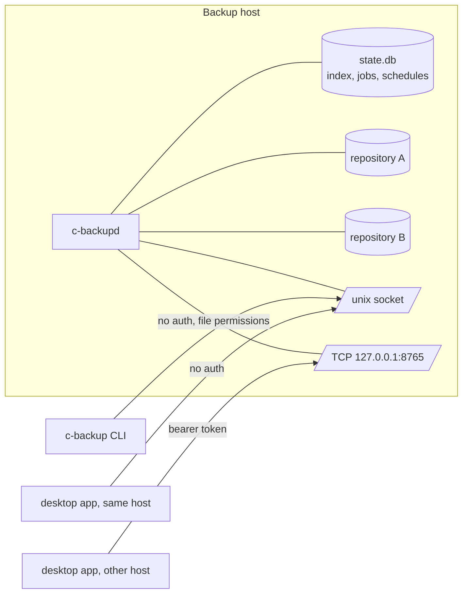
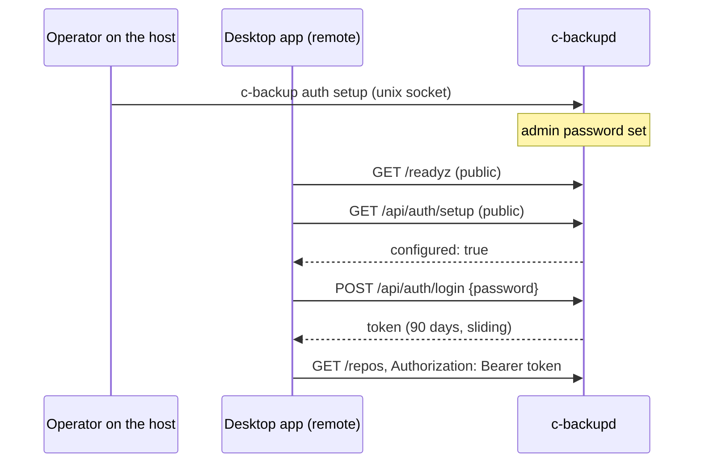
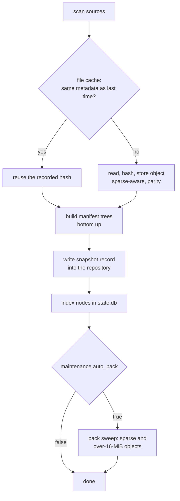

# c-backup Manual

Version 1.0. This is the operator's reference: what the system is, how to
install and configure it, how every operation behaves, what it guarantees,
what it costs, and how to recover when something is lost. `docs/api.md` is
the endpoint reference and `docs/data-paths.md` follows bytes through the
engine; this manual points at both rather than repeating them.

Contents

1. [What c-backup is](#1-what-c-backup-is)
2. [Installation](#2-installation)
3. [Configuration](#3-configuration)
4. [Access and security](#4-access-and-security)
5. [Repositories](#5-repositories)
6. [Backing up](#6-backing-up)
7. [Browsing, searching, comparing](#7-browsing-searching-comparing)
8. [Restoring](#8-restoring)
9. [Retention](#9-retention)
10. [Scheduling](#10-scheduling)
11. [Integrity: verify and repair](#11-integrity-verify-and-repair)
12. [Maintenance](#12-maintenance)
13. [Encryption](#13-encryption)
14. [Replication](#14-replication)
15. [The desktop app](#15-the-desktop-app)
16. [Monitoring and alerting](#16-monitoring-and-alerting)
17. [Disaster recovery](#17-disaster-recovery)
18. [Capacity planning and performance](#18-capacity-planning-and-performance)
19. [Troubleshooting](#19-troubleshooting)
20. [Limits and what is not in 1.0](#20-limits-and-what-is-not-in-10)
21. [Command reference](#21-command-reference)

---

## 1. What c-backup is

A content-addressed backup system built as one daemon per machine.

- **`c-backupd`** owns every repository on its host and is the only process
  that writes to them. It runs backups, restores, retention, verification,
  replication and schedules as jobs on a small worker pool, and serves an
  HTTP API.
- **`c-backup`** is a thin command-line client. Every command is one or a few
  HTTP requests to the daemon over its unix socket. There is no standalone
  mode: if the daemon is not running, the CLI says so and exits.
- **The desktop app** (Electron) is a second client of the same API. It
  connects to the local daemon over the unix socket, and to daemons on other
  machines over TCP with a session token.



### 1.1 The storage model

Every file's content is stored once, as an object named by its SHA-256. A
second copy of the same bytes anywhere, in any snapshot, costs nothing.
Objects are compressed with LZ4 when a 64 KiB probe says it is worthwhile and
left alone when it is not, so video, audio and database files do not burn CPU.
Every object and every pack carries Reed-Solomon parity, so bit rot can be
repaired, not just detected. Sparse files are stored as their data regions,
so a 1 TiB disk image holding 40 GiB costs 40 GiB.

A snapshot's metadata (names, modes, owners, times, links, extended
attributes, ACLs) is one content-addressed **manifest tree** object per
directory. A directory that did not change has the same tree hash and costs
nothing in the next snapshot; measured, an incremental snapshot writes about
3.3% new tree objects.

### 1.2 The repository is the source of truth

A repository is a directory that describes itself: objects, packs, manifest
trees and snapshot records. The daemon's database (`state.db`) is an index
over it, built for fast browsing and search. Lose the database and
`c-backup reindex` rebuilds it from the repository. What a database loss
costs is daemon-only state - schedules, sessions, job history, the journal -
never backups. Section 17 covers recovery.

### 1.3 Design constraints

These hold everywhere and decide many of the behaviours below.

1. **No size limit.** No limit on file or repository size; nothing assumes
   data fits in memory.
2. **Files exceed RAM.** Content is streamed, never buffered whole, including
   parity computation.
3. **Millions of inodes.** Traversal and change detection are linear in the
   number of entries.
4. **Fast incompressible bailout.** A 64 KiB probe decides compression.

Section 20 records the one place 1.0 falls short of constraint 3 on small
hosts: the scan's memory.

---

## 2. Installation

### 2.1 From source

**OpenSSL 3.2 or newer is required.** Repository encryption derives keys with
Argon2id through OpenSSL's KDF interface, which first shipped in 3.2. An older
OpenSSL stops the build at once with a message naming the version it found.

| Distribution | OpenSSL | Builds as is |
|---|---|---|
| Debian 13 (trixie), the Docker image's base | 3.5 | yes |
| Arch Linux | current 3.x | yes |
| Ubuntu 24.04 LTS | 3.0 | no: build against a newer OpenSSL, or use the Docker image |
| Debian 12 (bookworm) | 3.0 | no, as Ubuntu 24.04 |

On a distribution that ships an older OpenSSL, the Docker image (section 2.3)
is the supported install; a newer release of the distribution (Ubuntu 25.04
ships 3.4) also builds. Replacing the system OpenSSL on an LTS host is not
something to do for one program, and building against a private copy is not
a configuration the Makefile or CI supports.

Build dependencies on Debian/Ubuntu:

```sh
apt-get install build-essential pkg-config libssl-dev liblz4-dev \
                libacl1-dev libsqlite3-dev libmicrohttpd-dev \
                libcurl4-openssl-dev libcmocka-dev
```

The build needs [c-utils](https://git.airies.net/vifair22/c-utils) checked out
at `../c-utils`, or `CUTILS_DIR` pointing at it, at the version in
`cutils_version`. The JSON parser comes from there too: c-utils carries cJSON
and `libc-utils.a` holds it, so the daemon and CLI run on the cJSON the pinned
release was tested with, and moving the pin moves cJSON with it.
To fetch and build it:

```sh
git clone https://git.airies.net/vifair22/c-utils.git ../c-utils
git -C ../c-utils checkout "$(cat cutils_version)"
make -C ../c-utils
make                                   # build/bins/c-backupd, build/bins/c-backup
```

The default build targets the development CPU (`-march=znver3`). For another
machine pass `MARCH=x86-64-v2 MTUNE=generic` (what the Docker image uses) or
the target's own architecture level.

Install:

```sh
sudo install -m 0755 build/bins/c-backupd build/bins/c-backup /usr/local/bin/
sudo install -d -m 0700 /etc/c-backupd
sudo install -m 0600 packaging/config.yaml /etc/c-backupd/config.yaml
sudo install -m 0644 packaging/systemd/c-backupd.service /etc/systemd/system/
sudo systemctl daemon-reload
sudo systemctl enable --now c-backupd
```

The unit runs the daemon as root, because reading arbitrary source paths and
restoring ownership both need it. systemd creates `/run/c-backupd` (the
socket directory) and `/var/lib/c-backupd` (the database directory, mode
0700) on start.

The unit is `Type=notify`: the daemon tells systemd it is ready only once its
unix socket and TCP listener are bound, so `systemctl start` (and
`enable --now`) returns when the CLI can connect, and a unit ordered
`After=c-backupd.service` starts no earlier. Startup applies any schema
migrations first; the unit allows ten minutes for that (`TimeoutStartSec`).
On stop it reports `deactivating` while running jobs are cancelled. The
daemon implements the notification protocol itself and does not link
libsystemd; run outside systemd it simply skips it.

Check it:

```sh
sudo c-backup health          # the daemon's health, as JSON
sudo c-backup version
```

### 2.2 Stopping and restarting

`systemctl stop c-backupd` (SIGTERM) shuts the daemon down in order: it stops
accepting requests, stops firing schedules, then cancels running jobs, which
are recorded as `cancelled` in `c-backup jobs` and the journal. Jobs still
waiting in the queue are never started: they are recorded `cancelled` with no
start time, and journalled as "cancelled before it started". A job checks
for cancellation between files and between chunks inside one: storing,
packing and restoring a file all stop within one read of at most 8 MiB, so a
multi-gigabyte file in progress does not hold up the shutdown. This takes
about a second, well inside `docker stop`'s 10 second grace. A second SIGTERM
or SIGINT forces an immediate exit. Run the cancelled job again after the
restart; a backup skips what it already stored, a restore skips what it
already wrote. `c-backup jobs cancel <id>` is the same cancellation for one
job, and prints the job record with `"cancel_requested":true`. A job still
waiting in the queue never starts: it is `cancelled` in that record already,
and in the journal as "cancelled before it started".

A daemon that dies without stopping (a crash, `kill -9`, `docker kill`, power
loss) marks whatever was running as `failed: interrupted by daemon restart` on
its next start, and journals each such job then, since the killed process
could not. Either way the repository is consistent: a backup's partial pack
and the index rows staged into it are discarded, and the next backup stores
those files again. Staging files a killed writer left in the repository's
`tmp/` are removed by the next backup or gc, which hold the repository's write
lock and so know nothing else is writing there; opening a repository also
removes any an hour old.

### 2.3 Docker

CI publishes an image built from `Dockerfile`: Debian trixie, binaries built
for `x86-64-v2`.

```sh
docker run -d --name c-backupd \
  -v cbackup-state:/var/lib/c-backupd \
  -v /srv/backup:/srv/backup \
  -v /home:/source/home:ro \
  -p 127.0.0.1:8765:8765 \
  -e TZ=America/Chicago \
  <registry>/vifair22/c-backup:<tag>
```

- `/var/lib/c-backupd` holds `state.db` and, in `keys/`, the encryption key
  of every encrypted repository. Put it on fast storage (section 18).
- **The keys are the one thing on that volume a reindex cannot rebuild.**
  The image sets `C_BACKUP_SECURITY_KEY_DIR=/var/lib/c-backupd/keys`, so they
  survive replacing the container, but lose the volume and every `system`
  repository is unreadable. Back up `/var/lib/c-backupd/keys` somewhere other
  than this host, or keep each key from `repo key export` (section 13). The
  environment variable overrides `security.key_dir` in any config file you
  mount; to move the keys, pass `-e C_BACKUP_SECURITY_KEY_DIR=...` and keep
  the directory on a volume.
- Mount the repositories and the sources at whatever paths you will register
  and back up. Paths are always the container's view.
- The image binds TCP on every interface inside the container, because a
  published port cannot reach the container's loopback. What is exposed is
  decided by `-p`. TCP serves only the health probes until an admin password
  is set.
- **Set the time zone.** The image runs in UTC unless told otherwise, and
  calendar schedules (section 10) fire in the daemon's local time, so on a
  host in US Central `--at 03:00` would fire at 03:00 UTC, 21:00 the evening
  before. Pass `-e TZ=America/Chicago` (any zone name from the tz database;
  the image carries `tzdata`), or mount the host's zone read-only with
  `-v /etc/localtime:/etc/localtime:ro`; `TZ` wins if both are given.
  `c-backup schedule list` reports the zone in use (`timezone`) and each
  schedule's next fire with its offset (`next_due_iso`), so a wrong zone is
  visible before anything fires at the wrong hour. Changing the zone takes
  effect at the next daemon start.
- Run the CLI inside the container: `docker exec c-backupd c-backup ...`.
- Override configuration by mounting a file over
  `/etc/c-backupd/config.yaml`; a read-only mount (`:ro`) is fine. Keep the
  file 0600: the daemon warns at start if it is not and cannot fix it.

**Privileges.** The daemon runs as root inside the container, because it
has to read every source file whatever its owner and restore ownership,
modes and device nodes. It does not need root's full capability set. This
set covers backup and restore:

```sh
docker run -d --name c-backupd \
  --cap-drop ALL \
  --cap-add DAC_READ_SEARCH --cap-add DAC_OVERRIDE \
  --cap-add CHOWN --cap-add FOWNER --cap-add FSETID --cap-add MKNOD \
  --read-only --tmpfs /run/c-backupd \
  -v cbackup-state:/var/lib/c-backupd ... \
  <image>
```

| Capability | Needed for |
|---|---|
| `DAC_READ_SEARCH` | reading source files and directories regardless of their permissions |
| `DAC_OVERRIDE` | writing restored files into directories owned by others |
| `CHOWN` | restoring ownership |
| `FOWNER` | restoring modes and times on files owned by others |
| `FSETID` | keeping setuid and setgid bits on restored files |
| `MKNOD` | restoring device nodes (without it they are skipped and counted) |

With `--read-only`, the root filesystem is not written: state goes to the
`/var/lib/c-backupd` volume, the socket to the `/run/c-backupd` tmpfs, and
staging files into each repository's own `tmp/`.

**No writable `/tmp` is needed**, and none is used. Every temporary file
the engine makes goes into the repository it is working on: staged
objects and packs, snapshot records, the tag mirror, and the parity that
backup, `pack`, `gc` compaction and replication spill to disk for entries
past a few MiB. A replication target's staging goes into the target's own
`tmp/`. The `tmp/` directory is recreated when a repository is opened if
someone removed it. SQLite's own temporary files (large sorts, temporary
indices) go beside `state.db`, in the state volume, unless `SQLITE_TMPDIR`
names somewhere else; set it only to a directory the daemon can write. The
daemon logs the location at start (`sqlite temporary files: ...`).

### 2.4 The desktop app

The app lives in `ui/`. It needs Node.js 22.12 or newer, as `engines` in
`ui/package.json` says: Vite 7 needs that to build, and `npm test` runs the
TypeScript tests directly with `node --experimental-strip-types`. CI uses
Node 24. To build and run it from a checkout:

```sh
cd ui
npm ci
npm run build
npx electron .
```

There is no packaged installer in 1.0.

### 2.5 The Debian package

`packaging/deb` holds control files for a package, but nothing builds one in
1.0. Use the source install or the image.

---

## 3. Configuration

All configuration is in one YAML file, read once at start. The daemon finds
it at `$C_BACKUP_CONFIG_PATH`, or `config.yaml` in its working directory. The
systemd unit sets `/etc/c-backupd/config.yaml`. Keep the file 0600: it holds
the Pushover credentials.

There is no API that changes configuration. Edit the file and restart:
`systemctl restart c-backupd`. Per-repository settings (retention, auto-pack)
are different: they live in the database and change through the policy API
(section 9).

| Key | Default | Meaning |
|---|---|---|
| `db.path` | none, required | The daemon database. The shipped config sets `/var/lib/c-backupd/state.db`; a file without it stops the daemon |
| `http.socket` | `/run/c-backupd/c-backupd.sock` | Unix socket for the CLI and local clients. Must fit in 107 bytes |
| `http.port` | `8765` | TCP port for remote clients, 0 to 65535. `0` disables TCP |
| `http.bind` | `127.0.0.1` | TCP bind address, an IPv4 address (not a hostname). `0.0.0.0` for every interface |
| `security.key_dir` | `/etc/c-backupd/keys` | Where per-repository encryption keys live, one 0600 file each. The container image sets `/var/lib/c-backupd/keys` (section 2.3) |
| `auth.cookie_secure` | `0` | `1` sets `Secure` on session cookies. Only behind HTTPS |
| `log.level` | `info` | `debug`, `info`, `warn` (or `warning`), `error`. Anything else stops the daemon at start |
| `pushover.token`, `pushover.user` | empty | Pushover credentials for failure alerts. Empty disables them |
| `scheduler.enabled` | `1` | `0` stops schedules firing. Manual jobs still run. `0` or `1` |
| `jobs.max_parallel` | `2` | Jobs running at once, across all repositories. 1 to 256 |
| `backup.file_cache_match` | `auto` | How a backup recognises a file it need not read again: `auto`, `strict` or `relaxed` (section 6.3). Any other value stops the daemon at start |
| `backup.store_workers` | `0` | Threads one backup stores large files (over 16 MiB) on at once, 0 to 64. `0` picks two thirds of the CPUs the daemon may use, fewer when an eighth of RAM, or of the container's cgroup memory limit if that is smaller, cannot give each 40 MiB, and never more than there are large files; `1` stores them one after another. The snapshot is identical either way |
| `retention.keep_snaps` | `1` | Newest snapshots always kept |
| `retention.keep_daily` | `7` | Daily snapshots kept |
| `retention.keep_weekly` | `4` | Weekly snapshots kept |
| `retention.keep_monthly` | `12` | Monthly snapshots kept |
| `retention.keep_yearly` | `3` | Yearly snapshots kept |

The `retention.*` keys are defaults for repositories that have not set their
own (section 9). Each is a whole number, 0 or more.

The daemon refuses to start on a file it cannot honour, rather than running
on defaults nobody chose. Each problem is printed with the file and line,
all of them in one run, and the daemon exits with status 1 before it opens
the database or binds a socket:

```
/etc/c-backupd/config.yaml:12: error: unknown key 'security.key_dri' (did you mean 'security.key_dir'?)
appguard: config init failed; the problems are listed above
```

What stops it:

| Problem | Example |
|---|---|
| A line the parser does not understand | `log: [debug]`, a nested key, a top-level `verbose: true`, an unclosed `"`, a single-quoted value, a key indented differently from the rest of its section |
| An unknown key, or one in an unknown section | `security.key_dri`, `mystery.thing` |
| A key set twice | |
| A number that is not one | `jobs.max_parallel: eighty`, or one too large for an integer |
| A number outside the range in the table above | `http.port: 99999`, `jobs.max_parallel: 0`, `retention.keep_daily: -1`, `auth.cookie_secure: 2`, `backup.store_workers: 65` |
| An `http.bind` that is not an IPv4 address | `localhost`, `not-an-ip` |
| A missing `db.path` | `<file>: error: required config key 'db.path' is missing or empty; it has no default` |
| A tab in the indentation | YAML indents with spaces |
| A `log.level` that is not a level | `log.level: chatty` |
| A `backup.file_cache_match` that is not a mode | `fast` |

The file format is a small subset of YAML: sections at the left margin, each
holding `key: value` lines indented the same way with spaces, `#` comments,
and double quotes around a value that contains ` #`. Nothing else: no lists,
no nesting, no single quotes, no anchors. Windows line endings (CRLF) and a
UTF-8 byte order mark are accepted. The c-utils Manual (section 5) lists the subset
exactly.

Every key can also be set from the environment: `C_BACKUP_` followed by the
key in capitals with dots as underscores, so `security.key_dir` is
`C_BACKUP_SECURITY_KEY_DIR`. The environment wins over the file. The
container image uses this for the key directory (section 2.3). A number set
this way is checked like one in the file, and the error names the variable.

Logs go to stdout, which systemd sends to the journal
(`journalctl -u c-backupd`). The daemon also keeps 30 days of log lines in its
database.

---

## 4. Access and security

### 4.1 Two ways in

**The unix socket** carries no authentication. Whoever can open it is
authorised, so file permissions on it are the access control. The daemon sets
its umask to 0077 at start, so the socket is created mode 0700, owned by the
user the daemon runs as: under the shipped unit, only root can connect, and
the CLI is run with `sudo`. There is no setting to widen it in 1.0, by design:
anyone who can open the socket controls every repository and can read any
file the daemon can.

**TCP** is for the desktop app on another machine. It binds loopback by
default, so nothing off the host can reach it until `http.bind` is changed.
Every request except the public routes needs a session token.



### 4.2 Turning on remote access

1. On the daemon's host, set the admin password. It prompts, twice when on a
   terminal, and is at least 8 characters:

   ```sh
   sudo c-backup auth setup
   ```

   This is the only way to set the first password. Over TCP the setup
   request is refused, because a port that accepted it would belong to
   whoever reached it first. Until a password exists, TCP answers everything
   but the public routes with `403` and a message saying how to set one.

2. Widen the bind in `config.yaml` and restart:

   ```yaml
   http:
     bind: 0.0.0.0        # or one interface's address
   ```

3. In the desktop app, add a remote connection with the host and port, and
   sign in with the admin password (section 15).

The transport is plain HTTP and carries the token. On any network you do not
trust, put a TLS-terminating reverse proxy or a tunnel (WireGuard, SSH port
forwarding) in front, and set `auth.cookie_secure: 1` when the proxy serves
HTTPS.

### 4.3 Sessions and passwords

- A login returns a token valid for 90 days. Every authenticated request
  slides the expiry forward, so a connection in regular use does not expire.
- `c-backup auth password` changes the password; it always asks for the
  current one. A change revokes every other session at once: a client that
  signed in with the old password is signed out, not left holding a token
  that works for another 90 days. Over TCP the session that made the change
  survives; from the CLI, which has no session, every session goes.
- Sign out in the app, or `POST /api/auth/logout` with the token, revokes it.
- `sudo c-backup auth logout --all` (or `POST /api/auth/logout-all` with a
  token) revokes every session any client holds, including the caller's.
  Use it when a machine that was signed in is lost or no longer trusted and
  the password itself is not in doubt. `--all` is required: the CLI has no
  session of its own to sign out, so `auth logout` without it fails and
  says so rather than succeeding at nothing.
- Failed logins over TCP are throttled. Each client address gets 5 free
  failures; after that every failure locks it out for twice as long as the
  last (1 s, 2 s, 4 s, ... up to 5 minutes), and the lockout refuses the
  correct password too, with `429` and a `Retry-After` header. An address is
  forgotten after 15 minutes without a failure, or at once when it logs in.
  Across all addresses, a burst of 60 failures, or a sustained rate above
  one every 2 seconds, refuses every TCP login until the rate falls; that caps an attacker who
  rotates addresses - and can lock you out while one is trying. The socket is
  never throttled: `sudo c-backup ...` on the host always works. Behind a
  reverse proxy every client is the proxy's address and shares one budget.
  Details are in `docs/api.md`.
- The CLI never needs a password: it uses the socket. Sessions exist only
  for TCP clients, so there is no `auth login`: it fails with an
  explanation, and the daemon refuses a login over the socket with `400`.
  A token minted there would be a live 90-day credential nothing uses. To
  get a token for a script, log in over TCP (`POST /api/auth/login`).
- The app stores the session token, never the password (section 15.2).

### 4.4 Public routes

`/healthz`, `/readyz`, `/metrics` and `GET /api/auth/setup` answer without a
credential, on both transports. A health probe that needs a login cannot
report a daemon too unhealthy to authenticate. Metrics carry counts and ages,
and name at most the stalest repository by id and label; never paths or file
content.

### 4.5 What is protected, and what is not

- A repository can be encrypted (section 13). That protects it wherever it
  travels: a replica on a NAS, a disk in a drawer.
- The host running the daemon holds every key it uses and a plaintext index
  of every path backed up, in `state.db` (mode 0600). Protecting that machine
  is the operating system's job: full-disk encryption and ordinary access
  control.
- The daemon runs as root. A client with access to it can read any file the
  daemon can, by backing it up and restoring it somewhere else. Treat API
  access as root access.

---

## 5. Repositories

A repository is a directory the daemon registers and then owns.

```
<repo>/
  .cbackup          identity marker: format, version, UUID, encryption
  snapshots/<id>    snapshot records: root tree hash and metadata
  tags              the tag list, kept so a reindex can restore it
  objects/aa/bb...  loose objects, including manifest trees
  packs/<id>.dat    packs
  tmp/              staging for atomic writes
```

`docs/repo-format.md` describes the format.

### 5.1 Creating and registering

```sh
sudo c-backup repo add /srv/backup/main "Main"                     # unencrypted
sudo c-backup repo add /srv/backup/main "Main" --encrypt system      # see section 13
```

- A path that does not exist, or an empty directory, becomes a new
  repository. Missing parent directories are created as `mkdir -p` would,
  mode 0755; the repository directory itself is mode 0700. A path that
  cannot be created (a parent is a regular file, a read-only filesystem, no
  permission) is refused with HTTP 400 and the reason; only a failure of the
  host itself, such as a full disk, is a 500.
- A directory with a `.cbackup` marker is an existing repository and is
  re-registered, keeping its history. The UUID in the marker is its identity,
  not the path: move a repository, register the new location, and it links
  back to its snapshots.
- Adding a repository that is already registered succeeds and says so
  (`"already_registered":true`, HTTP 200 rather than 201). A label given
  that differs from the stored one replaces it; leaving the label out keeps
  the old one. Asking for an encryption mode the repository does not have is
  refused: encryption is fixed when a repository is created.
- Paths are stored normalised: `/srv/backup/main/` and
  `/srv/backup//main` are both `/srv/backup/main`.
- A non-empty directory without a marker is refused. Writing objects into
  somebody else's data is the failure this prevents.
- A path inside a registered repository, or one containing a registered
  repository, is refused with HTTP 400 naming that repository. One
  repository's objects would otherwise sit in a directory the other owns, so
  its garbage collection and verify would see them as strays, and deleting
  either directory would take data from both. The comparison is on resolved
  paths, so a symlink or `..` does not get around it.

### 5.2 Removing

```sh
sudo c-backup repo remove <id>
```

This deregisters the repository and drops its index rows. **The repository
directory is never touched.** Deleting backup data is the operator's act:
remove the directory yourself once you are sure. Registering it again later
restores everything, with a reindex.

The registration goes at once; the index rows (snapshots, nodes, objects,
schedules, jobs, journal, search and verify results) are deleted afterwards
by a background thread in short batches, so a large repository does not hold
the database while it goes. The log says `removed repo <id>: index rows
deleted` when it is done, and a purge cut short by a restart resumes at the
next start. Rows earlier builds left behind for removed repositories are
deleted the same way on the first start of this one.

Removal is refused with `409` while a job is running against the
repository; cancel it or wait for it first.

A removed repository's id is never handed out again; registering it again
gives it a new one. Ids used to be reused, so the next repository added
could take over the removed one's schedules and history.

The same holds for every other id the daemon hands out: jobs, schedules,
search and verify runs, and snapshots within a repository. Removing a
repository deletes its jobs, and the next job on another repository used
to take the removed one's newest job id, so a script or log line holding
it named an unrelated job; deleting the newest snapshot likewise gave its
number to the next backup. Neither happens since 1.0.0, though ids already
reused by an earlier build stay as they are. Snapshot numbering is tracked
in the database: after a database loss, a reindex continues above the
highest snapshot still in the repository.

### 5.3 Where to put a repository

Anywhere the daemon can write with ordinary POSIX semantics: `rename` within
the repository must be atomic, so `tmp/` lives inside it. Local disks, ZFS,
XFS, ext4 and NFS mounts all work.

Which disk is fastest for a repository depends on the hardware, not on the
kind of storage, so measure before assuming. On one Unraid server a
repository on the parity array (an 18 TB HDD with parity) was faster than on
a SATA SSD cache pool: a first backup took 295 s against 391 s, and a backup
with nothing changed 2.0 s against 6.6 s, with `state.db` on the cache both
times. What does matter is where `state.db` lives: it belongs on fast
storage and never on a parity array. See section 18.2.

---

## 6. Backing up

### 6.1 Running one

```sh
sudo c-backup sources set 1 /home/me /etc --exclude node_modules --exclude '*.iso'
sudo c-backup backup 1                     # uses the configured sources
sudo c-backup backup 1 /home/me/projects   # or name paths for this run
```

A backup is a job. The CLI submits it and waits, printing the finished job;
`--no-wait` returns the job id at once. `c-backup jobs <id>` and
`c-backup jobs watch <id>` follow it. `watch` prints a line with the job's
state as soon as it connects, then one per change and at least every 5
seconds, and exits when the job ends. Each line is one JSON document and
nothing else (NDJSON), so `jq` reads the output as it arrives:

```
{"id":7,"state":"running","phase":"store","current":3,"total":4,"bytes_done":1350565888,"bytes_total":2291249496,"error":""}
```

`current` counts entries, so it sits still while one large file is stored;
`bytes_done` moves through the file as it is read, a few times a second, and
each move is a new line. A finished job keeps its last report, and each
phase ends with `current` equal to `total`. A restore counts the entries it
restores: with `--subpath` that is the subtree, so restoring one file ends
at 1 of 1 rather than at the size of the snapshot.

`watch` exits 0 once it has printed the job's final state, whatever that
state is: read `state` for the outcome. It exits 1 with a message on stderr
when there is no such job, and when the daemon stops following a job that is
still running after an hour; watch it again to go on following.

`sources set` replaces the whole list. Each source must be an absolute path
(empty or relative ones are refused, and nothing is changed). A path that
does not exist on the daemon's host is stored with a warning in the reply,
not refused, since it may be a share or disk that is mounted only at backup
time. A backup does not skip it: while it is missing every backup of the
repository fails, naming it (below).

Sources belong to the repository so that a schedule, the app's Run Backup
button and the CLI all back up the same thing. A backup that names paths
overrides them for that run. Exclusions are inherited only when the request
gives none.

Options:

| Option | Effect |
|---|---|
| `--exclude PAT` | Repeatable. See 6.2 |
| `--one-filesystem` | Do not cross into other mounts below a source |
| `--label TEXT` | A label on the snapshot: at most 256 bytes of UTF-8 text with no control characters (tabs and newlines included). Anything else is refused before the backup starts |

### 6.2 Exclusion patterns

How a pattern matches follows from what it contains:

| Pattern | Matches |
|---|---|
| `/var/cache` | that directory and everything under it, on component boundaries, so not `/var/cache-manager` |
| `/home/*/Downloads` | absolute with wildcards; `*` stops at `/` |
| `build/tmp` | that tail of a path, at any depth, component-aligned |
| `node_modules`, `*.iso` | the basename, at any depth |
| anything containing `**` | as above, with wildcards crossing `/` |

A trailing slash is ignored. An excluded directory is never descended into.

### 6.3 What happens during a backup



1. **Scan.** The sources are walked and every entry recorded with its
   metadata. Paths are absolute, so a backup of `/a/b/c` also records `/a`
   and `/a/b`; a restore needs them to recreate the layout.
2. **Content.** For each regular file the file cache asks whether the path
   still has exactly the metadata it had last time; if so, the recorded hash
   is reused without opening the file. Otherwise the file is read, hashed and
   stored. A file whose content already exists in the repository costs one
   read and no write. An object of 16 MiB or less (file content, manifest
   tree, xattr or ACL blob) goes straight into a pack as it is written,
   compressed if that makes it smaller. Two kinds cannot, and are written
   loose and uncompressed: the object of a sparse file, and an object over
   16 MiB, whose pack entry header needs its hash before the bytes are read.

   "Exactly the metadata" is size, mtime, ctime, and the device and inode
   numbers, on a local filesystem. On a network or FUSE filesystem (NFS,
   SMB/CIFS, an Unraid user share, mergerfs, sshfs, 9p, Ceph) device and
   inode numbers are not stable: shfs hands out new inode numbers, and a
   container volume can remount on another device. There the cache compares
   size, mtime and ctime only, and the daemon logs once per device that it
   is doing so. Without this every incremental over such a share re-read
   every file. `backup.file_cache_match` overrides the choice: `strict`
   compares every field everywhere, `relaxed` compares only size and mtime
   everywhere (for a filesystem whose ctime is not stable either). At
   `log.level: debug` each miss on a known path is logged with the fields
   that differed, which is the place to look when an incremental takes as
   long as the first backup did and `files_unchanged` in the job result is
   near zero.
3. **Trees.** One manifest tree per directory, bottom up.
4. **Snapshot.** The snapshot record goes into the repository first, then
   the index rows go into the database. An interrupted backup leaves at most
   index rows a reindex cleans up.
5. **Pack sweep.** Loose objects are always stored uncompressed, so by
   default every backup ends with a pack run, as `pack` would do: it packs
   the loose objects of step 2 (and anything an interrupted run left). It
   does not merge small packs; only gc does that (section 12). Setting the
   policy key `maintenance.auto_pack` to `false` skips this sweep and
   nothing else. Small objects still go into
   packs during the backup, because that is how they are written; what
   stays loose until a `pack` is only sparse files' objects and objects
   over 16 MiB. A backup of small files therefore leaves no loose objects
   with the key on or off, and a `pack` straight after it finds nothing to
   do. A large incompressible object stays loose for good either way: the
   probe, or the pack step's check on the rest of the file, marks it once
   and no pack run moves it (section 12).

What is captured: regular files (sparse or not), directories, symlinks,
hardlinks (as groups), FIFOs, device nodes, modes, owner and group, times,
extended attributes and POSIX ACLs. A unix socket has no content and is
recorded without one; restore skips it.

A file inside a source that cannot be read is logged and skipped; the backup
continues. A source itself - a path named on the command line or configured
with `sources set` - that does not exist or cannot be opened fails the job
before anything is written, with an error naming it, even when the other
sources are fine:

```
c-backup: source /data/no-such-dir cannot be read (No such file or directory); no snapshot written
```

The difference is deliberate. A file vanishing between the scan and the read
is normal on a live filesystem; a whole source missing is a mount that did
not come up or a typo, and a snapshot without it would look like a backup of
everything that was asked for.

### 6.4 Concurrency

Jobs for one repository run one at a time: the dispatcher never starts a
second job for a repository that has one running, and queues it instead. Jobs
for different repositories run in parallel, up to `jobs.max_parallel`.

Metadata writes (tags, notes, policy, sources) during a running backup wait
briefly for the database rather than failing. A backup holds the database's
write lock across batches of up to 2,000 files, and lets it go as soon as
another write is queued for it: at the next file, the next read of the file
it is storing (at most 1 MiB), the next directory tree, or within 50 ms while
it waits on its large-file workers. A write that is waiting goes before the
backup's next batch, so it returns in well under a second however long the
backup runs. A backup nobody interrupts commits once per 2,000 files and
once per sealed pack, which matters on storage where each commit's sync is
slow.

A change to a repository's sources applies to backups submitted after it. A
backup takes its sources from the configuration when it is submitted, so a
backup already running, or already queued, keeps the sources it was
submitted with.

---

## 7. Browsing, searching, comparing

```sh
sudo c-backup snapshots 1                  # newest first, paged
sudo c-backup ls 1 12                      # top level of snapshot 12
sudo c-backup ls 1 12 <node-id>            # one directory down
sudo c-backup search 1 invoice             # file names containing "invoice"
sudo c-backup grep 1 'swordfish'           # file contents, extended regex
sudo c-backup diff 1 11 12                 # what changed between two snapshots
```

- Every listing pages. No request returns a whole snapshot, which is what
  keeps browsing fast at any size (section 18.4).
- **Name search** uses a trigram index: substring matches in milliseconds.
  Across all snapshots, a file kept unchanged is one result with a count of
  the snapshots holding it and the newest one's id; a file that changed
  appears once per distinct content. `--snapshot N` searches one snapshot.
- **Content search** (`grep`) runs as a job, because it reads the
  repository. Matching is POSIX extended regular expressions, line by line,
  over every distinct object in the snapshot; a file present under several
  names is read once. A binary file that matches is one hit, `(binary file
  matches)`, however often it matches. `--snapshot N` picks the snapshot
  (newest by default; one that does not exist is an error), `--path-prefix`
  limits it to a subtree, `-i` ignores case, `--limit N` stops after N
  matching files. A file stops being read after `--max-hits-per-file`
  matches (default 100) and the whole search after `--max-hits` (default
  10,000). `truncated` says the search itself stopped early (`--limit` or
  `--max-hits`); `files_capped` counts files read only as far as their cap,
  which may hold more matches than were recorded. Both are on the job's
  result and on the run in `grep runs`. The hits are kept: `c-backup grep runs <id>` lists past
  searches, newest first, and `c-backup grep show <id> <run>` prints one
  search's hits again, which is how a `--no-wait` search is read once it
  has finished.
- **Diff** walks manifest trees and skips any subtree whose hash did not
  change, so comparing two large snapshots costs what changed between them.

Snapshots carry notes and tags:

```sh
sudo c-backup snapshot note 1 12 "before the migration"
sudo c-backup tag set 1 pre-migration 12
sudo c-backup tag set 1 pre-migration 14 --move   # it is on 12; move it
sudo c-backup tag remove 1 pre-migration
```

- A note or tag needs a snapshot that exists; naming one that does not is
  an error, not a record attached to nothing.
- **A tag names one snapshot, and moving it must be asked for.** Setting a
  name that is already on another snapshot fails and says where the tag is.
  A tag is retention protection (section 9.1), so moving it unprotects the
  snapshot it was on; `--move` says that is intended. Setting a tag on the
  snapshot it is already on succeeds.
- Tag names are 1 to 64 letters, digits, `.`, `_` and `-`, starting with a
  letter or digit. A name is part of a URL path when it is removed, and one
  with a space or a slash could be set but never removed.
- Removing a tag that does not exist fails with "no such tag".
- Every tag change is also written into the repository's `tags` file, so
  tags survive losing the database (section 17.1). If that file cannot be
  written the change is refused, rather than leaving a tag that a recovery
  would silently drop.

---

## 8. Restoring

```sh
sudo c-backup restore 1 12 /mnt/restore
sudo c-backup restore 1 12 /mnt/restore --subpath /home/me/documents
```

- Paths are recreated under the destination as they were: restoring a
  backup of `/home/me` into `/mnt/restore` produces `/mnt/restore/home/me/...`.
- `--subpath` restores one file or directory. It matches on component
  boundaries and accepts the path with or without its leading slash.
- **Existing files are skipped, not overwritten**, and counted as skipped.
  This makes an interrupted restore re-runnable: run it again and it
  continues. `--overwrite` replaces existing files instead.
- Hardlinks are restored as hardlinks, including across a resumed restore.
- Sparse files come back sparse.
- Modes, times (directories included), extended attributes and ACLs are
  restored. Ownership is restored when the daemon runs as root.
- Device nodes need root and a kernel that allows them; one that cannot be
  created is skipped and counted, not failed.
- Sockets are skipped: they have no content.

The job reports files, directories, links, specials, skipped and failed. Any
failed entry makes the job fail with "restore incomplete", so a restore that
reports success restored everything restorable.

---

## 9. Retention

Retention is grandfather-father-son (GFS) over calendar days, plus a minimum
of recent snapshots, plus tags.

### 9.1 What survives a retention pass

A snapshot is kept if any of these holds:

1. It is among the newest `keep_snaps` snapshots (at least the newest one,
   always).
2. It holds a tier and is within that tier's count. Each calendar day
   elects its last snapshot as that day's **daily**; the last daily of each
   week (Monday to Sunday) becomes the **weekly**, the last weekly of each
   month the **monthly**, the last monthly of each year the **yearly**. A
   snapshot can hold several tiers at once and counts against its highest
   only: `keep_daily` 7 keeps the newest seven snapshots whose highest tier
   is daily.
3. It is tagged. Any tag protects a snapshot from retention, whatever its age.

Everything else is pruned. A tier count of `0` keeps every snapshot of that
tier.

A day, week, month or year still in progress elects its latest snapshot so
far, so the newest snapshot always holds all four tiers (`gfs_flags` 15).
When a later backup lands in the same period, the next pass moves the tier
to it and the earlier snapshot loses it: every pass clears and recomputes
every snapshot's tiers.

Because the period in progress counts, every count includes it.
`keep_yearly` 3 keeps this year plus the two before it, not three finished
years; `keep_daily` 7 keeps today plus the six days before it (counting only
days that have a snapshot). This is how restic and borg count too.

Tiers are assigned only by a retention pass, and a
dry run assigns none, so a repository that has never had a real pass shows
`gfs_flags` 0 on every snapshot. A reindex keeps the tiers the last pass
assigned.

Tags and tiers are independent. A tag does not grant a tier and does not
hide one: a tagged snapshot holds the tiers it was elected for and counts
against them like any other, and a tagged snapshot that is not the last of
any period shows `gfs_flags` 0. The tag keeps it either way.

For example, with every tier count at 1 and `keep_snaps` 1, a pass over
eighteen daily snapshots, Sunday the 7th to Wednesday the 24th, with the
second one tagged, keeps four: the newest (all four tiers), the 23rd (the
newest whose highest tier is daily), Sunday the 21st (the newest whose
highest is weekly), and the tagged 8th (daily, kept by its tag). Taken all
on one day instead, the same eighteen leave two: the newest, with every
tier, and the tagged one, with none.

Days are local calendar days on the daemon's host, in its timezone.

### 9.2 Setting it

Daemon-wide defaults are in `config.yaml` (section 3). A repository overrides
any of them:

```sh
sudo c-backup policy list 1
sudo c-backup policy set 1 retention.keep_daily 14
sudo c-backup policy set 1 retention.keep_snaps 5
```

`policy list` shows the repository's own values and the defaults in force,
`maintenance.auto_pack` (on) included. `maintenance.auto_pack` decides only
whether a backup ends with a pack sweep (section 6.3, step 5); it does not
stop a backup writing small objects into packs.

Only these keys are accepted; any other key, and any value of the wrong
kind, is refused with a message listing what is valid:

| Key | Accepts |
|---|---|
| `retention.keep_snaps`, `retention.keep_daily`, `retention.keep_weekly`, `retention.keep_monthly`, `retention.keep_yearly` | a whole number, 0 or more, digits only |
| `maintenance.auto_pack` | `true` or `false` (`yes`/`no`, `on`/`off`, `1`/`0` also accepted, and stored as `true`/`false`) |

A database from before this check may hold a value that would now be
refused. A retention pass ignores it, logs a warning naming it, and uses the
default; `policy set` with a valid value replaces it.

### 9.3 Running it

**Retention does not run on its own.** A backup never deletes snapshots.
Run it by hand, or schedule it:

```sh
sudo c-backup gfs 1 --dry-run              # what would go
sudo c-backup gfs 1
sudo c-backup schedule add 1 gfs --every day --at 04:00
```

The finished job says what the pass did. A dry run lists the snapshots it
would remove, a real run the ones it removed, and both give the retention
values the pass applied (the repository's policy over the defaults):

```json
"result":{"dry_run":true,"would_remove":[3,4,9],"count":3,
          "retention":{"keep_snaps":1,"keep_daily":7,"keep_weekly":4,"keep_monthly":12,"keep_yearly":3}}
```

The journal entry for the pass says the same in one line, for example
`removed 3 snapshots: 3, 4, 9`, naming up to 20 ids and counting the rest.

Pruning a snapshot removes its record and index rows. The space its objects
held is reclaimed by garbage collection (section 12), which a schedule should
follow.

---

## 10. Scheduling

Schedules belong to a repository and submit jobs through the same job
manager as everything else.

```sh
sudo c-backup schedule add 1 backup 14400                          # every 4 hours
sudo c-backup schedule add 1 backup --every day --at 02:00
sudo c-backup schedule add 1 verify --every week --on sunday --at 03:00
sudo c-backup schedule add 1 gc --every month --on-day 1 --at 05:00
sudo c-backup schedule add 1 replicate --every day --at 03:30 --dest /mnt/nas/main
sudo c-backup schedule list 1
sudo c-backup schedule disable 1 <schedule-id>
```

Actions: `backup`, `verify`, `grep`, `gc`, `gfs`, `reindex`, `pack`,
`replicate`. A schedule whose action cannot run is refused when created, not
when it first fires.

**Interval** triggers anchor to the last successful run, not to wall-clock
multiples: a long backup does not make the next one due the moment it ends.

**Calendar** triggers use the daemon's local time: the host's under systemd,
UTC in the Docker image unless `TZ` is set (section 2.3). `schedule list`
names the zone (`timezone`) and gives each next fire with its offset
(`next_due_iso`). `every` is `day`, `week`
(with `--on <weekday>`), `month` (with `--on-day 1-31`) or `year` (with
`--on-month` and `--on-day`). The edge cases are handled: a time that does
not exist on a spring-forward day still fires once, a time that occurs twice
on a fall-back day fires once, the 31st clamps to the last day of shorter
months, and 29 February fires every year (on the 28th in common years). A day
no year has, such as 30 February, is refused when the schedule is created.

Two policies per schedule:

| Option | Values | Meaning |
|---|---|---|
| `--on-overlap` | `skip` (default), `queue`, `cancel_running` | The schedule comes due while its previous run is still going |
| `--catchup` | `skip` (default), `run_once` | Windows missed while the daemon was down: move to the next, or fire once now. Applies to a schedule's first window too |

Any other value is refused when the schedule is created.

**Overlap.** A schedule overlaps when it comes due while a job for the same
repository and action is queued or running, whoever submitted it: a backup
started by hand counts. What each policy then does:

- `skip` does nothing for this window. The next fire is computed as usual.
- `queue` submits one run, which waits until the repository is free. A
  schedule never has more than one run waiting: a fire that finds one of its
  own runs still queued is folded into it, so a backup that runs across
  three intervals is followed by one more backup, not three.
- `cancel_running` cancels the running job exactly as `c-backup jobs cancel`
  does, then submits one replacement. The running job stops at its next
  check (section 2.2) and is recorded `cancelled`; the replacement waits in
  the queue meanwhile, because jobs for one repository never run together,
  and starts as soon as the cancelled job has let go of the repository. A
  fire that finds its replacement still waiting repeats the cancel and adds
  nothing, so it never cancels a replacement that has not started. Queued
  jobs are never cancelled by this policy, only a running one. If every run
  takes longer than the interval, every run is cancelled by the next one:
  use `skip` or a longer interval for work that cannot finish inside it.

A `backup` schedule uses the repository's sources unless it names
`--source` paths. A `replicate` schedule needs `--dest`, an absolute path. A
`grep` schedule needs `--pattern` (an extended regular expression, checked
when the schedule is created) and takes `--path-prefix` and `-i`; it searches
the newest snapshot each time it fires. An option that belongs to a
different action, such as `--dest` on a `gc` schedule, is refused rather than
stored and ignored.

`scheduler.enabled: 0` in `config.yaml` stops every schedule.

**Schedules from older builds.** Each rule above was added at some point, and
a schedule stored before its rule existed is still in the database after an
upgrade: an impossible day such as 30 February, an overlap or catchup value
outside the table, an action nothing runs. At every start the daemon holds
each enabled schedule to the rules a new one must pass and disables any that
fails, with a warning naming it:

```
schedules: disabled schedule 4 (repo 1, gc): catchup 'always' is not skip or run_once; delete it and create it again
```

It disables rather than repairs. Each of these has a nearest valid reading,
and running that under the old schedule's name would be a schedule nobody
chose. `schedule list` shows the schedule as `"enabled": false` with
`disabled_reason` saying why, and `schedule enable` refuses it with the same
reason until it is deleted and created again. The scheduler records a reason
the same way when it disables a schedule it cannot compute a next fire for.

A suggested set for one repository:

| What | When |
|---|---|
| `backup` | daily, or every few hours |
| `gfs` | daily, after the backup |
| `gc` | weekly, after retention |
| `verify` | weekly or monthly (deep verify reads everything) |
| `replicate` | daily, to another disk or machine |

---

## 11. Integrity: verify and repair

"Did the backup run" and "is the backup still good" are different questions.
Verify answers the second.

```sh
sudo c-backup verify 1                     # deep, repairing
sudo c-backup verify 1 --level index       # fast: every object still resolves
sudo c-backup verify 1 --level structure   # also parses every header
sudo c-backup verify 1 --no-repair         # check only, write nothing
sudo c-backup verify 1 --dry-run           # the same: still deep, repair off
sudo c-backup verify list 1                # past runs
```

| Level | Reads | Proves |
|---|---|---|
| `index` | no payloads | every registered object resolves to a location, and every pack file it names exists |
| `structure` | headers | every object's header is well formed |
| `deep` | everything | every payload's SHA-256 matches its name |

A deep verify repairs what it finds by default: every object carries
Reed-Solomon parity, and having already read the damaged bytes, writing the
correction costs almost nothing more. With `--no-repair` it still tells
recoverable damage from loss, applying parity in memory. Both work at any
object size, loose or packed and whatever the codec: parity is read and
applied one group window at a time (about 16 MiB of data and 1 MiB of
parity), never loaded whole.

`--dry-run` is exactly `--no-repair`, and wins over anything else on the
command line. It changes one thing: repair is off, so nothing in the
repository is written. It does **not** change the level. With no `--level`
a dry run is a deep verify, reads every payload, and takes as long as a
plain one; on a healthy repository the two print the same counts, because
the only count repair can change is `repaired`, and that is 0 when there is
nothing to repair. The differences show only when there is damage:

| | `verify` (default) | `verify --dry-run` or `--no-repair` |
|---|---|---|
| Level | deep | deep (or what `--level` says) |
| Reads | every payload | every payload |
| Damage within parity, any size | corrected on disk, counted `repaired` | corrected in memory only, counted `recoverable`; the disk stays wrong |
| Damage beyond parity | nothing written, counted `unrecoverable` | counted `unrecoverable` |
| Lock | write | read |
| Job `result` | `"repair":true,"dry_run":false` | `"repair":false`, and `"dry_run":true` for `--dry-run` |

For a quick look rather than a full read, combine it with a level:
`verify 1 --level index --dry-run`. The daemon records a dry run like any
other (`verify list`, `verify show`, the verify metrics), because the run
and its findings are the report. A dry run that finds loss fails like any
other verify.

What a run counts:

| Count | Meaning |
|---|---|
| `repaired` | Corrected from parity and written back. Always 0 with `--no-repair` or `--dry-run` |
| `recoverable` | Readable only through parity and still wrong on disk. Run a repairing verify |
| `unrecoverable` | Beyond what parity can rebuild. **Data loss** |
| `missing` | Indexed but absent, including every object in a pack file that has gone. **Data loss** |

**Loss fails the verify.** Any `unrecoverable` or `missing` object ends the
job `failed`, with an error naming the run and the counts, and
`c-backup verify` exits 1, so a scheduler or script that checks the exit
status sees it. The run and its findings are still recorded and still
printed on stdout (the failed job goes to stderr); `verify show <id> <run>`
reads them back later. A missing pack is reported as missing, never as
damage to repair: its parity went with it.

**Repair is disabled past about 59.75 GiB.** The parity trailer records its
own size in 32-bit fields, and RS parity costs 1024 bytes per 15296 stored,
so an object stored in more than 64,156,058,688 bytes, or any object in a
pack whose trailer outgrew those fields (an old unsealed pack can be any
size), has a trailer size that has wrapped. Reads are unaffected, because
they find parity from the object's header, but repair finds it from that
size and would write a wrong correction into the data. Until the format
carries wider fields, repair refuses these and writes nothing; the finding
says `unrecoverable: too large for 32-bit parity fields; repair disabled
pending format fix` when the object could not be read, or `recoverable, not
written back: ...` with the same reason when the read corrected it in
memory. The daemon logs a warning when it writes such an object or pack.

Findings name files, not hashes: each object that is not intact is reported
with its status, how many distinct paths reference it (`affected_files`),
how many versions of them across snapshots (`affected_versions`), up to
three full paths, and up to ten snapshot ids beside the exact count
(`affected_snapshot_count`, with `snapshots_truncated` set when the list is
short). The run's `affected_files` and `affected_snapshots` are distinct
paths and snapshots across every lost object. The CLI prints the run and its
findings as one JSON document.

A checking verify takes the read lock; a repairing one takes the write lock.

---

## 12. Maintenance

| Command | What it does | When |
|---|---|---|
| `gc 1` | Mark from every live snapshot, sweep unreferenced objects, compact packs | After retention prunes |
| `gc 1 --dry-run` | Report what would be removed | Before the first real run |
| `pack 1` | Pack and compress loose objects | If `maintenance.auto_pack` is off and backups hold sparse files or objects over 16 MiB |
| `reindex 1` | Rebuild the repository's index from its manifest trees | After a database loss, or if the index is suspect |
| `snapshot delete 1 12` | Delete one snapshot | By hand; GC reclaims its space |

`gc`, `pack` and `reindex` are jobs. Finished jobs stay visible for 30 days
(`c-backup jobs`); the per-repository journal (`c-backup journal 1`) is the
permanent record of what ran and how it ended. A journal entry's `source`
says who asked: `api` for a job run by hand (the CLI and the app both go
through the API), `schedule` for one a schedule fired, with the message
starting `schedule <id>`.

**Deleting a snapshot** is not a job: it removes a few rows and one file and
answers at once, `{"removed":true,"id":12,"tags_removed":0}`. It is
journalled all the same, as operation `snapshot-delete`. A snapshot
carrying a tag is refused, and the error names the tags:

```
$ c-backup snapshot delete 1 12
{"error":"snapshot 12 is tagged (guard); a tag protects a snapshot from deletion. ..."}
c-backup: request failed with HTTP 409
```

Remove the tag first (`tag remove 1 guard`), or pass `--force` to delete the
snapshot and its tags together; the journal entry then names the tags it
took (`removed snapshot 12 and its tag guard (forced)`). A snapshot that
does not exist, or was already deleted, is an error (HTTP 404, exit 1)
rather than a silent success. Retention never deletes a tagged snapshot
(section 9.1).

`gc` reports what it did in the job's `result`, and `gc --dry-run` what it
would do:

```json
{"dry_run":false,"reachable":5210,"objects_swept":12,"bytes_freed":40960,
 "pack_entries_kept":5100,"pack_entries_dropped":12,"packs_rewritten":1,
 "packs_deleted":0,"tmp_files_removed":0,"tmp_bytes_removed":0}
```

`objects_swept` and `bytes_freed` are what was swept, or on a dry run what
would be. `packs_rewritten` and `packs_deleted` are compaction, which a dry run
does not do; `tmp_files_removed` counts staging files an interrupted run left
behind (section 2.2). The journal entry carries the same in a line.

Compaction copies entries into packs whose parity is computed afresh, so it
corrects each entry from its old parity on the way. An entry damaged beyond
parity is copied as it is and compaction finishes, then the job **fails**
with `gc: N pack entr(ies) damaged beyond parity were copied as damaged`,
the alert goes out and `c-backup gc` exits 1. The result adds
`pack_entries_damaged`, `damaged` (the first 100 hashes) and
`damaged_listed`.

**Compaction rewrites a pack without its dead entries, split at 256 MiB.**
A pack holding any entry no snapshot names is copied, live entries only,
into new packs that seal at 256 MiB like a backup's, and the old pack is
deleted once the new ones are on disk and indexed. Packs every build since
OWN-19 writes are at most 256 MiB (plus one entry, when a single object is
larger), so a rewrite costs at most that much I/O and free space. Earlier
builds could write larger ones: a replica held one pack per snapshot of
whatever size the snapshot was, and a backup of fewer than 2,000 files put
everything it packed into one. Such a pack is split the first time
compaction rewrites it, which needs free space for its live entries once;
after that it is ordinary 256 MiB packs. A pack with no dead entries is
never rewritten, however large: splitting it would cost a full copy and free
nothing, and the same split happens anyway the first time something in it
dies. A gc interrupted during compaction (cancelled, failed or killed)
leaves every object readable. Cancelled or failed while copying, it leaves
only staging files in `tmp/`; killed after installing the new packs but
before deleting the old one, it leaves the old pack beside copies of its
live entries, which wastes that space until the snapshots naming them are
pruned and loses nothing; killed while deleting, it is finished by the next
gc or reindex. Merging small packs (coalescing), which gc does after
compaction and nothing else does, follows the same steps and leaves the same
states.

**Large incompressible objects stay loose.** A backup writes objects up to
16 MiB straight into packs. Anything larger is written as one loose file,
and the pack step then reads its first 64 KiB: if that does not compress
(video, audio, disk images, encrypted or already-compressed archives) the
object is marked and is never packed, by this or any later `pack` run. A
file whose head compresses and whose body does not (a container header or a
thumbnail in front of compressed media) is caught as it is packed: the pack
step measures what compression achieves over the last 8 MiB it read, and
once that is no better than the probe's threshold it abandons the entry,
takes it back off the pack it was writing, and marks the object the same
way. Abandoned before its compressed output passes 16 MiB, as a header in
front of media is, nothing of it reaches the pack; the backup's
`bytes_written_pack_abandoned` counts what a later abandon had to take back
(docs/api.md). It is
stored raw with its parity trailer, so `stats` and `summary` keep counting
it as loose and `phys_size` exceeds `orig_size` by the parity overhead
(section 18.1). That is deliberate: rewriting gigabytes into a pack would
save nothing but an inode. Large files that do compress are packed
normally. Details are in `docs/data-paths.md`.

**What `phys_size` counts.** For a loose object, the whole object file:
header, payload and parity. For a packed object, the stored payload only;
its 51-byte entry header and its parity are counted in the pack's size, so
`phys_size` against `orig_size` is its compression ratio and nothing is
counted twice. `object <id> <hash> layout` reads the object itself, and for
a packed object its `physical_size` (header plus payload) is `phys_size`
plus 51. docs/api.md has the full definition.

`pack` reports what it did in the job's `result`, including why it did
nothing when it did nothing:

```json
{"loose":3,"packed":0,"skip_marked":3,"incompressible":0,
 "reason":"all loose objects are skip-marked as incompressible"}
```

`loose` is what it found, `packed` what it moved into packs, `skip_marked`
objects an earlier run already marked incompressible, and `incompressible`
those this run's probe marked. `reason` is `null` when something was packed,
and otherwise one of `no loose objects`, `all loose objects are skip-marked
as incompressible`, `every remaining loose object is incompressible` or `no
loose object could be packed`. The journal entry says the same in a line
(`nothing packed: no loose objects`). Backups pack on completion, so a `pack`
run by hand afterwards usually finds nothing loose.

---

## 13. Encryption

A repository is encrypted or not, decided when it is created. To change it,
create a new repository with the encryption you want and replicate into it
with `--reencrypt` (section 14.1).

```sh
sudo c-backup repo add /srv/backup/main "Main" --encrypt system
sudo c-backup repo add /srv/backup/main "Main" --encrypt passphrase --passphrase '...'
```

`--passphrase` on its own implies `--encrypt passphrase`. Giving one with
`--encrypt none` or `--encrypt system` is refused, because neither mode can
use it and silently dropping it would leave you believing a passphrase
protects the repository.

A new repository's passphrase must be at least 8 characters, the same floor
as the admin password. Argon2id makes each guess slow, but a one-character
passphrase is a handful of guesses, and a passphrase repository is meant to
be safe to carry offsite.

Objects are encrypted with ChaCha20-Poly1305 before they reach disk, chosen
over AES-GCM because it does not depend on AES-NI. Hashes are of the
plaintext, so deduplication still works within a repository.

| Mode | Key lives | To recover elsewhere you need |
|---|---|---|
| `system` | a 0600 file in `security.key_dir` on this host | that key |
| `passphrase` | wrapped (Argon2id) in the repository, cached on this host | the repository and the passphrase |

The daemon keeps the key on its host in both modes, because a scheduled
backup cannot stop to ask for a passphrase.

**A system key exists in exactly one place: the machine being backed up.**
Lose that machine and every copy of the repository, offsite replicas
included, is unreadable. So:

1. `repo add --encrypt system` prints the key once.
2. Store it somewhere that is not this machine.
3. Confirm you have:

   ```sh
   sudo c-backup repo key export 1     # again, if you missed it
   sudo c-backup repo key ack 1
   ```

Until acknowledged, every backup logs a warning, the journal records it, and
`cbackup_repos_key_unescrowed` counts the repository. This is deliberately
persistent.

To use the repository on a new host (section 17):

```sh
sudo c-backup repo key import <id> <key-hex>
```

The import is refused unless the key matches the fingerprint in the
repository's marker. The marker never contains the key.

An encrypted repository whose key is not on this host can be registered and
verified, but not read: backup, restore, reindex, grep, pack, gc and
replicate are refused with 409 `no key loaded for repository <uuid>`, which
names the command that fixes it. A scheduled job fails with the same message.

A `passphrase` repository needs no import: registering it with its
passphrase (`repo add <path> --passphrase '...'`) unwraps the key and caches
it on this host, whether or not it is already registered. A wrong passphrase
is refused with `wrong passphrase`.

---

## 14. Replication

```sh
sudo c-backup replicate 1 /mnt/nas/main-replica
```

Copies the repository into another directory: a second disk, a NAS mount, a
USB dock. The replica is the same repository in another place, with the same
UUID and encryption identity, and can be registered by another daemon and
restored from.

- **Objects, not files.** Only objects the target lacks are sent. A tree hash
  covers everything beneath it, so an unchanged subtree is dismissed by one
  comparison and an unchanged repository replicates in one question.
- **As stored.** Objects travel compressed and encrypted. The target never
  needs the key, so a replica can live somewhere less trusted than the
  source.
- **No deletion.** Retention at the target is the target's business. A
  compromised source cannot delete the offsite copy through replication.
- **Whole snapshots only.** Each snapshot's new objects are written into
  packs sealed at 256 MiB, the size a backup seals at, and every one of
  them is synced to disk before the snapshot's record is written, so a
  snapshot the replica lists is one it can restore. A large snapshot fills
  several packs, each installed as it fills. If installing any of them
  fails, the job fails naming the snapshot, and that snapshot and the ones
  after it are not recorded; the packs that did go in are reused by the
  next run rather than sent again. A run that is cancelled, fails or is killed
  part-way leaves the replica openable and verify-clean with the snapshots
  it finished; the next run skips those and carries on. Objects it had
  staged for an unfinished snapshot are either kept (reused by the next
  run) or left in the replica's `tmp/`, where a later open sweeps them.
- A destination already holding a different repository is refused, unless
  `--reencrypt` says that is the point (below).
- So is the source repository's own directory, anything inside it, and any
  directory containing it, even through a symlink: a replica there is not a
  second copy of anything.

### 14.1 Changing a repository's encryption

Encryption is fixed when a repository is created, so changing it - adding
it, removing it, or moving to a new key or passphrase - means copying into a
new repository with `--reencrypt`:

```sh
sudo c-backup repo add /srv/backup/main2 "Main" --encrypt passphrase --passphrase '...'
sudo c-backup replicate 1 /srv/backup/main2 --reencrypt
sudo c-backup reindex 2
```

The destination must already be a repository, created with the encryption
you want; `--reencrypt` will not create one, so its mode is always chosen on
purpose. It keeps its own UUID and key. Each object is decrypted with the
source key and encrypted under the destination's (or written plaintext into
an unencrypted destination) as it crosses; compression is untouched, and
hashes are of the plaintext, so they, the trees and deduplication carry over
unchanged. Snapshot ids carry over too, so the destination must hold no
backups of its own: a snapshot number it already uses for a different tree
fails the run rather than being overwritten.

Unlike a plain replica, this is not for an untrusted target: the daemon
doing it holds both keys, and so must the host the destination is used on.
Refused when the destination is not a repository, is a replica of the source
(replicate without `--reencrypt`), or is encrypted and its key is not on this
host. If the destination is registered here, its write lock is held for the
run, and `reindex` it afterwards so its index sees the new snapshots. Run it
again after more backups and only the new snapshots are sent.

The job's `result` says what moved: `snapshots_sent`, `snapshots_skipped`
(already complete at the target), `objects_asked`, `objects_sent`,
`bytes_sent` (as stored, so what crossed to the target),
`subtrees_skipped` and `reencrypted`. A run with nothing to send reports
zeros and journals `target already up to date`, so a no-op and a full copy
are told apart at a glance.

Damage is corrected from parity before it is sent: the target computes
fresh parity over what it receives, so damage sent as it stood could never
be corrected there. An object damaged beyond parity is still sent, and the
run carries on and records its snapshots, so one lost object does not stop
replication for good. The job then **fails** with `replicated with N
object(s) damaged beyond parity; the replica holds them as damaged`, the
failure alert goes out, and `c-backup replicate` exits 1. The result adds
`objects_damaged` and `damaged`, the first 100 as `{"hash","snapshot"}`,
with `damaged_listed` saying how many are listed. Each is lost at the source
too; `verify` names the files.

The target is a path. Replicating to another machine means mounting it (NFS,
SMB, sshfs) or running a daemon there and replicating locally on that side.
A network transport is not in 1.0.

Replication is not exposed in the desktop app; use the CLI or a schedule.

---

## 15. The desktop app

### 15.1 Connections

The sidebar lists connections. Each is either:

- **This machine**: the local daemon's unix socket, default
  `/run/c-backupd/c-backupd.sock`. No password; the socket's permissions
  decide, so the app's user needs access to it (section 4.1).
- **Remote**: a host and port. The daemon's admin password is asked for once.

Add one with **+ Add**. A connection's status shows beside its name
(`local, connected`, `remote, signed out`, ...). Right-click a connection for
Connect or Sign in, Add Repository, Daemon status, Reconnect, Disconnect,
Sign out, Edit and Delete.

Connections are saved and restored when the app starts. Local connections,
and remote ones with a stored session, reconnect on their own.

**Edit** changes a connection's name, its address, or both. A rename alone
leaves the connection as it was: a connected one stays connected, signed in,
with the same repository open, and only the name in the sidebar changes. A
new address (socket path, host or port) is a different daemon, so the old
session is dropped and a connection that was connected reconnects to the new
address at once; for a remote daemon that means the sign-in dialog. A
connection that was not connected stays that way until you connect it.

### 15.2 Signing in

The sign-in dialog takes the admin password and exchanges it for a session
token. **Stay signed in** stores that token, never the password:

- encrypted with the operating system's keyring (Keychain, Windows DPAPI,
  libsecret) when one is available;
- otherwise as base64 in a file only your account can read
  (`credentials.json`, mode 0600, in the app's data directory). The dialog
  says which applies before you choose.

Without **Stay signed in**, the session lasts until the app closes. If the
daemon ends a session (a sign-out elsewhere, or expiry), the
app says so and asks again. **Sign out** revokes the token on the daemon and
forgets it locally.

Renaming a connection keeps its session, stored or not, and does not
disconnect it; changing its address drops the session, because a token
belongs to the daemon that issued it (section 15.1).

### 15.3 Paths are the daemon's

Every path typed into the app - a repository to add, sources, a restore
destination - is resolved by the daemon, on its host. For a remote connection
the dialogs say "on <host>".

### 15.4 Screens

For a repository: dashboard, snapshots and the snapshot browser (with file
preview and restore), name search, content search, snapshot diff, retention
policy, tags, journal, tasks (jobs), schedules, verify runs, encryption and
key, object and pack introspection. The daemon status screen covers the
daemon as a whole.

---

## 16. Monitoring and alerting

### 16.1 Probes

| Route | Meaning |
|---|---|
| `/healthz` | The process answers |
| `/readyz` | The database is open; the daemon can do work |

Both are public, on the socket and on TCP.

### 16.2 Metrics

`/metrics` is Prometheus text exposition, public, daemon-wide aggregates (no
per-repository series; see below for why, and for how an alert still names
the repository).

| Metric | Type | Meaning |
|---|---|---|
| `cbackup_repos_total` | gauge | Registered repositories |
| `cbackup_snapshots_total` | gauge | Snapshots across all repositories |
| `cbackup_objects_total` | gauge | Stored objects |
| `cbackup_objects_bytes` | gauge | Bytes stored by objects |
| `cbackup_nodes_total` | gauge | Indexed files and directories |
| `cbackup_jobs_running` | gauge | Jobs running |
| `cbackup_jobs_queued` | gauge | Jobs waiting |
| `cbackup_jobs_failed_total` | counter | Jobs that failed |
| `cbackup_jobs_completed_total` | counter | Jobs that completed |
| `cbackup_schedules_enabled` | gauge | Enabled schedules |
| `cbackup_last_snapshot_age_seconds` | gauge | Seconds since the stalest repository's newest snapshot, or since it was registered if it has none |
| `cbackup_stalest_snapshot_repo_info` | gauge | Always 1; its `repo_id` and `label` labels name the repository the age above measures |
| `cbackup_repos_never_backed_up` | gauge | Repositories with no snapshot |
| `cbackup_repos_key_unescrowed` | gauge | Encrypted repositories whose key is not acknowledged as stored elsewhere |
| `cbackup_repos_encrypted` | gauge | Encrypted repositories |
| `cbackup_last_verify_age_seconds` | gauge | Seconds since the stalest repository's last completed verify, or since it was registered if it has none |
| `cbackup_stalest_verify_repo_info` | gauge | Always 1; its `repo_id` and `label` labels name the repository the verify age measures |
| `cbackup_repos_never_verified` | gauge | Repositories with no completed verify |
| `cbackup_verify_unrecoverable_objects` | gauge | Objects the last verify found unrecoverable or missing |
| `cbackup_verify_repaired_objects` | gauge | Objects the last verify repaired and wrote back |
| `cbackup_verify_recoverable_objects` | gauge | Objects the last verify found damaged but did not write back |
| `cbackup_verify_affected_files` | gauge | Distinct paths referencing lost objects |
| `cbackup_alerts_sent_total` | counter | Push notifications Pushover accepted |
| `cbackup_alerts_failed_total` | counter | Push notifications given up on: rejected by Pushover (bad token or user key), or expired after 24 hours of failed retries |
| `cbackup_alerts_pending` | gauge | Push notifications queued and not yet sent |

The `cbackup_alerts_*` series count from zero each time the daemon starts, and
read zero when Pushover is not configured.

There are no per-repository series, by decision. A `repo` label on every
series multiplies the series count by the number of repositories, and the
gauges here are what an alert needs daemon-wide: the worst age, the summed
damage. The ages are the *stalest* repository's, so an alert on them fires
when any repository falls behind. To say which one, each age has an info
series: a single series, value 1, whose labels name that repository and
change when a different one becomes the stalest:

```
cbackup_last_snapshot_age_seconds 93784
cbackup_stalest_snapshot_repo_info{repo_id="3",label="nas"} 1
```

Ties go to the lowest repository id. The label is the repository's label
(empty when it has none), escaped as the exposition format requires; a
repository's path never appears. An alert rule templates the labels into its
message by joining the two; multiplying by the info series' 1 keeps the age
as the value and adds its labels:

```
(cbackup_last_snapshot_age_seconds > 90000)
  * on(instance) group_left(repo_id, label) cbackup_stalest_snapshot_repo_info
```

Only the stalest repository is named. When two have stopped, the alert names
the worse, and the other surfaces once that one is fixed; `c-backup repo list`
and each repository's summary give the full picture.

Alerts worth having:

- `cbackup_last_snapshot_age_seconds` above your backup interval plus margin:
  backups have stopped.
- `cbackup_last_verify_age_seconds` above your verify interval: nobody is
  checking what was written.
- `cbackup_verify_unrecoverable_objects > 0`: data is lost; the findings say
  which files.
- `cbackup_verify_recoverable_objects > 0`: damage parity still covers, left
  on disk by a checking-only verify; run a repairing one.
- `increase(cbackup_jobs_failed_total[1d]) > 0`.
- `cbackup_repos_key_unescrowed > 0`.
- `increase(cbackup_alerts_failed_total[1d]) > 0`: failure notifications are
  not arriving, so the alert above is the only one you will get.

### 16.3 Push notifications

With `pushover.token` and `pushover.user` set, every failed job sends a
notification naming the action, the repository and the error. A cancelled
job does not. The title names the action and the repository's label; the
body gives the label, id and path, the job id and the error:

```
c-backup: backup of photos failed

Repository photos (id 3) at /mnt/backup/photos
Job 118 (backup) failed: cannot read /data/photos/2024: Permission denied
```

A notification that cannot be delivered is retried for 24 hours unless
Pushover rejects it outright (a wrong token or user key), in which case it is
dropped at once. Either way the journal has a line naming the notification,
with Pushover's reason for a rejection:

```
push permanently failed (HTTP 400, {"user":"invalid",...}): c-backup: backup of photos failed
```

and `cbackup_alerts_failed_total` counts it (section 16.2). Watch that
counter: an alert path that has stopped working is otherwise silent.

---

## 17. Disaster recovery

### 17.1 The database is lost or corrupt

Backups are intact; the index is not. Start the daemon with an empty
database, register each repository again (its marker identifies it), and
rebuild:

```sh
sudo systemctl stop c-backupd
sudo mv /var/lib/c-backupd/state.db /var/lib/c-backupd/state.db.bad
sudo systemctl start c-backupd
sudo c-backup repo add /srv/backup/main "Main"
sudo c-backup reindex 1
```

Reindex walks every snapshot's trees, at roughly 764,000 rows per second.
It fails, rather than completing, if any snapshot or pack cannot be read: the
readable snapshots are indexed, and anything unreadable keeps whatever index
rows it already had, so a reindex never replaces a populated index with an
empty or partial one. An encrypted repository is refused outright until its
key is on the host (section 13).
Tags come back: the repository keeps its own copy of the tag list (a `tags`
file beside `snapshots/`), and the reindex job's result reports
`tags_restored`. A reindex that cannot read that file fails rather than
leaving tagged snapshots silently unprotected. Lost for good: schedules,
sources, policy, notes, the journal, job history and sessions. Re-create the schedules and sources. Remote clients sign
in again; set the admin password again first with `auth setup`.

Keep a copy of `config.yaml` and a note of your schedules somewhere else, and
this is a short job.

### 17.2 The backup host is lost

On a new host with the daemon installed:

1. Make the repository available: the original disk, or a replica.
2. For a `system`-encrypted repository, import the escrowed key **before**
   anything reads it:

   ```sh
   sudo c-backup repo add /srv/backup/main "Main"
   sudo c-backup repo key import 1 <key-hex>
   ```

   For a `passphrase` repository, register it with its passphrase, which
   unwraps the key from the marker and caches it in `security.key_dir`:

   ```sh
   sudo c-backup repo add /srv/backup/main "Main" --passphrase '...'
   ```

   A wrong passphrase is refused and registers nothing. Registering without
   one succeeds but answers `"key_loaded":false` with a warning; run the
   same command again with the passphrase to unlock it.
3. `sudo c-backup reindex 1`, then restore.

Without the key, a `system`-encrypted repository cannot be read by anyone.
That is why section 13's escrow step is not optional.

### 17.3 Damage inside a repository

Run `c-backup verify <id>` (deep, repairing). Parity repairs what it can;
the findings list anything unrecoverable with the files and snapshots it
affects. Restore those files from a replica, or from an older snapshot if the
damaged object is not shared with it.

### 17.4 Repositories from before the rewrite

1.0 cannot read repositories written by the pre-daemon versions, and there is
no migration. Build the `pre-daemon-rewrite` tag to read them, restore what
you need, and back it up again with 1.0.

---

## 18. Capacity planning and performance

Figures here were measured: on a development workstation against 6.8 GB and
46 GB corpora, and on an Unraid 7.3.2 server (125 GB RAM, 27 containers
running). `docs/acceptance.md` has the full results.

### 18.1 Disk

- **gc needs free space for the pack it is rewriting.** Compaction copies a
  pack's live entries before deleting it, so it needs up to 256 MiB free per
  pack, or the live size of a larger pack written by an earlier build, once
  (section 12).
- **Transient headroom: about twice the final size on a first backup.**
  Loose objects are written uncompressed and packing compresses them at the
  end. A 46 GB backup peaked at 53 GB of repository and settled at 26 GB.
- Deduplication is per repository, across every snapshot.
- Already-compressed data (media, archives, git objects) gains nothing from
  compression and is detected quickly; expect source size, less duplicates,
  **plus 6.7% for parity**.
- **Parity costs 6.7% of every stored payload, measured and by design.**
  Payloads are protected by Reed-Solomon RS(255,239): every 239 bytes of
  data carry 16 bytes of parity, 16/239 = 6.69%, which corrects up to 8
  damaged bytes per codeword, and codewords are interleaved 64 deep so a
  contiguous burst of up to 512 bytes is repairable. Parity is computed in
  whole interleave groups of 15,296 data bytes carrying 1,024 parity bytes,
  so the last group is paid in full: a tiny file still costs 1 KiB of
  parity. On top of that every object carries about 280 fixed bytes (a
  260-byte parity record for its header, a CRC32C, a reserved word and a
  12-byte footer). For compressible data the 6.7% applies to the compressed
  size; for a large incompressible file it is essentially the whole
  difference between `phys_size` and `orig_size`, which is where the
  measured +6.7% comes from. The rate is not configurable in 1.0.

### 18.2 Where state.db goes

The index is on the hot path of every backup: about two queries per file,
small and random. **Put `state.db` on the fastest storage available, never on
a parity-protected array.** Measured on the same 60,875 files, with only the
index moving: 3.35 ms/file on an Unraid array disk against 1.05 ms/file on
the SSD cache, a 3.2x difference for byte-identical repositories.

That 3.2x was the index, not the repository. A repository is written in
large sequential pieces and is far less sensitive, and where it is fastest
depends on the hardware. Measured on one Unraid server with `state.db` on
the SSD cache both times, a repository on the parity array (18 TB HDD plus
parity) beat the same repository on a SATA SSD cache pool: first backup
295 s against 391 s, an unchanged backup 2.0 s against 6.6 s. Put the
repository wherever capacity and your own measurements say; keep `state.db`
on fast storage.

### 18.3 Memory

- **The scan holds every entry in memory: about 820 bytes per file.** 622,000
  files measured at 487 MB; 1.2 million is about 925 MB; 10 million about
  8 GB. Fine on a server; on a 2-4 GB NAS, split very large trees into
  several repositories or several sources backed up separately. Section 20.
- File content is streamed in bounded chunks whatever its size. Parity for a
  large object spills to `<repo>/tmp` beyond 256 MiB.
- Storing a large file holds 8 MiB of pipeline buffers (eight 1 MiB chunks
  shared by a reading, a hashing and a writing thread), and the
  Reed-Solomon parity for it is kept in memory up to 256 MiB before
  spilling to disk.
- A large pack run uses up to about 1 GB of buffers at its widest (32
  workers, each with a 16 MiB read buffer and a compression buffer). The
  worker count is capped at one per 256 MiB of data to pack, so small runs
  use far less.

So peak memory is the scan's share plus whichever of these is running. As a
measured reference, a first backup of 66,218 entries and 417 GB of mostly
large media files peaked at 723 MiB resident (VmHWM) on a 12-core host:
about 50 MiB of scan, the store buffers, and packing at the end. Plan on
about 1 GB for a large first backup on a many-core machine, and more only
for trees of several million files (the scan's 820 bytes each).

### 18.4 What to expect

| Operation | Measured |
|---|---|
| First backup, 5,722 files / 6.8 GB | 21.5 s |
| First backup, 225,240 files / 46 GB | 443 s |
| Incremental, nothing changed (5.7k files) | 1 s |
| Restore, 6.8 GB | 20 s |
| Snapshot list, any size | 5 ms |
| One directory, any size | 5 ms |
| Name search over 225k files | 22 ms |
| Dashboard over 225k files | 142 ms |
| Starting a job (handoff) | under 15 ms |
| Reindex | about 764k rows/s |

Interactive operations do not grow with repository size: listings page, and
search uses an index. The app adds roughly 20 ms over the CLI.

Reading through FUSE (Unraid's `/mnt/user` shares) costs about 7% against
the underlying disk.

---

## 19. Troubleshooting

| Symptom | Cause | Fix |
|---|---|---|
| `c-backup: daemon not running at /run/c-backupd/c-backupd.sock` | The daemon is stopped, or the socket path differs | `systemctl status c-backupd`, or in Docker `docker ps` (the daemon is the container's process: start the container, or `docker exec` into the right one); `--socket PATH` or `C_BACKUP_SOCKET`. The message itself says which applies: systemctl wherever systemd runs with the unit installed, a container included, and both commands in a container running systemd without it |
| `permission denied` on the socket | Not root, and the socket is root-only | `sudo`, or section 4.1 |
| `another daemon is serving <socket>` at start | A second instance | Stop the other one; only one daemon owns a host |
| App: `no daemon at host:port`, mentions `http.bind` | TCP not reachable: bound to loopback, firewalled, or the daemon is down | Set `http.bind`, open the port, check the daemon |
| App or API: 403 `not configured` | No admin password yet | `sudo c-backup auth setup` on the daemon's host |
| App: `login failed: check the admin password` | Wrong password | Retry; `c-backup auth password` on the host to change it |
| `429 too many failed logins` | The login throttle (section 4.3) locked out this address, or every address during an attack | Wait the `Retry-After` seconds; the socket is never throttled |
| App: `sign in again` mid-use | Session revoked or expired | Sign in |
| `repo is busy` | Another job holds the repository | Wait, or `c-backup jobs` to see what |
| Backup logs `key not escrowed` | System key not acknowledged | Section 13 |
| Job `cancelled` after a restart | `systemctl stop` cancels running jobs (section 2.2) | Run it again |
| Job `failed: interrupted by daemon restart` | The daemon died mid-job: crash, `kill -9`, power loss | Run it again; nothing partial is kept |
| `restore incomplete: N entries could not be restored` | Some entries failed | The job and log name them; check permissions and space at the destination |
| `purge is not supported` | `repo remove` never deletes data | Delete the directory yourself |
| Retention keeps everything | Retention is not scheduled, every snapshot is tagged, or tiers are 0 | `c-backup gfs <id> --dry-run`; section 9 |
| Repository much larger than expected right after a backup | Packing has not run or is running | Wait for the job; `c-backup pack <id>`; check `maintenance.auto_pack` |
| Backups slow on Unraid | `state.db` on the parity array | Section 18.2 |
| Daemon exits at start with `config.yaml:N: error: ...` | The config file has a line, key or value the daemon cannot honour | Fix the line it names; every problem is listed (section 3) |
| No failure notifications arrive | Pushover credentials wrong, or Pushover unreachable for 24 hours | `cbackup_alerts_failed_total`; the journal's `push permanently failed` line says why (section 16.3) |

`journalctl -u c-backupd` has the daemon's log; `log.level: debug` for more.
`c-backup journal <id>` shows every operation on a repository and its outcome.

---

## 20. Limits and what is not in 1.0

Known limits:

- **Scan memory** is linear in the number of files, about 820 bytes each
  (section 18.3), so a tree of many millions of files needs gigabytes of RAM
  while it is scanned. This falls short of the "millions of inodes" design
  constraint on small hosts.
- **Plain HTTP.** No TLS in the daemon; use a reverse proxy or a tunnel.
- **IPv4 only** for `http.bind`.
- **One admin password.** No users or roles.
- **No configuration API.** Edit `config.yaml` and restart.
- **No resumable jobs.** A job interrupted by a restart is marked failed and
  run again. Backups skip what is unchanged; restores skip what exists.

Not in 1.0, by decision:

| Item | Notes |
|---|---|
| ARM64 builds | Not built, so not offered |
| Export and import (`xfer`) | Deferred, not dropped |
| Network replication | Replicate to a mounted path for now |
| Web UI served by the daemon | The desktop app is the UI |
| Debian package builds | Control files exist; nothing builds them |
| Schedule jitter | Jobs per repository already serialise |
| Table or YAML output from the CLI | JSON only |
| Per-repository metric labels | Daemon-wide aggregates only |

---

## 21. Command reference

Every command talks to the daemon over its socket: `--socket PATH` before the
command, or `C_BACKUP_SOCKET`, overrides the default. Output is the daemon's
JSON, one document per command, on stdout (a remove prints what it removed,
`{"removed":true,...}`); errors go to stderr. `jobs watch` is the one command
that prints several: one document per line until the job ends. The exit
status is 0 on success and 1 otherwise. Flags may appear anywhere after the
command. Commands that start a job wait for it unless given `--no-wait`.

| Command | Purpose |
|---|---|
| `repo list` | Registered repositories |
| `repo add <path> [label] [--encrypt system\|passphrase] [--passphrase TEXT]` | Create or register |
| `repo show <id>` | One repository |
| `repo remove <id>` | Deregister; the directory is kept |
| `repo key export\|ack <id>`, `repo key import <id> <key-hex>` | Encryption key escrow and recovery |
| `sources list <id>`, `sources set <id> <path>... [--exclude PAT]...` | What a repository backs up |
| `backup <id> [path...] [--exclude PAT]... [--one-filesystem] [--label TEXT]` | Back up |
| `restore <id> <snapshot> <dest> [--subpath PATH] [--overwrite]` | Restore |
| `snapshots <id> [--limit N] [--offset N]` | List snapshots |
| `snapshot delete <id> <snapshot> [--force]` | Delete one; a tagged one only with `--force` (section 12) |
| `snapshot note <id> <snapshot> [text]` | Read or write a note |
| `ls <id> <snapshot> [node-id]`, `snapshot tree <id> <snapshot> [node-id] [--limit N] [--offset N]` | One directory level; the root when no node is given |
| `search <id> <text> [--snapshot N] [--limit N]` | File names, one result per path and content |
| `grep <id> <pattern> [--snapshot N] [--path-prefix PATH] [--limit N] [--max-hits-per-file N] [--max-hits N] [-i]` | File contents |
| `grep runs <id> [--limit N] [--offset N]`, `grep show <id> <run> [--limit N] [--offset N]` | Past content searches, and one search's hits |
| `diff <id> <from> <to>` | Compare two snapshots |
| `verify <id> [--level index\|structure\|deep] [--no-repair] [--dry-run]`, `verify list <id> [--limit N] [--offset N]`, `verify show <id> <run> [--limit N] [--offset N]` | Integrity |
| `gc <id> [--dry-run]` | Garbage collection |
| `gfs <id> [--dry-run]` | Retention |
| `pack <id>` | Pack and compress |
| `reindex <id>` | Rebuild the index |
| `replicate <id> <dest> [--reencrypt]` | Copy into another directory; `--reencrypt` into another repository under its own encryption |
| `stats <id> [--scope loose]`, `summary <id>`, `fanout <id>` | Repository statistics |
| `objects <id> [--location loose\|packed]`, `object <id> <hash> [refs\|layout\|content]` | Objects |
| `packs <id> [pack-id]` | Packs |
| `policy list <id>`, `policy set <id> <key> <value>` | Per-repository settings |
| `tag list <id>`, `tag set <id> <name> <snapshot> [--move]`, `tag remove <id> <name>` | Tags |
| `journal <id> [--limit N] [--result STATE]` | Operation history |
| `schedule list\|add\|remove\|enable\|disable <id> ...` | Schedules (section 10) |
| `jobs [--limit N] [--offset N]`, `jobs <job-id>`, `jobs cancel <job-id>`, `jobs watch <job-id>` | Jobs |
| `auth status` | Whether an admin password is set |
| `auth setup\|password` | Set or change the admin password (prompts) |
| `auth logout --all` | Revoke every remote session (section 4.3) |
| `health [live]`, `metrics`, `version` | The daemon |
| `help` | This list, from the binary |

Policy keys: `retention.keep_snaps`, `retention.keep_daily`,
`retention.keep_weekly`, `retention.keep_monthly`, `retention.keep_yearly`,
`maintenance.auto_pack`.
