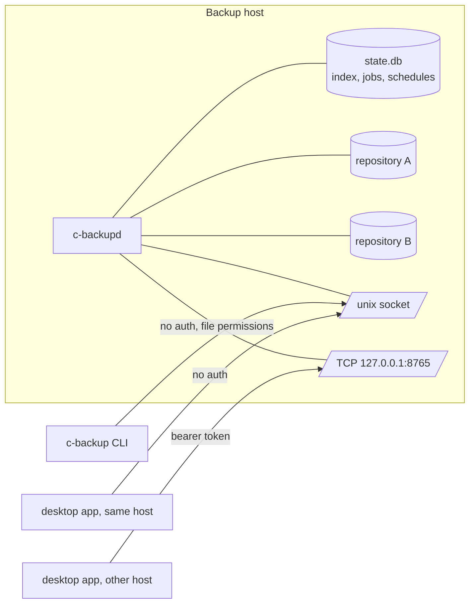
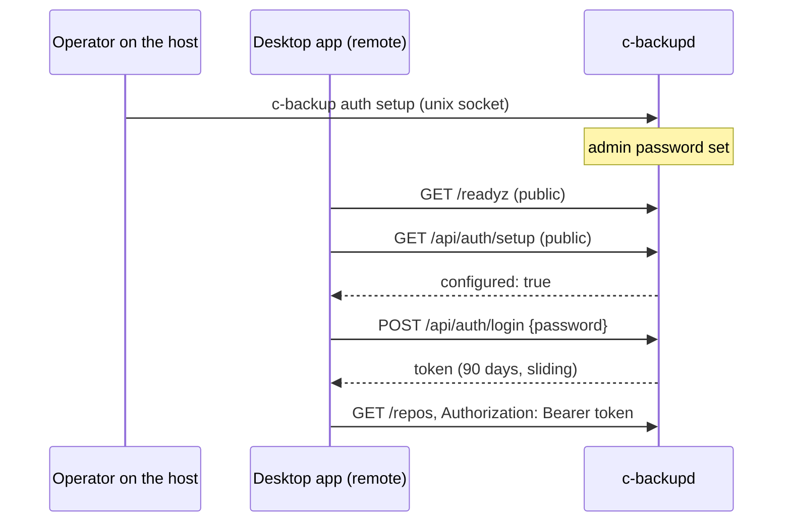
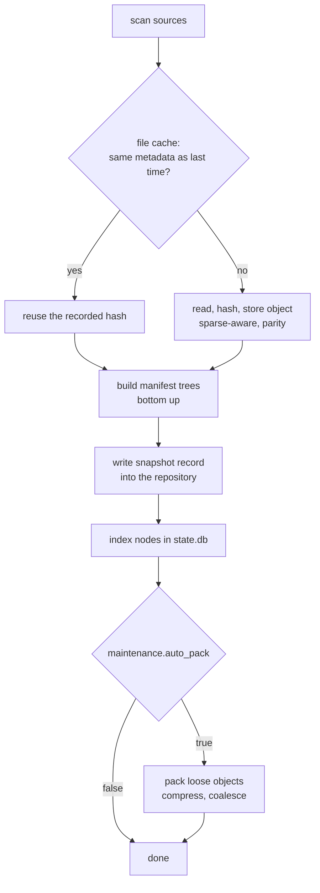

# c-backup Manual

Version 1.0. This is the operator's reference: what the system is, how to
install and configure it, how every operation behaves, what it guarantees,
what it costs, and how to recover when something is lost. `docs/api.md` is
the endpoint reference and `docs/data-paths.md` follows bytes through the
engine; this manual points at both rather than repeating them.

Contents

1. [What c-backup is](#1-what-c-backup-is)
2. [Installation](#2-installation)
3. [Configuration](#3-configuration)
4. [Access and security](#4-access-and-security)
5. [Repositories](#5-repositories)
6. [Backing up](#6-backing-up)
7. [Browsing, searching, comparing](#7-browsing-searching-comparing)
8. [Restoring](#8-restoring)
9. [Retention](#9-retention)
10. [Scheduling](#10-scheduling)
11. [Integrity: verify and repair](#11-integrity-verify-and-repair)
12. [Maintenance](#12-maintenance)
13. [Encryption](#13-encryption)
14. [Replication](#14-replication)
15. [The desktop app](#15-the-desktop-app)
16. [Monitoring and alerting](#16-monitoring-and-alerting)
17. [Disaster recovery](#17-disaster-recovery)
18. [Capacity planning and performance](#18-capacity-planning-and-performance)
19. [Troubleshooting](#19-troubleshooting)
20. [Limits and what is not in 1.0](#20-limits-and-what-is-not-in-10)
21. [Command reference](#21-command-reference)

---

## 1. What c-backup is

A content-addressed backup system built as one daemon per machine.

- **`c-backupd`** owns every repository on its host and is the only process
  that writes to them. It runs backups, restores, retention, verification,
  replication and schedules as jobs on a small worker pool, and serves an
  HTTP API.
- **`c-backup`** is a thin command-line client. Every command is one or a few
  HTTP requests to the daemon over its unix socket. There is no standalone
  mode: if the daemon is not running, the CLI says so and exits.
- **The desktop app** (Electron) is a second client of the same API. It
  connects to the local daemon over the unix socket, and to daemons on other
  machines over TCP with a session token.



### 1.1 The storage model

Every file's content is stored once, as an object named by its SHA-256. A
second copy of the same bytes anywhere, in any snapshot, costs nothing.
Objects are compressed with LZ4 when a 64 KiB probe says it is worthwhile and
left alone when it is not, so video, audio and database files do not burn CPU.
Every object and every pack carries Reed-Solomon parity, so bit rot can be
repaired, not just detected. Sparse files are stored as their data regions,
so a 1 TiB disk image holding 40 GiB costs 40 GiB.

A snapshot's metadata (names, modes, owners, times, links, extended
attributes, ACLs) is one content-addressed **manifest tree** object per
directory. A directory that did not change has the same tree hash and costs
nothing in the next snapshot; measured, an incremental snapshot writes about
3.3% new tree objects.

### 1.2 The repository is the source of truth

A repository is a directory that describes itself: objects, packs, manifest
trees and snapshot records. The daemon's database (`state.db`) is an index
over it, built for fast browsing and search. Lose the database and
`c-backup reindex` rebuilds it from the repository. What a database loss
costs is daemon-only state - schedules, sessions, job history, the journal -
never backups. Section 17 covers recovery.

### 1.3 Design constraints

These hold everywhere and decide many of the behaviours below.

1. **No size limit.** No limit on file or repository size; nothing assumes
   data fits in memory.
2. **Files exceed RAM.** Content is streamed, never buffered whole, including
   parity computation.
3. **Millions of inodes.** Traversal and change detection are linear in the
   number of entries.
4. **Fast incompressible bailout.** A 64 KiB probe decides compression.

Section 20 records the one place 1.0 falls short of constraint 3 on small
hosts: the scan's memory.

---

## 2. Installation

### 2.1 From source

Build dependencies on Debian/Ubuntu:

```sh
apt-get install build-essential pkg-config libssl-dev liblz4-dev \
                libacl1-dev libsqlite3-dev libmicrohttpd-dev \
                libcurl4-openssl-dev libcmocka-dev
```

The build needs [c-utils](https://git.airies.net/vifair22/c-utils) checked out
at `../c-utils`, or `CUTILS_DIR` pointing at it, at the version in
`cutils_version`:

```sh
git clone https://git.airies.net/vifair22/c-utils.git ../c-utils
git -C ../c-utils checkout "$(cat cutils_version)"
make -C ../c-utils
make                                   # build/bins/c-backupd, build/bins/c-backup
```

The default build targets the development CPU (`-march=znver3`). For another
machine pass `MARCH=x86-64-v2 MTUNE=generic` (what the Docker image uses) or
the target's own architecture level.

Install:

```sh
sudo install -m 0755 build/bins/c-backupd build/bins/c-backup /usr/local/bin/
sudo install -d -m 0700 /etc/c-backupd
sudo install -m 0600 packaging/config.yaml /etc/c-backupd/config.yaml
sudo install -m 0644 packaging/systemd/c-backupd.service /etc/systemd/system/
sudo systemctl daemon-reload
sudo systemctl enable --now c-backupd
```

The unit runs the daemon as root, because reading arbitrary source paths and
restoring ownership both need it. systemd creates `/run/c-backupd` (the
socket directory) and `/var/lib/c-backupd` (the database directory, mode
0700) on start.

Check it:

```sh
sudo c-backup health          # the daemon's health, as JSON
sudo c-backup version
```

### 2.2 Stopping and restarting

`systemctl stop c-backupd` (SIGTERM) shuts the daemon down in order: it stops
accepting requests, stops firing schedules, then cancels running jobs, which
stop between files and are recorded as `cancelled` in `c-backup jobs` and the
journal. This takes about a second. A second SIGTERM or SIGINT forces an
immediate exit. Run the cancelled job again after the restart; a backup skips
what it already stored, a restore skips what it already wrote.

A daemon that dies without stopping (a crash, `kill -9`, power loss) marks
whatever was running as `failed: interrupted by daemon restart` on its next
start. Either way the repository is consistent: a backup's partial pack is
discarded and the next backup stores those files again.

### 2.3 Docker

CI publishes an image built from `Dockerfile`: Debian trixie, binaries built
for `x86-64-v2`.

```sh
docker run -d --name c-backupd \
  -v cbackup-state:/var/lib/c-backupd \
  -v /srv/backup:/srv/backup \
  -v /home:/source/home:ro \
  -p 127.0.0.1:8765:8765 \
  <registry>/vifair22/c-backup:<tag>
```

- `/var/lib/c-backupd` holds `state.db`. Put it on fast storage (section 18).
- Mount the repositories and the sources at whatever paths you will register
  and back up. Paths are always the container's view.
- The image binds TCP on every interface inside the container, because a
  published port cannot reach the container's loopback. What is exposed is
  decided by `-p`. TCP serves only the health probes until an admin password
  is set.
- Run the CLI inside the container: `docker exec c-backupd c-backup ...`.
- Override configuration by mounting a file over
  `/etc/c-backupd/config.yaml`.

### 2.4 The desktop app

The app lives in `ui/`. To build and run it from a checkout:

```sh
cd ui
npm ci
npm run build
npx electron .
```

There is no packaged installer in 1.0.

### 2.5 The Debian package

`packaging/deb` holds control files for a package, but nothing builds one in
1.0. Use the source install or the image.

---

## 3. Configuration

All configuration is in one YAML file, read once at start. The daemon finds
it at `$C_BACKUP_CONFIG_PATH`, or `config.yaml` in its working directory. The
systemd unit sets `/etc/c-backupd/config.yaml`. Keep the file 0600: it holds
the Pushover credentials.

There is no API that changes configuration. Edit the file and restart:
`systemctl restart c-backupd`. Per-repository settings (retention, auto-pack)
are different: they live in the database and change through the policy API
(section 9).

| Key | Default | Meaning |
|---|---|---|
| `db.path` | `state.db` in the working directory | The daemon database. The shipped config sets `/var/lib/c-backupd/state.db` |
| `http.socket` | `/run/c-backupd/c-backupd.sock` | Unix socket for the CLI and local clients. Must fit in 107 bytes |
| `http.port` | `8765` | TCP port for remote clients. `0` disables TCP |
| `http.bind` | `127.0.0.1` | TCP bind address, IPv4. `0.0.0.0` for every interface |
| `security.key_dir` | `/etc/c-backupd/keys` | Where per-repository encryption keys live, one 0600 file each |
| `auth.cookie_secure` | `0` | Set `Secure` on session cookies. Only behind HTTPS |
| `log.level` | `info` | `debug`, `info`, `warn`, `error` |
| `pushover.token`, `pushover.user` | empty | Pushover credentials for failure alerts. Empty disables them |
| `scheduler.enabled` | `1` | `0` stops schedules firing. Manual jobs still run |
| `jobs.max_parallel` | `2` | Jobs running at once, across all repositories |
| `retention.keep_snaps` | `1` | Newest snapshots always kept |
| `retention.keep_daily` | `7` | Daily snapshots kept |
| `retention.keep_weekly` | `4` | Weekly snapshots kept |
| `retention.keep_monthly` | `12` | Monthly snapshots kept |
| `retention.keep_yearly` | `3` | Yearly snapshots kept |

The `retention.*` keys are defaults for repositories that have not set their
own (section 9).

Logs go to stdout, which systemd sends to the journal
(`journalctl -u c-backupd`). The daemon also keeps 30 days of log lines in its
database.

---

## 4. Access and security

### 4.1 Two ways in

**The unix socket** carries no authentication. Whoever can open it is
authorised, so file permissions on it are the access control. The daemon sets
its umask to 0077 at start, so the socket is created mode 0700, owned by the
user the daemon runs as: under the shipped unit, only root can connect, and
the CLI is run with `sudo`. There is no setting to widen it in 1.0, by design:
anyone who can open the socket controls every repository and can read any
file the daemon can.

**TCP** is for the desktop app on another machine. It binds loopback by
default, so nothing off the host can reach it until `http.bind` is changed.
Every request except the public routes needs a session token.



### 4.2 Turning on remote access

1. On the daemon's host, set the admin password. It prompts, twice when on a
   terminal, and is at least 8 characters:

   ```sh
   sudo c-backup auth setup
   ```

   This is the only way to set the first password. Over TCP the setup
   request is refused, because a port that accepted it would belong to
   whoever reached it first. Until a password exists, TCP answers everything
   but the public routes with `403` and a message saying how to set one.

2. Widen the bind in `config.yaml` and restart:

   ```yaml
   http:
     bind: 0.0.0.0        # or one interface's address
   ```

3. In the desktop app, add a remote connection with the host and port, and
   sign in with the admin password (section 15).

The transport is plain HTTP and carries the token. On any network you do not
trust, put a TLS-terminating reverse proxy or a tunnel (WireGuard, SSH port
forwarding) in front, and set `auth.cookie_secure: 1` when the proxy serves
HTTPS.

### 4.3 Sessions and passwords

- A login returns a token valid for 90 days. Every authenticated request
  slides the expiry forward, so a connection in regular use does not expire.
- `c-backup auth password` changes the password; it always asks for the
  current one.
- Sign out in the app, or `POST /api/auth/logout` with the token, revokes it.
- The CLI never needs a password: it uses the socket.
- The app stores the session token, never the password (section 15.2).

### 4.4 Public routes

`/healthz`, `/readyz`, `/metrics` and `GET /api/auth/setup` answer without a
credential, on both transports. A health probe that needs a login cannot
report a daemon too unhealthy to authenticate. Metrics carry counts and ages,
never paths or file content.

### 4.5 What is protected, and what is not

- A repository can be encrypted (section 13). That protects it wherever it
  travels: a replica on a NAS, a disk in a drawer.
- The host running the daemon holds every key it uses and a plaintext index
  of every path backed up, in `state.db` (mode 0600). Protecting that machine
  is the operating system's job: full-disk encryption and ordinary access
  control.
- The daemon runs as root. A client with access to it can read any file the
  daemon can, by backing it up and restoring it somewhere else. Treat API
  access as root access.

---

## 5. Repositories

A repository is a directory the daemon registers and then owns.

```
<repo>/
  .cbackup          identity marker: format, version, UUID, encryption
  snapshots/<id>    snapshot records: root tree hash and metadata
  objects/aa/bb...  loose objects, including manifest trees
  packs/<id>.dat    packs
  tmp/              staging for atomic writes
```

`docs/repo-format.md` describes the format.

### 5.1 Creating and registering

```sh
sudo c-backup repo add /srv/backup/main "Main"                     # unencrypted
sudo c-backup repo add /srv/backup/main "Main" --encrypt system      # see section 13
```

- A path that does not exist, or an empty directory, becomes a new
  repository. Missing parent directories are created as `mkdir -p` would,
  mode 0755; the repository directory itself is mode 0700. A path that
  cannot be created (a parent is a regular file, a read-only filesystem, no
  permission) is refused with HTTP 400 and the reason; only a failure of the
  host itself, such as a full disk, is a 500.
- A directory with a `.cbackup` marker is an existing repository and is
  re-registered, keeping its history. The UUID in the marker is its identity,
  not the path: move a repository, register the new location, and it links
  back to its snapshots.
- Adding a repository that is already registered succeeds and says so
  (`"already_registered":true`, HTTP 200 rather than 201). A label given
  that differs from the stored one replaces it; leaving the label out keeps
  the old one. Asking for an encryption mode the repository does not have is
  refused: encryption is fixed when a repository is created.
- Paths are stored normalised: `/srv/backup/main/` and
  `/srv/backup//main` are both `/srv/backup/main`.
- A non-empty directory without a marker is refused. Writing objects into
  somebody else's data is the failure this prevents.
- A path inside a registered repository, or one containing a registered
  repository, is refused with HTTP 400 naming that repository. One
  repository's objects would otherwise sit in a directory the other owns, so
  its garbage collection and verify would see them as strays, and deleting
  either directory would take data from both. The comparison is on resolved
  paths, so a symlink or `..` does not get around it.

### 5.2 Removing

```sh
sudo c-backup repo remove <id>
```

This deregisters the repository and drops its index rows. **The repository
directory is never touched.** Deleting backup data is the operator's act:
remove the directory yourself once you are sure. Registering it again later
restores everything, with a reindex.

### 5.3 Where to put a repository

Anywhere the daemon can write with ordinary POSIX semantics: `rename` within
the repository must be atomic, so `tmp/` lives inside it. Local disks, ZFS,
XFS, ext4 and NFS mounts all work. On Unraid, measured, a repository on a
parity-protected array disk is several times slower than on the cache pool
or an unassigned device; see section 18.

---

## 6. Backing up

### 6.1 Running one

```sh
sudo c-backup sources set 1 /home/me /etc --exclude node_modules --exclude '*.iso'
sudo c-backup backup 1                     # uses the configured sources
sudo c-backup backup 1 /home/me/projects   # or name paths for this run
```

A backup is a job. The CLI submits it and waits, printing the finished job;
`--no-wait` returns the job id at once. `c-backup jobs <id>` and
`c-backup jobs watch <id>` follow it.

Sources belong to the repository so that a schedule, the app's Run Backup
button and the CLI all back up the same thing. A backup that names paths
overrides them for that run. Exclusions are inherited only when the request
gives none.

Options:

| Option | Effect |
|---|---|
| `--exclude PAT` | Repeatable. See 6.2 |
| `--one-filesystem` | Do not cross into other mounts below a source |
| `--label TEXT` | A label on the snapshot |

### 6.2 Exclusion patterns

How a pattern matches follows from what it contains:

| Pattern | Matches |
|---|---|
| `/var/cache` | that directory and everything under it, on component boundaries, so not `/var/cache-manager` |
| `/home/*/Downloads` | absolute with wildcards; `*` stops at `/` |
| `build/tmp` | that tail of a path, at any depth, component-aligned |
| `node_modules`, `*.iso` | the basename, at any depth |
| anything containing `**` | as above, with wildcards crossing `/` |

A trailing slash is ignored. An excluded directory is never descended into.

### 6.3 What happens during a backup



1. **Scan.** The sources are walked and every entry recorded with its
   metadata. Paths are absolute, so a backup of `/a/b/c` also records `/a`
   and `/a/b`; a restore needs them to recreate the layout.
2. **Content.** For each regular file the file cache asks whether the path
   still has exactly the metadata it had last time; if so, the recorded hash
   is reused without opening the file. Otherwise the file is read, hashed and
   stored. A file whose content already exists in the repository costs one
   read and no write.
3. **Trees.** One manifest tree per directory, bottom up.
4. **Snapshot.** The snapshot record goes into the repository first, then
   the index rows go into the database. An interrupted backup leaves at most
   index rows a reindex cleans up.
5. **Packing.** Loose objects are always stored uncompressed; compression
   happens at pack time. So by default every backup ends by packing what it
   wrote. Set the policy key `maintenance.auto_pack` to `false` to pack on
   your own schedule instead.

What is captured: regular files (sparse or not), directories, symlinks,
hardlinks (as groups), FIFOs, device nodes, modes, owner and group, times,
extended attributes and POSIX ACLs. A unix socket has no content and is
recorded without one; restore skips it.

Files that cannot be read are logged and skipped; the backup continues. A
source that is unreadable as a whole fails the job.

### 6.4 Concurrency

Jobs for one repository run one at a time: the dispatcher never starts a
second job for a repository that has one running, and queues it instead. Jobs
for different repositories run in parallel, up to `jobs.max_parallel`.

Metadata writes (tags, notes, policy, sources) during a running backup wait
briefly for the database rather than failing.

---

## 7. Browsing, searching, comparing

```sh
sudo c-backup snapshots 1                  # newest first, paged
sudo c-backup ls 1 12                      # top level of snapshot 12
sudo c-backup ls 1 12 <node-id>            # one directory down
sudo c-backup search 1 invoice             # file names containing "invoice"
sudo c-backup grep 1 'swordfish'           # file contents, extended regex
sudo c-backup diff 1 11 12                 # what changed between two snapshots
```

- Every listing pages. No request returns a whole snapshot, which is what
  keeps browsing fast at any size (section 18.4).
- **Name search** uses a trigram index: substring matches in milliseconds.
- **Content search** (`grep`) runs as a job, because it reads the
  repository. Matching is POSIX extended regular expressions, line by line,
  over every distinct object in the snapshot; a file present under several
  names is read once. Binary files are reported without an excerpt.
  `--snapshot N` picks the snapshot (newest by default), `--path-prefix`
  limits it to a subtree, `-i` ignores case, `--limit N` stops after N
  matching files. The hits are kept and `GET /repos/<id>/grep` lists past
  searches.
- **Diff** walks manifest trees and skips any subtree whose hash did not
  change, so comparing two large snapshots costs what changed between them.

Snapshots carry notes and tags:

```sh
sudo c-backup snapshot note 1 12 "before the migration"
sudo c-backup tag set 1 pre-migration 12
```

---

## 8. Restoring

```sh
sudo c-backup restore 1 12 /mnt/restore
sudo c-backup restore 1 12 /mnt/restore --subpath /home/me/documents
```

- Paths are recreated under the destination as they were: restoring a
  backup of `/home/me` into `/mnt/restore` produces `/mnt/restore/home/me/...`.
- `--subpath` restores one file or directory. It matches on component
  boundaries and accepts the path with or without its leading slash.
- **Existing files are skipped, not overwritten**, and counted as skipped.
  This makes an interrupted restore re-runnable: run it again and it
  continues. `--overwrite` replaces existing files instead.
- Hardlinks are restored as hardlinks, including across a resumed restore.
- Sparse files come back sparse.
- Modes, times (directories included), extended attributes and ACLs are
  restored. Ownership is restored when the daemon runs as root.
- Device nodes need root and a kernel that allows them; one that cannot be
  created is skipped and counted, not failed.
- Sockets are skipped: they have no content.

The job reports files, directories, links, specials, skipped and failed. Any
failed entry makes the job fail with "restore incomplete", so a restore that
reports success restored everything restorable.

---

## 9. Retention

Retention is grandfather-father-son (GFS) over calendar days, plus a minimum
of recent snapshots, plus tags.

### 9.1 What survives a retention pass

A snapshot is kept if any of these holds:

1. It is among the newest `keep_snaps` snapshots (at least the newest one,
   always).
2. It holds a tier and is within that tier's count. Each closed calendar day
   elects its last snapshot as that day's **daily**; the last daily of each
   week (ending Sunday) becomes the **weekly**, the last weekly of each month
   the **monthly**, the last monthly of each year the **yearly**. A snapshot
   can hold several tiers at once and counts against its highest.
3. It is tagged. Any tag protects a snapshot from retention, whatever its age.

Everything else is pruned. A tier count of `0` keeps every snapshot of that
tier. The current day is never closed, so a snapshot taken today holds no
tier until tomorrow.

Days are local calendar days on the daemon's host, in its timezone.

### 9.2 Setting it

Daemon-wide defaults are in `config.yaml` (section 3). A repository overrides
any of them:

```sh
sudo c-backup policy list 1
sudo c-backup policy set 1 retention.keep_daily 14
sudo c-backup policy set 1 retention.keep_snaps 5
```

`policy list` shows the repository's own values and the defaults in force.

### 9.3 Running it

**Retention does not run on its own.** A backup never deletes snapshots.
Run it by hand, or schedule it:

```sh
sudo c-backup gfs 1 --dry-run              # what would go
sudo c-backup gfs 1
sudo c-backup schedule add 1 gfs --every day --at 04:00
```

Pruning a snapshot removes its record and index rows. The space its objects
held is reclaimed by garbage collection (section 12), which a schedule should
follow.

---

## 10. Scheduling

Schedules belong to a repository and submit jobs through the same job
manager as everything else.

```sh
sudo c-backup schedule add 1 backup 14400                          # every 4 hours
sudo c-backup schedule add 1 backup --every day --at 02:00
sudo c-backup schedule add 1 verify --every week --on sunday --at 03:00
sudo c-backup schedule add 1 gc --every month --on-day 1 --at 05:00
sudo c-backup schedule add 1 replicate --every day --at 03:30 --dest /mnt/nas/main
sudo c-backup schedule list 1
sudo c-backup schedule disable 1 <schedule-id>
```

Actions: `backup`, `verify`, `grep`, `gc`, `gfs`, `reindex`, `pack`,
`replicate`. A schedule whose action cannot run is refused when created, not
when it first fires.

**Interval** triggers anchor to the last successful run, not to wall-clock
multiples: a long backup does not make the next one due the moment it ends.

**Calendar** triggers use the host's local time. `every` is `day`, `week`
(with `--on <weekday>`), `month` (with `--on-day 1-31`) or `year` (with
`--on-month` and `--on-day`). The edge cases are handled: a time that does
not exist on a spring-forward day still fires once, a time that occurs twice
on a fall-back day fires once, the 31st clamps to the last day of shorter
months, and 29 February fires every year.

Two policies per schedule:

| Option | Values | Meaning |
|---|---|---|
| `--on-overlap` | `skip` (default), `queue`, `cancel_running` | The schedule comes due while its previous run is still going |
| `--catchup` | `skip` (default), `run_once` | Windows missed while the daemon was down: move to the next, or fire once now |

A `backup` schedule uses the repository's sources unless it names
`--source` paths. A `replicate` schedule needs `--dest`, an absolute path.

`scheduler.enabled: 0` in `config.yaml` stops every schedule.

A suggested set for one repository:

| What | When |
|---|---|
| `backup` | daily, or every few hours |
| `gfs` | daily, after the backup |
| `gc` | weekly, after retention |
| `verify` | weekly or monthly (deep verify reads everything) |
| `replicate` | daily, to another disk or machine |

---

## 11. Integrity: verify and repair

"Did the backup run" and "is the backup still good" are different questions.
Verify answers the second.

```sh
sudo c-backup verify 1                     # deep, repairing
sudo c-backup verify 1 --level index       # fast: every object still resolves
sudo c-backup verify 1 --level structure   # also parses every header
sudo c-backup verify 1 --no-repair         # check only, write nothing
sudo c-backup verify list 1                # past runs
```

| Level | Reads | Proves |
|---|---|---|
| `index` | no payloads | every registered object resolves to a location, and every pack file it names exists |
| `structure` | headers | every object's header is well formed |
| `deep` | everything | every payload's SHA-256 matches its name |

A deep verify repairs what it finds by default: every object carries
Reed-Solomon parity, and having already read the damaged bytes, writing the
correction costs almost nothing more. With `--no-repair` it still tells
recoverable damage from loss for small objects, applying parity in memory.

What a run counts:

| Count | Meaning |
|---|---|
| `repaired` | Corrected from parity and written back. Always 0 with `--no-repair` |
| `recoverable` | Readable only through parity and still wrong on disk. Run a repairing verify |
| `unrecoverable` | Beyond what parity can rebuild. **Data loss** |
| `missing` | Indexed but absent, including every object in a pack file that has gone. **Data loss** |

**Loss fails the verify.** Any `unrecoverable` or `missing` object ends the
job `failed`, with an error naming the run and the counts, and
`c-backup verify` exits 1, so a scheduler or script that checks the exit
status sees it. The run and its findings are still recorded and still
printed on stdout (the failed job goes to stderr); `verify show <id> <run>`
reads them back later. A missing pack is reported as missing, never as
damage to repair: its parity went with it.

Findings name files, not hashes: each object that is not intact is reported
with its status, how many distinct paths reference it (`affected_files`),
how many versions of them across snapshots (`affected_versions`), up to
three full paths, and up to ten snapshot ids beside the exact count
(`affected_snapshot_count`, with `snapshots_truncated` set when the list is
short). The run's `affected_files` and `affected_snapshots` are distinct
paths and snapshots across every lost object. The CLI prints the run and its
findings as one JSON document.

A checking verify takes the read lock; a repairing one takes the write lock.

---

## 12. Maintenance

| Command | What it does | When |
|---|---|---|
| `gc 1` | Mark from every live snapshot, sweep unreferenced objects, compact packs | After retention prunes |
| `gc 1 --dry-run` | Report what would be removed | Before the first real run |
| `pack 1` | Pack and compress loose objects, coalesce small packs | If `maintenance.auto_pack` is off |
| `reindex 1` | Rebuild the repository's index from its manifest trees | After a database loss, or if the index is suspect |
| `snapshot delete 1 12` | Prune one snapshot | By hand; GC reclaims its space |

Each is a job. Finished jobs stay visible for 30 days (`c-backup jobs`); the
per-repository journal (`c-backup journal 1`) is the permanent record of what
ran and how it ended.

---

## 13. Encryption

A repository is encrypted or not, decided when it is created. To change it,
create a new repository and replicate into it.

```sh
sudo c-backup repo add /srv/backup/main "Main" --encrypt system
sudo c-backup repo add /srv/backup/main "Main" --encrypt passphrase --passphrase '...'
```

`--passphrase` on its own implies `--encrypt passphrase`. Giving one with
`--encrypt none` or `--encrypt system` is refused, because neither mode can
use it and silently dropping it would leave you believing a passphrase
protects the repository.

Objects are encrypted with ChaCha20-Poly1305 before they reach disk, chosen
over AES-GCM because it does not depend on AES-NI. Hashes are of the
plaintext, so deduplication still works within a repository.

| Mode | Key lives | To recover elsewhere you need |
|---|---|---|
| `system` | a 0600 file in `security.key_dir` on this host | that key |
| `passphrase` | wrapped (Argon2id) in the repository, cached on this host | the repository and the passphrase |

The daemon keeps the key on its host in both modes, because a scheduled
backup cannot stop to ask for a passphrase.

**A system key exists in exactly one place: the machine being backed up.**
Lose that machine and every copy of the repository, offsite replicas
included, is unreadable. So:

1. `repo add --encrypt system` prints the key once.
2. Store it somewhere that is not this machine.
3. Confirm you have:

   ```sh
   sudo c-backup repo key export 1     # again, if you missed it
   sudo c-backup repo key ack 1
   ```

Until acknowledged, every backup logs a warning, the journal records it, and
`cbackup_repos_key_unescrowed` counts the repository. This is deliberately
persistent.

To use the repository on a new host (section 17):

```sh
sudo c-backup repo key import <id> <key-hex>
```

The import is refused unless the key matches the fingerprint in the
repository's marker. The marker never contains the key.

---

## 14. Replication

```sh
sudo c-backup replicate 1 /mnt/nas/main-replica
```

Copies the repository into another directory: a second disk, a NAS mount, a
USB dock. The replica is the same repository in another place, with the same
UUID and encryption identity, and can be registered by another daemon and
restored from.

- **Objects, not files.** Only objects the target lacks are sent. A tree hash
  covers everything beneath it, so an unchanged subtree is dismissed by one
  comparison and an unchanged repository replicates in one question.
- **As stored.** Objects travel compressed and encrypted. The target never
  needs the key, so a replica can live somewhere less trusted than the
  source.
- **No deletion.** Retention at the target is the target's business. A
  compromised source cannot delete the offsite copy through replication.
- A destination already holding a different repository is refused.

The target is a path. Replicating to another machine means mounting it (NFS,
SMB, sshfs) or running a daemon there and replicating locally on that side.
A network transport is not in 1.0.

Replication is not exposed in the desktop app; use the CLI or a schedule.

---

## 15. The desktop app

### 15.1 Connections

The sidebar lists connections. Each is either:

- **This machine**: the local daemon's unix socket, default
  `/run/c-backupd/c-backupd.sock`. No password; the socket's permissions
  decide, so the app's user needs access to it (section 4.1).
- **Remote**: a host and port. The daemon's admin password is asked for once.

Add one with **+ Add**. A connection's status shows beside its name
(`local, connected`, `remote, signed out`, ...). Right-click a connection for
Connect or Sign in, Add Repository, Daemon status, Reconnect, Disconnect,
Sign out, Edit and Delete.

Connections are saved and restored when the app starts. Local connections,
and remote ones with a stored session, reconnect on their own.

### 15.2 Signing in

The sign-in dialog takes the admin password and exchanges it for a session
token. **Stay signed in** stores that token, never the password:

- encrypted with the operating system's keyring (Keychain, Windows DPAPI,
  libsecret) when one is available;
- otherwise as base64 in a file only your account can read
  (`credentials.json`, mode 0600, in the app's data directory). The dialog
  says which applies before you choose.

Without **Stay signed in**, the session lasts until the app closes. If the
daemon ends a session (a sign-out elsewhere, or expiry), the
app says so and asks again. **Sign out** revokes the token on the daemon and
forgets it locally.

Renaming a connection keeps its session; changing its address drops it,
because a token belongs to the daemon that issued it.

### 15.3 Paths are the daemon's

Every path typed into the app - a repository to add, sources, a restore
destination - is resolved by the daemon, on its host. For a remote connection
the dialogs say "on <host>".

### 15.4 Screens

For a repository: dashboard, snapshots and the snapshot browser (with file
preview and restore), name search, content search, snapshot diff, retention
policy, tags, journal, tasks (jobs), schedules, verify runs, encryption and
key, object and pack introspection. The daemon status screen covers the
daemon as a whole.

---

## 16. Monitoring and alerting

### 16.1 Probes

| Route | Meaning |
|---|---|
| `/healthz` | The process answers |
| `/readyz` | The database is open; the daemon can do work |

Both are public, on the socket and on TCP.

### 16.2 Metrics

`/metrics` is Prometheus text exposition, public, daemon-wide aggregates (no
per-repository labels).

| Metric | Type | Meaning |
|---|---|---|
| `cbackup_repos_total` | gauge | Registered repositories |
| `cbackup_snapshots_total` | gauge | Snapshots across all repositories |
| `cbackup_objects_total` | gauge | Stored objects |
| `cbackup_objects_bytes` | gauge | Bytes stored by objects |
| `cbackup_nodes_total` | gauge | Indexed files and directories |
| `cbackup_jobs_running` | gauge | Jobs running |
| `cbackup_jobs_queued` | gauge | Jobs waiting |
| `cbackup_jobs_failed_total` | counter | Jobs that failed |
| `cbackup_jobs_completed_total` | counter | Jobs that completed |
| `cbackup_schedules_enabled` | gauge | Enabled schedules |
| `cbackup_last_snapshot_age_seconds` | gauge | Age of the newest snapshot |
| `cbackup_repos_key_unescrowed` | gauge | Encrypted repositories whose key is not acknowledged as stored elsewhere |
| `cbackup_repos_encrypted` | gauge | Encrypted repositories |
| `cbackup_last_verify_age_seconds` | gauge | Age of the newest verify run |
| `cbackup_verify_unrecoverable_objects` | gauge | Objects the last verify found unrecoverable or missing |
| `cbackup_verify_repaired_objects` | gauge | Objects the last verify repaired and wrote back |
| `cbackup_verify_recoverable_objects` | gauge | Objects the last verify found damaged but did not write back |
| `cbackup_verify_affected_files` | gauge | Distinct paths referencing lost objects |

Alerts worth having:

- `cbackup_last_snapshot_age_seconds` above your backup interval plus margin:
  backups have stopped.
- `cbackup_last_verify_age_seconds` above your verify interval: nobody is
  checking what was written.
- `cbackup_verify_unrecoverable_objects > 0`: data is lost; the findings say
  which files.
- `cbackup_verify_recoverable_objects > 0`: damage parity still covers, left
  on disk by a checking-only verify; run a repairing one.
- `increase(cbackup_jobs_failed_total[1d]) > 0`.
- `cbackup_repos_key_unescrowed > 0`.

### 16.3 Push notifications

With `pushover.token` and `pushover.user` set, every failed job sends a
notification naming the action, the repository and the error. A cancelled
job does not.

---

## 17. Disaster recovery

### 17.1 The database is lost or corrupt

Backups are intact; the index is not. Start the daemon with an empty
database, register each repository again (its marker identifies it), and
rebuild:

```sh
sudo systemctl stop c-backupd
sudo mv /var/lib/c-backupd/state.db /var/lib/c-backupd/state.db.bad
sudo systemctl start c-backupd
sudo c-backup repo add /srv/backup/main "Main"
sudo c-backup reindex 1
```

Reindex walks every snapshot's trees, at roughly 764,000 rows per second.
Lost for good: schedules, sources, policy, tags, notes, the journal, job
history and sessions. Re-create the schedules and sources. Remote clients sign
in again; set the admin password again first with `auth setup`.

Keep a copy of `config.yaml` and a note of your schedules somewhere else, and
this is a short job.

### 17.2 The backup host is lost

On a new host with the daemon installed:

1. Make the repository available: the original disk, or a replica.
2. For a `system`-encrypted repository, import the escrowed key **before**
   anything reads it:

   ```sh
   sudo c-backup repo add /srv/backup/main "Main"
   sudo c-backup repo key import 1 <key-hex>
   ```

   For a `passphrase` repository, register it and supply the passphrase.
3. `sudo c-backup reindex 1`, then restore.

Without the key, a `system`-encrypted repository cannot be read by anyone.
That is why section 13's escrow step is not optional.

### 17.3 Damage inside a repository

Run `c-backup verify <id>` (deep, repairing). Parity repairs what it can;
the findings list anything unrecoverable with the files and snapshots it
affects. Restore those files from a replica, or from an older snapshot if the
damaged object is not shared with it.

### 17.4 Repositories from before the rewrite

1.0 cannot read repositories written by the pre-daemon versions, and there is
no migration. Build the `pre-daemon-rewrite` tag to read them, restore what
you need, and back it up again with 1.0.

---

## 18. Capacity planning and performance

Figures here were measured: on a development workstation against 6.8 GB and
46 GB corpora, and on an Unraid 7.3.2 server (125 GB RAM, 27 containers
running). `docs/acceptance.md` has the full results.

### 18.1 Disk

- **Transient headroom: about twice the final size on a first backup.**
  Loose objects are written uncompressed and packing compresses them at the
  end. A 46 GB backup peaked at 53 GB of repository and settled at 26 GB.
- Deduplication is per repository, across every snapshot.
- Already-compressed data (media, archives, git objects) gains nothing from
  compression and is detected quickly; expect source size, less duplicates,
  plus parity overhead of a few percent.

### 18.2 Where state.db goes

The index is on the hot path of every backup: about two queries per file,
small and random. **Put `state.db` on the fastest storage available, never on
a parity-protected array.** Measured on the same 60,875 files, with only the
index moving: 3.35 ms/file on an Unraid array disk against 1.05 ms/file on
the SSD cache, a 3.2x difference for byte-identical repositories.

A repository is written in large sequential pieces and is less sensitive, but
on Unraid it too belongs on cache, an unassigned device, or anything outside
the array.

### 18.3 Memory

- **The scan holds every entry in memory: about 820 bytes per file.** 622,000
  files measured at 487 MB; 1.2 million is about 925 MB; 10 million about
  8 GB. Fine on a server; on a 2-4 GB NAS, split very large trees into
  several repositories or several sources backed up separately. Section 20.
- File content is streamed in bounded chunks whatever its size. Parity for a
  large object spills to `<repo>/tmp` beyond 256 MiB.
- A large pack run uses up to about 1 GB of buffers at its widest (32
  workers). Smaller runs use proportionally less.

### 18.4 What to expect

| Operation | Measured |
|---|---|
| First backup, 5,722 files / 6.8 GB | 21.5 s |
| First backup, 225,240 files / 46 GB | 443 s |
| Incremental, nothing changed (5.7k files) | 1 s |
| Restore, 6.8 GB | 20 s |
| Snapshot list, any size | 5 ms |
| One directory, any size | 5 ms |
| Name search over 225k files | 22 ms |
| Dashboard over 225k files | 142 ms |
| Starting a job (handoff) | under 15 ms |
| Reindex | about 764k rows/s |

Interactive operations do not grow with repository size: listings page, and
search uses an index. The app adds roughly 20 ms over the CLI.

Reading through FUSE (Unraid's `/mnt/user` shares) costs about 7% against
the underlying disk.

---

## 19. Troubleshooting

| Symptom | Cause | Fix |
|---|---|---|
| `c-backup: daemon not running at /run/c-backupd/c-backupd.sock` | The daemon is stopped, or the socket path differs | `systemctl status c-backupd`; `--socket PATH` or `C_BACKUP_SOCKET` |
| `permission denied` on the socket | Not root, and the socket is root-only | `sudo`, or section 4.1 |
| `another daemon is serving <socket>` at start | A second instance | Stop the other one; only one daemon owns a host |
| App: `no daemon at host:port`, mentions `http.bind` | TCP not reachable: bound to loopback, firewalled, or the daemon is down | Set `http.bind`, open the port, check the daemon |
| App or API: 403 `not configured` | No admin password yet | `sudo c-backup auth setup` on the daemon's host |
| App: `login failed: check the admin password` | Wrong password | Retry; `c-backup auth password` on the host to change it |
| App: `sign in again` mid-use | Session revoked or expired | Sign in |
| `repo is busy` | Another job holds the repository | Wait, or `c-backup jobs` to see what |
| Backup logs `key not escrowed` | System key not acknowledged | Section 13 |
| Job `cancelled` after a restart | `systemctl stop` cancels running jobs (section 2.2) | Run it again |
| Job `failed: interrupted by daemon restart` | The daemon died mid-job: crash, `kill -9`, power loss | Run it again; nothing partial is kept |
| `restore incomplete: N entries could not be restored` | Some entries failed | The job and log name them; check permissions and space at the destination |
| `purge is not supported` | `repo remove` never deletes data | Delete the directory yourself |
| Retention keeps everything | Retention is not scheduled, every snapshot is tagged, or tiers are 0 | `c-backup gfs <id> --dry-run`; section 9 |
| Repository much larger than expected right after a backup | Packing has not run or is running | Wait for the job; `c-backup pack <id>`; check `maintenance.auto_pack` |
| Backups slow on Unraid | `state.db` or the repository on the parity array | Section 18.2 |

`journalctl -u c-backupd` has the daemon's log; `log.level: debug` for more.
`c-backup journal <id>` shows every operation on a repository and its outcome.

---

## 20. Limits and what is not in 1.0

Known limits:

- **Scan memory** is linear in the number of files, about 820 bytes each
  (section 18.3), so a tree of many millions of files needs gigabytes of RAM
  while it is scanned. This falls short of the "millions of inodes" design
  constraint on small hosts.
- **Plain HTTP.** No TLS in the daemon; use a reverse proxy or a tunnel.
- **IPv4 only** for `http.bind`.
- **One admin password.** No users or roles.
- **No configuration API.** Edit `config.yaml` and restart.
- **No resumable jobs.** A job interrupted by a restart is marked failed and
  run again. Backups skip what is unchanged; restores skip what exists.

Not in 1.0, by decision:

| Item | Notes |
|---|---|
| ARM64 builds | Not built, so not offered |
| Export and import (`xfer`) | Deferred, not dropped |
| Network replication | Replicate to a mounted path for now |
| Web UI served by the daemon | The desktop app is the UI |
| Debian package builds | Control files exist; nothing builds them |
| Schedule jitter | Jobs per repository already serialise |
| Table or YAML output from the CLI | JSON only |
| Per-repository metric labels | Daemon-wide aggregates only |

---

## 21. Command reference

Every command talks to the daemon over its socket: `--socket PATH` before the
command, or `C_BACKUP_SOCKET`, overrides the default. Output is the daemon's
JSON, one document per command, on stdout; errors go to stderr. The exit
status is 0 on success and 1 otherwise. Flags may appear anywhere after the
command. Commands that start a job wait for it unless given `--no-wait`.

| Command | Purpose |
|---|---|
| `repo list` | Registered repositories |
| `repo add <path> [label] [--encrypt system\|passphrase] [--passphrase TEXT]` | Create or register |
| `repo show <id>` | One repository |
| `repo remove <id>` | Deregister; the directory is kept |
| `repo key export\|ack <id>`, `repo key import <id> <key-hex>` | Encryption key escrow and recovery |
| `sources list <id>`, `sources set <id> <path>... [--exclude PAT]...` | What a repository backs up |
| `backup <id> [path...] [--exclude PAT]... [--one-filesystem] [--label TEXT]` | Back up |
| `restore <id> <snapshot> <dest> [--subpath PATH] [--overwrite]` | Restore |
| `snapshots <id> [--limit N] [--offset N]` | List snapshots |
| `snapshot delete <id> <snapshot>` | Prune one |
| `snapshot note <id> <snapshot> [text]` | Read or write a note |
| `ls <id> <snapshot> [node-id]`, `snapshot tree <id> <snapshot> [node-id] [--limit N] [--offset N]` | One directory level; the root when no node is given |
| `search <id> <text> [--limit N]` | File names |
| `grep <id> <pattern> [--snapshot N] [--path-prefix PATH] [--limit N] [-i]` | File contents |
| `diff <id> <from> <to>` | Compare two snapshots |
| `verify <id> [--level index\|structure\|deep] [--no-repair] [--dry-run]`, `verify list <id>` | Integrity |
| `gc <id> [--dry-run]` | Garbage collection |
| `gfs <id> [--dry-run]` | Retention |
| `pack <id>` | Pack and compress |
| `reindex <id>` | Rebuild the index |
| `replicate <id> <dest>` | Copy into another directory |
| `stats <id>`, `summary <id>`, `fanout <id>` | Repository statistics |
| `objects <id> [--location loose\|packed]`, `object <id> <hash> [refs\|layout\|content]` | Objects |
| `packs <id> [pack-id]` | Packs |
| `policy list <id>`, `policy set <id> <key> <value>` | Per-repository settings |
| `tag list <id>`, `tag set <id> <name> <snapshot>`, `tag remove <id> <name>` | Tags |
| `journal <id> [--limit N] [--result STATE]` | Operation history |
| `schedule list\|add\|remove\|enable\|disable <id> ...` | Schedules (section 10) |
| `jobs`, `jobs <job-id>`, `jobs cancel <job-id>`, `jobs watch <job-id>` | Jobs |
| `auth setup\|login\|logout\|password` | Admin password and sessions (prompts) |
| `health [live]`, `metrics`, `version` | The daemon |
| `help` | This list, from the binary |

Policy keys: `retention.keep_snaps`, `retention.keep_daily`,
`retention.keep_weekly`, `retention.keep_monthly`, `retention.keep_yearly`,
`maintenance.auto_pack`.
