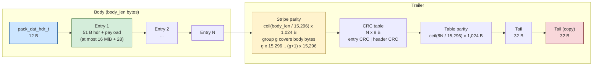
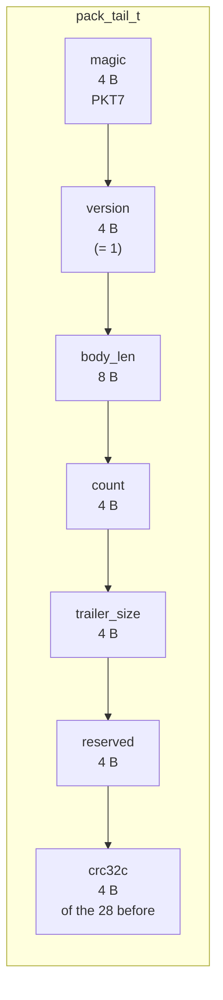

# Parity Trailer Byte Layout

Physical byte-level anatomy of a pack file under pack version 7: striped
parity over the whole body (OWN-44). `docs/pack-parity.md` has the design
and `docs/repo-format.md` the field-level layout.

## Pack .dat (pack version 7)

## Tail (32 bytes, written twice)

The stripe is the body as one stream: the pack header, every entry header
and every payload are protected alike, and an entry's damage is corrected
from the one or two groups it overlaps. The tail places everything else; a
reader takes the last copy that verifies, and with both gone derives the
trailer from the body (count from the pack header, body_len from a walk of
the entries, checked against the file size).

> Loose objects, the `.idx` sidecar, the `.snap` container and per-entry
> parity blocks (pack version 6) all had layouts here. None exists any more.
> The tail's 32-bit trailer_size cannot wrap because every pack is bounded
> (`PACK_MAX_BYTES`, `PACK_MAX_ENTRIES`).
