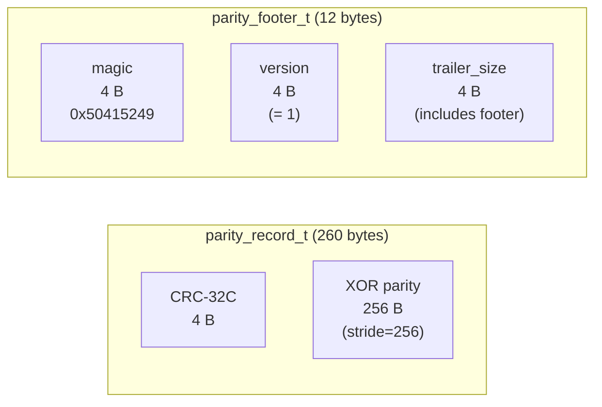
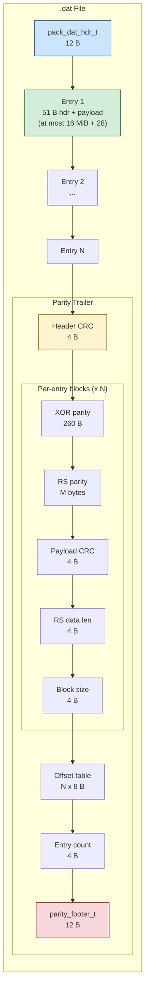

# Parity Trailer Byte Layout

Physical byte-level anatomy of the pack parity trailer, the one parity trailer
format 3 has.

## Common building blocks

## Pack .dat (format 3)

> Loose objects, the `.idx` sidecar and the `.snap` container all had layouts
> here. None exists any more: every object is in a pack, a pack is a single
> `.dat` installed by one rename, and a snapshot is a record plus manifest
> trees. The trailer's 32-bit sizes cannot wrap because every pack is bounded
> (`PACK_MAX_BYTES`, `PACK_MAX_ENTRIES`). See `docs/repo-format.md`.
