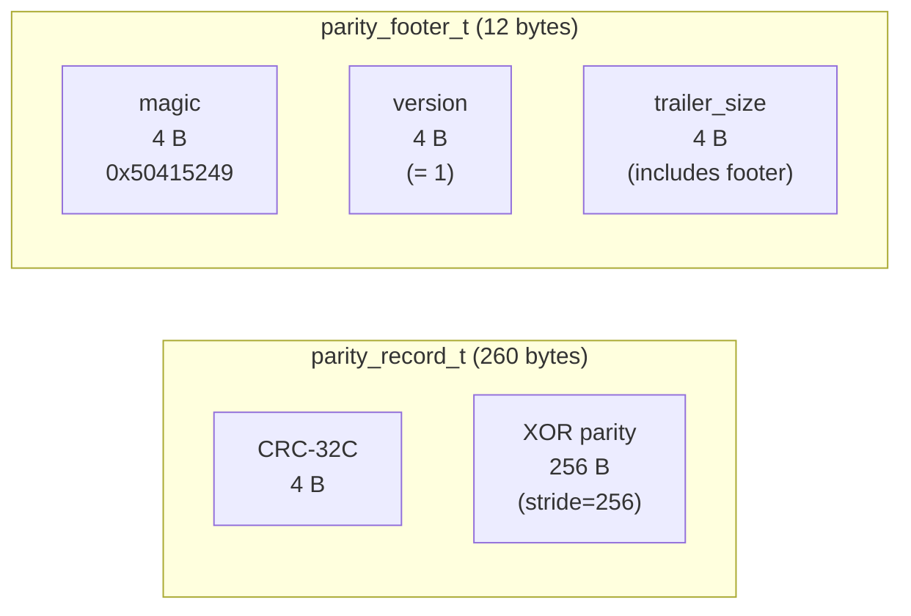
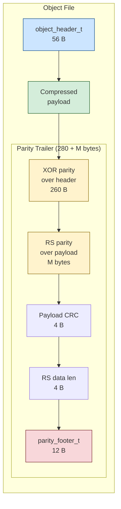
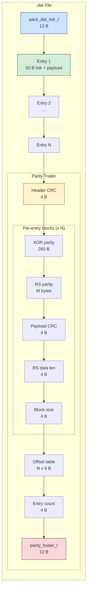

# Parity Trailer Byte Layout

Physical byte-level anatomy of parity trailers across all on-disk file types.

## Common building blocks

## Loose Object (version 2)

## Pack .dat (V3/V4)

> The `.idx` sidecar and the `.snap` container both had layouts here. Neither
> exists any more: a pack is a single `.dat` installed by one rename, and a
> snapshot is a record plus manifest trees. See `docs/repo-format.md`.
