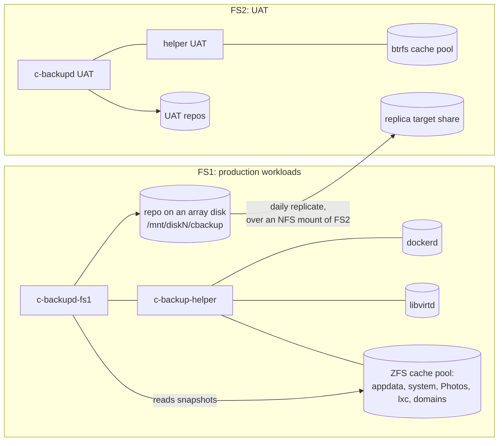

# Container backup (Docker and LXC)

Design document. Nothing here is built yet. It is the Docker and LXC
providers for the source-provider interface in `source-providers.md`,
which defines the vtable, consistency levels, session lifecycle, intents
and sweep, the repository representation, retention groups and the common
API. This document covers what is specific to containers.

Host facts are from the read-only survey of FS1 and FS2,
`unraid-infra/fs2/c-backup-uat/SURVEY-sources.md` (2026-11-16), cited as
"survey".

## FORMAT IMPACT

**None.** A container snapshot is an ordinary format 3 snapshot. The
container's data (bind mounts, named volumes, an LXC rootfs) is files and
directories recorded at their real host paths, exactly as a file backup
records them, so any format 3 build restores it by path. The definition
(`docker inspect`, image digests, the Unraid template, compose files, the
LXC config), hook logs, hook dumps and `unit.json` (the consistency level
and the per-mount capture method) are files under the reserved
`.cbackup-unit/` directory. Per-container history and retention are
derived into `state.db` from that directory by reindex. The one
prerequisite is the `.cbackup-unit` reservation in file backups, a
behaviour change, not a format change (`source-providers.md` section 7).

## 1. Scope and user decisions

| Decision | Choice |
|----------|--------|
| Docker and LXC | Both 1.0, behind the same provider interface |
| Consistency | Pre hooks (live), then an atomic filesystem snapshot, with a pause around it only when the capture needs one (`pause: auto`, decided; `always` per unit), then post hooks; the backup reads from the snapshot while the workload runs |
| Filesystems | ZFS and btrfs first: FS1's cache is ZFS, FS2's is btrfs (survey section 2). Other filesystems get a fallback (section 7), flagged for the user |
| Images | Not backed up. The definition is, and restore pulls the image |
| Definitions | `docker inspect` output, plus the compose files or the Unraid template (`/boot/config/plugins/dockerMan/templates-user/my-*.xml`) where present |
| LXC | Unraid's LXC plugin (plain LXC), driven through the `lxc-*` tools, not liblxc |
| Testing | Disposable test containers only; `units.allow` enforces it (`source-providers.md` 8.3) |

## 2. What the hosts actually have

From the survey, the facts that shape this design:

- **Docker uses overlay2 on a directory** on both hosts
  (`/var/lib/docker` = `/mnt/cache/system/docker`), not the zfs or btrfs
  storage driver. There are no per-container or per-layer datasets or
  subvolumes. Images and layers are re-pullable. State worth keeping is in
  **bind mounts**, almost all under `/mnt/cache/appdata`, plus three named
  volumes (two on FS1 in `cache/system`, one NFS volume on FS2).
- **FS1** (production): cache pool is ZFS, 3 x 2-way mirror, 17 datasets.
  `cache/appdata` is **one dataset** of 506 GB holding nearly every
  container's state. Immich's library is in `cache/appdata` with photos in
  `cache/Photos`; named volumes are in `cache/system`. 33 containers (27
  running); compose projects `Immich`, `RXR` and `gitlab-server`.
- **FS2**: cache pool is btrfs RAID10 with **no subvolumes at all**;
  `appdata` is a plain directory in the top-level subvolume. Every container
  on FS2 is c-backup UAT; nothing there is a production workload.
- **LXC**: FS1 only, two stopped containers (DevBox, StoneBlock),
  `dir` backing inside the single dataset `cache/lxc`.
- **Today's backup**: the Appdata Backup plugin, Mondays 05:00 on FS1,
  stops each container and tars its appdata to `/mnt/user/UnRaid Backup/`.
  GitLab was down about 40 minutes this morning because of it.

## 3. Units

### 3.1 The compose project is the unit

A compose project is one application split across containers, and only a
capture of all its containers at one instant is consistent:
`gitlab_server` is GitLab plus OpenSearch plus two Zoekt containers sharing
an index; `immich` is the server, PostgreSQL, the ML worker and Valkey.
Backing up GitLab's data at one instant and OpenSearch's at another gives
an index that disagrees with the database it indexes.

So the Docker provider's units are:

| Unit | `unit_id` | When |
|------|-----------|------|
| compose project | `compose:<project>` (the `com.docker.compose.project` label) | every container carrying the label |
| standalone container | `<container name>` | every other container |

A compose unit's items are the union of its containers' mounts, and its
config blobs include every member's inspect. Restore granularity still goes
down to one container, one mount or one file (section 11).

`--all` covers both kinds. A container that joins or leaves a project
between sessions changes the unit's item set; that is an ordinary item
addition or removal.

### 3.2 Never paused

- the c-backupd container itself and the helper (section 8), found by their
  own container id (from `/proc/self/cgroup` and the label
  `net.cbackup.role`);
- any container in `containers.never_pause` (globs), for example a DNS
  server whose seconds of silence the user does not want. Such a unit is
  still backed up from a snapshot (crash-consistent for a single dataset,
  section 6.4), just not paused.

### 3.3 LXC units

One unit per container under the LXC path: `lxc-ls -P <lxcpath> --line`,
state from `lxc-info -P <lxcpath> -n <name> -s`. On FS1 the path is
`/mnt/cache/lxc` (dataset `cache/lxc`).

## 4. What is captured

### 4.1 The definition

Docker, through the Engine API over the unix socket (libcurl is already
linked for Pushover; `CURLOPT_UNIX_SOCKET_PATH` makes it a Docker client,
with no `docker` CLI in the image), API version negotiated via `/version`:

| File in `.cbackup-unit/config/` | Source |
|---|---|
| `containers/<name>/inspect.json` | `GET /containers/<id>/json`, verbatim |
| `containers/<name>/image.json` | `GET /images/<image id>/json`: `RepoTags`, `RepoDigests`, `Id` |
| `containers/<name>/unraid-template.xml` | `/boot/config/plugins/dockerMan/templates-user/my-<name>.xml` (the helper's `templates_dir`), when it exists. One the helper cannot read (EACCES, EPERM, ENOTDIR or ELOOP: an unprivileged helper, or a host that is not Unraid) is left out with a warning on the unit naming it, rather than failing the unit; any other error still fails it |
| `compose/<file>` and `compose/.env` | the files named by `com.docker.compose.project.config_files`, and `.env` in `com.docker.compose.project.working_dir` (on FS1 under `/mnt/cache/appdata/<project>`) |

Secrets: the survey notes some FS1 templates carry secrets (fleet-derper,
tailsync), and inspect output contains every environment variable. They are
stored verbatim (decided: backup never mutates what it captures, and a
restore needs them). An unencrypted repository therefore holds every
environment value, template field and compose `.env` entry in the clear;
the Manual says so plainly, and each such snapshot carries the notice
`definition stored verbatim; repository is not encrypted`.

LXC: `<lxcpath>/<name>/config`, plus any `lxc.include` file under the LXC
path (system includes under `/usr/share/lxc` are recorded by path only).
The plugin's own settings (`/boot/config/plugins/lxc/*.cfg`) are captured
once per unit as context.

### 4.2 The data: classifying every mount

For each mount of each container (`Mounts` in inspect) or each
`lxc.mount.entry` and the rootfs:

| Mount | Default | Capture |
|---|---|---|
| bind under an include root (`containers.include_roots`, default `/mnt/cache/appdata,/mnt/user/appdata`) | included | snapshot if its real path is on ZFS/btrfs, else fallback |
| named volume (`/var/lib/docker/volumes/<v>/_data`) | included | snapshot (FS1: in `cache/system`) |
| NFS or other remote volume driver | excluded: `remote-volume` | |
| bind outside the include roots (media libraries, `/mnt/user`, whole pools) | excluded: `outside-include-roots` | |
| `tmpfs`, `/dev/*`, `/proc`, `/sys`, `docker.sock`, single host files under `/etc` | excluded: `system` | |
| LXC rootfs (`lxc.rootfs.path = dir:...`) | included | snapshot (FS1: `cache/lxc`) |

Real path resolution, because a bind of `/mnt/user/...` goes through
Unraid's shfs (FUSE) and cannot be snapshotted as such:

```
resolve(/mnt/user/<share>/<rest>):
    candidates = [/mnt/<pool or diskN>/<share>/<rest> that exist]
    exactly one, on a pool        -> that path (snapshot-able)
    exactly one, on an array disk -> that path (xfs: fallback)
    several (share split across pool and array, mover in progress)
                                  -> fallback for this mount, warning 'share-split'
    none                          -> the mount source is missing: unit fails
```

Symlinks are resolved too (`/mnt/user/domains` is a symlink to
`../cache/domains` on FS1), and then bind mounts on the host, through the
host's mount table (B170): `/var/lib/docker` is a bind of
`/mnt/cache/system/docker`, so a named volume's
`/var/lib/docker/volumes/<v>/_data` is read as
`/mnt/cache/system/docker/volumes/<v>/_data`, in `cache/system`'s domain.
A mount table entry whose root is below `/` is a bind of that directory of
its filesystem; the path is rewritten through another mount of the same
major:minor, preferring one under `/mnt`. Docker in a loop-mounted
`docker.img` has no such mount: its volumes are read live and noted
`loop-image` (`helper.md`, Docker and LXC providers). The **recorded** path is always the source as
the container binds it, so a plain file restore puts data back where
Docker expects it; the read path is the snapshot's copy of the resolved
path.

Per-unit exclusions use the existing pattern syntax (Manual section 6.2),
applied to recorded paths. Decided (C7): exclusions are suggestions only,
shown in the UI and the Manual and never applied by default. Suggestions
for the FS1 workloads:

| Unit | Exclude | Why |
|---|---|---|
| `compose:immich` | `/mnt/cache/appdata/Immich/ml_cache` | 11 GB of downloaded models, re-created on start |
| `compose:gitlab_server` | `/mnt/cache/appdata/gitlab-ee-opensearch/data` (optional) | 27 GB search index GitLab can rebuild; keeping it avoids a long reindex after restore |
| `Plex-Media-Server` | `**/Plex Media Server/Cache`, `**/Codecs` | re-creatable |

Every mount appears in `unit.json` and in the UI with its outcome:
`snapshot`, `fallback-paused`, `fallback-live`, or `excluded:<reason>`.

### 4.3 Where it lands

```
.cbackup-unit/unit.json
.cbackup-unit/config/...                 (4.1)
.cbackup-unit/hooks/<hook>.log           stdout+stderr, at most 1 MiB each
.cbackup-unit/hooks/<hook>.dump          dump hooks' stdout, any size (6.6)
mnt/cache/appdata/gitlab-ee/config/...   data at recorded paths
mnt/cache/appdata/gitlab-ee/data/...
```

## 5. One session, step by step

```mermaid
sequenceDiagram
  participant J as unit job
  participant H as provider (helper)
  participant D as dockerd
  participant F as ZFS / btrfs
  J->>H: begin(unit)
  H->>D: inspect members, classify mounts
  H->>D: pre hooks (docker exec, live)
  H->>F: syncfs on each snapshot domain (pre-flush, outside the pause)
  H->>H: intents 'pause' + 'fs_snapshot'
  par every member
    H->>D: POST /containers/<id>/pause
  end
  H->>F: syncfs (residual)
  H->>F: one atomic snapshot of every domain the unit touches
  par every member
    H->>D: POST /containers/<id>/unpause
  end
  H->>H: drop intent 'pause'
  H->>D: post hooks (docker exec)
  H-->>J: session: level, read roots per mount
  J->>J: scan + store from the snapshot (workload running)
  J->>H: end(COMMITTED)
  H->>F: destroy the snapshot; drop intent 'fs_snapshot'
```

The only time the workload is affected is between the first pause and the
last unpause.

## 6. Consistency

### 6.1 The pause window, quantified

| Step | Typical | Bound | Notes |
|---|---|---|---|
| pre-flush `syncfs` | outside the window | | writes back what is dirty now, so the in-window flush is small |
| `pause` (cgroup v2 freeze), members in parallel | 10-200 ms | `containers.pause_timeout_s` (5) | the slowest member dominates; a task in uninterruptible I/O delays freezing |
| residual `syncfs` | under 100 ms | | only what was written since the pre-flush |
| ZFS snapshot (one `zfs snapshot` command, one or more datasets) | 0.1-1 s | | forces a transaction group commit; the cache pool has an SLOG (survey) |
| btrfs snapshot (`BTRFS_IOC_SNAP_CREATE_V2`) | 0.05-2 s | | commits a transaction |
| `unpause`, in parallel | 10-50 ms | | |
| **total** | **about 0.3 to 1.5 s** | `containers.max_pause_s` (30) watchdog | |

These are estimates; UAT measures every one (`pause_ms`, `snapshot_ms` in
`unit.json`) on disposable containers on both hosts.

Against today: GitLab's 40-minute stop becomes a pause of about a second,
three orders of magnitude less, and GitLab keeps its connections and
processes (a pause freezes them; nothing restarts).

### 6.2 One snapshot per unit, or one for many units

With all of FS1's appdata in one dataset, every unit's snapshot is a
snapshot of `cache/appdata` (plus `cache/Photos` and `cache/system` where a
unit uses them). Two ways to take them:

| | Per unit (one snapshot per consistency group) | Shared (pause everything, one snapshot, unpause) |
|---|---|---|
| snapshots per run on FS1 | about 21 (27 running containers: 2 compose projects of 4, 19 standalone), created and destroyed one after another | 1 |
| each container paused | once, about 0.3-1.5 s, at a different moment from the others | once, for the slowest container's freeze plus one snapshot, about 0.5-2 s, all at the same moment |
| a container that will not freeze | delays and degrades only its own unit | delays every container's pause, or forces the whole capture to proceed without it |
| snapshot lifetime | only while that unit is read: minutes | the whole job: the first run of 506 GB at an array disk's 150 MB/s is about an hour |
| space held by snapshots | what that unit's dataset overwrites while it is read | everything appdata overwrites during the whole job (GitLab logs, Plex, Prometheus) |
| consistency across units | none (not needed between unrelated applications) | all units at one instant |
| cost of a snapshot | O(1) on ZFS and btrfs; each `zfs snapshot`/`destroy` call is tens to hundreds of ms of wall time, nobody waits on it except the job | |

**Recommendation: per unit**, where the unit is the compose project or the
standalone container (`containers.pause_scope: unit`, the default). Each
application is affected for about a second, independently; failures stay
local; snapshots are short-lived. `pause_scope: job` gives the shared mode
for users who want every container captured at one instant (for example a
reverse proxy and its certificate manager), and `pause_scope: group` with
an explicit `group` name in enrolment ties chosen standalone containers
together. The implementation is the same either way: a **capture** is a set
of units paused together plus one atomic snapshot per pool; units read from
their capture, and the capture is destroyed after its last unit is read.

### 6.3 What the level means

A paused-and-snapshotted unit is `crash`: every file of every member at one
instant, as after a power cut, with all writes completed before the pause
included (`syncfs` plus the snapshot's own commit). Journalled filesystems
are not involved (the snapshot is below them), and the applications that
matter recover from exactly this: PostgreSQL and SQLite with their WAL or
journal, Prometheus with its WAL, OpenSearch with its translog. A unit
whose pre hooks all exited 0 is `application`. A stopped unit is `offline`.
A unit any of whose included mounts fell back to a live read is
`inconsistent` for those mounts, and the unit's level is the lowest of its
mounts'.

### 6.4 When a pause adds anything

This is the basis for open question C1.

**What one atomic snapshot already gives.** `zfs snapshot a@s b@s c@s`
with every dataset in one pool is a single transaction-group operation:
all of them are taken at the same instant, or none is. Every write the
kernel completed before that instant is in it, and none after. That is
crash consistency across every file in those datasets, with the
applications' own write ordering kept, which is exactly what a power cut
leaves and what PostgreSQL, SQLite, Prometheus and OpenSearch are built to
recover from. A pause adds nothing to it. Neither does the pre-snapshot
`syncfs`: data still dirty in the page cache is not in the snapshot, but
it is not on disk after a power cut either, and the applications that
matter `fsync` what they need. (The `syncfs` stays, outside any pause, for
the predictability of the snapshot's own commit time.)

**When a pause does add something:**

| Situation | Without a pause | With a pause |
|---|---|---|
| all of the unit's included mounts are in datasets of **one ZFS pool**, taken by one `zfs snapshot` command | crash-consistent | the same; the pause adds nothing |
| datasets in **more than one ZFS pool** | one snapshot per pool, each its own transaction group: two instants, milliseconds to a second apart. Writes in between that span both pools (a database in one, its blobs in the other) are torn | one instant for the unit as far as the application can tell: nothing it does happens between the snapshots |
| **btrfs, one subvolume** (FS2 today: only the top-level subvolume exists) | the snapshot is atomic for that subvolume: crash-consistent | the same; the pause adds nothing |
| **btrfs, more than one subvolume** | btrfs has no multi-subvolume snapshot. Each `BTRFS_IOC_SNAP_CREATE_V2` snapshots exactly one subvolume (nested subvolumes appear as empty directories inside it), and there is no user interface to take several in one transaction. So a unit spanning subvolumes gets several instants, as with several pools | one instant, as above |
| a **ZFS and a btrfs** domain, or a snapshot domain plus anything else | several instants | one |
| any **mount that cannot be snapshotted** (array disk, unassigned device, split share; section 7) | read live while the application writes: `inconsistent` | the pause covers the fallback's second pass: `crash` |
| a **pre hook whose effect must hold until the capture** (an application told to flush and stop writing, a lock taken and held) | the application may write again between the hook returning and the snapshot | nothing runs between the hook's end and the snapshot. A hook that only produces its own consistent artefact (a `pg_dumpall` dump hook) does not need this |

So `containers.pause: auto` pauses a unit exactly when its capture plan
contains more than one snapshot instant, a fallback mount, or a hook
marked `needs_quiesce: true`; otherwise it takes the atomic snapshot with
the workload running.

**On FS1 that means almost no pauses.** Every production container's
included mounts are in the `cache` pool (`cache/appdata`, plus
`cache/Photos` and `cache/system` for Immich), which one `zfs snapshot`
command covers atomically. GitLab's four containers, Immich's four, and
every standalone container would be captured with no pause at all, and be
exactly as consistent as with one. Only units with opted-in fallback
mounts (frigate's `/mnt/disks/NVR`) would pause. On FS2, with no
subvolumes, the single top-level snapshot is likewise atomic.

**Decided (C1): `pause: auto` is the default**, because it never touches a
workload it does not need to. `pause: always` is available per unit in
enrolment and costs about a second per capture (6.1); a pause never makes a
capture worse, so it is the choice for a unit whose owner wants it
regardless.

### 6.5 Failure handling

| Failure | Handling |
|---|---|
| a member fails to pause within `pause_timeout_s` | unpause every member already paused, skip the pause, take the snapshot anyway: level `crash` if the unit lives in one atomic snapshot, else the unit fails (or falls back, per `containers.fallback`) |
| snapshot fails | unpause, record the error, fail the unit; no data read |
| watchdog: the window exceeds `max_pause_s` | the watchdog unpauses (from its own thread, or from the helper); if the snapshot completed first, nothing is lost; if not, the unit fails |
| daemon or helper dies holding a pause | the `pause` intent survives; `sweep` at start unpauses (an unpause of a running container is a harmless error). Docker's restart policy brings the process back within seconds. Under the helper option the helper's watchdog does it without waiting for the daemon |
| read fails mid-unit | `end(ABORTED)`: snapshot destroyed, no snapshot record, the next unit proceeds |
| hook fails | per hook `on_fail`: `abort` (unit fails before any pause), `continue` (level drops to `crash`, warning) |

### 6.6 Hooks

**Where they run.** Inside the unit's own containers, never on the host:
`docker exec` into a member container (Engine API `POST
/containers/<id>/exec`, then `POST /exec/<id>/start` with the stream
attached), or `lxc-attach -P <lxcpath> -n <name> -- <argv>` for an LXC
unit. The process runs with the container's namespaces, filesystem and
privileges, so a hook can do nothing the container could not already do
to itself. There are **no host hooks in 1.0**: a host command is root on
the host, and nothing about database dumps needs one.

**When.** Outside the pause: pre hooks while the workload is live, before
the pause; post hooks after the unpause and after the snapshot. A paused
container cannot run anything, and nobody should wait for a dump inside
the window. Hooks of one unit run one at a time, in their configured order.

**Definition.** A hook is a fixed argv, never a shell string assembled by
c-backup (a hook that wants a shell says `["sh","-c","..."]` itself, and
that string is the operator's, written once in the policy):

| Field | Meaning |
|---|---|
| `name` | `[a-z0-9_-]{1,32}`, unique in the unit; names the output files |
| `kind` | `exec` or `dump` |
| `phase` | `pre` or `post` |
| `container` | a member of the unit (checked against the unit's members at run time; anything else is refused) |
| `argv` | 1 to 64 strings, each at most 4 KiB, no NUL |
| `user` | optional, as `docker exec --user` |
| `timeout_s` | 1 to 86400; default `containers.hook_timeout_s` (600) |
| `on_fail` | `abort` or `continue` |
| `needs_quiesce` | `true` if the hook's effect must hold until the capture (forces a pause under `pause: auto`, 6.4) |

Under option B the definitions live in the helper's policy file and
enrolment can only list hook names (`source-providers.md` 11.3); under
option A they live in enrolment.

**Timeout.** The Engine API has no call to kill an exec. At the deadline
the provider reads the exec's host pid (`GET /exec/<id>/json`, `Pid`) and
sends `SIGTERM`, then `SIGKILL` 10 s later, to that pid in the host's pid
namespace (the helper runs with `--pid=host` for this); for `lxc-attach`
it signals the attach process group. A timed-out hook counts as failed with
exit status `timeout`.

**Exit-code policy, per hook.** Exit 0 is success. Anything else (or a
timeout, or a signal) is failure, and `on_fail` decides:

| `on_fail` | pre hook fails | post hook fails |
|---|---|---|
| `abort` | the unit fails before any pause or snapshot; nothing is stored for it; later units continue | the snapshot is already committed and is kept; the job reports the failure and the unit's result is `ok_with_errors` |
| `continue` | warning; the level drops from `application` to `crash` (the capture still happens) | warning |

The level is `application` only when every pre hook exited 0.

**Output.**

- `exec`: stdout and stderr, demultiplexed from Docker's stream framing,
  interleaved in arrival order into `hooks/<name>.log`. Capped at
  `containers.hook_log_max_kb` (default 1024): the first half and the last
  half of the cap are kept, with a line saying how many bytes were dropped
  between them, so both the start and the error at the end survive. The
  log is stored whatever the exit status.
- `dump`: **stdout is the backup**. It streams from the exec's attach
  stream straight into `cdc_store_source` as `hooks/<name>.dump` in the
  unit's snapshot: no temporary file in any volume, no size limit, memory
  bounded like any file read. Under option B the helper passes the daemon
  one end of a pipe (`SCM_RIGHTS`, 11.2 of `source-providers.md`) and
  copies the demultiplexed stdout into it, so the bytes never pass through
  an RPC message. stderr goes to `hooks/<name>.log` with the same cap. If
  the hook fails, the dump's tree entry is not written (a truncated dump
  looks valid and is worse than none); the chunks already stored are
  unreferenced and gc reclaims them. A dump is consistent by itself (the
  database's own export, at its own instant, seconds before the snapshot).

Examples for the FS1 workloads:

```json
{"unit":"docker:compose:immich",
 "exclude":["/mnt/cache/appdata/Immich/ml_cache"],
 "hooks":{"pre":[
   {"name":"pg_dumpall","kind":"dump","container":"immich_postgres",
    "argv":["pg_dumpall","--clean","--if-exists","-U","postgres"],
    "timeout_s":900,"on_fail":"continue"}]}}
```

Immich's PostgreSQL (466 MB of data) is safe from the snapshot alone,
because the whole data directory is captured atomically and PostgreSQL
recovers from a crash-consistent copy. The dump adds a logical backup that
restores into any later PostgreSQL, which matters because Immich pins a
specific PostgreSQL-with-vector-extension image that will change. It is a
few hundred MB, compresses well, and dedups poorly (a dump shifts).
Whether to enable it is no longer a per-application decision: database
detection (`db-detection.md`) finds Immich's PostgreSQL, reports that the
atomic snapshot already covers it, and offers this dump as a one-click
suggestion.

```json
{"unit":"docker:Grafana",
 "hooks":{"pre":[
   {"name":"sqlite-check","kind":"exec","container":"Grafana",
    "argv":["sh","-c","test -f /var/lib/grafana/grafana.db"],
    "timeout_s":10,"on_fail":"abort"}]}}
```

Grafana's SQLite database is safe from the snapshot (SQLite's journal
recovers it); no dump is needed. The example only shows a guard hook.

```json
{"unit":"docker:prometheus",
 "hooks":{"pre":[
   {"name":"tsdb-snapshot","kind":"exec","container":"prometheus",
    "argv":["wget","-qO-","--post-data=","http://localhost:9090/api/v1/admin/tsdb/snapshot"],
    "timeout_s":120,"on_fail":"continue"}],
  "post":[
   {"name":"tsdb-snapshot-clean","kind":"exec","container":"prometheus",
    "argv":["sh","-c","rm -rf /prometheus/snapshots/*"],
    "timeout_s":60,"on_fail":"continue"}]}}
```

Prometheus's TSDB recovers from a crash-consistent copy through its WAL;
the TSDB snapshot (which needs `--web.enable-admin-api`) is optional
belt-and-braces.

```json
{"unit":"docker:compose:gitlab_server",
 "exclude":["/mnt/cache/appdata/gitlab-ee/log"]}
```

GitLab needs no hook: its PostgreSQL, Redis, Gitaly repositories and
OpenSearch are all in `cache/appdata` and captured together. `gitlab-backup
create` is what made today's downtime long and is not used. Logs (14 GB)
are excluded in the example because they are not needed to restore
service.

## 7. Filesystems that cannot be snapshotted (FLAGGED FOR THE USER)

Array disks (xfs on md), unassigned devices (`/mnt/disks/...`, for example
frigate's `/mnt/disks/NVR`), shares split between pool and array, and any
non-ZFS, non-btrfs filesystem cannot be snapshotted. Options per mount
(`containers.fallback`, overridable per unit):

| Mode | Behaviour | Level | Downtime |
|---|---|---|---|
| **`pause-read`** (proposed default) | two passes: (1) read the mount live, storing content and recording every file in the file cache; (2) pause the unit, rescan the mount and re-read only files whose metadata changed since pass 1, unpause | `crash` | the rescan plus the changed bytes: seconds for a typical appdata tree, since pass 1 stored nearly everything |
| `live` | read live, no pause | `inconsistent` | none |
| `stop` | stop the unit for the read, as the Appdata Backup plugin does | `offline` | the whole read |
| `fail` | refuse the unit | | |

`pause-read` details:

- pass 1's packs are sealed before pass 2, so the file cache's
  object-presence check sees what pass 1 stored;
- the pause in pass 2 is bounded by `containers.max_pause_s`. At the
  deadline the watchdog unpauses and pass 2 finishes live: those mounts are
  recorded `fallback-live`, the level drops to `inconsistent`, and the
  snapshot is kept with a warning, because a flagged backup is better than
  none (`containers.fallback_on_deadline: keep`, or `fail` to discard it);
- snapshot-able mounts of the same unit are still snapshotted in the same
  pause, so the unit's level is `crash` when pass 2 finishes in time.

On FS1 today only opt-in mounts would use it (frigate's NVR, if included);
appdata is all on the ZFS pool. Decided (C2): `pause-read` with a 30 s
cap is the default, and a capture that hits the cap keeps its snapshot
with those mounts flagged `inconsistent`.

## 8. Snapshot mechanics

### 8.1 ZFS (FS1)

- **Domain**: a dataset. The snapshot domain of a path is the dataset
  mounted at the longest mountpoint prefix of its resolved path (from
  `zfs list -H -o name,mountpoint`). FS1's 17 datasets (survey section 2):
  most container data is `cache/appdata`; Immich also touches `cache/Photos`
  and `cache/system`; LXC is `cache/lxc`.
- **Create**: one command per pool, so it is atomic across datasets:
  `zfs snapshot -o com.cbackup:owner=<daemon id> cache/appdata@cbk-<d8>-<job>-<n> cache/Photos@... cache/system@...`.
  Non-recursive: child datasets are added explicitly only when a unit's
  path lies in them. A child dataset mounted *below* a unit's path would
  read as an empty directory from the parent's snapshot, so such a mount
  is not read from the snapshot at all: it drops to the fallback (B231,
  Manual 22.1).
- **Read**: `<dataset mountpoint>/.zfs/snapshot/<name>/<rest>`. FS1's
  datasets have `snapdir=hidden` (survey section 7, U3): `.zfs` exists only
  at a dataset's root, is not listed, and is reachable by name. The daemon
  binds the pool root (`-v /mnt/cache:/mnt/cache:ro,rslave`), so it reaches
  `/mnt/cache/appdata/.zfs/snapshot/<name>`; ZFS mounts the snapshot on
  first access, and `rslave` lets that automount appear in the daemon's
  view. If the automount does not propagate, the helper mounts the snapshot
  explicitly (`mount -t zfs -o ro <ds>@<snap> <dir>`). c-backup never
  changes `snapdir`.
- **Who else can see it** (U3): a container that binds a subdirectory of a
  dataset (every appdata container on FS1) cannot reach `.zfs` at all. A
  container that binds a **dataset root** can: Plex-Mover binds `/mnt/cache`
  read-write and reaches `/mnt/cache/appdata/.zfs/snapshot`. While a
  capture snapshot exists, such a container can read every unit's data in
  that dataset **as of the capture instant**. It can already read the same
  data live, so what the snapshot adds is narrow: files deleted, or made
  unreadable, after the instant stay readable until the snapshot is gone.
  Whether shfs also resolves `/mnt/user/appdata/.zfs` (shfs passes dot
  names through below the share level, U4) is to be checked in UAT; if it
  does, containers binding `/mnt/user` see the same window. The answer is
  to keep that window as short as possible (8.3), and it is recorded in
  `source-providers.md` 11.8.
- **Destroy**: `zfs destroy <ds>@<name>` only after checking the
  `com.cbackup:owner` property equals this daemon's id. A snapshot with a
  hold or a clone (neither of which c-backup creates) is left alone and
  reported.
- **Sweep**: `zfs list -H -t snapshot -o name,com.cbackup:owner`, filter by
  the name grammar and the owner property, skip those owned by a running
  job, destroy the rest.
- **Exclusion**: the scanner never descends into `.zfs` at any depth, under
  the pool path and under its `/mnt/user` alias (it is excluded by name, and
  it is a separate mount besides), so a file backup of `/mnt/cache` or
  `/mnt/user/appdata` never reads snapshots.

### 8.2 btrfs without subvolumes (FS2)

FS2's pool has no subvolumes (survey section 2), so the only snapshot
domain is the top-level subvolume (id 5): the whole pool.

- **Create**: `BTRFS_IOC_SNAP_CREATE_V2` with the source fd on the pool's
  mount point (subvolume 5), `BTRFS_SUBVOL_RDONLY`, into the snapshot
  directory. Snapshotting the top-level subvolume is supported and, like
  any btrfs snapshot, is a new root pointing at the existing tree plus a
  transaction commit: constant time whatever the pool's 1.78 TB holds, no
  data copied, no space used until the live tree diverges. Read-only, so
  nothing can modify it.
- **What it contains**: everything in the pool, except nested subvolumes,
  which appear as empty directories. There are none on FS2 today; if any
  appear, `describe` finds them (a directory whose inode is 256 on btrfs is
  a subvolume root) and snapshots each one a unit's path lies in, in the
  same pause (separate btrfs snapshots are not atomic together, which is
  what the pause is for). A subvolume *below* a unit's path (found with
  one `btrfs subvolume list` per pool) would read as an empty directory
  from the snapshot of the one above, so that mount drops to the fallback
  instead (B231).
- **Where it goes** (survey section 7, U4): inside the same filesystem,
  and chosen so that nothing else picks it up.
  - **Inside an existing share**, not at the top of the pool: a dot
    directory at a pool's top level is skipped by the mover, but whether
    Unraid's GUI would treat it as a share is unverified, so it is avoided.
  - **Inside a pool-only share**: the mover never moves pool-only shares
    (`shareUseCache="only"`), dot names included. On FS2, `system`,
    `appdata` and `cbackup` are pool-only.
  - **Never inside an exported share**: NFS exports whole share paths, dot
    directories included (FS1 exports Media, Media - Program, isos and
    Documents), and SMB hides dot files only by attribute on FS1 and not at
    all on FS2. The helper reads the share's `/boot/config/shares/<share>.cfg`
    and refuses a snapshot directory in a share with `shareExport` or
    `shareExportNFS` set. FS2 exports nothing.
  - The location is `/mnt/cache/system/.cbackup-snapshots/`
    (`containers.btrfs_snapshot_dir`).
  - shfs passes dot names through below the share level, so the same
    directory also appears as `/mnt/user/system/.cbackup-snapshots/`; it is
    visible to containers that bind `/mnt/user`, for the snapshot's
    lifetime (8.3).
- **Read**: `<snapshot dir>/<name>/<path relative to the pool root>`.
- **Destroy**: `BTRFS_IOC_SNAP_DESTROY_V2`, after checking the subvolume is
  read-only, its name matches the grammar with this daemon's id, and its
  `parent_uuid` (from `BTRFS_IOC_GET_SUBVOL_INFO`) is the top-level
  subvolume's uuid. Destroying a subvolume needs `CAP_SYS_ADMIN` unless the
  pool is mounted with `user_subvol_rm_allowed`.
- **Sweep after a crash**: list the snapshot directory, apply the same
  three checks, destroy what no running job owns. The intent row names
  each snapshot before it is created, so a crash between create and the
  read is covered even if the directory listing is the only evidence left.
- **Exclusion**: the scanner never descends into the configured snapshot
  directory under **both** its pool path (`/mnt/cache/system/.cbackup-snapshots`)
  and its shfs alias (`/mnt/user/system/.cbackup-snapshots`), nor into any
  directory named `.cbackup-snapshots`, nor into a btrfs subvolume whose
  name matches the grammar. Under `/mnt/user` the alias is a FUSE path with
  the share's device number, so `--one-filesystem` would not stop there;
  the name rule is what does. Other tools that walk `/mnt/cache/system` or
  `/mnt/user/system` (indexers, `du`, another backup tool) would see a
  read-only copy of the pool while a job holds one; that window is the cost
  of no subvolumes, and 8.3 keeps it short.
- **Decided (C6): snapshot the whole pool.** The alternative, converting
  `appdata` into a subvolume (stop containers, `btrfs subvolume create`,
  `cp -a --reflink=always`, swap names) so snapshots cover appdata only, was
  not adopted: it is an operator step with downtime. FS2 carries no
  production containers, so the top-level design is what UAT exercises
  there.

### 8.3 Snapshot lifetime is kept minimal

A capture snapshot is visible to more than c-backup while it exists:
containers that bind a dataset root reach `.zfs` (8.1), containers that
bind `/mnt/user` see the btrfs snapshot directory (8.2), and any tool
walking those paths sees a frozen copy of the pool or dataset. So no
snapshot lives longer than its read:

- **Per-unit captures** (`pause_scope: unit`, the default) mean a snapshot
  exists only while that unit's mounts are read, minutes on an
  incremental, and is destroyed by `capture.end` the moment the last read
  finishes, before the snapshot record is even written. A `job`-scope
  capture lives for the whole job, which is one more reason it is not the
  default.
- **Leases.** Every capture has a deadline (`capture_max_s`, default 24 h,
  for a first full backup of a large unit); at the deadline the helper
  destroys the snapshot itself, whatever the daemon is doing, and the
  unit's read fails rather than outliving its lease.
- **Sweep** at helper and daemon start destroys any capture snapshot no
  running job owns.
- `cbackup_unit_hold_seconds_max` has a sibling,
  `cbackup_capture_snapshot_seconds_max`, so the lifetime is monitored.

## 9. Privileges and deployment

### 9.1 Exactly what each piece needs

| Capability or mount | Docker provider | LXC provider | ZFS snapshots | btrfs snapshots | Root-equivalent |
|---|---|---|---|---|---|
| `/var/run/docker.sock` (root:docker 0660, survey) | inspect, pause, unpause, exec (hooks), create and pull (restore) | | | | **yes** |
| `lxc-*` tools from the host, in the host's mount namespace | | list, info, freeze, unfreeze, start (restore) | | | |
| host network namespace | | LXC's command socket is an abstract unix socket in the host netns | | | |
| `/sys/fs/cgroup` write | | freezer | | | |
| `/dev/zfs` (0666 on Unraid, survey) | | | snapshot, destroy, list | | **yes** (with the cap below, over every pool) |
| `CAP_SYS_ADMIN` | | (through the host tools) | ZFS's privilege check for snapshot/destroy; explicit snapshot mounts | subvolume destroy | **yes** |
| `zfs` userland matching kmod 2.4.4 | | | Debian trixie ships an older one (survey); use the host's binary | | |
| pool mounted read-only with `rslave` | | | read `.zfs/snapshot` | read snapshot dir | no |
| pool snapshot dir writable | | | | create snapshot (needs owner-or-`CAP_FOWNER` on the source) | no |
| `DAC_READ_SEARCH` (already in the image's cap set) | read data | read rootfs | | | no |
| restore caps (`DAC_OVERRIDE`, `CHOWN`, `FOWNER`, `FSETID`, `MKNOD`) and read-write mounts | restore data | restore rootfs (device nodes in `/dev`) | | | no |

So under option A (everything in the daemon) the c-backupd container needs
the Docker socket, `/dev/zfs`, `CAP_SYS_ADMIN`, the host's `zfs` binary
(by `nsenter` into the host's mount namespace, which needs `--pid=host`
and `CAP_SYS_PTRACE` as well) and, for LXC, the host network namespace:
in practice `--privileged --pid=host --network=host`. That is the whole
host, behind the daemon's HTTP API.

### 9.2 SECURITY DECISION: the host helper

`source-providers.md` section 11 sets out options A, B and C. For
containers the case for **B** is strongest:

- LXC and host-matching ZFS need host-side execution in any case;
- the Docker socket and `CAP_SYS_ADMIN` are each root on the host;
- the helper can own the pause watchdog, so a crashed daemon cannot leave
  GitLab paused.

**How the helper survives Unraid's RAM rootfs** (survey section 6: nothing
installed outside `/boot` or the pools survives a reboot): as a
**sidecar container**, `c-backup-helper`, from the same image with a
different entrypoint. Docker autostarts it from images on the pool, so it
needs nothing installed on the host:

```sh
docker run -d --name c-backup-helper --restart unless-stopped \
  --privileged --pid=host --network=none \
  --label net.cbackup.role=helper \
  -v /var/run/docker.sock:/var/run/docker.sock \
  -v /var/run/libvirt:/var/run/libvirt \
  -v /run/c-backup-helper:/run/c-backup-helper \
  -v /boot/config/c-backup-helper.ini:/etc/c-backup-helper.ini:ro \
  <image> c-backupd --helper
```

It runs host tools as `nsenter -t 1 -m -- zfs ...` and
`nsenter -t 1 -m -n -C -- lxc-freeze ...`, so it always uses the host's own
`zfs` 2.4.4 and `lxc-*`, with no version skew. `lxc-*` also enter the
host's network namespace (LXC's command socket is abstract) and cgroup
namespace (B190): from the helper's own, `lxc-start` fails `Failed to open
10/../..: Invalid cross-device link`, and from the host's it puts the
container in the host's cgroup tree, as a start on the host would. `--network=none` means it
has no network listener at all; its only interface is the socket in
`/run/c-backup-helper` (0660, peer uid checked). Its policy file on the
flash names the units, snapshot domains and hooks it will act on; anything
else is refused whatever the daemon asks. The wire protocol, the complete
operation list, the validation rules and what a compromised daemon can
still do are specified in `source-providers.md` sections 11.2 to 11.5:
typed operations only, no command or shell-string passthrough, every path,
snapshot name and XML document built by the helper itself. The alternative
packaging, an Unraid plugin (`.plg`) that installs a static binary at boot
and starts it on the array-started event, is more Unraid-native but more to
build.

The main daemon then runs as a non-root uid (990) with effective
`CAP_DAC_READ_SEARCH` only and the five restore capabilities permitted but
raised only by restore threads (`source-providers.md` 11.6). Its mounts:
the pools read-only with `rslave`, the helper socket, its repository and
state, and one read-write mount of each dataset's `.cbackup-restore`
staging directory for restores into place. No Docker socket, no libvirt
socket, no `/dev/zfs`, no `CAP_SYS_ADMIN`, no host pid or network
namespace.

```sh
docker run -d --name c-backupd-fs1 --restart unless-stopped \
  --cap-drop ALL --cap-add DAC_READ_SEARCH --cap-add DAC_OVERRIDE \
  --cap-add CHOWN --cap-add FOWNER --cap-add FSETID --cap-add MKNOD \
  --read-only -v /run/c-backupd:/run/c-backupd \
  -e C_BACKUP_SECURITY_RUN_AS_UID=990 \
  -v /mnt/cache:/mnt/cache:ro,rslave \
  -v /mnt/cache/appdata/.cbackup-restore:/mnt/cache/appdata/.cbackup-restore \
  -v /run/c-backup-helper:/run/c-backup-helper \
  -v /mnt/cache/appdata/c-backupd:/var/lib/c-backupd \
  -v /mnt/disk3/cbackup:/mnt/disk3/cbackup \
  -p 127.0.0.1:8765:8765 <image>
```

(The container starts as root only so the daemon can drop to uid 990
keeping exactly those capabilities; Docker gives a non-root `--user` none
of them.)

**Decided (C5): option B, as the sidecar.**

### 9.3 Which host runs what

Snapshots are taken on the host that holds the data, and network transport
is post-1.0, so each host with workloads runs its own daemon:



- **FS1** gets a new `c-backupd-fs1` (plus helper) for its containers, LXC
  and VMs (`vm-backup.md` section 9.1). Decided: its repository goes on an FS1 array
  disk by disk path (`/mnt/diskN/...`, not shfs): different devices from the
  cache pool it protects, local `fsync`/`rename`. A daily `replicate`
  schedule copies it to FS2 through an NFS mount, for one off-host copy.
- **FS2** keeps the UAT daemon, which exercises the btrfs path on
  disposable containers.
- **Two daemons never share a repository.** Repository locking is in-process
  (`src/meta/lock.c`); two daemons writing one repository would corrupt it.
  Cross-host dedup therefore means one repository per host; a replica is a
  copy, not a second writer.
- The desktop app connects to both daemons (Manual section 15.1).
- `c-backupd-fs1`'s own state (`/mnt/cache/appdata/c-backupd`) is excluded
  from its own unit backups by default; its encryption keys need a copy off
  the host, as the Manual already requires.

## 10. Replacing the Appdata Backup plugin

One schedule on FS1:

```sh
c-backup schedule add <repo> units --provider docker --all \
    --exclude 'c-backup*' --every day --at 05:00
c-backup schedule add <repo> units --provider lxc --all --every day --at 05:30
c-backup schedule add <repo> gfs --every day --at 07:00
```

| | Appdata Backup plugin (today) | c-backup |
|---|---|---|
| downtime per application | the container is stopped for the whole tar: GitLab about 40 minutes | paused about 0.3-1.5 s (6.1) |
| what is stored | a full tar of each appdata every run | only new chunks; unchanged files are not even read (file cache over snapshots) |
| consistency | offline per container, but a compose project's containers stopped at different times | `crash` per compose project at one instant; `application` with dump hooks |
| run time | as long as tarring 506 GB | the first run is bound by the repository's write speed (about an hour to an array disk); later runs by the scan of changed trees: minutes |
| restore | untar, re-add the container by hand | per file, per mount, per container, per project; definitions re-created, images pulled by digest |
| retention | by count | GFS per unit |

The plugin stays enabled until UAT on disposable containers passes and the
user decides; running both means keeping its downtime meanwhile.

## 11. Dedup and restore granularity

### 11.1 Dedup

- **Across snapshots of a unit**: the file cache, looked up by recorded
  path with device numbers ignored (`source-providers.md` 4.3), skips every
  unchanged file; ZFS and btrfs snapshots preserve inode numbers, ctime and
  mtime, so the remaining fields still prove a file unchanged. Changed large
  files store only changed chunks (SQLite and PostgreSQL pages, Plex
  databases).
- **Across units**: files with the same content anywhere in the repository
  are one set of objects: shared libraries in game servers' appdata,
  identical photos in Immich's library and `cache/Photos`.
- **Immich's library** (290 GB of photos, written once): stored once, then
  only new photos.
- **Dumps** dedup poorly, since a logical dump shifts with every change;
  which is why a dump is only ever a suggestion (`db-detection.md`).

### 11.2 Restore

| Granularity | How | Provider involvement |
|---|---|---|
| one file or directory | the ordinary restore with `--subpath` from a unit snapshot, to anywhere | none |
| one mount (volume) | `item` mode: to its original path (the unit stopped) or elsewhere | stop check |
| one container of a project | `unit` mode with `containers: [name]`: its mounts and its definition | define for that container |
| a whole unit | every included mount, then the definition | `restore_preflight`, `define` |

`define` for Docker:

1. **Preflight**: name collisions (refused unless `name` or `replace`),
   static IPs and published ports already in use, networks that do not
   exist (custom networks such as `br0` are recorded and must exist; they
   are not created), and privileged settings (`Privileged`, `CapAdd`,
   `Devices`, binds outside the include roots), which refuse the define
   without `accept_privileged` (`source-providers.md` section 11).
2. **Data first**, with the target containers stopped or absent.
3. **Image**: pulled by the recorded digest from `RepoDigests`
   (`POST /images/create?fromImage=<repo>@<digest>`), so the application
   comes back at the version its data was written by: tags such as
   `release`, `beta` and `latest` move, and GitLab in particular requires
   stepwise upgrades. Decided (C3): if the registry no longer serves the
   digest, the restore falls back to the recorded tag and says so in the
   job result and the journal (`image digest sha256:... no longer
   available; pulled tag gitlab/gitlab-ee:19.5.5-ee.0 instead`).
   `pin_digest: true` in the request refuses the fallback.
4. **Create**:
   - standalone container with an Unraid template: write the template back
     to `templates-user/my-<name>.xml` (so Unraid's UI knows the container)
     and create the container through the Engine API from the inspect
     output (`Config`, `HostConfig`, `NetworkingConfig`, minus runtime-only
     fields), with the pinned image;
   - standalone without a template: the Engine API create alone;
   - compose project: write the compose files and `.env` back to the
     project directory, then `docker compose -p <project> up -d --no-build`
     through the helper (`nsenter` into the host, where the compose plugin
     lives), with each service's image pinned by digest through a generated
     override file. Without the helper, the files and data are restored and
     the user runs compose.
5. **Start** only if asked (`start: true`).

**In place, the restored volumes are attached by name (B188).** The data
of a volume is swapped in at the volume's own directory, so the
re-created container must mount that volume. One named in the recorded
`HostConfig` is; an anonymous one is named only in `Config.Volumes`, and
Docker gave the re-created container a new, empty one. The helper adds
each recorded volume whose destination nothing in `HostConfig` covers to
`Binds` as `<name>:<destination>`. (A compose re-create keeps a
service's anonymous volumes itself.)

**A copy under a new name mounts nothing of the original's (B188).** The
recorded definition names the original's volumes and bind paths; created
from it as recorded, a copy mounted the original's live volume, so a
restore meant as a look at old data wrote to, and served, production, and
an anonymous volume came back empty with the restored data unattached.
The daemon rewrites every mount (`HostConfig.Binds`, `HostConfig.Mounts`,
and each volume of the inspect's `Mounts`, anonymous ones included) to a
bind of its restored copy under `target_root`, and passes `target_root`
with the definition (for compose, each service's recorded `mounts` too).
The helper creates the container, so it holds the rule itself: every bind
source under `target_root` and inside none of the original's mounts, no
volume by name, no `VolumesFrom`, every recorded mount replaced. Host
binds follow a fixed rule: `/proc`, `/sys`, `/etc/localtime`,
`/etc/timezone`, the Docker socket and `/dev` character devices (or a
`/dev` directory with no block device in it) are kept as recorded; a
block device anywhere, judged by `S_ISBLK` on the host path after
following links (by-id, mapper), as a bind or in `Devices`, and anything
else under `/etc`, under `/run` or `/var/run`, or under `/boot`, is
refused, the error naming `<host path> -> <container path>` and the
reason. A bind source under `target_root` does not exist yet when the
define check runs, so its block-device test uses the original it stands in
for, the recorded mount at the same container path or the path with
`target_root` taken off, resolved on the host (B210): a device node inside
an include root is refused before the restore writes it. When neither
exists on the host, the daemon's `recorded_types` decides: the type of each
copy source's entry in the manifest of the snapshot being restored
(`blk`, `chr`, `dir`, `reg`, `lnk`, `link`, `fifo`, `sock` for an entry
the scan recorded unclassified (a socket; NIT-44), `other`, or
`missing`). `blk` is refused; `sock` is refused because a restore never
recreates a socket, so the copy would bind nothing; `missing`, `other`,
`lnk`, `link` or no record at all is refused as
"cannot verify", since nothing then says what the restore would write,
and the refusal names the alternative: the files restored to a path
(`c-backup restore <repo> <snapshot> <dir> --subpath <path>`, or `c-backup
unit restore <repo> <snapshot> <dir>`) and the container created by hand. Paths are
resolved in the host's tree one component at a time, so
a restored symlink cannot point a data bind out of `target_root` either. It refuses otherwise, in the
define check too, so before the daemon writes anything. After the create
and before any start it inspects what Docker made and removes a container
that mounts a volume that existed before the restore or a bind outside
`target_root` (a compose copy is created `--no-start`, checked, then
started), which covers mounts the definition does not show.

`define` for LXC: write `config` and the rootfs to `<lxcpath>/<name or new
name>/`, rewriting `lxc.rootfs.path` and `lxc.uts.name`, and regenerating
`lxc.net.*.hwaddr` unless `keep_macs`; ownership is restored numerically, so
unprivileged containers keep their shifted ids; `lxc-start` only if asked.
The config is written with the original's mode, never wider (B212): the
config replaced, else the original unit's on the host, else `0640`, LXC's
own. The snapshot holds the config as a blob without its mode.

## 12. LXC specifics

- **Running container**: `lxc-freeze -P <lxcpath> -n <name>`, `syncfs`,
  one snapshot covering the rootfs dataset and any bind-mount datasets
  (StoneBlock binds `/mnt/cache/appdata/StoneBlock4`, so its capture is
  `cache/lxc` and `cache/appdata` in one `zfs snapshot` command),
  `lxc-unfreeze`. The same watchdog, intents and sweep as Docker; the
  freezer is the cgroup freezer either way.
- **Stopped container** (both on FS1 today): no freeze; the snapshot is
  still taken (it is cheap, and it removes the race of the container
  starting mid-read): level `offline` if `lxc-info` reports `STOPPED`
  before and after.
- **Backing**: `dir` (FS1, survey section 4) is a TREE item. A rootfs on
  its own btrfs subvolume or ZFS dataset (`lxc-create -B btrfs|zfs`) is the
  same TREE item with that subvolume or dataset as its snapshot domain.
- **The plugin's own backup** (`LXC_BACKUP_SERVICE`, disabled on FS1) is
  not used.

## 13. Surface

### 13.1 Config

| Key | Default | Meaning |
|---|---|---|
| `containers.enabled` | `0` | Load the Docker provider |
| `containers.docker_socket` | `/var/run/docker.sock` | Engine API socket (option A only) |
| `containers.include_roots` | `/mnt/cache/appdata,/mnt/user/appdata` | Bind sources under these are data; others are excluded and listed |
| `containers.pause` | `auto` | `auto`, `always`, `never` (6.4); per-unit override in enrolment |
| `containers.pause_scope` | `unit` | `unit`, `group`, `job` (6.2) |
| `containers.pause_timeout_s` | `5` | Time for every member to freeze |
| `containers.max_pause_s` | `30` | Watchdog bound on the window, fallback pass 2 included |
| `containers.never_pause` | empty | Container-name globs never paused |
| `containers.fallback` | `pause-read` | `pause-read`, `live`, `stop`, `fail` (section 7) |
| `containers.fallback_on_deadline` | `keep` | `keep` (flagged) or `fail` |
| `containers.btrfs_snapshot_dir` | `<pool>/system/.cbackup-snapshots` | Where btrfs snapshots go (8.2) |
| `containers.hook_timeout_s` | `600` | Default hook timeout |
| `containers.hook_log_max_kb` | `1024` | Cap on each hook log (head and tail kept) |
| `lxc.enabled` | `0` | Load the LXC provider |
| `lxc.path` | `/mnt/cache/lxc` | The LXC path (`-P`) |

### 13.2 API and CLI

Common routes are in `source-providers.md` section 10, with `<p>` =
`docker` (units `compose:<project>` or a container name) or `lxc`.
Container-specific: restore bodies take `containers`, `mounts`, `name`,
`replace`, `pin_digest`, `start`, `accept_privileged`.

```sh
c-backup container list                       # units, members, mounts and their capture method
c-backup container show compose:immich
c-backup container enrol 1 compose:immich --exclude /mnt/cache/appdata/Immich/ml_cache
c-backup container hooks set 1 compose:immich hooks.json
c-backup container backup 1 --all
c-backup container history 1 compose:gitlab_server
c-backup container restore 1 5120 --mount /mnt/cache/appdata/Grafana --dest /tmp/grafana
c-backup container restore 1 5120 --define --name immich-test --start
c-backup lxc list; c-backup lxc backup 1 DevBox; c-backup lxc restore 1 5200 --define --name devbox2
```

### 13.3 UI

- **Containers** list grouped by unit (compose projects expanded to their
  members): last snapshot, level badge, pause time, per-mount capture
  badges (`snapshot`, `fallback`, `excluded`), schedule.
- **Unit** page: history with level and pause time per snapshot, hook
  results with their logs, the mount table with sizes and exclusions.
- **Restore wizard**: file, mount, container or unit; destination;
  preflight table (collisions, ports, IPs, networks, privileged settings,
  image digest availability) before anything changes.
- **Settings** per unit: exclusions, hooks, pause policy and scope, group,
  fallback mode.
- **LXC** tab: the same, without compose.

### 13.4 Metrics

The common ones (`source-providers.md` section 10) with
`provider="docker"` or `"lxc"`, plus `cbackup_container_fallback_mounts_total{mode}`
and `cbackup_container_hook_failures_total{kind}`.

### 13.5 Manual chapter outline

New chapter "Containers", after "Virtual machines":

1. What is captured: definitions, mounts, volumes; what is not: images, excluded mounts
2. Units: compose projects and standalone containers; never-paused containers
3. Consistency: hooks, pause, snapshot; the pause window and how it is measured; levels
4. ZFS and btrfs snapshots: domains, names, cleanup, the btrfs top-level case
5. Filesystems without snapshots: the fallback modes and their trade-offs
6. Hooks: kinds, examples for PostgreSQL, SQLite, Prometheus
7. Deployment: the helper sidecar, mounts, which host runs what
8. The all-containers schedule; moving off the Appdata Backup plugin
9. Restore: files, mounts, containers, projects; image digests; collisions
10. LXC
11. Troubleshooting: a container that will not pause, leftover snapshots, `.zfs` visibility

## 14. Test plan

### 14.1 Unit tests (fake provider and fixtures)

- Mount classification and `/mnt/user` resolution over a fake directory
  layout: single pool, array-only, split share, symlinked share, missing.
- Path remapping: a snapshot read root recorded at the original path; file
  cache hits across sessions whose snapshot paths and device numbers
  differ; a changed file under an unchanged one's directory.
- Capture planning: per-unit, group and job scopes produce the right pause
  sets and one snapshot per pool per capture.
- Lifecycle faults through the fake provider: a member that will not pause,
  snapshot failure, watchdog firing before and after the snapshot, hook
  timeouts and failures with each `on_fail`, read failure, end failure,
  crash at every step followed by `sweep`: every pause released, every
  snapshot of ours destroyed, a foreign snapshot with a matching-looking
  name left alone.
- Fallback two-pass: pass 2 re-reads exactly the files changed between
  passes; deadline behaviour for `keep` and `fail`.
- Dump hooks: a multi-GB generated stdout streamed with bounded memory; the
  Docker multiplexed stream parser against crafted frames.
- Definition round trip: inspect to create-body translation over a corpus
  of real inspect documents (including the FS1 ones, with secrets scrubbed).

### 14.2 Integration in CI

- ZFS: a file-backed pool (`zpool create` on a sparse file) in a privileged
  CI job where the runner has the zfs module; otherwise skipped with a
  reason. Snapshot, read through `.zfs`, destroy, sweep, owner property.
- btrfs: a loop-mounted btrfs image with no subvolumes: top-level snapshot,
  read, destroy, `parent_uuid` check, scanner exclusion of the snapshot
  directory.
- Docker: a rootful Docker-in-Docker service in a dedicated CI job, with
  throwaway containers (`alpine` writing a known pattern; a PostgreSQL with
  a generated workload): pause timing, hooks, restore with digest pinning.
- LXC: a privileged job with `lxc` installed and a busybox container, if a
  runner supports it; otherwise UAT only.

### 14.3 UAT (disposable containers only)

With `units.allow: cbk-uat-*`:

- **FS2 (btrfs, no subvolumes)**: `cbk-uat-pg` (PostgreSQL under a pgbench
  load), `cbk-uat-sqlite` (an SQLite writer), `cbk-uat-compose` (a
  two-service compose project). Nightly for a week; measure `pause_ms` and
  `snapshot_ms`; kill the daemon and the helper mid-pause and mid-read and
  check the sweep; restore each and verify (PostgreSQL starts and
  `pg_amcheck` passes, SQLite `integrity_check`, compose project comes up).
- **FS1 (ZFS)**: the same set, on `cache/appdata`, after the user approves
  running disposable containers there; U3 (`.zfs` visibility from a
  container) and the helper's `nsenter` paths.
- **LXC**: a disposable `cbk-uat-lxc` container on FS1, running and
  stopped.
- Exit: every restore verified as above; measured pause windows reported
  against 6.1; zero leftover snapshots, pauses or intents across all fault
  injections.

Production containers are enrolled only after the user's explicit OK.

## 15. Phasing

| Phase | Delivers | Depends on |
|---|---|---|
| C0 | Shared with VMs: interface, fake provider, unit assembler, reservation, retention groups, intents/sweep, `units` schedules (`vm-backup.md` V0) | - |
| C1 | Docker provider: units (compose and standalone), definition capture, mount classification and resolution, ZFS snapshots, pause/unpause, path remapping, file cache over snapshots; restore files and mounts | C0 |
| C2 | The helper sidecar and the control/data split; option A remains for development | C1 |
| C3 | Hooks (`exec`, `dump`), watchdog, the all-containers schedule | C1 |
| C4 | btrfs top-level snapshots (FS2), fallback `pause-read` | C1 |
| C5 | Restore define: Engine API create with digest pinning, Unraid templates, compose through the helper | C2 |
| C6 | LXC provider | C2 |

All of C1 to C6 are in the 1.0 scope the user set; C1, C3 and C5 are what
replacing the Appdata Backup plugin on FS1 needs.

## 16. Decisions

Decided by the user (2026-11-16):

| Question | Decision |
|---|---|
| C1. Pause policy | `containers.pause: auto` is the default: pause only when the capture has more than one snapshot instant, a fallback mount, or a hook with `needs_quiesce` (6.4). `always` is available per unit in enrolment (and `never` for units listed in `containers.never_pause`) |
| C2. Fallback | Two-pass `pause-read` with a 30 s cap; when the cap is hit, the snapshot is kept and its fallback mounts are flagged `inconsistent` (section 7) |
| C3. Restore image | Pull by the recorded digest; if the registry no longer serves it, fall back to the recorded tag with a warning in the job result and the journal (11.2) |
| C4. Immich dump hook | Superseded: per-application hook decisions give way to general database detection (`db-detection.md`), which suggests a capture method per detected engine and never applies one silently |
| C5. Security | Option B, the helper sidecar (9.2; `source-providers.md` section 11) |
| C6. FS2 btrfs | Snapshot the whole pool (the top-level subvolume) into `system/.cbackup-snapshots` (8.2); `appdata` is not converted |
| C7. Exclusions | Suggestions only: shown in the UI and the Manual, never applied by default (4.2) |
| Secrets in definitions | Never stripped: `docker inspect`, templates and compose files are stored verbatim; an unencrypted repository holds them in the clear (4.1) |
| FS1 repository | An FS1 array disk by disk path, replicated daily to FS2 (9.3) |

Answered by the read-only follow-up checks (survey section 7):

| Item | Finding | Design consequence |
|---|---|---|
| U3 | `snapdir=hidden`; `.zfs` is reachable only through a mount of a dataset root. Subdirectory binds (every appdata container) cannot see it; Plex-Mover, binding `/mnt/cache`, can | The daemon binds the pool root to read snapshots; the exposure to dataset-root binds is documented (8.1, `source-providers.md` 11.8) and bounded by minimal snapshot lifetime (8.3) |
| U4 | The mover skips top-level dot directories and never moves pool-only shares; shfs passes dot names through below the share level; FS1 NFS exports whole shares, FS1 SMB hides dot files by attribute, FS2 exports nothing | Snapshot directory inside an existing pool-only, unexported share (`system`); the helper refuses an exported share; the scanner excludes it under both the pool path and the `/mnt/user` alias (8.2) |

Still to check in UAT: whether shfs resolves `/mnt/user/<share>/.zfs` for a
share that is its own dataset, and that the `rslave` automount of
`.zfs/snapshot` reaches the daemon's container (else the helper mounts the
snapshot explicitly).
