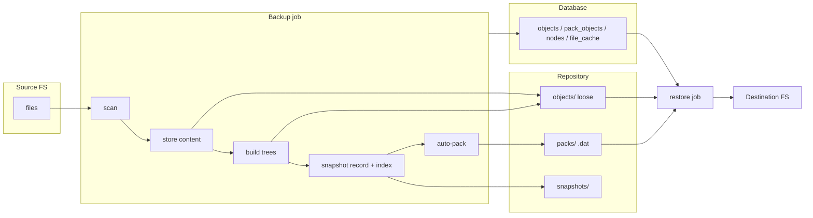
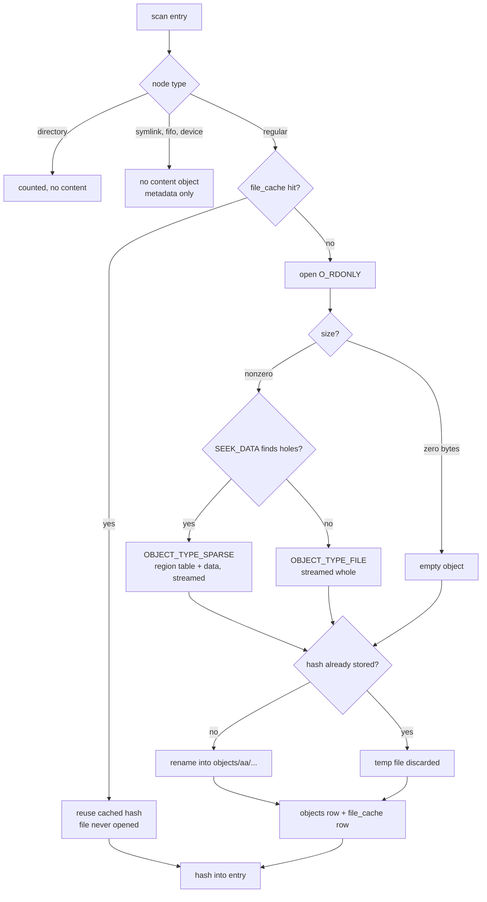
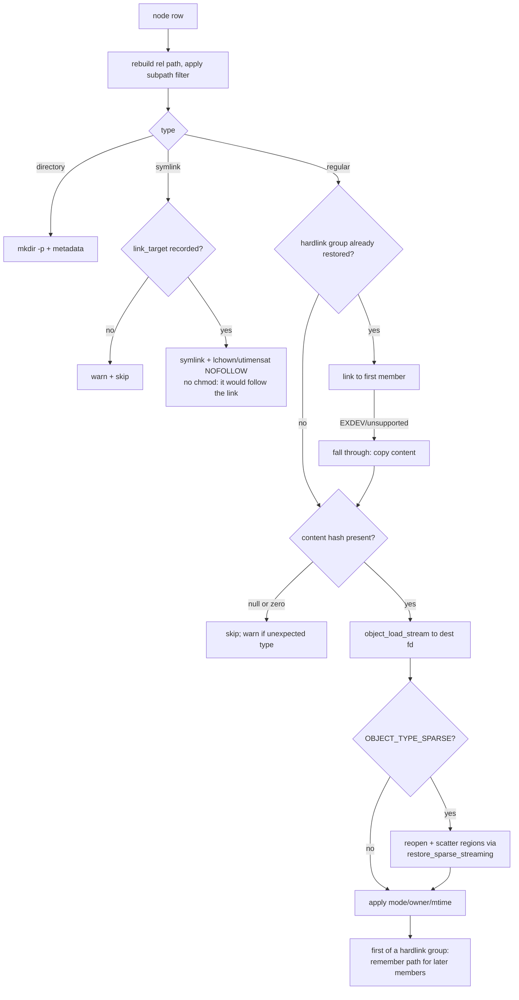

# Data paths

How bytes move through the daemon: from a source filesystem into the
repository, and from the repository back out. This is the companion to
`repo-format.md`, which describes what ends up on disk; this document
describes the machinery that puts it there and gets it back, including
every branch a file can take based on its type, size and content.

Code references are to the current source; the authoritative behaviour is
always the code. Sections marked **Gap** describe things the format supports
but the pipeline does not yet do, recorded here so they read as decisions
rather than surprises.

## The one-paragraph version

A backup scans the source into a flat entry list, stores file content as
loose content-addressed objects (skipping files the metadata cache can vouch
for), serialises one manifest tree object per directory bottom-up, writes a
snapshot record, and indexes everything into the database. Packing then runs
as the tail of the same job: loose objects are compressed into 256 MiB pack
files, incompressible ones are skip-marked and stay loose. A restore reads
node rows from the database, resolves each content hash through the store
(loose first, then packs via the DB resolver), and rebuilds the tree with
per-type handling for directories, symlinks, hardlinks, sparse files and
regular files.



Two invariants frame everything below:

- **The repository is the source of truth; the database is a derived
  index.** Every table the data path writes (`objects`, `pack_objects`,
  `nodes`, `snapshots`) can be rebuilt by `reindex` from the repository
  files alone. The one exception is `file_cache`, which is a pure
  performance cache and is simply cold after a rebuild.
- **Nothing buffers a whole file.** Every path that touches file content is
  streaming with bounded RAM, because files are allowed to exceed memory.

---

## Part 1: the storage path

### 1.1 Entry point and locking

`POST /repos/<id>/backup` builds a `backup_job_t` and hands it to the job
manager (`src/api/routes/backup_routes.c`). The job manager serialises
dispatch per repository: the job takes the repo write lock via
`repo_trylock_write`, and a second writer for the same repo is rejected
rather than queued, so a client that fires two backups learns immediately.

Everything from scan through auto-pack runs inside this one job, under this
one lock. The store is opened and bound to the database resolver
(`store_index_bind`) for the duration; the binding is what lets the engine
find packed objects at all (section 3.1).

### 1.2 Scan (`src/ops/scan.c`)

`backup_run` scans every source root into **one** flat `scan_result_t`.
Each entry carries the absolute path, the `lstat` result, a scan-assigned
`node_id`, and a `parent_node_id` pointer. Order of operations per root:

1. **Ancestor synthesis.** Paths are stored tar-style: absolute with the
   leading `/` stripped, so backing up `/home/alice` also emits directory
   entries for `home` and `home/alice`'s ancestors. A restore needs them to
   rebuild the tree. This is why a one-file change rewrites more trees than
   the single directory containing it.
2. **Directory walk.** `readdir` results are batched and sorted by inode
   number before the per-entry `lstat`, which turns random HDD seeks into
   near-sequential ones. Dotfiles are kept; `.` and `..` are not.
3. **Per-entry classification.** `lstat` maps to a node type: regular,
   directory, symlink, FIFO, character device, block device. Sockets and
   anything unrecognised become type 0 and carry no content.
4. **Hardlink detection.** A regular file with `st_nlink > 1` looks up its
   `inode_identity` (an FNV hash of `st_dev` and `st_ino`) in an inode map
   shared across all source roots of the run, so links spanning roots are
   detected once. The first member becomes the group primary.
5. **Symlink targets** are read with `readlinkat` through an
   `O_PATH|O_NOFOLLOW` fd to close the TOCTOU window between `lstat` and
   the read. The target string travels with the entry.
6. **Filters.** `exclude` prefixes are matched at path-component
   boundaries; `one_filesystem` compares each entry's `st_dev` against the
   root's and skips mount crossings.
7. **Failures are warnings.** A file that vanishes, a directory that cannot
   be opened, a path that overflows `PATH_MAX`: each is recorded as a
   warning and skipped. A live filesystem changes underneath the scan and
   that must not fail the backup.

xattrs and POSIX ACLs are also collected per entry at this stage
(`collect_xattrs`, `collect_acl`), with a 64 MiB cap per file. Both are
serialised deterministically, because their blobs become objects whose
hashes land in manifest trees: xattrs sorted by name with explicit
little-endian lengths (the wire formats are documented in
`src/common/types.h`), ACLs as `acl_to_text` records, access before
default. Three filters keep the collection honest:

- `system.posix_acl_*` xattrs are excluded; ACLs travel on their own
  channel and carrying them twice would apply them twice on restore.
- A trivial access ACL (one that `acl_equiv_mode` reduces to mode bits) is
  not collected at all: `acl_get_file` synthesises one for every file on
  the system, and storing them would give every node an ACL object whose
  restore is a slower chmod.
- Symlinks get no ACL, because `acl_get_file` follows the link and would
  record the target's ACL under the symlink's name. Directories are the
  only type that also collects `ACL_TYPE_DEFAULT`.

### 1.3 Phase 1: content (`store_content` in `src/ops/backup.c`)

The scan list is walked once. Per entry:



**The change-detection cache** (`src/ops/file_cache.c`) is what makes an
incremental cost a directory walk instead of a full read. A row keyed on
`(repo_id, path)` stores `dev`, `inode`, `size`, `mtime_ns`, `ctime_ns` and
the content hash. A hit requires every field to match **and** the object to
still exist in the `objects` table; the second check matters because GC can
reclaim an object whose only snapshot was pruned, and trusting the cache
alone would commit a snapshot referencing bytes that are gone. A hit does no
writes at all: a hit has to be free or the cache costs more than the reading
it avoids. Cache reads and writes are batched 2,000 entries per transaction;
one transaction per file would put an fsync between every entry, and holding
one transaction open for the whole scan blocks WAL checkpointing until
lookups slow to tens of milliseconds. Both extremes were measured; the batch
is the middle. After the snapshot commits, `file_cache_sweep` deletes rows
for paths the scan no longer saw, diffing against the sorted scanned-path
list rather than restamping every row.

**Loose object writing** (`src/store/object.c`). Every content write follows
the same durability pattern: `mkstemp` in `<repo>/tmp/`, write, patch the
header, `sync_file_range`-based writeback (falling back to `fdatasync`),
`rename` into `objects/<aa>/<rest-of-hex>`. The rename is atomic because
`tmp/` is inside the repository, on the same filesystem. A rename that loses
the race to a concurrent writer of the same hash is dedup, not an error.

On-disk, a loose object is:

```
object_header_t (56 bytes: magic, version, type, compression,
                 pack_skip_ver, uncompressed_size, compressed_size, hash)
payload         (always COMPRESS_NONE for loose objects)
parity trailer  (XOR record for the header, RS parity for the payload,
                 CRC32C, footer)
```

**Loose objects are never compressed.** Compression happens exactly once,
at pack time (section 2). This is deliberate: the backup's hot loop is
read-hash-write at disk speed, and the CPU-heavy work is deferred to the
pack workers that run after the snapshot is already committed. The
consequence is that a repository that never packs stores more than its
source, which is why packing is part of the backup job and not a separate
op someone has to remember.

The non-sparse streaming path reads 128 MiB chunks (1-4 MiB on FUSE),
feeding three consumers per chunk: the SHA-256 context, the temp file
write, and the parity accumulators (CRC32C plus a Reed-Solomon parity
stream that holds at most 256 MiB in RAM and spills to `<repo>/tmp/`
beyond that; `rs_parity_size` of the payload is written into the trailer).
The hash is only known at the end, so the header is patched by `pwrite` and
the existence check runs after hashing; a duplicate costs a full read of
the source file but never a second copy in the repo. Source pages are
dropped with `POSIX_FADV_DONTNEED` as they are consumed so a large backup
does not evict the page cache.

Read errors mid-stream get a recovery ladder (transient retry, `lseek` on
the same fd, reopen by path and seek), capped at 5 attempts; this exists
for FUSE-backed sources that drop connections under load. The optional
FUSE readahead ring (a 4-slot reader thread) is off by default,
`enable_fuse_readahead` opts in.

**Sparse files.** `SEEK_DATA`/`SEEK_HOLE` discovers data regions before any
reading. A file with holes is stored as `OBJECT_TYPE_SPARSE`: a small
header, a region table of `(offset, length)` pairs, then only the data
bytes, streamed region by region through the same hash/parity/temp-file
machinery. A 1 TiB virtual disk image with 40 GiB of data costs 40 GiB. A
filesystem that does not support `SEEK_DATA` (some FUSE) is detected by a
probe read and falls through to the non-sparse path, which is correct, just
larger. The content hash of a sparse object covers the serialised
region-table form, not the logical file bytes: the same logical content
stored sparse and non-sparse yields different objects.

**Empty files** become a zero-length `OBJECT_TYPE_FILE` object; all of them
across the repository dedup to the single well-known hash of the empty
input.

**Metadata blobs.** Before the type branches above, every entry's xattr
set and ACL text are stored as their own content-addressed objects
(`OBJECT_TYPE_XATTR`/`OBJECT_TYPE_ACL`); the hashes go into the node and
from there into its manifest entry, with a zero hash meaning "none". One
blob typically covers many files (a single SELinux label set can cover a
whole machine), so dedup collapses them to a handful of objects, and an
in-run memo of already-ensured hashes keeps repeats from costing a
resolver query each - a quarter-million of those per incremental would be
the tight-loop-on-the-shared-DB-handle pattern again.

Each newly stored object gets a row in `objects` (`location = 'loose'`,
`phys_size` = header + payload + parity trailer as actually written,
`orig_size` = logical size) via `store_index_put_loose`. Seeing the same
hash twice leaves the existing row alone.

### 1.4 Phase 2: manifest trees (`build_trees`)

Once every file has a hash, directories are serialised bottom-up: one
`OBJECT_TYPE_TREE` object per directory, containing that directory's
immediate children. A directory cannot be serialised until every child
directory has its hash, so ordering is deepest-first. Depths are computed in
a single memoised pass over the parent chains, directories are ordered by a
counting sort on depth, and an open-addressed `node_id -> index` map keeps
the whole pass linear in entries. (This pass was quadratic once; at 25,000
directories it did not finish. Anything added here has to stay linear.)

Each manifest entry carries: name, type, mode, uid, gid, size, mtime,
`inode_identity`, the target hash (child tree hash for directories, content
hash for files, zero otherwise), the symlink target string, and the
reserved xattr/ACL hashes. The wire format is fixed-width little-endian,
entries sorted in `memcmp` byte order, and contains **no snapshot-scoped
values**: no node id, no parent pointer, no backup timestamp. That is the
determinism contract from `repo-format.md`: an unchanged directory must
serialise to byte-identical output so `object_store_ex` sees an existing
hash and writes nothing. `trees_new` vs `trees_reused` in the backup result
is the health metric; the measured baseline is about 3% new trees per
incremental, and a number near 100% means determinism broke silently.

A synthetic root tree ties all source roots of the run together; its hash
is the snapshot's identity.

Tree objects go through the same loose-object write path as file content,
so they are parity-protected, deduplicated, and later packed (and thereby
compressed) by the same code.

### 1.5 Phase 3: snapshot record and index (`write_snapshot_record`, `index_nodes`)

The snapshot record `snapshots/<id>` is a one-line JSON file (id,
timestamp, root tree hash, label) written mkstemp-fsync-rename. This file
is what makes the repository self-describing: reindex starts from these.

Then the whole scan list is indexed into `nodes` in one transaction: one
row per entry with parent pointer, name, type, mode, ownership, mtime,
size, `content_hash`, `subtree_hash` (directories), `link_target`
(symlinks) and `hardlink_group_id`, plus an FTS row per name. Two
c-utils-specific rules apply here and everywhere else in the daemon:

- The params array is NULL-terminated, so a conditional NULL *value* would
  silently truncate the bind list. Absent values travel as `""` and
  `NULLIF(?,'')` turns them back into real SQL NULLs, because reader
  queries ask `content_hash IS NOT NULL` to mean "has content".
- `hardlink_group_id` is the 64-bit `inode_identity` written as a *signed*
  decimal. Unsigned, half of all values exceed `INT64_MAX`, SQLite falls
  back to REAL, precision collapses distinct inodes onto one value, and
  restore hardlinks unrelated files together. The bit pattern round-trips
  exactly through int64.

Node ids are an index artifact: nothing in the repository refers to them,
which is what lets reindex rebuild the database without preserving them.

Snapshot ids are per-repo monotonic (`MAX(id)+1`). The `snapshots` row is
written last; a crash between the record file and the row leaves a
snapshot that the next reindex picks up from disk.

### 1.6 Auto-pack: the tail of the backup

If `maintenance.auto_pack` is set (default on), the same job, still holding
the repo write lock, runs `repo_pack`. A pack failure is logged but does
not fail the backup: the snapshot is committed and every object is readable
loose; packing is retried by the next backup or an explicit pack job.

---

## Part 2: the packing path (`repo_pack` in `src/store/pack.c`)

Packing converts many loose files into few pack files, and it is the only
place compression happens. The classification matrix it implements:

| | compressible | incompressible |
|---|---|---|
| **small (<= 16 MiB)** | packed, LZ4 block per entry (objects under 4 KiB skip compression: not worth the header) | packed uncompressed (inode reduction still pays) |
| **large (> 16 MiB)** | packed, LZ4 frame streamed | **skip-marked, stays loose forever** |

"Large" is `PACK_STREAM_THRESHOLD` (16 MiB); pack bodies seal at
`PACK_MAX_MULTI_BYTES` (256 MiB). "Incompressible" is decided by a 64 KiB
LZ4 probe: for large objects a compressed/original ratio >= 0.90, for the
in-memory small path a sample ratio > 0.98 skips the full compress attempt.
This is design constraint 4: video, audio and databases must cost a 64 KiB
probe, not a full compression pass, and must cost it **once**. The verdict
is durable: `pack_skip_ver` in the loose object's header is set to the
prober version (with the header's parity record recomputed), and every
future pack run skips the object at the partition pass without re-reading
its data. Bumping `PROBER_VERSION` is how a smarter prober re-evaluates
old verdicts.

The run itself:

1. **Collect**: walk `objects/XX/` for every loose hash.
2. **Partition**: read each 56-byte header; skip-marked objects drop out
   here. Everything else (file, sparse, tree objects alike) is packable.
3. **Probe**: large `COMPRESS_NONE` candidates get the 64 KiB probe;
   failures are skip-marked and drop out.
4. **Fan out**: up to 32 worker threads, capped at one per 256 MiB of
   candidate bytes so a small run does not produce confetti packs. Workers
   pull from a shared atomic cursor over the hash-sorted candidate list.
   **Each worker owns its own pack file**; there is no cross-thread pack
   state. A worker seals and starts a new pack when the next object would
   push the body past 256 MiB.
5. **Per object**: small objects are read whole (<= 16 MiB by definition),
   probed, LZ4-block-compressed if that makes them smaller, and written as
   `entry header + payload`. Large objects are streamed through the LZ4
   frame API in 256 KiB chunks with the entry header's `compressed_size`
   patched afterwards; large objects that are already compressed are
   raw-copied. Every entry gets its own parity set (XOR header record,
   CRC32C, RS parity - streamed with the same 256 MiB spill bound), so a
   packed object is exactly as repairable as it was loose.
6. **Finalize** (`finalize_pack`): patch the entry count into the pack
   header, append the pack parity trailer, fsync, refuse to overwrite an
   existing pack number, and `rename` the single `.dat` into `packs/`.
   There is no `.idx` sidecar any more; a pack file is one atomic rename.
7. **Commit**: only after the file is durably in place, the store emits
   `store_emit_pack_commit` with every entry's hash, offset, sizes and
   `entry_index`. The daemon-side handler (`src/ops/store_index.c`) writes
   the `packs` row, all `pack_objects` rows, and flips each `objects` row
   to `location = <pack_id>` with its packed `phys_size` - one transaction
   per pack, serialised across workers by a mutex because SQLite has no
   nested transactions on the shared handle. `entry_index` is the
   *on-disk* entry position (the array was hash-sorted first); it is what
   lets a reader find the entry's parity block in the trailer.
8. **Unlink**: the loose files that are now in a committed pack are batch
   unlinked, grouped by fan-out directory.

Crash ordering is: pack file installed, then DB rows, then loose unlink. A
crash between any two steps leaves both copies readable (loose wins the
lookup) and the next pack run converges.

---

## Part 3: reading objects back

### 3.1 Location resolution

The engine never queries the database. It asks the store where a hash
lives, and the store answers through the resolver callback the daemon
registered at bind time:

- **Loose**: an in-memory open-addressed set of loose hashes (built lazily
  from one `objects/` walk, maintained on insert/GC), backed by a direct
  `faccessat` when the set is not built.
- **Packed**: `store_locate` -> `db_locate` -> one indexed query joining
  `pack_objects` to `packs`, returning pack id, byte offset, sizes,
  `entry_index` and pack version.

With no resolver registered (unit tests, benchmarks), nothing is packed as
far as the engine is concerned and only loose objects resolve. Open pack
`.dat` handles are cached per store, so a restore does not fopen per
object.

### 3.2 Load paths

Every load verifies before it trusts:

- `object_load`: whole object into memory, capped at 16 MiB
  (`STREAM_LOAD_MAX`) for uncompressed payloads; larger objects are
  refused with `ERR_TOO_LARGE` and must stream. Verifies the parity
  trailer if present (XOR-repairs a damaged header, CRC-checks the
  payload, RS-repairs on mismatch), decompresses (`COMPRESS_NONE` or LZ4
  block for pack entries; loose is always `COMPRESS_NONE`), and re-hashes
  the result against the requested hash. LZ4-frame entries must stream.
- `object_load_stream`: streams to a caller fd in 16 MiB chunks, hashing
  as it goes; this is the restore path's workhorse and the only correct
  path for arbitrary-size objects.
- `object_load_prefix`: bounded prefix for previews and probes, LZ4
  partial decode for packed entries, no hash verification (a prefix
  cannot be hash-checked).

In-place repair (`object_repair`, `pack_object_repair`) rewrites corrected
bytes via `pwrite` and is invoked by the integrity endpoints, not by normal
reads; normal reads repair the in-memory copy only.

---

## Part 4: the restore path (`src/ops/restore.c`)

`POST /repos/<id>/restore` (dest, snapshot, optional `subpath`, optional
`overwrite`) becomes a job that takes the repo write lock and runs
`restore_run`.

The node list comes from the database, not from walking trees: one query
for the snapshot's rows, ordered directories-first so every parent exists
before its children need it. A snapshot whose node rows were evicted
returns "reindex it first" rather than a silent empty restore. Each node's
relative path is rebuilt by walking parent links; the `subpath` filter then
matches at path-component boundaries (so `src/doc` does not pull in
`src/documents`), accepting the path with or without a leading slash.

Per node, in order:



Type-specific behaviour, spelled out:

- **Directories**: `mkdir` (EEXIST tolerated), then mode, ownership and
  mtime, then xattrs and ACLs - both the access ACL and, uniquely to
  directories, the default ACL. `chown` failing with `EPERM` is expected
  for non-root restores and downgraded to best-effort; the restore keeps
  going.
- **Symlinks**: recreated from `link_target` with the link's *own*
  ownership and timestamps applied via `lchown`/`utimensat(NOFOLLOW)`.
  Mode is deliberately not applied: the kernel ignores a symlink's
  permissions and `chmod` would follow the link. xattrs are reapplied with
  `lsetxattr` (the attributes belong to the link, not its target); ACLs
  are not, because symlinks have none. A symlink with no recorded target
  (a pre-fix backup that was never reindexed) is skipped with a warning
  rather than materialised as an empty file.
- **Hardlinks**: the first restored member of each `hardlink_group_id` is
  remembered in an open-addressed map; every later member is `link()`ed
  to it, preserving the shared inode. If the link fails (cross-device
  destination, filesystem without hardlinks) the member falls through to
  a full content copy, correct but larger.
- **Regular files**: content streams straight from the store to the
  destination fd, then metadata, then xattrs, then ACLs - the ACL last
  because its base entries carry the definitive permissions and must win
  over chmod. Later hardlink members share the first member's inode, so
  the attributes applied there are already theirs. All of it is best
  effort with warnings: an unprivileged restore cannot set `security.*`
  or `trusted.*` attributes, and that must not fail a file whose content
  just restored correctly. If the object turns out to be `OBJECT_TYPE_SPARSE`, the
  linear bytes just written are a region-table serialisation, not file
  content, so the file is reopened and `restore_sparse_streaming` scatters
  each region to its recorded offset through a pipe from
  `object_load_stream` - holes are never materialised and RAM stays
  bounded no matter the logical size.
- **Overwrite**: with `overwrite` off, an existing destination file is
  skipped; with it on, symlink/hardlink sites `unlink` first and regular
  files are `O_TRUNC`ed.
- **FIFOs and device nodes**: **Gap.** They are scanned and indexed (type,
  mode, ownership), but restore currently skips them with a warning, and
  device major/minor numbers are not part of the manifest wire format at
  all, so they do not survive reindex. If device-node fidelity is ever
  needed, the manifest format needs a field before restore can grow the
  `mknod` branch.

Per-file failures (unreadable object, unwritable destination) are counted
as skips and logged; the restore completes and reports
files/dirs/symlinks/hardlinks/skipped so partial success is visible rather
than binary.

---

## Part 5: maintenance paths that move data

These are not backup or restore but they rewrite the same bytes, and each
one respects the same boundary: only `pack.c` unlinks a pack, and every
pack deletion site emits `store_emit_pack_removed` so `pack_objects` rows
never outlive their pack.

- **GC** (`src/ops/gc.c`): mark-and-sweep in one DB transaction. Marks are
  refcounts: every snapshot's tree is walked from `snapshots.root_tree_hash`
  and every reachable object incremented, so an object shared by ten
  snapshots counts ten. An unreadable tree aborts the mark, because
  sweeping on an incomplete mark deletes live data - the one failure GC
  must never have. Sweep unlinks dead *loose* objects and deletes dead
  rows; dead *packed* objects lose their `pack_objects` rows immediately
  (they must stop being locatable) but their bytes wait for pack
  compaction.
- **Pack compaction and coalescing** (`pack_gc`,
  `maybe_coalesce_packs`): the second half of the sweep, run by `gc_run`
  itself after the DB transaction commits (dry runs stop before it).
  The reference list is every surviving `objects` row - the sweep just
  deleted everything unreachable, so surviving is the definition of
  referenced. `pack_gc` rewrites only packs that contain dead entries,
  then merges small packs (under a quarter of the seal size) when there
  are enough of them, under a rewrite budget, and only when the merge
  provably removes at least two pack files - merging n candidates of B
  bytes yields ceil(B/256 MiB) packs, so the reduction is known before a
  byte is copied. Every rewrite emits its removal and commit callbacks,
  so the derived index never drifts.
- **Prune / GFS** (`src/ops/prune.c`, `gfs.c`): retention deletes snapshot
  records and node rows; the objects they referenced become GC's problem,
  which is the correct division - prune decides *what* is dead, GC decides
  *when* bytes go.
- **Reindex** (`src/ops/reindex.c`): the recovery direction. Walks
  `snapshots/`, reads every manifest tree from the store, and rebuilds
  `nodes` (including `link_target` and `hardlink_group_id`, which is why
  pre-fix backups regain their links by reindexing), the object registry,
  and the pack index by enumerating the pack files themselves. Anything
  the database held that reindex cannot rebuild did not belong in the
  database.

---

## Part 6: sizes, thresholds and where they live

| Constant | Value | Meaning |
|---|---|---|
| `PROBE_SIZE` / `PACK_PROBE_SIZE` | 64 KiB | incompressibility probe sample |
| `PACK_RATIO_THRESHOLD` | 0.90 | probe ratio at/above which a large object is skip-marked |
| `PACK_STREAM_THRESHOLD` | 16 MiB | small/large split for pack entries; also the whole-object load cap |
| `PACK_MAX_MULTI_BYTES` | 256 MiB | pack body seal size |
| `STREAM_CHUNK` | 128 MiB | backup read chunk (non-FUSE) |
| `STREAM_LOAD_MAX` | 16 MiB | in-memory load cap / stream chunk on load |
| RS parity stream bound | 256 MiB | parity RAM ceiling before spilling to `<repo>/tmp/` |
| `PACK_WORKER_THREADS_MAX` | 32 | pack worker ceiling (also capped at one per 256 MiB of input) |
| `CACHE_BATCH` | 2,000 | file-cache entries per transaction |
| `PACK_COALESCE_SMALL_BYTES` | 64 MiB | a pack below this is a coalesce candidate |

Memory ceiling worth knowing: each pack worker holds a 16 MiB read buffer
plus an LZ4 bound-sized compress buffer, so a full 32-worker pack run can
reach roughly a gigabyte of buffer space. Deliberate; this targets modern
systems, and the per-object streaming paths stay bounded regardless.
