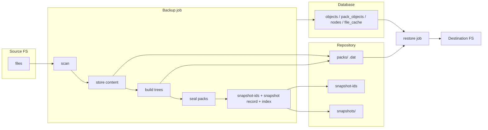
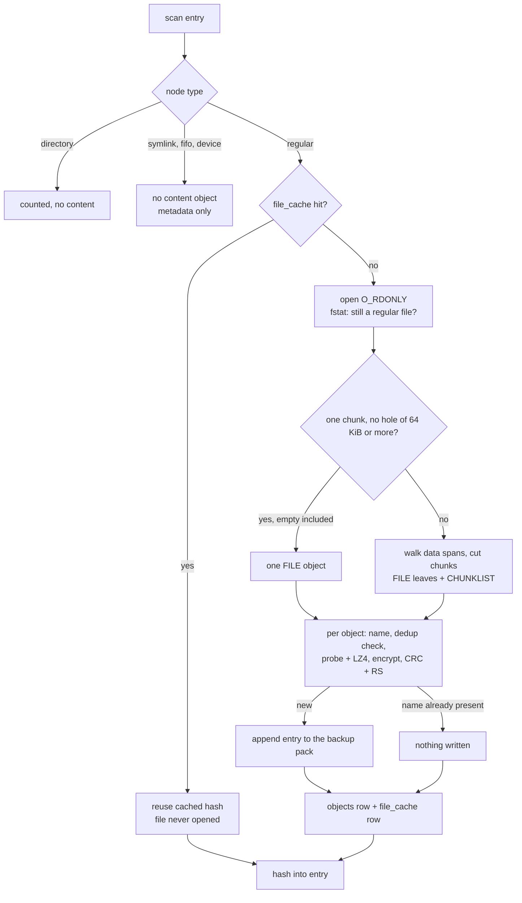
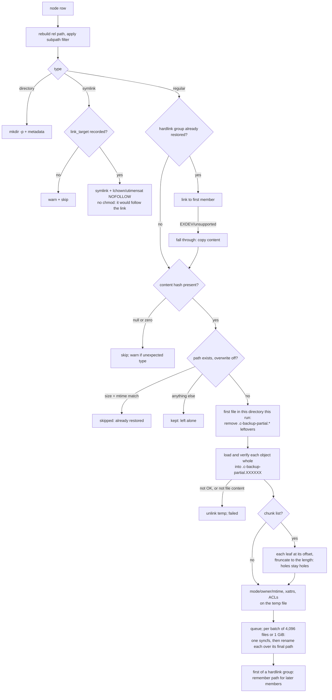

# Data paths

How bytes move through the daemon: from a source filesystem into the
repository, and from the repository back out. This is the companion to
`repo-format.md`, which describes what ends up on disk; this document
describes the machinery that puts it there and gets it back, including
every branch a file can take based on its type, size and content.

Code references are to the current source; the authoritative behaviour is
always the code. Sections marked **Gap** describe things the format supports
but the pipeline does not yet do, recorded here so they read as decisions
rather than surprises.

## The one-paragraph version

A backup scans the source into a flat entry list, stores file content as
content-addressed objects (skipping files the metadata cache can vouch for),
serialises one manifest tree object per directory bottom-up, seals its packs,
writes a snapshot record, and indexes everything into the database. Every
object is written exactly once, straight into a pack: repository format 3 has
no loose objects and no pack pass. That works because every object is at most
16 MiB, so each one is named, probed, compressed, encrypted and given its
parity whole, in memory, before its entry is appended. A file larger than one
object is cut at content-defined boundaries into chunks named by a chunk list,
and its holes are gaps in that list. A restore reads node rows from the
database, resolves each object through the daemon's index of the packs, and
rebuilds the tree with per-type handling for directories, symlinks, hardlinks
and regular files, leaving holes as holes.

Two invariants frame everything below:

- **The repository is the source of truth; the database is a derived
  index.** Every table the data path writes (`objects`, `pack_objects`,
  `nodes`, `snapshots`) can be rebuilt by `reindex` from the repository
  files alone, the snapshot-id mark included (`snapshot-ids`). The one
  exception is `file_cache`, which is a pure performance cache and is
  simply cold after a rebuild.
- **Nothing buffers a whole file; everything buffers a whole object.**
  Files are allowed to exceed memory, objects are not: the 16 MiB object
  bound (`OBJECT_MAX_BYTES`) is what lets every stage work on whole objects,
  and content-defined chunking is what keeps a file of any size inside it.
  Memory per file is bounded by the chunker's window and its chunks in
  flight, never by the file's size.

---

## Part 1: the storage path

### 1.1 Entry point and locking

`POST /repos/<id>/backup` builds a `backup_job_t` and hands it to the job
manager (`src/api/routes/backup_routes.c`). The job manager serialises
dispatch per repository: the job takes the repo write lock via
`repo_trylock_write`, and a second writer for the same repo is rejected
rather than queued, so a client that fires two backups learns immediately.

Everything from scan through the snapshot's index rows runs inside this one
job, under this one lock. The store is opened and bound to the database resolver
(`store_index_bind`) for the duration; the binding is what lets the engine
find packed objects at all (section 3.1).

### 1.2 Scan (`src/ops/scan.c`)

`backup_run` scans every source root into **one** flat `scan_result_t`.
Each entry carries the absolute path, the `lstat` result, a scan-assigned
`node_id`, and a `parent_node_id` pointer. Order of operations per root:

1. **Ancestor synthesis.** Paths are stored tar-style: absolute with the
   leading `/` stripped, so backing up `/home/alice` also emits directory
   entries for `home` and `home/alice`'s ancestors. A restore needs them to
   rebuild the tree. This is why a one-file change rewrites more trees than
   the single directory containing it.
2. **Directory walk.** `readdir` results are batched and sorted by inode
   number before the per-entry `lstat`, which turns random HDD seeks into
   near-sequential ones. Dotfiles are kept; `.` and `..` are not.
3. **Per-entry classification.** `lstat` maps to a node type: regular,
   directory, symlink, FIFO, character device, block device. Sockets and
   anything unrecognised become type 0 and carry no content. Device nodes
   additionally record their major/minor pair, which is the entire content
   of a device file.
4. **Hardlink detection.** A regular file with `st_nlink > 1` looks up its
   `inode_identity` (an FNV hash of `st_dev` and `st_ino`) in an inode map
   shared across all source roots of the run, so links spanning roots are
   detected once. The first member becomes the group primary.
5. **Symlink targets** are read with `readlinkat` through an
   `O_PATH|O_NOFOLLOW` fd to close the TOCTOU window between `lstat` and
   the read. The target string travels with the entry.
6. **Filters.** `exclude` patterns are matched by shape: an absolute
   literal is a prefix match on component boundaries, an absolute pattern
   with wildcards matches the whole path, a pattern containing a slash
   matches any component-aligned tail, and a bare name matches the basename
   at any depth (`**` lets wildcards cross `/`). Directories are tested
   before the walk descends, so an excluded directory prunes its subtree.
   `one_filesystem` compares each entry's `st_dev` against the root's and
   skips mount crossings.
7. **Failures are warnings.** A file that vanishes, a directory that cannot
   be opened, a path that overflows `PATH_MAX`: each is recorded as a
   warning and skipped. A live filesystem changes underneath the scan and
   that must not fail the backup.

xattrs and POSIX ACLs are also collected per entry at this stage
(`collect_xattrs`, `collect_acl`). Each set becomes one object, so it is
bounded by the 16 MiB object bound; the format's rule is that a larger set
is refused and the file backed up without it, with a warning. Both are
serialised deterministically, because their blobs become objects whose
hashes land in manifest trees: xattrs sorted by name with explicit
little-endian lengths (the wire formats are documented in
`src/common/types.h`), ACLs as `acl_to_text` records, access before
default. Three filters keep the collection honest:

- `system.posix_acl_*` xattrs are excluded; ACLs travel on their own
  channel and carrying them twice would apply them twice on restore.
- A trivial access ACL (one that `acl_equiv_mode` reduces to mode bits) is
  not collected at all: `acl_get_file` synthesises one for every file on
  the system, and storing them would give every node an ACL object whose
  restore is a slower chmod.
- Symlinks get no ACL, because `acl_get_file` follows the link and would
  record the target's ACL under the symlink's name. Directories are the
  only type that also collects `ACL_TYPE_DEFAULT`.

### 1.3 Phase 1: content (`store_content` in `src/ops/backup.c`)

The scan list is walked once. Per entry:

**The change-detection cache** (`src/ops/file_cache.c`) is what makes an
incremental cost a directory walk instead of a full read. A row keyed on
`(repo_id, path)` stores `dev`, `inode`, `size`, `mtime_ns`, `ctime_ns` and
the content hash. A hit requires every field to match **and** the object to
still exist in the `objects` table; the second check matters because GC can
reclaim an object whose only snapshot was pruned, and trusting the cache
alone would commit a snapshot referencing bytes that are gone. A hit does no
writes at all: a hit has to be free or the cache costs more than the reading
it avoids. Cache reads and writes are batched 2,000 entries per transaction;
one transaction per file would put an fsync between every entry, and holding
one transaction open for the whole scan blocks WAL checkpointing until
lookups slow to tens of milliseconds. Both extremes were measured; the batch
is the middle. After the snapshot commits, `file_cache_sweep` deletes rows
for paths the scan no longer saw, diffing against the sorted scanned-path
list rather than restamping every row.

**Writing an object** (`pack_backup_*` in `src/store/pack.c`). Every
object a backup produces - a whole small file, a chunk, a chunk list, a tree,
an xattr or ACL blob - goes through one writer, the backup's pack, and is
handled whole:

1. **Name.** `object_name`: SHA-256 of the type byte followed by the
   payload. The type is part of the name so that a file whose bytes happen
   to be a valid tree serialisation can never be mistaken for that tree
   (OWN-38).
2. **Dedup.** The name is checked against the repository (through the
   resolver) and against the pack the writer has open. A present object
   costs the read and the hash, never a second copy.
3. **Compress.** Payloads under 4 KiB are stored as they are. Otherwise a
   64 KiB LZ4 probe decides; a payload whose probe does not compress is
   stored as it is, having cost LZ4 on 64 KiB rather than on the object, and
   a full compression is kept only when it is smaller than the input. Since
   every large file is chunked, the bail-out is per chunk: a compressible
   header in front of media costs LZ4 on the header's chunks only.
4. **Encrypt**, when the repository is keyed: one-shot ChaCha20-Poly1305
   under a key derived from the repository key by HKDF, a fresh random
   nonce, and the type and name as associated data, so a ciphertext moved
   under another name fails authentication where it is read.
5. **Protect.** CRC-32C and Reed-Solomon parity over the stored bytes,
   computed in memory, then the 51-byte entry header and the payload are
   appended to the pack's staging file in `<repo>/tmp/`; the parity goes into
   the trailer when the pack is sealed.

There is no per-object file, no rename per object, and no second pass. The
one-file-per-object path this replaced spent 41% of a full backup in
`rename()` and wrote every byte twice (`docs/direct-to-pack.md` is the
record).

**Files larger than one chunk.** A regular file is walked with
`SEEK_DATA`/`SEEK_HOLE` one data span at a time; holes shorter than 64 KiB
(`CDC_HOLE_MIN`) are read as zeroes, longer ones are left out. Each data span
is cut by the content-defined chunker into chunks of 512 KiB to 8 MiB
(repository constants recorded in `.cbackup`), each chunk is an ordinary
`FILE` object written as above, and the file's content hash names a
`CHUNKLIST` object listing them by offset; bytes no entry covers are holes.
A one-byte insert, an append or a local edit stores one or two new chunks
and the lists above them rather than the whole file again. The chunker's
gear table is keyed per repository when it is encrypted, so cut points do
not reveal known content. The format is in `repo-format.md` ("Format 3:
content-defined chunking").

A file that is no longer a regular file when it is opened (replaced since the
scan) is skipped with a warning, as is one that vanished: a directory opens
read-only without complaint, and treating it as file content once stored the
scan's size in zeroes. There is no read-retry ladder in format 3; a read
error fails that file with a warning and the backup carries on.

**Empty files** become a zero-length `OBJECT_TYPE_FILE` object; all of them
across the repository dedup to the one name of an empty `FILE` payload.

**Metadata blobs.** Before the type branches above, every entry's xattr
set and ACL text are stored as their own content-addressed objects
(`OBJECT_TYPE_XATTR`/`OBJECT_TYPE_ACL`); the hashes go into the node and
from there into its manifest entry, with a zero hash meaning "none". One
blob typically covers many files (a single SELinux label set can cover a
whole machine), so dedup collapses them to a handful of objects, and an
in-run memo of already-ensured hashes keeps repeats from costing a
resolver query each - a quarter-million of those per incremental would be
the tight-loop-on-the-shared-DB-handle pattern again.

Each newly stored object gets a row in `objects` with `location = 'staged'`
while its pack is still open (`store_index_put_staged`), `phys_size` the
stored bytes and `orig_size` the payload size. The pack-commit callback
turns `staged` into the pack's id when the pack is installed. An object the
repository already holds in a pack is recorded with that pack's location
(`store_index_put_packed`). Seeing the same name twice leaves the existing
row alone.

### 1.4 Phase 2: manifest trees (`build_trees`)

Once every file has a hash, directories are serialised bottom-up: one
`OBJECT_TYPE_TREE` object per directory, containing that directory's
immediate children. A directory cannot be serialised until every child
directory has its hash, so ordering is deepest-first. Depths are computed in
a single memoised pass over the parent chains, directories are ordered by a
counting sort on depth, and an open-addressed `node_id -> index` map keeps
the whole pass linear in entries. (This pass was quadratic once; at 25,000
directories it did not finish. Anything added here has to stay linear.)

Each manifest entry carries: name, type, mode, uid, gid, size, mtime (seconds
are signed, stored as the two's complement pattern in a u64 slot, so a file
from before 1970 round-trips and a later one encodes exactly as it always did),
`inode_identity`, the device major/minor pair (devices only), the target
hash (child tree hash for directories, content hash for files, zero
otherwise), the symlink target string, and the xattr/ACL blob hashes. The wire format is versioned (2, the only version a reader
accepts), fixed-width
little-endian, entries sorted in `memcmp` byte order, and contains **no
snapshot-scoped values**: no node id, no parent pointer, no backup timestamp. That is the
determinism contract from `repo-format.md`: an unchanged directory must
serialise to byte-identical output so `object_store_ex` sees an existing
hash and writes nothing. `trees_new` vs `trees_reused` in the backup result
is the health metric; the measured baseline is about 3% new trees per
incremental, and a number near 100% means determinism broke silently. The
one legitimate exception is the first backup after a tree-format version
bump, which re-serialises every directory exactly once. That is cheaper
than it sounds: measured on a 39,240-file tree, the 314 tree objects cost
2.0 MiB physical against a 182 MiB repository, roughly 1%.

A synthetic root tree ties all source roots of the run together; its hash
is the snapshot's identity.

Tree objects go through the same pack writer as file content, so they are
compressed, parity-protected and deduplicated by the same code. A directory
whose serialisation would exceed 256 KiB is cut by name into fragments of at
most 1 MiB under a `CHUNKLIST` with `TREE` leaves (OWN-34), so a directory of
any size is bounded objects and adding a file to a huge directory stores the
one fragment it lands in plus the list.

### 1.5 Phase 3: seal, snapshot record and index (`write_snapshot_record`, `index_nodes`)

Every pack the backup wrote is sealed, installed and announced through the
commit callback before anything names its objects, so a snapshot record
never refers to an object no pack holds.

The snapshot record `snapshots/<id>` is a one-line JSON file (id,
timestamp, root tree name, label) written mkstemp-fsync-rename. This file
is what makes the repository self-describing: reindex starts from these.

Then the whole scan list is indexed into `nodes` in one transaction: one
row per entry with parent pointer, name, type, mode, ownership, mtime,
size, `content_hash`, `subtree_hash` (directories), `link_target`
(symlinks) and `hardlink_group_id`, plus an FTS row per name. Two
c-utils-specific rules apply here and everywhere else in the daemon:

- The params array is NULL-terminated, so a conditional NULL *value* would
  silently truncate the bind list. Absent values travel as `""` and
  `NULLIF(?,'')` turns them back into real SQL NULLs, because reader
  queries ask `content_hash IS NOT NULL` to mean "has content".
- `hardlink_group_id` is the 64-bit `inode_identity` written as a *signed*
  decimal. Unsigned, half of all values exceed `INT64_MAX`, SQLite falls
  back to REAL, precision collapses distinct inodes onto one value, and
  restore hardlinks unrelated files together. The bit pattern round-trips
  exactly through int64.

Node ids are an index artifact: nothing in the repository refers to them,
which is what lets reindex rebuild the database without preserving them.

Snapshot ids are per repository and never reissued. A backup numbers its
snapshot one past the highest of the index's mark, the index's highest id
and the repository's `snapshot-ids` file, raises `snapshot-ids` to it
durably, and only then writes `snapshots/<id>`; the record is never on disk
before the mark that covers it. The mark lives in the repository so that a
lost database cannot bring back an id pruned from the top, which would move
every tag, note and client naming it onto a different tree (DEC-1 in
`repo-format.md`). The `snapshots` row is written last; a crash between the
record file and the row leaves a snapshot that the next reindex picks up
from disk.

---

## Part 2: packs (`src/store/pack.c`)

A pack is the only container. It holds a 12-byte header, entries of a
51-byte header plus stored payload, and a parity trailer with one block per
entry (`repo-format.md` has the layout). Three writers produce packs, and
nothing else does:

- **The backup writer** (`pack_backup_*`), described in 1.3. A backup holds
  one open pack at a time and rolls over to a new one at the 256 MiB seal
  (`PACK_MAX_MULTI_BYTES`) or at `PACK_MAX_ENTRIES`, checking before each
  entry that the largest possible entry still fits, so no pack can exceed
  `PACK_MAX_BYTES`. Writes outside a backup (`object_store`) go through a
  writer of the same kind owned by the store handle, which seals when it
  fills, when the store closes, when `object_store_flush` is called, or when
  something reads an object it is still holding.
- **The stored writer** (`pack_stored_*`): entries already in stored form
  (compressed and encrypted as the source holds them), copied verbatim with
  fresh parity. Replication's. It refuses any entry a reader would refuse.
- **The rewriter** (`pack_rw_t`) in gc and coalescing, Part 5.

Sealing (`finalize_pack`) patches the entry count into the header, appends
the trailer, fsyncs, refuses to overwrite an existing pack number, and
renames the single `.dat` into `packs/XXXXXX/pack-NNNNNNNNNN.dat`: the pack
number shifted right by 8 as six hex digits names the directory, and the
number itself as ten decimal digits names the file, so every 32-bit pack
number has a name the directory scan parses back. There is no `.idx`
sidecar; a pack is one atomic rename. Only after the file is durably in
place does the store emit `store_emit_pack_commit` with every entry's name,
offset, sizes and `entry_index`. The daemon-side handler
(`src/ops/store_index.c`) writes the `packs` row, all `pack_objects` rows,
and moves each `objects` row from `staged` to the pack's id - one
transaction per pack, serialised by a mutex because SQLite has no nested
transactions on the shared handle. `entry_index` is the *on-disk* entry
position (the array was sorted by name first); it is what lets a reader
find the entry's parity block in the trailer.

**A pack is sealed only where no transaction is open.** Sealing emits the
commit callback, which begins one, and the write lock is not recursive. In
`store_content` that is the batch boundary and nowhere else.

Crash ordering is: staging file in `tmp/`, install by rename, then rows,
then the snapshot record. A crash before the rename leaves a staging file
the next start sweeps, along with any `staged` rows; a crash after it
leaves an installed pack the index may not know, which a reindex picks up.
Either way no snapshot names an object the repository does not hold,
because the record is written after every seal.

Measured on 60,000 files when backups first wrote straight into packs:
31.07s before, 6.33s after, with the per-object `rename` that was 41% of
the run gone entirely. See PERF.md.

---

## Part 3: reading objects back

### 3.1 Location resolution

The engine never queries the database. It asks the store where a hash
lives, and the store answers through the resolver callback the daemon
registered at bind time:

- **Installed**: `store_locate` -> `db_locate` -> one indexed query joining
  `pack_objects` to `packs`, returning pack id, byte offset, sizes,
  `entry_index` and pack version.
- **Staged**: an object still in the store's own pack writer is found
  there; reading it seals that pack first, so every read is of an installed
  pack.

With no resolver registered (unit tests, tools, benchmarks), the store
answers from a built-in index it builds by scanning every pack on the first
lookup (`store_scan_packs`) and keeps current from its own commits and
removals. The daemon always registers a resolver and never builds one. Open
pack `.dat` handles are cached per store, so a restore does not fopen per
object.

### 3.2 Load paths

Every load verifies before it trusts, and every load is whole: an object
is at most 16 MiB, so nothing is streamed and no byte is released before it
has been checked.

- `object_load`: reads the entry, CRC-checks the stored payload and, on a
  mismatch, corrects it from the entry's Reed-Solomon parity (the 51-byte
  header has its own XOR parity record); decrypts and authenticates;
  decompresses (`COMPRESS_NONE` or the LZ4 block codec); and recomputes the
  name, type included, against the requested one. Restore, grep, preview,
  verify, gc's tree walk and reindex all read through it.
- Every reader refuses an entry of a type it does not know with "object
  type N is not known to this build; written by a newer c-backup?"
  (OWN-39), after parity has had its chance: a damaged type byte is
  repairable, an unknown one is not. An entry claiming more than the object
  bound, or a stored size inconsistent with its codec, is corrupt and
  refused before anything is allocated.
- `object_read_stored`: the object as stored, which is what replication
  moves. No decrypt or decompress, but the stored bytes are corrected from
  parity first, so damage parity covers is never shipped to a replica that
  would compute fresh parity over it. Damage beyond parity is returned as it
  is with `out_damaged` set, so one lost object does not block replication;
  `replicate_run` counts and lists those objects and fails the job at the
  end (OWN-31). The name is not checked here, and without the key cannot
  be.

Parity is fetched only when the CRC disagrees, one window of groups at a
time; the default window (1,097 groups) covers the largest possible entry,
so a correction is one parity read. The pack bounds in `repo-format.md`
make every trailer size fit its 32-bit field, so the format 2 refusal to
correct from packs whose trailer sizes might have wrapped (OWN-30) is gone.

In-place repair (`pack_object_repair`) rewrites corrected bytes via `pwrite`
and is invoked by verify's repair mode, not by normal reads; normal reads
repair the in-memory copy only. It first corrects the whole entry in memory
and checks the result against the trailer's CRC, and only then writes: RS
can miscorrect a group damaged past its capacity, and writing that back
would trade damage verify can see for damage it cannot. Writing in place is
crash-safe because each write puts back the bytes the entry was written with
and touches nothing else, so an interrupted repair leaves a subset of the
original damage and a rerun finishes it. Rewriting the pack through
`pack_rw_replace` would copy up to the whole pack to fix a few bytes, on a
disk that is already failing.

gc's rewrite and coalescing copy entries into new packs whose parity is
computed afresh over what they hold. They check each entry's CRC as the
bytes go by and rewrite it corrected on a mismatch, so a copy never turns
damage parity could still fix into damage it protects. An entry damaged
beyond parity is copied as it is and listed in `pack_gc_stats_t`, and
`gc_run` fails once compaction has finished (OWN-31).

---

## Part 4: the restore path (`src/ops/restore.c`)

`POST /repos/<id>/restore` (dest, snapshot, optional `subpath`, optional
`overwrite`) becomes a job that takes the repo write lock and runs
`restore_run`.

The node list comes from the database, not from walking trees: one query
for the snapshot's rows, ordered directories-first so every parent exists
before its children need it. A snapshot whose node rows were evicted
returns "reindex it first" rather than a silent empty restore. Each node's
relative path is rebuilt by walking parent links; the `subpath` filter then
matches at path-component boundaries (so `src/doc` does not pull in
`src/documents`), accepting the path with or without a leading slash.

Per node, in order:

Type-specific behaviour, spelled out:

- **Directories**: `mkdir` (EEXIST tolerated), then mode, ownership and
  mtime, then xattrs and ACLs - both the access ACL and, uniquely to
  directories, the default ACL. `chown` failing with `EPERM` is expected
  for non-root restores and downgraded to best-effort; the restore keeps
  going.
- **Symlinks**: recreated from `link_target` with the link's *own*
  ownership and timestamps applied via `lchown`/`utimensat(NOFOLLOW)`.
  Mode is deliberately not applied: the kernel ignores a symlink's
  permissions and `chmod` would follow the link. xattrs are reapplied with
  `lsetxattr` (the attributes belong to the link, not its target); ACLs
  are not, because symlinks have none. A symlink with no recorded target
  (a pre-fix backup that was never reindexed) is skipped with a warning
  rather than materialised as an empty file.
- **Hardlinks**: the first restored member of each `hardlink_group_id` is
  remembered in an open-addressed map; every later member is `link()`ed
  to it, preserving the shared inode. If the link fails (cross-device
  destination, filesystem without hardlinks) the member falls through to
  a full content copy, correct but larger.
- **Regular files** (OWN-36): content is written into a temporary file,
  `.c-backup-partial.XXXXXX` from `mkostemp` (O_EXCL, mode 0600), in the
  destination's own directory so the final rename is atomic. Every object
  is loaded, decrypted and checked against its name whole before a byte of
  it is written, so nothing unverified reaches even the temporary file; the
  temporary file is what keeps a half-restored file from ever sitting at the
  final path. A single `FILE` object is the file. A `CHUNKLIST` is walked
  leaf by leaf, each leaf written at its offset with `pwrite`, and the file
  truncated to the list's length with `ftruncate`, so holes are never
  written and memory is one leaf plus one list per level whatever the
  file's size. Then metadata, xattrs and ACLs go onto the temporary file -
  the ACL last because its base entries carry the definitive permissions
  and must win over chmod - then the file joins a batch: once 4,096 files or
  1 GiB are queued (or a hardlink needs a queued member, or the run
  ends), one `syncfs` makes the batch durable and each file is renamed over
  its final path. The final name never reaches disk before the data, and
  one sync per batch instead of per file is the difference between 175 and
  6,200 small files a second on btrfs. Later hardlink members share the
  first member's inode, so the attributes applied there are already
  theirs. Metadata is best effort with warnings: an unprivileged restore
  cannot set `security.*` or `trusted.*` attributes, and that must not fail
  a file whose content restored correctly. The content must be a `FILE`
  object or a `CHUNKLIST` of `FILE` leaves (OWN-39); any other type fails
  the file. A list's leaves are written at their offsets and the file is
  extended to its length, so holes stay holes.
- **Interruption**: a daemon killed mid-file leaves only a temporary file.
  Before the first file restored into a directory in a run, that
  directory's `.c-backup-partial.` + six-character regular files are
  removed, so a resumed restore cleans up exactly where it goes back to
  work, at one `readdir` per directory written into.
- **Overwrite**: with `overwrite` off, an existing regular file whose size
  matches and whose mtime is within two seconds of the node's is skipped as
  already restored (the final name only ever appears after verification
  and metadata, so such a file is complete); anything else at the path is
  kept and counted in `kept`. The hardlink pre-pass anchors a group only on
  a member that passes the same rule. With `overwrite` on, symlink/hardlink
  sites `unlink` first and regular files are replaced by the rename, which
  replaces a symlink at the path rather than writing through it.
- **FIFOs and device nodes**: recreated by `mkfifo`/`mknod`, then metadata,
  xattrs and ACLs like any other node. Neither has a content object; for a
  device the major/minor pair is the whole file, which is why the manifest
  format carries it. Two guards matter here: a device node with no
  recorded numbers is skipped rather than created at 0:0 pointing at the
  wrong driver, and a `mknod`
  refused for lack of `CAP_MKNOD` is a warning, not a failed restore.
  Sockets are scanned but have no meaningful restore and are skipped.

Per-file failures (unreadable object, unwritable destination) are counted
in `failed` and logged; the restore completes and reports
files/dirs/symlinks/hardlinks/specials/skipped/kept/failed so partial
success is visible rather than binary, and any failure fails the job.

---

## Part 5: maintenance paths that move data

These are not backup or restore but they rewrite the same bytes, and each
one respects the same boundary: only `pack.c` unlinks a pack, and every
pack deletion site emits `store_emit_pack_removed` so `pack_objects` rows
never outlive their pack.

- **GC** (`src/ops/gc.c`): mark-and-sweep in one DB transaction. Marks are
  refcounts: every snapshot's tree is walked from `snapshots.root_tree_hash`
  and every reachable object incremented, so an object shared by ten
  snapshots counts ten. An unreadable tree aborts the mark, because
  sweeping on an incomplete mark deletes live data - the one failure GC
  must never have. The walk goes through chunk lists and tree fragments, so
  a chunk referenced only from a list is live. Sweep deletes dead rows;
  dead objects lose their `pack_objects` rows immediately (they must stop
  being locatable) but their bytes wait for pack compaction. There is
  nothing to unlink per object: every object is in a pack.
- **Pack compaction and coalescing** (`pack_gc`,
  `maybe_coalesce_packs`): the second half of the sweep, run by `gc_run`
  itself after the DB transaction commits (dry runs stop before it).
  The reference list is every surviving `objects` row - the sweep just
  deleted everything unreachable, so surviving is the definition of
  referenced. `pack_gc` rewrites only packs that contain dead entries,
  copying the live ones into new packs that roll over at the seal. The
  copies are
  staged in `tmp/` and sealed, then installed under new numbers and
  synced, then announced, and only then is the old pack removed behind a
  `.deleting` marker: a crash anywhere leaves every object readable, at
  worst beside a duplicate copy. Coalescing goes through the same code
  (`pack_rw_t`), and reindex replays any outstanding marker before it
  reads the packs, so it never indexes a copy the marker is about to
  delete. A pack with no dead entries is not rewritten.
  `pack_gc` then merges small packs (under a quarter of the seal size) when there
  are enough of them, under a rewrite budget, and only when the merge
  provably removes at least two pack files - merging n candidates of B
  bytes yields ceil(B/256 MiB) packs, so the reduction is known before a
  byte is copied. Every rewrite emits its removal and commit callbacks,
  so the derived index never drifts. This is the only consolidation there
  is: format 3 has no pack job, because nothing is ever written outside a
  pack.
- **Verify** (`src/ops/verify.c`): the scrub. Seals anything its own store
  handle has staged, then walks every registered object in pack order
  (sequential within each `.dat`), reads it back whole through
  `object_load`, which applies the Reed-Solomon parity in memory, and checks
  its name. That is what lets a read-only scrub tell "damaged but
  recoverable" from "gone" without writing anything. With repair on, damage
  that parity covers is written back to disk via `pack_object_repair`, the
  only caller it has. Damage beyond parity is reported with its blast radius
  resolved through `nodes.content_hash`: which files, which snapshots.
- **Prune / GFS** (`src/ops/prune.c`, `gfs.c`): retention deletes snapshot
  records and node rows; the objects they referenced become GC's problem,
  which is the correct division - prune decides *what* is dead, GC decides
  *when* bytes go.
- **Reindex** (`src/ops/reindex.c`): the recovery direction. Walks
  `snapshots/`, reads every manifest tree from the store, and rebuilds
  `nodes` (including `link_target` and `hardlink_group_id`, which is why
  pre-fix backups regain their links by reindexing), the object registry,
  and the pack index by enumerating the pack files themselves. An object a
  tree names that no pack holds is recorded as `absent`, for verify to
  report. It sets the snapshot-id mark from `snapshot-ids`, the highest
  record and any existing mark, rewriting the file when it was missing,
  damaged or behind (`snapshot_mark` and `snapshot_ids_repaired` in the job
  result). Anything the database held that reindex cannot rebuild did not
  belong in the database.

---

Parity applies on every read path, and every read path is the same: an
entry is read whole, CRC-checked, corrected from its parity only when the
CRC disagrees, and then decrypted and checked against its name. Format 2
needed a second, rewinding pass for objects too large to hold, and a
fallback for sinks that could not be rewound; with every object bounded,
neither exists.

## Part 6: sizes, thresholds and where they live

| Constant | Value | Meaning |
|---|---|---|
| `OBJECT_MAX_BYTES` | 16 MiB | the payload bound on every object of every type; writers refuse past it, readers treat it as corrupt |
| chunker `min` / `avg` / `max` | 512 KiB / 1 MiB / 8 MiB | content-defined chunk sizes; repository constants recorded in `.cbackup`, never tunable |
| `CDC_HOLE_MIN` | 64 KiB | holes shorter than this are stored as data |
| `MANIFEST_FRAG_MIN` / `MANIFEST_FRAG_MAX` | 256 KiB / 1 MiB | a directory larger than the first is split into fragments of at most the second |
| `PACK_PROBE_SIZE` | 64 KiB | incompressibility probe sample |
| `PACK_RATIO_THRESHOLD` | 0.90 | probe ratio above which a payload is stored uncompressed |
| `PACK_MAX_MULTI_BYTES` | 256 MiB | pack body seal size |
| `PACK_MAX_ENTRIES` | 1,000,000 | entries per pack; every writer rolls over on it |
| `PACK_MAX_FILE_BYTES` | 1,608,307,299 | the largest pack file a reader accepts |
| `PARITY_WINDOW_GROUPS_DEFAULT` | 1,097 groups | parity read window: covers the largest entry, so a correction is one read |
| `BATCH_ENTRIES` | 2,000 | file-cache entries per transaction |
| `PACK_COALESCE_SMALL_BYTES` | 64 MiB | a pack below this is a coalesce candidate |

Memory worth knowing: each object is held whole, so a writer holds up to
16 MiB of payload plus an LZ4 bound-sized compress buffer and its parity
(about 1.1 MiB at the bound). That is per object in flight, not per file.

## Part 7: where the index lives, and why it matters

The repository is the source of truth and the database is a derived index, so
it is tempting to treat the index as unimportant and put it anywhere. It is on
the hot path of every backup instead.

A backup runs at least one `file_cache` SELECT and one INSERT per file, plus a
second SELECT on `objects` for every cache hit. That is roughly 1.2M queries
for a 622,000-file tree, and they are small random accesses, which is the
access pattern parity-protected storage is worst at: every write becomes a
read-modify-write across the data disk and the parity disk.

Measured on `gitlab-runner/builds`, 60,875 files, with the source and the
repository both on the ZFS cache and only the index moving:

| `state.db` on | wall | ms/file |
|-----------------------------------|------------|--------:|
| Unraid array disk, xfs on `md1p1` | 204,165 ms | 3.35 |
| ZFS SSD cache | 64,056 ms | 1.05 |

Both runs wrote byte-identical repositories. The index placement was worth 3.2x
on its own.

**Put `state.db` on the fastest storage available, and never on a
parity-protected array.** On Unraid that means an appdata share backed by a
cache pool, which is where the shipped deploy puts it. The repository itself is
written in large sequential pieces and cares much less; array storage is a
reasonable place for it.

