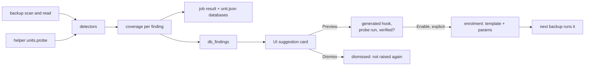

# Database detection and consistent capture

Design document, built in phases (section 8): D0 to D4 are built;
section 14 records what they settled. It replaces one-off,
per-application hook decisions (such as an Immich `pg_dumpall`) with a
general mechanism. c-backup recognises live databases in what it backs up,
judges whether the capture it is already making covers them consistently,
and, where it does not or where an engine-level copy adds something,
suggests the right method for that engine. Suggestions are applied only
when a user enables them, never silently.

It builds on `source-providers.md` (units, the helper and its protocol,
the consistency levels), `container-backup.md` (captures, hooks, fallback
mounts) and `vm-backup.md` (guest freeze). It also builds on OWN-45 /
OWN-45-LIVE as they stand on `origin/v3` (e6dd246): `src/ops/settle.c`
stores a file that never settles, flagged `MANIFEST_FLAG_UNSETTLED` in its
tree entry. This branch was cut before that work merged, so the code is
cited from `origin/v3`.

## FORMAT IMPACT

**None.** Engine-produced copies are ordinary files:

- in a unit snapshot, under `.cbackup-unit/hooks/` (a dump hook's output,
  `container-backup.md` 6.6) and described in `unit.json`;
- in a file snapshot, under a second reserved top-level directory,
  `.cbackup-captures/`, which mirrors the original paths and holds an
  `index.json` (section 9.3).

The link between a raw database file and its engine copy is by path,
recorded in `unit.json` or `index.json`. It needs **no new
`MANIFEST_FLAG_*` bit**: the tree format's existing flags byte (version 3,
`MANIFEST_FLAG_UNSETTLED`) is used as it is. The only prerequisite is
behavioural, like `.cbackup-unit`'s: file backups refuse a source at or
under `/.cbackup-captures` and never emit that name at the snapshot root.
Both reservations should land together.

## 1. Principles

1. **Advisory, never silent.** Detection produces findings and suggestions.
   Nothing changes how a unit or source is captured until a user enables it,
   explicitly, per finding.
2. **A snapshot is often enough, and saying so is a result.** Every engine
   below with crash recovery is consistently captured by an atomic snapshot
   of all its files. Pushing a dump on top of that costs space and time and
   dedups poorly. Detection reports "covered" when it is, and suggests a
   dump only for what a dump adds: portability across major versions, a
   logical check of the data, engines that are not crash-safe, and captures
   that are not atomic.
3. **Engine methods beat torn reads.** Where a database file is read live
   (plain file sources, fallback mounts), the engine's own consistent copy
   is the right capture, and OWN-45's flag says so.
4. **Backup never mutates what it captures.** The raw files are stored as
   read; an engine copy is stored beside them, never instead of them unless
   the user opts out of the raw copy.
5. **Detection never blocks a backup.** It runs inside the backup's own scan
   and read, costs almost nothing, and a detector failure is logged and
   skipped.

## 2. Where detection runs and what it can see

| Source | Signals available | Notes |
|---|---|---|
| container unit (Docker, LXC) | files in the unit's mounts; image name and tag; the container's command, args, environment variable **names**, exposed ports; processes; listening ports; files open for writing | processes, ports and open files come from the helper (`units.probe`, 8.1), which reads `/proc` in the host's pid namespace for the unit's cgroup |
| plain file source | files only | nothing knows which process owns a file; liveness comes from OWN-45's settle bracket (the file changed during its read) and from the `-wal`/`-shm`/`postmaster.pid` style markers |
| VM unit | guest OS and filesystem list through the guest agent | no processes, no files: section 10 says what is and is not feasible |

### 2.1 Signals and confidence

Each signal has a strength; a finding's confidence comes from the
combination:

| Signal | Strength | Example |
|---|---|---|
| file signature (a structure, not a name) | **strong**: required for a finding | `PG_VERSION` plus `global/pg_control` plus `base/` |
| file opened for writing by a process of the unit | strong liveness | `postgres` holding `base/16384/2619` `O_RDWR` |
| engine process running in the unit | liveness | `postgres`, `mariadbd`, `redis-server` |
| liveness marker file | liveness | `postmaster.pid`, `mongod.lock` non-empty, a SQLite `-wal` file |
| the file changed during the backup's read (OWN-45) | liveness | settle re-read |
| image name, listening port | hint only | `postgres:16`, port 5432 |

| Confidence | Meaning | What happens |
|---|---|---|
| `live` | file signature plus any liveness signal | coverage assessed (section 5); a suggestion where coverage falls short or a method adds value |
| `dormant` | file signature, no liveness | the files are at rest: any capture is consistent. Reported, with no suggestion |
| `hint` | image or port without a file signature in an included mount | shown as information only ("image suggests PostgreSQL; no data directory found in the backed-up mounts"). Usually a client-only container (a `postgres` image used for `pg_dump` against another host, adminer), or data on an excluded or unmounted path, which is worth seeing |

## 3. Signatures, per engine

Detectors work on what the scan already has (names, sizes, types) and, for
content checks, on the first bytes of files the backup reads anyway (the
first chunk's buffer). Unchanged files skipped by the file cache keep their
previous detection, keyed by path and `(size, mtime, ctime)`.

| Engine | File signature (strong) | Liveness markers | Processes | Ports (hint) | Images (hint) |
|---|---|---|---|---|---|
| PostgreSQL | directory with `PG_VERSION` (digits), `global/pg_control`, `base/`; version from `PG_VERSION`; tablespaces via `pg_tblspc/` symlinks | `postmaster.pid` | `postgres`, `postmaster` | 5432 | `postgres`, `*postgres*`, `timescale/*`, `tensorchord/*`, Immich's postgres |
| MySQL / MariaDB | directory with `ibdata1` or `mysql.ibd`, and `ib_logfile0` or `#innodb_redo/`, and a `mysql/` schema directory; MariaDB adds `aria_log_control`; `*.MYD`/`*.MYI` mark MyISAM tables | `*.pid` in the datadir, `mysql.sock` | `mysqld`, `mariadbd` | 3306 | `mysql`, `mariadb`, `*/mariadb` |
| SQLite | header `SQLite format 3\0` (16 bytes); journal mode from header bytes 18-19 (1 rollback, 2 WAL) | sibling `-wal` (WAL), `-journal` (hot rollback journal), `-shm` | any process holding the file open | | (embedded: Grafana, Plex, Home Assistant, Pi-hole, *arr, Vaultwarden, Frigate, Jellyfin, Nextcloud with `dbtype sqlite3`) |
| Redis / Valkey | `dump.rdb` starting `REDIS` plus 4 digits; `appendonly.aof`, or `appendonlydir/` with `*.manifest` (Redis 7+) | | `redis-server`, `valkey-server` | 6379 | `redis`, `valkey/*`, `bitnami/redis` |
| Prometheus TSDB | directory with `wal/`, `chunks_head/`, and block directories (26-character ULIDs) containing `meta.json` with `"ulid"` and `index` | `lock`, `queries.active` | `prometheus` | 9090 | `prom/prometheus` |
| InfluxDB 1.x | `meta/meta.db`, `data/`, `wal/` | | `influxd` | 8086 | `influxdb:1*` |
| InfluxDB 2.x | `influxd.bolt` (bbolt) plus `engine/data`, `engine/wal` | | `influxd` | 8086 | `influxdb:2*` |
| MongoDB | `WiredTiger`, `WiredTiger.turtle`, `WiredTiger.wt`, `journal/` | `mongod.lock` non-empty | `mongod` | 27017 | `mongo`, `mongodb/*` |
| Elasticsearch / OpenSearch | `nodes/0/` (older) or `_state/` with `indices/<uuid>/` holding Lucene `segments_N` | `node.lock` | `java` with `org.elasticsearch.bootstrap` or `org.opensearch.bootstrap` in its args | 9200 | `elasticsearch`, `opensearchproject/*` |
| LevelDB | `CURRENT` naming a `MANIFEST-*`, plus `*.ldb` or `*.log` | `LOCK` held | owning app | | (embedded) |
| RocksDB | as LevelDB, with `OPTIONS-*` and `*.sst` | `LOCK` held | owning app | | (embedded) |
| LMDB | `data.mdb` (magic `0xBEEFC0DE` at offset 16 of a meta page) plus `lock.mdb` | readers in `lock.mdb` | owning app | | (embedded) |
| bbolt | magic `0xED0CDAED` in a meta page | | owning app | | (embedded: InfluxDB 2, many Go apps) |
| ClickHouse | `metadata/`, `store/` with UUID-sharded directories, parts holding `columns.txt` and `checksums.txt` | `status` | `clickhouse-server` | 8123, 9000 | `clickhouse/*` |
| Nextcloud | not an engine: `config/config.php` with `'dbtype' => 'sqlite3'|'mysql'|'pgsql'` and `'dbhost'`, read with a fixed pattern, never evaluated | | | | `nextcloud`, `linuxserver/nextcloud` |

Nextcloud is listed because it is the common case of an application whose
consistency spans two engines (its database and its data directory). The
detector links the Nextcloud unit to the database it names (`dbhost`
resolved against other units' container names) and reports whether both
are in one capture (one compose unit, one atomic snapshot: consistent) or
two (suggest grouping them, `container-backup.md` 6.2, or the maintenance
mode hooks of 7.2).

Applications that embed SQLite are the long tail on Unraid. The detector
names the engine, not the application. A small table of known applications
(Plex, Home Assistant, Grafana, Pi-hole, Vaultwarden) adds application
notes only: for example, Plex's databases should be copied with its own
`Plex SQLite` binary, because they use custom tokenizers.

Detected on FS1 by the survey's evidence (to confirm in UAT): Immich's
PostgreSQL, GitLab's bundled PostgreSQL and Redis inside
`gitlab-ee/data`, GitLab's OpenSearch, Grafana's SQLite, Prometheus's
TSDB, SQLite in Pi-hole, Plex, tautulli, Frigate and airies-requests,
Immich's Valkey (a cache and queue).

## 4. False positives

| Trap | Rule |
|---|---|
| a file named `*.db` that is not SQLite | content signatures only; names never decide |
| thousands of tiny SQLite caches (browser profiles, thumbnail caches, app state) | SQLite findings need size at least `db_detect.sqlite_min_kb` (1024) **or** a liveness signal; smaller dormant ones are counted, not listed |
| an old copy of a data directory (`pgdata.bak/`) | no liveness: `dormant`, no suggestion |
| a client-only image (`postgres` used to run `pg_dump` elsewhere) | `hint` only: no data directory in the unit |
| two engines claim one directory | the more specific signature wins (RocksDB over LevelDB, InfluxDB 2 over bbolt); the evidence of both is kept |
| a finding the user says is wrong | `dismissed` for that (unit or source, path, engine); not raised again unless the signature changes (a different engine or a major version change) |
| an engine nested inside another's directory (GitLab's `data/postgresql/data` inside the GitLab mount) | each is its own finding, attributed to the unit |

Every finding carries its evidence (which files, which process, which open
file, which marker) so a user can judge it.

## 5. Coverage: is the current capture already consistent?

For each `live` finding, the detector asks whether the capture the unit or
source is already getting is consistent for that engine:

| Capture of all of the engine's files | Engine crash-safe | Coverage |
|---|---|---|
| one atomic snapshot (one ZFS pool by one command, one btrfs subvolume, or a paused multi-domain capture) | yes | **`covered-crash`**: restores as after a power cut, and the engine recovers |
| the same, plus a successful pre hook that quiesces or dumps | | **`covered-application`** |
| one VM backup job (atomic across the VM's disks) | yes | `covered-crash`, or `covered-quiesced` when the guest froze |
| atomic snapshot, but the engine is not crash-safe for some of its data (MyISAM or Aria tables; Elasticsearch and OpenSearch, which support only their own snapshot API) | partly | **`engine-unsafe`**: suggestion |
| the files span captures taken at different instants (two units, or two pools with no pause) | | **`split`**: suggest grouping or a pause (`pause: always` for the unit) |
| a live read (plain file source, a fallback mount past its deadline) | | **`uncovered`**: may be torn; OWN-45 will usually flag it (section 9). Suggestion, and a notification if `db_detect.notify_uncovered` |

"All of the engine's files" is checked, not assumed: PostgreSQL's
tablespaces and a relocated `pg_wal`, MySQL's separate redo or undo
directories, and MongoDB's journal must sit in the same capture as the
data directory. One of them outside it (another pool, an excluded path)
makes the finding `split`.

## 6. Capture methods, per engine

"Snapshot" means the engine's files captured by one atomic capture
(section 5). The trade-off columns compare against it.

| Engine | Method | Consistency | Size | Time | Dedup | Restore |
|---|---|---|---|---|---|---|
| PostgreSQL | snapshot (PGDATA with `pg_wal` and tablespaces) | crash; WAL replay on start | the cluster's files | none | page-level changes only | put the files back, start the **same major version** |
| | `pg_dumpall` (dump hook) | transactional (MVCC snapshot), live | smaller than the files (no indexes, no bloat) | minutes per GB | poor (a dump shifts) | `psql` into a fresh cluster of **any later** version; indexes rebuilt |
| | `pg_dump -Fc -Z0` per database | transactional | as above | as above | poor | `pg_restore`, selective |
| | `pg_basebackup -D - -Ft -X fetch` | physical, consistent with WAL | the cluster's files | read once | good (same pages) | extract, start the same major version. Needs replication access (local socket) and a single tablespace |
| MySQL / MariaDB | snapshot | crash: InnoDB recovers; **MyISAM/Aria may not** | files | none | good | files back, same version |
| | `mariadb-dump` / `mysqldump --single-transaction --quick --routines --events --triggers --hex-blob --all-databases` | transactional for InnoDB; MyISAM needs `--lock-tables` (blocks writes) | smaller | minutes per GB | poor | client import, any later version |
| | `mariadb-backup --stream=xbstream` | physical hot | files | read once | good | a `--prepare` step, then copy back; tool must match the server |
| SQLite | snapshot (db with its `-wal`/`-journal` in the same capture) | crash: journal or WAL recovered on open | file | none | good | file back |
| | online backup API (`sqlite3_backup_*`, or `VACUUM INTO`) | transactional copy | the database (compacted with `VACUUM INTO`) | about a second per 100 MB | good for the API copy, less after `VACUUM` | the copy is a standalone database: put it in place, remove any stale `-wal`/`-shm` |
| Redis / Valkey | snapshot | the on-disk RDB as of the last save (written by rename, never torn); AOF up to the last `fsync` (a truncated tail is accepted on load) | files | none | RDB poor, AOF good | files back |
| | `BGSAVE`, wait, then capture (exec hook) | RDB as of the hook | dataset | seconds | poor | `dump.rdb` back |
| | `redis-cli --rdb -` (dump hook) | RDB as of the dump | dataset | seconds | poor | as above |
| Prometheus | snapshot | crash: WAL replay, loses seconds | files | none | excellent (blocks immutable) | files back |
| | snapshot API (`POST /api/v1/admin/tsdb/snapshot`) then capture, then delete it (exec pre and post) | consistent blocks, hard-linked | no extra space | seconds | excellent | point `--storage.tsdb.path` at the snapshot's contents. Needs `--web.enable-admin-api` |
| InfluxDB 1 / 2 | snapshot | crash: WAL replay | files | none | TSM good | files back |
| | `influxd backup -portable` (1.x), `influx backup` (2.x, needs the operator token from the container's environment) as a dump hook streaming a tar | consistent | about the data | minutes | moderate | `influx restore` |
| MongoDB | snapshot (dbPath with `journal/`) | crash: journal recovery (MongoDB documents filesystem snapshots as a backup method when journaling is on) | files | none | good | files back, same version |
| | `mongodump --archive` (no `--gzip`: c-backup compresses) | per collection; `--oplog` only on replica sets | smaller | minutes per GB | poor | `mongorestore` |
| Elasticsearch / OpenSearch | snapshot | **unsupported by the vendors**; a single node usually recovers like a crash | files | none | good | files back, best effort |
| | the engine's snapshot API | consistent | incremental | varies | good | API restore. Needs `path.repo` configured, which is a change to the user's setup, so it is documented, not generated |
| | exclude and rebuild | | 0 | 0 | | rebuild the index (GitLab advanced search, for example) |
| LevelDB / RocksDB / LMDB / bbolt | snapshot | crash-safe by design (at most the latest unsynced writes lost) | files | none | good | files back |
| | (no generic dump: application-specific) | | | | | |
| ClickHouse | snapshot | crash: parts are immutable and installed by rename (ClickHouse lists filesystem snapshots as a backup method) | files | none | excellent | files back |
| | `BACKUP ... TO Disk(...)` | consistent | incremental | varies | | needs a backup disk configured: documented, not generated |
| Nextcloud | one capture of its database and data directory (one unit) | crash, across both | | | | |
| | maintenance mode around the capture (pre and post hooks, `needs_quiesce`) | application: no changes during the capture | | | | |

**What is suggested, by coverage:**

| Coverage | Suggestion |
|---|---|
| `covered-crash` / `covered-quiesced` | none required. Optional, with its reason: a logical dump for PostgreSQL, MySQL and MongoDB when the image pins a version that will change (portability), shown as "optional" |
| `engine-unsafe` | MySQL with MyISAM/Aria tables: `mariadb-dump`. Elasticsearch/OpenSearch: exclude and rebuild if the index is derived, otherwise configure the snapshot API (documented steps) |
| `split` | group the units (one capture) or `pause: always`; failing that, the engine's dump |
| `uncovered` | for file sources, source snapshot mode where the filesystem allows it (9.4), else the engine method (9.2); for containers, the reason the capture is live (a fallback mount) and the dump template |

## 7. Suggesting and enabling

### 7.1 Results

Each backup's detection results are recorded in two places:

- **`unit.json`** gains a `databases` array: engine, version, recorded path,
  confidence, coverage, method in use. That is the permanent record, in the
  repository, of how each database was captured at that instant, so a
  restore months later can say "this PostgreSQL 14 was captured crash-
  consistently; start PostgreSQL 14 on it" even after the daemon's database
  is lost. For file snapshots, the equivalent goes in
  `.cbackup-captures/index.json` when there are captures, and in the job
  result otherwise.
- **`state.db`** keeps the current view, daemon-only:

```sql
CREATE TABLE db_findings (
    id           INTEGER PRIMARY KEY AUTOINCREMENT,
    repo_id      INTEGER NOT NULL REFERENCES repos(id) ON DELETE CASCADE,
    scope        TEXT NOT NULL,       -- 'unit:<unit key>' or 'source:<path>'
    engine       TEXT NOT NULL,       -- closed vocabulary (section 3)
    path         TEXT NOT NULL,       -- recorded path of the data dir or file
    version      TEXT,
    confidence   TEXT NOT NULL,       -- live, dormant, hint
    coverage     TEXT,                -- section 5
    suggestion   TEXT,                -- template name, or NULL
    state        TEXT NOT NULL,       -- new, suggested, enabled, dismissed
    evidence     TEXT NOT NULL,       -- JSON: files, processes, open files, markers
    first_seen   INTEGER NOT NULL,
    last_seen    INTEGER NOT NULL,
    last_snap_id INTEGER,
    alerted_at   INTEGER              -- the one alert for this uncovered spell
);
```

### 7.2 Templates, not commands

An enabled suggestion becomes a hook built from a **template**. Templates
are compiled into the helper, each a fixed argv (a fixed shell string where
the template needs one, written once in the catalog, never assembled from
input) plus a short list of typed parameters. The daemon sends
`{unit, template, params}` and the helper builds the argv
(`source-providers.md` 11.3; `hook.run` gains this form). Credentials never
leave the database's container: templates read them from that container's
own environment at run time (`$POSTGRES_USER`, `$MARIADB_ROOT_PASSWORD`,
`$MONGO_INITDB_ROOT_PASSWORD`), so c-backup neither stores nor sees them.

The 1.0 catalog:

| Template | Kind | argv (fixed) | Params | Probe (dry run, no data) |
|---|---|---|---|---|
| `pg-dumpall` | dump | `sh -c 'exec pg_dumpall --clean --if-exists -U "${POSTGRES_USER:-postgres}"'` | none | `psql -U ... -Atc 'select version()'` |
| `pg-dump` | dump | `pg_dump -Fc -Z0 -U <user> <database>` | `user` `[a-z_][a-z0-9_]{0,62}`, `database` same | as above |
| `pg-basebackup` | dump | `sh -c 'exec pg_basebackup -D - -Ft -X fetch -U "${POSTGRES_USER:-postgres}"'` | none | `pg_basebackup --version`, single tablespace check |
| `mariadb-dump` | dump | `sh -c 'MYSQL_PWD="${MARIADB_ROOT_PASSWORD:-$MYSQL_ROOT_PASSWORD}" exec mariadb-dump --single-transaction --quick --routines --events --triggers --hex-blob --all-databases -uroot'` (`mysqldump` for MySQL images) | `lock_tables` bool (adds `--lock-tables` for MyISAM) | `SELECT` of non-InnoDB tables from `information_schema` |
| `redis-bgsave` | exec, pre | `sh -c` script: `BGSAVE`, then poll `INFO persistence` until `rdb_bgsave_in_progress:0` and `rdb_last_bgsave_status:ok` (auth from `REDISCLI_AUTH`) | none | `redis-cli PING` |
| `redis-rdb` | dump | `redis-cli --rdb -` (`valkey-cli` for Valkey) | none | CLI supports `--rdb -` |
| `sqlite-backup` | dump | `sh -c 'f=$(mktemp) && sqlite3 "$1" ".backup $f" && cat "$f"; rc=$?; rm -f "$f"; exit $rc' sh <db>` | `db`: a detected SQLite path, mapped by the helper to the container's path | `sqlite3 -version` exists in the image (often it does not; then the snapshot covers it, or 9.2 for file sources) |
| `prometheus-snapshot` | exec, pre and post | pre: `wget -qO- --post-data= http://localhost:9090/api/v1/admin/tsdb/snapshot`; post: `rm -rf /prometheus/snapshots/*` | `port` 1-65535 | admin API answers (`--web.enable-admin-api` in the container's args) |
| `influx2-backup` | dump | `sh -c 'd=$(mktemp -d) && influx backup "$d" -t "$DOCKER_INFLUXDB_INIT_ADMIN_TOKEN" >&2 && tar -C "$d" -cf - .; rc=$?; rm -rf "$d"; exit $rc'` | none | `influx ping` |
| `mongodump` | dump | `sh -c 'exec mongodump --archive --username "$MONGO_INITDB_ROOT_USERNAME" --password "$MONGO_INITDB_ROOT_PASSWORD" --authenticationDatabase admin'` | none | `mongosh --eval 'db.runCommand({ping:1})'` |
| `nextcloud-maintenance` | exec, pre and post, `needs_quiesce` | `php occ maintenance:mode --on` / `--off`, user `www-data` | none | `php occ status` |

Dumps are uncompressed by design (`-Z0`, no `--gzip`): c-backup compresses
with its per-chunk probe, and compressed dumps defeat what little dedup a
dump allows.

The helper's policy enables templates by name (`[db] allow_templates =
pg-dumpall, mariadb-dump, ...`). **Decided:** the shipped policy allows only
templates that write nothing inside the application's data: the stdout
dumps (`pg-dumpall`, `pg-dump`, `pg-basebackup`, `mariadb-dump`,
`redis-rdb`, `mongodump`, and `sqlite-backup` and `influx2-backup`, whose
temporary files are in the container's own `/tmp`, not in its data) and
every template's probe. Templates that write into the application's data
or change its state are **opt-in per host** in the helper policy, where
they ship commented out: `redis-bgsave` (rewrites `dump.rdb`),
`prometheus-snapshot` (writes `snapshots/` in the TSDB directory) and
`nextcloud-maintenance` (rewrites `config.php`). Until a host's policy
allows one, its suggestion shows the policy line to add instead of an
Enable button. Enabling an allowed template never requires editing the
policy, and the policy keeps the final say for the rest.

### 7.3 The flow



- **Result.** Each job's result has a `databases` section; a new `live`
  finding or a change in coverage also writes a journal entry.
  **Decided:** an `uncovered` live finding alerts **once**, when it is
  first detected (Pushover, `db_detect.notify_uncovered`, default 1). After
  that it is not re-alerted on every backup: it stays visible in the UI
  (an "uncovered" badge on the unit or source and in the repository-wide
  list) and in each job result and journal, until it is fixed (its coverage
  changes) or dismissed. A finding that becomes uncovered again after being
  fixed counts as new and alerts once more. `db_findings` records
  `alerted_at` for this.
- **UI card**, per finding: engine and version, path, confidence with its
  evidence, coverage in words ("captured by one atomic ZFS snapshot with
  the rest of Immich: restores like a power cut; PostgreSQL recovers"), the
  suggestion if any with its trade-offs from section 6, and three buttons:
  **Preview**, **Enable**, **Dismiss**.
- **Preview** shows the exact argv the helper will run, the output file it
  produces, its estimated size (from the engine's own size query where the
  probe provides one), and runs the template's probe: "verified: pg_dumpall
  16.4 connects as postgres". A probe failure is shown with its output, and
  Enable stays available but marked unverified.
- **Enable** is an explicit API call from an authenticated session
  (`POST /repos/<id>/databases/<finding>/enable`). It adds the template to
  the unit's enrolment and takes effect at the next backup. It is journalled
  with the caller.
- **Dismiss** records the reason and stops the finding being raised again.
- Nothing is enabled by a schedule, an upgrade, a default or a detection.

### 7.4 API and CLI

| Route | Purpose |
|---|---|
| `GET /repos/<id>/databases` | findings, filterable by scope, engine, coverage, state; paginated |
| `GET /repos/<id>/databases/<f>` | one finding with evidence and history |
| `POST /repos/<id>/databases/<f>/preview` | generated hook and probe result |
| `POST /repos/<id>/databases/<f>/enable` | body `{"template":"pg-dumpall","params":{}}` |
| `POST /repos/<id>/databases/<f>/dismiss` | body `{"reason":"..."}` |
| `POST /repos/<id>/units/<p>/<u>/detect` | run detection now without a backup (scan and probe only; reads only file headers) |

```sh
c-backup db list 1 [--unit compose:immich] [--coverage uncovered]
c-backup db show 1 12
c-backup db preview 1 12
c-backup db enable 1 12 --template pg-dumpall
c-backup db dismiss 1 12 --reason "test data"
```

## 8. Integration

### 8.1 Helper additions

Two operations join `source-providers.md` 11.3, with the same validation
rules:

| Operation | Arguments | Returns |
|---|---|---|
| `units.probe` | `unit` | processes of the unit's containers (command name and the first 256 bytes of args); listening TCP ports from each container's network namespace; files under the unit's included mounts held open for writing (from `/proc/<pid>/fd` and `fdinfo` flags), mapped to recorded paths. Nothing outside the included mounts is returned |
| `db.probe` | `unit`, `template`, `params` | the template's probe output and exit status, capped at 64 KiB |

`hook.run` additionally accepts `{unit, template, params}`.

### 8.2 Not blocking the VM and container build

Detection depends on the provider work and nothing depends on detection:

| Detection needs | From |
|---|---|
| a hook point in the scan (names, sizes) and in the read (the first chunk's bytes) | the engine; a callback in `backup_opts_t`, no behaviour change when unset |
| unit description (image, args, env names, ports) | `units.describe`, already in C1 |
| hooks, dump streaming, `needs_quiesce` | C3 |
| `units.probe`, `db.probe`, templates | new, phase D1/D2, in the helper |
| OWN-45 settle results | on `origin/v3` already |

| Phase | Delivers | After |
|---|---|---|
| D0 | Detector module (signatures, confidence, coverage) over file signals, results in the job result and `unit.json`, `db_findings`; reporting only | C1 for units; any time for file sources |
| D1 | `units.probe` liveness, UI cards and the findings API | C2 |
| D2 | Template catalog, `db.probe`, preview/enable/dismiss | C3 |
| D3 | File-source engine copies (SQLite through the daemon's own library, 9.2), `.cbackup-captures/`, OWN-45 messages | D0 |
| D4 | Source snapshot mode for plain file sources on ZFS/btrfs (9.4): `capture.begin_paths` in the helper, path remapping and the file cache rule from the TREE item, per-source opt-in | C2 and C4 (the helper's ZFS and btrfs machinery) |

**Decided:** the design is approved, and D0 to D4 are all 1.0, built in
that order after the provider slices (V0 to V3, C1 to C6). D0 to D2
replace the per-application Immich decision; D4 reuses the helper's
snapshot machinery rather than adding any of its own.

Detector module sketch (`src/ops/db_detect.h`):

```c
typedef enum { DB_ENGINE_POSTGRES = 1, DB_ENGINE_MYSQL, DB_ENGINE_SQLITE,
               DB_ENGINE_REDIS, DB_ENGINE_PROMETHEUS, DB_ENGINE_INFLUX1,
               DB_ENGINE_INFLUX2, DB_ENGINE_MONGO, DB_ENGINE_ELASTIC,
               DB_ENGINE_LEVELDB, DB_ENGINE_ROCKSDB, DB_ENGINE_LMDB,
               DB_ENGINE_BBOLT, DB_ENGINE_CLICKHOUSE } db_engine_t;

typedef struct db_detector db_detector_t;

/* One per backup run; fed by the scan and the read paths, thread-safe. */
status_t db_detect_begin(const db_detect_cfg_t *cfg, db_detector_t **out);
void     db_detect_dir(db_detector_t *d, const char *rec_path,
                       const char *const *names, size_t n);    /* scan */
void     db_detect_head(db_detector_t *d, const char *rec_path,
                        const void *head, size_t len,
                        const struct stat *st);                 /* first chunk */
void     db_detect_unsettled(db_detector_t *d, const char *rec_path);  /* OWN-45 */
void     db_detect_unit(db_detector_t *d, const sp_unit_desc_t *u,
                        const sp_probe_result_t *probe);        /* may be NULL */
status_t db_detect_finish(db_detector_t *d, const db_capture_desc_t *cap,
                          db_findings_t **out);                 /* + coverage */
```

Cost: a directory-name check per directory and a 32-byte header check per
file read; no extra I/O. `db_detect_finish` runs after the read, so a slow
or failing detector cannot delay the capture.

## 9. Plain file sources and OWN-45

### 9.1 What OWN-45 already does

`settle_store_fd` brackets every read with `fstat` and re-reads a file that
moved; a file still moving on the last read is stored as read and flagged
`MANIFEST_FLAG_UNSETTLED` (`backup.unsettled: store`, the default), or
skipped (`skip`). Restore warns for flagged files and verify reports them.
A live database file is the textbook unsettled file.

### 9.2 Engine copies for file sources

When a file source contains a `live` finding and the user enables its
suggestion, the file backup adds an engine copy:

- **SQLite** (the common case on hosts, and the only engine c-backup can
  copy without the application's tools): the daemon opens the database with
  its own `libsqlite3` (already a dependency), `SQLITE_OPEN_READONLY`, with
  a 5 s busy timeout, and copies it with the online backup API into a
  temporary file in the repository's `tmp/` (never memory: databases may
  exceed RAM), which is then stored and removed. Conditions, each checked
  and reported:
  - **WAL mode** databases only by default: readers do not block writers in
    WAL mode, so the copy cannot make the application see `SQLITE_BUSY`. A
    rollback-journal database's copy takes a shared lock that blocks the
    application's writers for its duration; that is opt-in per finding
    (`allow_rollback_lock`).
  - The read-only open must succeed. A WAL database whose `-shm` the daemon
    cannot use (its uid 990 cannot write it, and SQLite's read-only WAL
    support needs the `-wal` and `-shm` files present) falls back to the
    flagged raw read, with that reason.
  - The scanner's own descriptor on the file is closed before SQLite opens
    it: POSIX locks are per process, and closing any descriptor on the file
    would silently drop SQLite's locks.
  - A copy that has to restart more than 3 times because the source keeps
    changing is abandoned with a warning; the raw read stands.
- **Other engines** in a plain file source run as host services or in
  containers c-backup does not manage. There is no credential-free engine
  copy for them from the daemon, so the suggestion is: back the application
  up as a unit (if it is a container), or use source snapshot mode (9.4).

### 9.3 Where engine copies go

```
.cbackup-captures/
  index.json
  mnt/cache/appdata/someapp/app.db        the SQLite backup-API copy
```

`index.json` lists each capture: recorded path of the original, engine,
method, time, the original's settle result (`settled` or `unsettled`), and
the copy's path. Readers that do not know it see ordinary files.

### 9.4 Source snapshot mode (D4)

**Decided: in 1.0**, built after the provider slices on the helper's ZFS
and btrfs machinery. A plain file source on ZFS or btrfs is read from a
snapshot exactly as a container's mounts are:

- **Opt-in per source** (`sources set ... --snapshot`, or a per-source flag
  in the API), suggested by detection wherever a file source holds a live
  database on a snapshot-capable filesystem. No pause: there is no unit to
  pause, and one atomic snapshot per pool is already crash-consistent for
  everything in it (`container-backup.md` 6.4).
- **Helper:** `capture.begin_paths {paths}` (added to `source-providers.md`
  11.3). The helper resolves each path to its snapshot domain itself,
  checks the domains against the policy's `zfs_domains`/`btrfs_domains`,
  takes one atomic snapshot per pool, and returns read roots;
  `capture.end` destroys them. Same names, ownership proofs, intents,
  watchdog, leases and sweep as unit captures.
- **Daemon:** each source is scanned from its read root and recorded at
  its own path (the TREE item's `(read_root, record_root)` pair), with the
  file cache's device check relaxed as for container snapshots, so
  incrementals still skip unchanged files.
- **A source not on ZFS or btrfs**, or outside the policy's domains, is
  read live as today, and the job result says so for that source.

Every database in a snapshot-read source is then `covered-crash` without
any engine copy, and OWN-45 has nothing left to flag there.

**As built (D4).** `PUT /repos/<id>/sources` takes `snapshot:
[{path, mode}]` and the CLI `sources set --snapshot PATH` /
`--snapshot-warn PATH`; the modes are rows of `repo_backup_paths` (kinds
`snapshot:strict`, `snapshot:warn`), so no migration. **Strict is the
default** (decided 2026-11-18): a source in snapshot mode that cannot be
read from a snapshot fails the backup before anything is read, naming each
path and reason. `warn` is an explicit per-source opt-in that reads it live
with a job warning naming each path and reason, journalled and alerted as a
warning, and lists it in the job result's `live_sources`. The point above
("read live as today, and the job result says so") therefore applies to
`warn` only. Paths the helper does not snapshot get no action from it at all
beyond placing them (`helper.md`). A mount below a source shows empty in
its snapshot, so such a source is read from the snapshot only with
`one_filesystem`. Excludes match the recorded paths
(`scan_opts_t.exclude_on_record`); the trees and the file cache are a live
read's (B229). The capture is ended after the read on every outcome; the
helper ends it if the daemon dies and sweeps it at its own start. No new
repository-writing path, so no power-cut scenario: the repository sees an
ordinary file backup. Detection (D0) is told which sources were read from a
snapshot (`DB_CAP_ATOMIC`, each its own instant), so their databases are
judged `covered-crash` rather than `uncovered`; a lost lease drops that.
Manual 6.6.

### 9.5 The flag explains, and restore prefers the engine copy

When the unsettled file is a detected database, the flag's explanation
says so, everywhere it appears (job result, restore warning, verify
notice):

| Situation | Message |
|---|---|
| no engine copy enabled | `stored while changing: live SQLite database (WAL mode, held open). The bytes may mix two versions. Enable "sqlite online backup" for this source for a consistent copy (finding 12)` |
| engine copy made | `stored while changing: live SQLite database. A consistent copy made with SQLite's online backup is in this snapshot at .cbackup-captures/mnt/cache/appdata/someapp/app.db` |
| engine copy failed | `stored while changing: live SQLite database. The online backup was abandoned (source changed 3 times); only this possibly torn copy exists` |

Settle's behaviour with an engine copy enabled: the raw file is read
**once** and not re-read when it moves (the re-read exists to obtain a
consistent version, which the engine copy now provides), and it is still
flagged if it moved. **Decided: both are kept**, always: the raw file as
read (flagged if it moved) and the engine copy. Backup drops nothing it
read, and there is no option to skip the raw copy.

Restore: a whole-snapshot or subtree restore restores the raw files, as
stored, and lists each flagged database that has an engine copy, with the
command to use it instead. `--prefer-engine-copy` restores the engine copy
at the original path and does not restore that database's stale `-wal`,
`-shm` or `-journal` siblings (a backup-API copy is a complete database;
pairing it with the old WAL would corrupt it). Dumps (PostgreSQL, MySQL,
MongoDB) are never "restored in place": restore writes the dump file and
the UI shows the engine's import command, because importing is the
operator's decision.

In unit snapshots read from a filesystem snapshot nothing moves, so OWN-45
does not flag anything; the `databases` record says `covered-crash`
instead. A fallback mount that went live after its pause deadline behaves
like a file source.

## 10. VMs: what can and cannot be detected

From the host, a VM's databases are inside its disk images.

**Feasible in 1.0:**

- The guest agent through libvirt's public API:
  `virDomainGetGuestInfo(VIR_DOMAIN_GUEST_INFO_OS |
  VIR_DOMAIN_GUEST_INFO_FILESYSTEM)` gives the OS and the mounted
  filesystems with their types. That says where data lives, not what it
  is.
- Coverage without detection. A libvirt backup job captures all of a VM's
  disks at one instant, so every crash-safe engine inside is `covered-crash`
  by construction (`covered-quiesced` when the freeze succeeded). The VM
  page says this in general terms; there is no per-engine finding.
- **Guest-side quiescing**, which is where VM database consistency belongs:
  `qemu-ga` runs its fsfreeze hook (`--fsfreeze-hook`, scripts in
  `/etc/qemu/fsfreeze-hook.d/` called with `freeze` and `thaw`) around every
  freeze c-backup asks for. The Manual documents per-engine scripts: a
  `CHECKPOINT` for PostgreSQL (optional; it shortens recovery), the
  read-lock-held-across-freeze script QEMU ships for MySQL (needed only for
  MyISAM), `BGSAVE` for Redis. On Windows, VSS writers (SQL Server,
  Exchange) take part through the agent's VSS freeze, and the level is then
  `application`. c-backup records whether the freeze succeeded; the hook
  scripts' own success is visible only through it.

**Not feasible in 1.0, and why:**

| Would need | Why not |
|---|---|
| guest process list, guest files (`guest-exec`, `guest-file-open`) | reachable only through `virDomainQemuAgentCommand` (agent passthrough), which taints the domain and is excluded like QMP passthrough; many distributions' `qemu-ga` also block those commands by default |
| reading the guest filesystem from the disk image | a filesystem reader for ext4, xfs, btrfs, NTFS and LVM inside the daemon is a large, risky surface |

A post-1.0 option, recorded only: run detection against a VM snapshot
after the fact, through the NBD export (`vm-backup.md` 7.3) and a host-side
read-only mount by the helper. That would give per-engine findings for VMs
without touching the guest.

## 11. Test fixtures

### 11.1 Everywhere (unit tests, no Docker)

- **Signature trees** in `tests/fixtures/db/`: minimal synthetic layouts per
  engine (the marker files with real headers, truncated data) and
  near-misses: a `*.db` that is not SQLite, a `PG_VERSION` without
  `global/pg_control`, a LevelDB inside a RocksDB directory, an old
  `pgdata.bak` with no liveness. Assert engine, path, confidence and
  evidence.
- **SQLite end to end**, in-process with `libsqlite3`: a WAL database with a
  writer thread committing a counter. Back it up as a file source; assert
  the raw file is flagged unsettled, the engine copy passes `PRAGMA
  integrity_check` and holds a committed counter value, the messages of 9.5
  appear, `--prefer-engine-copy` restores a database that opens without its
  stale `-wal`. Also a rollback-mode database: no copy unless
  `allow_rollback_lock`, and with it, the writer is never refused for longer
  than its busy timeout.
- **Coverage logic** with fake captures: atomic one-pool, two pools without
  a pause, a tablespace outside the capture (`split`), MyISAM present
  (`engine-unsafe`).
- **Templates**: argv construction from typed params, refusal of invalid
  params, no template reachable without its category in the policy.

### 11.2 Containers in CI

A `db-fixtures` CI job with a rootful Docker-in-Docker service. Per engine,
a fixture container, a workload, every method of section 6 that has a
template, and verification after restoring into a fresh container of the
same image:

| Engine | Image | Workload | Verification |
|---|---|---|---|
| PostgreSQL | `postgres:16` | `pgbench` plus a ledger table | `pg_amcheck`, ledger |
| MariaDB | `mariadb:11` | ledger inserts in InnoDB, one MyISAM table | `mariadb-check`, ledger, the MyISAM finding is `engine-unsafe` |
| MySQL | `mysql:8.4` | as MariaDB | `mysqlcheck`, ledger |
| Redis / Valkey | `redis:7`, `valkey/valkey:8` | `SET` ledger keys, AOF on | `redis-check-rdb` / `redis-check-aof`, ledger |
| MongoDB | `mongo:7` | ledger inserts | `validate` on each collection, ledger |
| InfluxDB | `influxdb:2` | line-protocol writes | `influxd inspect verify-tsm`, point counts |
| Prometheus | `prom/prometheus` scraping itself, admin API on | | `promtool tsdb analyze` |
| SQLite in an app | `grafana/grafana` | dashboards via its API | Grafana starts and lists them |
| OpenSearch | `opensearchproject/opensearch` (nightly: about 1 GB of RAM) | index documents | cluster health green after restore, document count |
| ClickHouse | `clickhouse/clickhouse-server` (nightly) | inserts | `CHECK TABLE`, counts |
| Nextcloud | compose with MariaDB (nightly) | upload files | `occ files:scan` consistency, both units found and linked |

The **ledger** is how crash consistency is tested, not assumed: the
workload commits rows with increasing ids and the test runner records the
highest acknowledged id immediately before it calls `capture.begin`. After
restore, every id up to that one must be present and the engine's own
integrity check must pass. Snapshot-based captures in CI need a filesystem
with snapshots: a file-backed ZFS pool where the runner has the module, and
a loop-mounted btrfs image otherwise. Where neither is available, only the
dump templates run and the snapshot cases are skipped with a reason.

Negative fixtures in the same job: `postgres` used as a client only
(`hint`), a stopped PostgreSQL (`dormant`), a container with dozens of
small SQLite caches (counted, not listed).

### 11.3 VMs

In the libvirt end-to-end job (`vm-backup.md` 10.3): the test guest's
`qemu-ga` runs with an fsfreeze hook script that writes a marker on freeze
and removes it on thaw. Assert the marker is present in the backed-up disk
and absent in the guest afterwards, and that the level is `quiesced`.

### 11.4 UAT

On disposable containers only (`cbk-uat-*`): a PostgreSQL, a MariaDB with a
MyISAM table, a Redis, and a SQLite application, on FS2 (btrfs) and, once
approved, FS1 (ZFS). Check the findings, coverage and suggestions against
expectations, enable each suggestion through the UI, and restore and
verify. Production units get findings as soon as detection ships, because
reporting is read-only; enabling anything on them waits for the user.

## 12. Surface

| Config key | Default | Meaning |
|---|---|---|
| `db_detect.enabled` | `1` | Run detectors during backups (reporting only) |
| `db_detect.sqlite_min_kb` | `1024` | Smallest dormant SQLite file listed as a finding |
| `db_detect.notify_uncovered` | `1` | One Pushover alert when a live database is first found captured `uncovered` (7.3) |

| Metric | Type | Labels |
|---|---|---|
| `cbackup_db_findings` | gauge | `coverage` (section 5) |
| `cbackup_db_engine_captures_total` | counter | `engine` (closed list), `result` |
| `cbackup_db_uncovered_reads_total` | counter | none |

UI: a **Databases** panel on each unit page and on each repository's
sources page (section 7.3 cards), and a repository-wide list filterable by
coverage, so "which live databases are not consistently captured" is one
view.

Manual: a chapter "Databases" after "Containers": what detection looks
for, coverage levels, methods per engine with the trade-offs of section 6,
enabling a suggestion, file-source engine copies and OWN-45 flags, restoring
dumps per engine, VM guidance with fsfreeze hook scripts.

## 13. Decisions

The design is approved (user, 2026-11-16), to be built in phases D0 to D4
after the provider work. Decided:

| Question | Decision |
|---|---|
| Alerting for an uncovered live database | One alert, on first detection. After that the finding shows in the UI, job results and journal until it is fixed or dismissed; becoming uncovered again after a fix alerts once more (7.3) |
| Raw copy alongside an engine copy | Keep both: the raw file as read, flagged if it moved, and the engine copy. No option to skip the raw copy (9.5) |
| Templates allowed by default | Only those that write nothing inside the application's data (the stdout dumps). Anything that writes into the application's data or changes its state (`redis-bgsave`, `prometheus-snapshot`, `nextcloud-maintenance`) is opt-in per host in the helper policy (7.2) |
| Source snapshot mode for plain file sources | In 1.0, phase D4, on the helper's ZFS/btrfs machinery after the provider slices (9.4) |

## 14. As built

### 14.1 D0

The detector is `src/ops/db_detect.c` (signatures, confidence, coverage;
no database access) and `src/ops/db_findings.c` (the `db_findings` rows,
the events, the job result's JSON). Where the build settled something the
design left open or sketched differently:

| Point | As built |
|---|---|
| The scan hook | One call per scanned entry from the store loop (`db_detect_entry`), not one per directory with its names: the scan is a flat list, and a name check per entry sets marker bits on the directory the name is about (`PG_VERSION` on its parent, `global/pg_control` on its grandparent). Memory follows the number of database-like names, not files |
| The read hook | One `pread` of 64 bytes at offset 0 on the store's own descriptor, on every store path (backup thread, file workers, small-file workers), rather than a tap into the chunker's first buffer: the same page, no extra device I/O, and no change to the chunker. 16 KiB for a Nextcloud `config/config.php` |
| Unchanged files | `file_cache.db_head` (migration 011) keeps the classification of each file read; a cache hit uses it. The upsert resets it when a file changes. A file unchanged since before detection existed is not classified until it changes; directory engines are found by names regardless |
| unit.json | Stored after the unit's trees (`backup_synth_t.late`), so `databases` can say what reading them found. Additive: version stays 1 |
| Unit coverage | From each tree item's capabilities and the session: a snapshot-domain tree read from the snapshot is atomic; a fallback tree is paused when begin held the pause and the watchdog did not let it go, live otherwise. At `crash` or better the provider guarantees one instant; below it each tree counts as its own instant, conservative for several datasets of one pool |
| Links in containers | A tablespace, `pg_wal` or `journal` link inside a container names a container path, not a recorded one, so in a unit it is listed `unchecked` and not judged. File sources check it: the target must be a scanned tablespace (`PG_<v>_<cat>/`), WAL (`archive_status/`) or journal (`WiredTigerLog.*`) directory under a captured root, or the finding is `split` |
| Names only where a header is unknown | A header decides when the backup read one. Without one (the cache vouched), directory layouts are judged by names; single-file engines (SQLite, RDB, bbolt) never are. `data.mdb` and `CURRENT` that were read and are not LMDB or a MANIFEST pointer veto their directory |
| Prometheus | `queries.active` stands in for block directories, which a server younger than two hours does not have yet |
| MyISAM and Aria | Counted for `engine-unsafe` only outside `mysql/`, `performance_schema/` and `sys/`: MariaDB's own system tables are Aria on every install |
| Stale findings | A `new` or `suggested` row its scope's next backup does not see is dropped; `enabled` and `dismissed` stay. A dismissal is lifted by a version change |
| Alert and journal | The one alert is the job's warning (`job_set_warning`), which already alerts and journals; new live findings and coverage changes are `info` journal entries of operation `db-detect` |
| Suggestions | Names from section 6 and 7.2; for file sources, `sqlite-backup` (the daemon's copy, 9.2) or `source-snapshot` (9.4) |
| Deferred to D1 | `hint` confidence and the Nextcloud link need `units.describe`'s image, arguments and other units' names; D0 reports Nextcloud's `dbtype` only |
| Test fixtures | Built by `tests/test_db_detect.c` into scratch, not committed under `tests/fixtures/db/`: half are binary headers, which read better as the bytes they are |

### 14.2 D3

`src/ops/sqlite_copy.c` makes the copy; `src/ops/db_capture.c` plans the
copies from enabled findings, supplies them to the backup as synthetic
entries under `/.cbackup-captures/` (`backup_opts_t.captures`), writes
`index.json` and the 9.5 messages. Restore (`prefer_engine_copy`) and
verify read the snapshot and `db_findings`.

| Point | As built |
|---|---|
| What enables a copy | A `db_findings` row in a `source:` scope, engine `sqlite`, state `enabled`, template `sqlite-backup`, optional params `{"allow_rollback_lock":true}`; D2's enable route writes it. Detection off means no copies: the plan needs the backup's detector, which also carries the read-once set to every store thread |
| When the copy is made | When its synthetic entry is opened, before the content loop opens any regular file: so tmp/ holds one copy at a time, and no descriptor of the backup's is open on the database while SQLite holds its locks (POSIX locks are per process) |
| One step | `sqlite3_backup_step(-1)` copies in one read transaction, a WAL snapshot of one commit, so writers never restart it; only a lock not got within the busy timeout makes it try again, and three such tries abandon it |
| A copy not made | The synthetic entry's `keep` says "leave out, uncounted" (new: `keep` below 0), so it is not counted among unreadable files; `index.json`, the result and the log say why |
| Read once | `cdc_opts_t.settle_reads`, set to 1 by every store path for a file with a copy; the flag is still set if it moved |
| index.json | Stored last (`late`), so it can say how each raw file settled |
| Restore | `prefer_engine_copy` swaps in the copy's content at the original path (owner, mode and mtime stay the original's), and leaves out `-wal`, `-shm` and `-journal` of a database that has a copy. A flagged database without it names the copy and the flag; one with no copy but a finding names the finding |
| Verify | Each sample path of the unsettled notice that a SQLite finding names gets a notice of its own with the explanation and the finding id |
| Reservation | Already in place since `reserved.h`: sources at or under `/.cbackup-captures` are refused, and a source of `/` never records the name |

### 14.3 D2

The template catalog (`src/helper/db_template.c`, linked into the helper,
which decides, and the daemon, which checks a request and describes it),
`db.probe` and `hook.run`'s template form in the helper
(`src/helper/helper_server.c`), the preview, enable and dismiss routes
(`src/api/routes/db_actions.c`) and CLI, and the next backup running an
enabled template (`src/units/unit_backup.c`, `src/providers/remote_provider.c`).

| Point | As built |
|---|---|
| A unit's enrolment | Its enabled findings: `db_findings` rows of scope `unit:<key>`, state `enabled`, with `template` and `params`. No copy in `unit_policy` that could disagree with the finding |
| Where a template runs | The daemon sends the finding's recorded path beside `{unit, template, params}` (`path`, in `hook.run` and `db.probe`); the helper picks the Docker member whose included mount holds it, from its own inspect, and maps `sqlite-backup`'s database through the mount's destination. LXC: the container, a path in its rootfs. No container (libvirt): `unsupported` |
| Exec templates | Run by the daemon through `hook.run` and `hook.wait`, the pre run before `capture.begin` and the post run after it returns, or fails, so a maintenance mode is never left on. `capture.begin` is unchanged. `needs_quiesce` forces no pause: `nextcloud-maintenance`'s effect lasts until its own post run |
| Output names | `.cbackup-unit/hooks/<template>.dump` and `.log` (pinned); a second finding of one unit enabling the same template gets `<template>-<finding>` |
| A dump that cannot start | The helper refusing it (the policy changed since enable, the container stopped) is a failed dump, an empty stream with the reason in its log, never a failed unit |
| Coverage | A stored dump makes a live finding `covered-application` whatever the capture was; an exec template lifts only `covered-crash` and `covered-quiesced`. The unit's own level is the helper's, unchanged |
| unit.json | A database entry gains `template` `{name, ok, dump}`, additively (version stays 1) |
| mariadb-dump's `lock_tables` | Replaces `--single-transaction` with `--lock-tables`: `LOCK TABLES` commits any open transaction, so the two do not combine |
| One tool, two names | The scripts pick `mariadb-dump` or `mysqldump`, `redis-cli` or `valkey-cli`, whichever the image has; occ is looked for where the official and linuxserver images keep it |
| Timeouts | Dumps 6 hours, exec templates 10 minutes, probes 30 s |
| Preview's default | The finding's suggestion, else what is enabled, else the engine's first template the default policy allows (a covered finding names its dump only as `optional`) |
| Not built | The estimated size from the engine's own size query (7.3): no probe reports one yet. The real-engines CI job has no network, so 11.2's `db-fixtures` engines are not run there; templates are tested through the fake backend with stand-in tools |
| The UI buttons | Left to follow D1's cards |

### 14.4 D1

`units.probe` is in the helper (`src/helper/proc_probe.c`, the Docker, LXC
and fake backends, `src/providers/unit_probe.c` for the wire shape) and a
provider operation (`unit_probe`); the detector takes it through
`db_detect_unit`; `src/api/routes/databases.c` serves the findings and
`src/units/unit_detect.c` runs detection without a backup. Where the build
settled something the design left open:

| Point | As built |
|---|---|
| Image and names | Come with the probe, per container, beside its processes: the daemon has the inspect only inside a capture session (the blob is passed with `capture.begin`'s describe), and a detection run has no session. The helper reads the same inspect. A probe that fails therefore costs the hints as well as the liveness, which principle 5 allows |
| When the probe runs | Once per unit in a backup, after describe and before `capture.begin`: it never lengthens a pause, and the processes it sees are the ones that wrote what the capture then reads |
| Process liveness | Every finding of the process's engine in the unit, until a process of that engine is seen holding files of one of them; then only those it holds, so `pgdata.bak/` beside a live cluster stays `dormant` (section 4). Library engines (SQLite, LMDB, LevelDB, RocksDB, bbolt) take liveness only from an open file |
| Hints | One finding per engine, path `""`, evidence listing every image, port and process that suggested it and a `note`. An engine process with no signature makes a hint too (data on an excluded path is what a hint is for). Port 9000 is not a ClickHouse hint: php-fpm and MinIO use it as often |
| Elasticsearch process | `java` with `elasticsearch` or `opensearch` in its first 256 bytes of arguments (the install path, `-Des.` properties): the bootstrap class sits at the end of the command line, past what the probe keeps |
| InfluxDB | A process or port fits both versions and is liveness for either; a hint from them names `influxdb2`, an image tag `1*` names `influxdb1` |
| Nextcloud link | The `dbhost` is read with the dbtype's fixed pattern into the detector (the head code has no room for it); a `config.php` the cache vouched for is re-read once, 16 KiB, through its tree's read root. Resolved in the container (localhost, loopback, socket), then the unit (container names, compose service, network aliases, from the probe), then the repository's other units by the `unit_names` their PostgreSQL and MySQL findings record. Across units it is `consistent` only within one `capture.group`, otherwise suggested `group-units` (container-backup.md 6.2) |
| Findings detail | Migration 012 adds `coverage_why`, `method` and `optional` to `db_findings`, so the API answers a finding as the job result gave it |
| Detection run | `POST /repos/<id>/units/<p>/<u>/detect` is a repo job (never beside a backup of the same repository), scans each tree at its host path as pause-read's first pass does, through `open_scanned`, and judges coverage against the capture the next backup would make. It records with `db_findings_record_detect`: `last_snap_id` kept, its own rows told by `last_seen`, no alert (the coverage is a prediction; the next backup alerts). It fills `file_cache.db_head` only for rows whose size, mtime and ctime still match |
| UI | The app has no unit pages and no sources page; the Databases view is reached from the repository dashboard and grouped by scope, with Detect now on each unit, and the backup dialog marks sources with uncovered findings. The card leaves an empty actions area for D2 |

### 14.5 An engine copy's coverage (B242)

Section 5 judged a plain file source's live database by the read alone, so
a SQLite finding stayed `uncovered` after its `sqlite-backup` was enabled
and the copy made: the badge and the "needs attention" count could only be
cleared by dismissing the finding, which defeats 7.3's "until it is fixed".
Decided: the copy is the capture that matters.

| The backup's copy | Coverage | Method | Suggestion | coverage_why |
|---|---|---|---|---|
| made (`ok`) | `covered-application`, as a dump hook that succeeded makes a unit's finding (5) | `engine-copy` | none | where the copy is |
| refused, abandoned or failed | as the read judged it (`uncovered` for a live read) | as before | as before | the read's reason, then what happened to the copy and why |
| not attempted (not enabled, or not this source's) | as the read judged it | as before | as before | as before |

`covered-application` rather than `covered-crash`: the online backup is a
transactional copy of one commit, as `pg_dumpall` is, not a crash image. It
is judged per backup: a later backup whose copy fails is `uncovered` again,
a coverage change (journalled), and alerts once more (7.3). Applied in
`db_captures_judge` (`src/ops/db_capture.c`) before the findings are
recorded, so the job result, `db_findings`, the metrics and the app agree.
