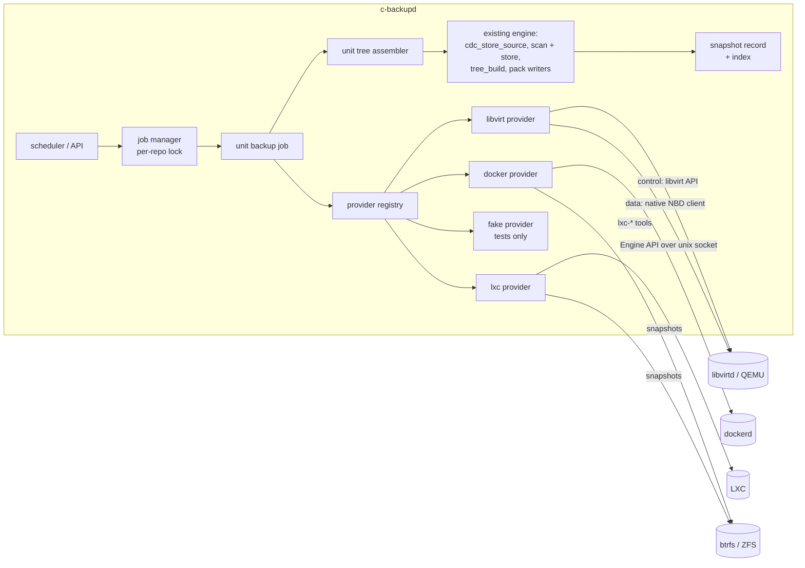
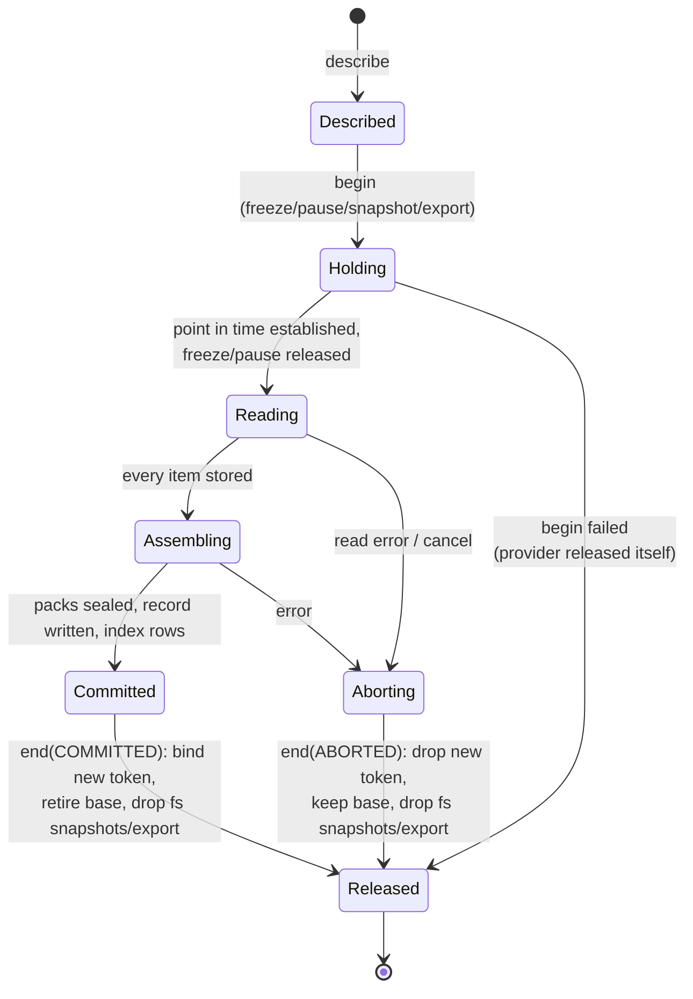

# Source providers

Design document. Nothing here is built yet. It specifies the interface that
lets c-backup back up things that are not plain directory trees - virtual
machines, Docker containers, LXC containers - as first-class units with
their own history, consistency guarantees, retention and restore. The
provider-specific designs are in `vm-backup.md` (libvirt/QEMU) and
`container-backup.md` (Docker and LXC); both build on this one.

## FORMAT IMPACT

**None. Repository format 3 can freeze as it is.** No change to the marker,
object types, packs, chunk lists, tree payloads or snapshot records is
needed for VM, Docker or LXC backup. Everything a unit snapshot carries is
expressed with what format 3 already has:

- A VM disk is a regular-file entry whose content is a chunk list: offsets,
  content-defined splits and holes as gaps are exactly what a block device
  image needs. Disks up to 2^64 bytes fit (`size` is u64, a list tree of
  nine levels of 16,384 entries is far beyond any disk).
- Container data is files and directories, backed up as files and
  directories at their real host paths.
- Unit metadata (provider, unit identity, consistency level achieved, domain
  XML, `docker inspect` output, Unraid template, compose file, hook logs,
  checkpoint names for forensics) is ordinary files under one reserved
  top-level directory, `.cbackup-unit/`, in the snapshot's own tree.
- Everything the daemon needs to list, filter and retain units is derived
  from that directory into `state.db` by reindex, like every other index.

One **behavioural** reservation (not a format change) must ship with the
feature: file backups never emit a top-level `.cbackup-unit` entry, and a
file source at or under `/.cbackup-unit` is refused. That is what lets
reindex trust the directory as a daemon-written unit marker. It changes no
reader and no byte on disk. Section 7 gives the alternatives that were
rejected, notably a field in `snapshots/<id>`, which a 1.0 replicator would
silently strip.

## 1. Terms

| Term | Meaning |
|------|---------|
| provider | A module that knows one kind of workload: `libvirt`, `docker`, `lxc`, and `fake` for tests |
| unit | One backed-up thing: a VM, a container. Identified by `(provider, unit_id)` |
| unit key | `<provider>:<unit_id>`, the grouping key for history and retention |
| item | One piece of a unit: a disk, a volume, a bind mount, a config blob |
| session | One backup of one unit, from `begin` to `end` |
| consistency level | What point-in-time guarantee a session achieved (section 5) |
| snapshot domain | The unit of atomic capture underneath: a libvirt backup job, a btrfs subvolume, a ZFS dataset |
| token | Provider-opaque incremental state carried from one session to the next (a libvirt checkpoint) |

Unit identity is provider-defined and must be stable across the things users
do routinely:

| Provider | `unit_id` | Why |
|----------|-----------|-----|
| libvirt | domain UUID | Names can be changed with `virsh domrename`; the UUID survives. The name is recorded per snapshot for display |
| docker | `compose:<project>` for a compose project, else the container name | A compose project is one application and the consistency unit (`container-backup.md` 3.1). Unraid and compose recreate a container (new id) on every update; the name is what persists. Container ids are recorded per snapshot |
| lxc | container name | The name is the directory under the LXC path |

## 2. Architecture



The engine below the assembler is the existing one. A disk is handed to
`cdc_store_source` through a `cdc_source_t` (exactly what replication's
re-chunking already uses), a container path is handed to the scanner with a
read root that differs from the recorded root (section 4.3), and the unit's
metadata blobs are stored as small file objects. The tree is built by
`tree_build`, packs are sealed, the snapshot record is written, the index
is updated: the same sequence as Manual section 6.3.

The control plane (pausing, freezing, snapshotting, checkpoints, defining)
and the data plane (reading bytes) are separate in the interface on
purpose. Section 11 uses that split to move every root-equivalent operation
out of the network-facing daemon.

## 3. The interface

Sketch of `src/providers/provider.h`. Names are proposals; the semantics
are the specification.

```c
#define SP_ABI_VERSION 1

typedef enum {
    SP_CONSIST_INCONSISTENT = 0, /* read live; no single point in time */
    SP_CONSIST_CRASH        = 1, /* one point in time, as after a power cut */
    SP_CONSIST_QUIESCED     = 2, /* guest/container filesystems flushed and
                                    frozen at that point (guest agent) */
    SP_CONSIST_APPLICATION  = 3, /* quiesced, plus application participation:
                                    VSS writers, or a pre hook that succeeded */
    SP_CONSIST_OFFLINE      = 4, /* the unit was not running while read */
} sp_consistency_t;

typedef enum { SP_ITEM_BLOB = 1, SP_ITEM_BLOCK = 2, SP_ITEM_TREE = 3 } sp_item_kind_t;

/* Unit capabilities (sp_unit_desc_t.caps) and item capabilities. */
#define SP_CAP_QUIESCE      0x01u  /* can freeze (guest agent present) */
#define SP_CAP_PAUSE        0x02u  /* can pause the whole unit */
#define SP_CAP_SNAPSHOT     0x04u  /* item lives on an instantly snapshottable fs */
#define SP_CAP_INCREMENTAL  0x08u  /* item can report changed ranges vs a token */
#define SP_CAP_DEFINE       0x10u  /* provider can re-create the unit on restore */
#define SP_CAP_PARALLEL     0x20u  /* items of one session may be read concurrently */

typedef struct {
    char           id[64];          /* stable within the unit: "vda", "vol:pgdata" */
    sp_item_kind_t kind;
    uint64_t       size;            /* BLOCK: virtual size; BLOB: bytes; TREE: 0 */
    char           format[16];      /* BLOCK: "raw", "qcow2", ...; else "" */
    char          *source;          /* host path or URI, informational */
    char          *tree_path;       /* where it lands in the snapshot tree */
    uint32_t       caps;
} sp_item_desc_t;

typedef struct {
    char            provider[16];
    char            unit_id[128];
    char           *name;           /* display name at describe time */
    int             state;          /* SP_STATE_RUNNING/_PAUSED/_STOPPED/_SUSPENDED */
    uint32_t        caps;
    sp_item_desc_t *items;
    size_t          n_items;
} sp_unit_desc_t;

/* Per-item incremental request and result. */
typedef enum {
    SP_READ_FULL = 0,      /* every allocated byte is read */
    SP_READ_INCREMENTAL,   /* only ranges changed since base_token */
    SP_READ_UNCHANGED,     /* provably identical to the base: reuse its root */
} sp_read_mode_t;

typedef struct {
    const char *item_id;
    const char *base_token;         /* NULL: no usable base */
} sp_item_base_t;

typedef struct {
    int64_t                job_id;
    const sp_item_base_t  *bases;   /* from state.db (section 7.4) */
    size_t                 n_bases;
    sp_consistency_t       want;    /* best effort target */
    sp_consistency_t       require; /* below this, begin fails */
    unsigned               freeze_timeout_s;
    unsigned               pause_max_s;
    atomic_int            *cancel;
} sp_begin_req_t;

typedef struct {
    const char     *item_id;
    sp_read_mode_t  mode;
    const char     *reason;         /* bounded vocabulary, section 6.4 */
} sp_item_plan_t;

/* Filled by begin, read by the job, owned by the session. */
typedef struct {
    sp_consistency_t achieved;
    uint32_t         consist_flags; /* SP_CF_HOOK_PRE_OK, SP_CF_FROZEN_FS_n, ... */
    uint64_t         freeze_ms, pause_ms;
    sp_item_plan_t  *plans;
    size_t           n_plans;
    char            *new_token;     /* to bind if the snapshot commits */
    char           **warnings;
    size_t           n_warnings;
} sp_session_info_t;

/* A block item as a stream of extents. Forward-only. */
typedef enum { SP_EXT_DATA = 1, SP_EXT_ZERO = 2 } sp_ext_type_t;

typedef struct {
    /* Allocation from 'from' onward: the next extent, DATA or ZERO
     * (ZERO: guaranteed to read as zeroes). *done at the end of the disk. */
    status_t (*extent)(void *ctx, uint64_t from, sp_ext_type_t *type,
                       uint64_t *len, int *done);
    /* Changed ranges since the base token, ascending, from 'from' onward.
     * Only valid when the plan says SP_READ_INCREMENTAL. */
    status_t (*changed)(void *ctx, uint64_t from, uint64_t *s, uint64_t *e,
                        int *done);
    /* Exactly n bytes at off. May be called from several threads for
     * different items; for one item, calls are issued in increasing order
     * but may overlap in time (the reader pipelines). */
    status_t (*read)(void *ctx, void *buf, size_t n, uint64_t off);
    void     (*close)(void *ctx);
    void      *ctx;
} sp_block_stream_t;

typedef struct sp_session sp_session_t;
typedef struct sp_ctx     sp_ctx_t;   /* provider instance: config, connection */

typedef enum { SP_END_COMMITTED = 1, SP_END_ABORTED = 2 } sp_end_outcome_t;

typedef struct sp_provider_ops {
    const char *name;
    uint32_t    abi;

    status_t (*init)(const sp_config_t *cfg, sp_ctx_t **out);
    void     (*fini)(sp_ctx_t *ctx);

    /* Versions, permissions, reachable sockets, tools present. Never
     * touches a unit. Feeds GET /providers. */
    status_t (*probe)(sp_ctx_t *ctx, sp_probe_t *out);

    /* Live enumeration. cb is called once per unit, unit ids only plus a
     * name and state; describe gives detail. */
    status_t (*list_units)(sp_ctx_t *ctx, sp_unit_cb cb, void *cbctx);

    /* Full description, including items and capabilities. Read-only. */
    status_t (*describe)(sp_ctx_t *ctx, const char *unit_id,
                         sp_unit_desc_t **out);
    void     (*desc_free)(sp_unit_desc_t *d);

    /* Establish the point in time: freeze/pause/snapshot, start export.
     * On error nothing is left behind (the provider has already released
     * whatever it took). On success the caller MUST call end exactly once. */
    status_t (*begin)(sp_ctx_t *ctx, const sp_unit_desc_t *unit,
                      const sp_begin_req_t *req, sp_session_t **out,
                      const sp_session_info_t **info);

    /* Items, by kind. */
    status_t (*blob_read)(sp_session_t *s, const sp_item_desc_t *item,
                          void **data, size_t *len);      /* <= 16 MiB */
    status_t (*block_open)(sp_session_t *s, const sp_item_desc_t *item,
                           sp_block_stream_t *out);
    status_t (*tree_root)(sp_session_t *s, const sp_item_desc_t *item,
                          char *read_root, size_t sz);    /* path to read */

    /* Release everything: thaw, unpause, delete fs snapshots, abort the
     * export, and settle tokens: on COMMITTED keep new_token and retire the
     * base; on ABORTED discard new_token and keep the base. Idempotent,
     * never blocks indefinitely, and best-effort: a failure here is logged
     * and recorded as an intent for the sweep, it never fails a snapshot
     * that already committed. */
    status_t (*end)(sp_session_t *s, sp_end_outcome_t outcome,
                    int64_t snapshot_id);

    /* Crash recovery and hygiene, at daemon start and after every job:
     * thaw/unpause anything an intent says may be held, delete leftover
     * snapshots/checkpoints/exports this daemon created, retire tokens
     * state.db no longer binds. Never touches anything it cannot prove it
     * created (section 6.3). */
    status_t (*sweep)(sp_ctx_t *ctx, const sp_sweep_req_t *req,
                      sp_sweep_report_t *out);

    /* Restore support. preflight reports collisions and dangerous settings
     * without changing anything; define re-creates the unit from the
     * snapshot's config blobs, after the core has written the data. */
    status_t (*restore_preflight)(sp_ctx_t *ctx, const sp_restore_req_t *req,
                                  sp_restore_plan_t *out);
    status_t (*define)(sp_ctx_t *ctx, const sp_restore_req_t *req,
                       const sp_restore_plan_t *plan, sp_define_result_t *out);
} sp_provider_ops_t;
```

### 3.1 Contract details

- **Errors** follow the codebase: `status_t`, the deepest function sets the
  message with `set_error`, callers propagate. "Incremental not possible" is
  not an error: it is a plan with `SP_READ_FULL` and a reason. Errors are
  for "this unit cannot be backed up right now".
- **Memory.** `describe` and `begin` allocate bounded structures (items are
  few). Nothing in the interface hands over a whole disk or an extent map:
  extents and changed ranges are pulled forward one at a time, because a
  16 TiB disk with a fragmented allocation map must cost no memory
  (design constraints 1 to 3).
- **Threads.** One job thread drives a session. With `SP_CAP_PARALLEL` the
  job may read different items concurrently from up to
  `units.parallel_items` threads; `read` for one item is pipelined by the
  stream itself. Provider contexts are shared across jobs and must be
  thread-safe; the libvirt connection is (libvirt's public API is
  thread-safe per connection).
- **Cancellation.** `begin` and every read check `req->cancel`. A cancel
  mid-session still runs `end(ABORTED)`.
- **Time bounds.** Every provider call that talks to something external has
  a timeout. A call that cannot be bounded (a libvirt agent call stuck
  behind the guest) is bounded by a watchdog (section 6.2), never by hope.
- **Determinism.** Two reads of the same unit state must produce the same
  objects. For BLOCK items this rules out using anything but content to
  decide spans (see `vm-backup.md` section 5.2: holes are maximal zero runs,
  not whatever the allocation map said this time).

## 4. Item kinds

### 4.1 BLOB

Small configuration, at most 16 MiB (one object): domain XML, NVRAM
variables, `docker inspect` JSON, an Unraid template, a compose file, a hook
log. Stored as a regular file under `.cbackup-unit/`. Small blobs are one
`FILE` object; the rare large one (UEFI NVRAM is 128 KiB to 4 MiB) goes
through `cdc_store_source` like any file.

### 4.2 BLOCK

An extent stream (above). The core turns it into a `cdc_source_t`:
`next_span` walks `extent` and the zero-run rule, `read` pipelines into the
provider's `read`. For a full read that is all; for an incremental read the
core runs the delta merge of `vm-backup.md` section 5.3, which needs
`changed` plus the previous snapshot's chunk list for the item. The result
is a content hash naming a chunk list, written as a regular-file node at the
item's `tree_path` with `size` = the virtual size.

### 4.3 TREE

A directory to back up through the normal scanner, read from `read_root`
but recorded at the item's original path. For a container volume that is
`read_root = /mnt/cache/.cbackup-snapshots/cbk-.../appdata/gitlab`,
recorded as `/mnt/user/appdata/gitlab` (the path Docker binds). Two things
in the existing engine are generalised for it:

1. `backup_opts_t` gains a per-source `(read_root, record_root)` pair; the
   scanner reads under the first and emits entries under the second. Every
   other part of the pipeline sees record paths only.
2. The file cache is looked up by record path with `FILE_CACHE_IGNORE_DEV`
   forced on for snapshot reads. A btrfs snapshot is a new subvolume with a
   new anonymous device number every time, and a ZFS snapshot has its own
   `st_dev`; but both preserve inode numbers, ctime, mtime and size, so the
   remaining fields still prove a file unchanged. Without this every
   container incremental would re-read every file.

## 5. Consistency model

The level is ordinal for display and for `require`, but it is a statement of
fact about one session, not a promise about the data:

| Level | Produced by | What a restore is like |
|-------|-------------|------------------------|
| `offline` | VM shut off; container stopped | A clean stop, if the unit was stopped cleanly |
| `application` | VSS writers via the guest agent (Windows); a container or VM pre hook that exited 0 | Applications took part: databases flushed or dumped |
| `quiesced` | guest agent `fsfreeze` succeeded and was held across the capture | Filesystems clean, applications as after a sudden but orderly freeze |
| `crash` | one point in time with nothing flushed: a libvirt backup without freeze, a paused-and-snapshotted container | A power cut at that instant. Journalled filesystems and WAL databases recover |
| `inconsistent` | live read with no snapshot | Different files from different moments. Flagged everywhere it is shown |

Rules:

- The achieved level is recorded in the snapshot (`unit.json`,
  section 7.2) and indexed. The UI and API show it on every snapshot, and a
  unit's history shows when it changed.
- `require` lets a user say "fail rather than store less than `crash`". The
  default is `crash` for VMs and containers on snapshot filesystems, and
  `inconsistent` only where the user picked the live fallback explicitly.
- Downgrades are never silent: a freeze that timed out, a pre hook that
  failed, a pause that was cut short by the watchdog each produce a warning
  in the job result, a journal entry, and the lower level.

## 6. Lifecycle and failure handling

### 6.1 One session



The `Holding` state is the only one that affects the workload (a frozen
guest, a paused container) and it is kept as short as the mechanism
allows: seconds, not the duration of the read. Each provider design
quantifies it.

### 6.2 Intents and watchdogs

Every action that leaves something held outside the daemon is written down
before it is taken, in a daemon-state table:

```sql
-- migrations/002_units.sql (sketch)
CREATE TABLE unit_intents (
    id         INTEGER PRIMARY KEY AUTOINCREMENT,
    provider   TEXT NOT NULL,
    unit_id    TEXT NOT NULL,
    kind       TEXT NOT NULL,   -- 'freeze','pause','fs_snapshot','export','checkpoint_new'
    detail     TEXT NOT NULL,   -- what exactly: snapshot name, checkpoint name, socket
    job_id     INTEGER,
    created_at INTEGER NOT NULL
);
```

The row is inserted (and committed) before the action, and deleted after
the matching release succeeds. So after any crash, `sweep` at start knows
exactly what might still be held: it thaws, unpauses, deletes and aborts
each, idempotently (thawing a guest that is not frozen and unpausing a
running container are no-ops that succeed).

A watchdog thread bounds every hold: an intent of kind `freeze` or `pause`
older than its limit (`vm.freeze_timeout_s`, `containers.max_pause_s`) is
released by the watchdog itself, from another thread, whatever the job
thread is doing. The session then records the downgrade (section 5).
Freeze and pause are always released in `begin`, before any data is read,
so in the normal path the watchdog never fires.

The crash case that intents cannot cover is the daemon dying while holding
a pause or freeze and not coming back. Docker's restart policy (`unless-
stopped`) brings the daemon back within seconds and its sweep releases the
hold; the host helper of section 11, if adopted, holds the watchdog itself
and is independent of the daemon's lifetime, which closes the gap.

### 6.3 Never touch what we did not create

Every external artefact c-backup creates is named with a recognisable,
parseable grammar that includes a per-daemon id:

```
cbk-<daemon8>-<job>[-<n>]        e.g. cbk-7f3a09c1-4127-0
```

`daemon8` is the first 8 hex digits of a random id generated once per
`state.db` and kept in `auth_config`-style daemon state (and in a file in
the state directory, so a lost database does not make the daemon forget its
own artefacts). `sweep` deletes an artefact only when all hold:

1. its name matches the grammar exactly and carries this daemon's id;
2. it is not owned by a running job;
3. a provider-specific ownership proof passes: a btrfs subvolume must be
   read-only with a `parent_uuid` equal to the source subvolume's uuid; a
   ZFS snapshot must carry the user property `com.cbackup:owner=<daemon id>`
   set at creation; a libvirt checkpoint's XML must carry the
   `<description>` c-backup wrote.

Anything else is reported in the sweep result and left alone. A user's
snapshot named `cbk-something` is never at risk.

### 6.4 Read-mode reasons

A bounded vocabulary, so they can label a metric without exploding its
cardinality: `first`, `no-incremental-support` (raw disk, plain directory
tree), `no-base`, `base-pruned`, `token-missing`, `token-invalid`,
`item-new`, `item-resized`, `item-source-changed`, `unit-redefined`,
`audit`, `forced`, `unchanged-offline`, `incremental`.

### 6.5 One unit, one session at a time

Two repositories may back up the same unit. libvirt allows one backup job
per domain, and pausing a container twice is meaningless, so the daemon
keeps a process-wide mutex per unit key. A second job waits for it, up to
`units.unit_wait_s` (default 3600), then fails that unit with `unit busy`;
other units in the job proceed.

## 7. Representation in the repository

### 7.1 One snapshot per unit

A unit backup produces one snapshot per unit, even when one job backs up
twenty containers. Per-unit snapshots are what make per-unit history,
per-unit retention and per-unit restore simple: a snapshot id names exactly
one unit at exactly one point in time. A job backing up many units holds
the repository lock once and commits a snapshot after each unit, so a
failure in unit 17 keeps units 1 to 16.

### 7.2 The synthetic tree

```
/                                   root tree of a unit snapshot
  .cbackup-unit/                    reserved; only unit snapshots have it
    unit.json                       volatile: what this session did
    config/                         stable: dedups across snapshots
      domain.xml                    (libvirt)  inactive domain XML
      nvram.fd                      (libvirt)  UEFI variable store
      inspect.json                  (docker)   container inspect, verbatim
      image.json                    (docker)   image inspect: digests
      unraid-template.xml           (docker)   dockerMan template, if any
      compose/<file>                (docker)   compose files and .env
      lxc.config                    (lxc)      the container's config file
    disks/                          (libvirt)
      vda                           regular file, size = virtual size,
      vdb                           content = chunk list, holes = gaps
    hooks/
      pre.log, post.log             hook stdout/stderr, bounded to 1 MiB
  mnt/user/appdata/gitlab/...       (containers) data at its real paths
```

Why each choice:

- **Disks as regular files.** A disk image is a file with holes; format 3
  represents that exactly. A build that knows nothing about units restores
  a VM snapshot as `disks/vda`, a sparse raw image any hypervisor boots. The
  same is true of container data, restored by path. This is the property
  that made the "no format change" decision easy: unit support degrades to
  file support, never to unreadable.
- **Guest-visible content, not the container file.** `disks/vda` is the
  bytes the guest sees, whatever the image format (raw, qcow2, a qcow2
  overlay on a template, a block device). qcow2 cluster layout differs from
  VM to VM; guest content does not, so two VMs cloned from one template
  dedup against each other and against the template.
- **Data at real paths** for containers, so a plain file restore puts
  appdata back where the container binds it, and browsing and search work
  as for any file backup.
- **Volatile and stable separated.** `unit.json` changes every session (it
  records timing and the level achieved); everything under `config/` changes
  only when the configuration does, so its tree object is reused and costs
  nothing. Each session adds about three small objects of metadata.
- **Metadata `mtime`.** Synthetic files carry `mtime` 0 and mode 0600,
  uid/gid 0, so unchanged ones serialise identically (the determinism rule
  in `repo-format.md`). Disk nodes carry the image file's mtime where there
  is one; it is real metadata and costs only the one tree object that
  changes anyway.

`unit.json` (UTF-8 JSON, one object, at most 64 KiB):

```json
{"format":"cbackup-unit","version":1,
 "provider":"libvirt","unit_id":"5c1f...-...","name":"win11-test",
 "consistency":"quiesced","consist_flags":["agent-fsfreeze"],
 "freeze_ms":412,"pause_ms":0,
 "items":[
   {"id":"vda","kind":"block","path":".cbackup-unit/disks/vda","size":68719476736,
    "format":"qcow2","source":"/mnt/user/domains/win11-test/vdisk1.qcow2",
    "read_mode":"incremental","reason":"incremental","bytes_read":1288490188,
    "checkpoint":"cbk-7f3a09c1-4127"},
   {"id":"nvram","kind":"blob","path":".cbackup-unit/config/nvram.fd"}],
 "warnings":[]}
```

Readers ignore unknown keys and refuse `version` > 1 for interpretation
(the snapshot is then shown as an unclassified file snapshot, never
misread). The checkpoint name is informational: it is never trusted for an
incremental (section 7.4 says what is).

### 7.3 The reserved name

`.cbackup-unit` at the root is the classification signal. To make it
unforgeable by data, file backups must never produce it: `sources set` and
`POST /repos/<id>/backup` refuse a source at or under `/.cbackup-unit`,
and the scanner drops a root-level entry of that name with an error if one
appears through a source of `/`. Only the unit assembler writes it. Since
file backups record absolute paths, the root of a file snapshot contains
only first path components of sources; with this rule none of them can be
`.cbackup-unit`.

### 7.4 What lives where

| Fact | Repository (authoritative) | state.db (derived, rebuilt by reindex) | state.db (daemon-only, loss costs a full read) |
|------|---|---|---|
| unit, name, consistency, items, read modes | `unit.json` | `snapshot_units`, `snapshot_unit_items` | |
| domain XML, inspect, template, compose, NVRAM | `config/*` | | |
| disk and volume content | the tree | `nodes` as usual | |
| enrolment, per-unit settings, hooks | | | `unit_enrolment` |
| per-unit retention | | | `unit_policy` |
| incremental tokens (checkpoint name + XML, bound snapshot, item root hash) | informational copy in `unit.json` | | `unit_tokens` |
| intents | | | `unit_intents` |

```sql
-- derived
CREATE TABLE snapshot_units (
    repo_id     INTEGER NOT NULL REFERENCES repos(id) ON DELETE CASCADE,
    snap_id     INTEGER NOT NULL,
    unit_key    TEXT NOT NULL,          -- 'libvirt:<uuid>', 'docker:<name>'
    provider    TEXT NOT NULL,
    unit_name   TEXT NOT NULL,
    consistency INTEGER NOT NULL,       -- sp_consistency_t
    PRIMARY KEY (repo_id, snap_id)
);
CREATE INDEX snapshot_units_by_unit ON snapshot_units(repo_id, unit_key, snap_id);

-- daemon-only
CREATE TABLE unit_tokens (
    repo_id    INTEGER NOT NULL REFERENCES repos(id) ON DELETE CASCADE,
    unit_key   TEXT NOT NULL,
    item_id    TEXT NOT NULL,
    token      TEXT NOT NULL,           -- provider-opaque (checkpoint name)
    token_blob TEXT,                    -- e.g. checkpoint XML for redefine
    snap_id    INTEGER NOT NULL,        -- the snapshot the token describes
    item_root  BLOB NOT NULL,           -- that snapshot's content hash for the item
    identity   TEXT NOT NULL,           -- source path, size, format, file identity
    created_at INTEGER NOT NULL,
    PRIMARY KEY (repo_id, unit_key, item_id)
);
```

An incremental base is usable only if the token row exists, its snapshot
still exists, the snapshot's tree still names `item_root` at the item's
path, and `identity` matches what `describe` reports now. Any mismatch is a
full read with a reason. That is why the token is daemon-only state: after
a lost database the daemon cannot prove a checkpoint matches a snapshot, so
it does not try, and pays one full read per item.

Reindex reads `.cbackup-unit/unit.json` from every snapshot root it walks
(one small object each; it already walks every root) and fills
`snapshot_units`. A snapshot whose `unit.json` is unreadable is indexed as
`unit_key = 'unknown:<snap id>'` and retention never prunes it (7.5).

### 7.5 Alternatives rejected

| Alternative | Why not |
|-------------|---------|
| A `unit` field in `snapshots/<id>` | The 1.0 reader ignores unknown keys, but both 1.0 writers (`backup.c` and `replica_local.c`) re-encode records through `snapshot_record_encode(id, ts, root, label)`, so a 1.0 replicator would strip the field silently. The tree survives every format 3 replicator, copying or re-chunking |
| A new object type or tree node type | A format change for something the tree already expresses; an older reader refuses it instead of degrading to files |
| A field inside `unit.json` deciding identity, with no reserved name | Data could plant it. The reservation makes the signal daemon-written by construction |
| Units as sources inside one multi-unit snapshot | GFS tiers by calendar day per repository; with twenty VMs per day it would keep one per day. Per-unit retention needs per-unit snapshots |
| One repository per unit | Loses dedup across units, which is most of the value for VMs from one template and containers sharing base layers in appdata |

## 8. Retention and schedules

### 8.1 Retention groups

GFS today elects tiers over every snapshot of a repository and never
prunes the head. With unit snapshots it runs once per **retention group**:

- group `files`: snapshots with no `snapshot_units` row (file backups);
- one group per `unit_key`.

Each group has its own head, which is never pruned, and its own policy:
`unit_policy` rows for that unit if present, else the repository's
`policy_values`, else the config defaults. `gfs_run` gains a group filter;
the election code is unchanged. A group named `unknown:*` is never pruned
and makes the pass emit a warning, because a snapshot that cannot be
classified must not be judged by the wrong group's calendar.

Pruning a unit snapshot is ordinary: it removes the record and its index
rows; gc reclaims unreferenced chunks later. Because every unit snapshot is
complete (incremental reads produce full chunk lists, there are no chains),
pruning any snapshot never breaks another. The only coupling is the
incremental base: if the token's snapshot is pruned, the next session reads
that item in full (`base-pruned`) and the provider retires the stale token.
GFS never prunes a group's head, so in steady state the base is the head
and survives.

### 8.2 Schedules

A new schedule action `units`:

```sh
c-backup schedule add 1 units --provider docker --all --exclude 'cbk-*' --every day --at 03:00
c-backup schedule add 1 units --provider libvirt --unit win11-test --every day --at 01:00
```

- `--all` enumerates at fire time, so a container added last week is
  included without editing the schedule; `--exclude` globs match unit
  names. `--unit` (repeatable) names units.
- A per-unit schedule is a `units` schedule with one `--unit`.
- Overlap and catchup policies are the existing ones, keyed by (repository,
  action, unit set).
- `gfs` schedules are unchanged; a pass covers every group.

Enrolment (`unit_enrolment`) holds per-unit settings: excluded items,
hooks, freeze policy, `require`. A unit selected by `--all` and not
enrolled uses defaults.

### 8.3 Guard rail for testing

`units.allow` is a glob list in the config file (comma-separated, the YAML
subset has no lists) of unit names the daemon may touch at all, for any
operation including describe-and-begin. Default empty means all. During
UAT it is set to `cbk-uat-*`, which enforces "no production VMs or
containers" in the daemon itself rather than in the operator's care. It
lives in the root-owned config file, not the API, so a session token cannot
widen it.

## 9. Jobs, locking, parallelism

- A unit job is a repo-scoped job like a backup: it takes the repository
  write lock and serialises with every other job on that repository
  (CLAUDE.md, "Job dispatch is serialised per repository").
- Inside the job, units are processed `units.parallel_units` at a time
  (default 1) and items of one unit `units.parallel_items` at a time
  (default 4). Each concurrent BLOCK item is a large file to the engine and
  uses the existing file-worker machinery: its own pack writer, the shared
  chunk workers and the shared claim set (`pack_claims_t`), so two disks
  holding the same template chunk store it once.
- Progress reports the unit (`unit 3/12 win11-test`), the item and bytes,
  through the existing `progress_cb`/`bytes_cb`.
- `jobs.max_parallel` still caps jobs daemon-wide.

## 10. Common surface

Provider-specific keys, routes and screens are in the provider documents.
The common part:

**Config** (`config.yaml`, read at start, refused if unknown, as every key):

| Key | Default | Meaning |
|-----|---------|---------|
| `units.allow` | empty (all) | Unit-name globs the daemon may touch (8.3) |
| `units.parallel_units` | `1` | Units of one job processed at once, 1 to 16 |
| `units.parallel_items` | `4` | Items of one unit read at once, 1 to 16 |
| `units.unit_wait_s` | `3600` | How long a job waits for a unit another job holds |
| `units.helper_socket` | empty | Path of the host helper's socket (11); empty = in-process control |

**API** (all under the existing auth rules; ids in paths are URL-escaped):

| Route | Purpose |
|-------|---------|
| `GET /providers` | Each compiled-in provider, enabled or not, and its `probe` result |
| `GET /providers/<p>/units` | Live enumeration, paginated by name |
| `GET /providers/<p>/units/<u>` | `describe`, read-only |
| `GET /repos/<id>/units` | Units with history in this repository: last snapshot, its level, enrolment |
| `PUT /repos/<id>/units/<p>/<u>` / `DELETE` | Enrol, change settings, unenrol (history stays) |
| `GET /repos/<id>/units/<p>/<u>/snapshots` | That unit's snapshots, paginated, with level and read modes |
| `POST /repos/<id>/units/backup` | Body `{"provider":"docker","all":true,"exclude":[...]}` or `{"units":[...]}`; returns a job |
| `POST /repos/<id>/snapshots/<sid>/unit/restore` | Restore a unit snapshot (provider docs give modes); returns a job |
| `POST /repos/<id>/units/<p>/<u>/reset-incremental` | Drop tokens; the next session reads everything |
| `GET/PUT /repos/<id>/units/<p>/<u>/policy` | Per-unit retention |

Existing routes gain an optional `unit` object on snapshot listings
(`{"key","provider","name","consistency"}`), additive.

**CLI**: a generic `c-backup unit ...` family (`list`, `show`, `enrol`,
`backup`, `history`, `restore`, `reset-incremental`, `policy`) with
`vm`, `container` and `lxc` as aliases that fill in `--provider`.
Output is the existing compact JSON.

**Metrics** (daemon-wide aggregates only, per the 1.0 cardinality
decision; labels are bounded enums, never unit names):

| Metric | Type | Labels |
|--------|------|--------|
| `cbackup_unit_sessions_total` | counter | `provider`, `result` (`ok`,`failed`,`aborted`) |
| `cbackup_unit_consistency_total` | counter | `provider`, `level` |
| `cbackup_unit_read_bytes_total` | counter | `provider`, `mode` (`full`,`incremental`) |
| `cbackup_unit_full_reads_total` | counter | `provider`, `reason` (6.4) |
| `cbackup_unit_hold_seconds_max` | gauge | `provider`, `kind` (`freeze`,`pause`): longest hold in the last job |
| `cbackup_unit_watchdog_releases_total` | counter | `provider`, `kind` |
| `cbackup_unit_sweep_removed_total` | counter | `provider`, `kind` |
| `cbackup_provider_up` | gauge | `provider` |

Per-unit numbers are API data, not metrics.

**UI**: a "Workloads" area with one tab per enabled provider (Machines,
Containers, LXC). Common pieces: a unit list (name, state, last snapshot,
consistency badge, schedule, last read mode), a unit page (history
timeline coloured by level, bytes read/new per snapshot, warnings), the
restore wizard, and per-unit settings. Provider documents list their
screens.

## 11. Security model, and the host helper (SECURITY DECISION)

Every provider needs at least one root-equivalent capability on the host:

| Provider | Root-equivalent requirement |
|----------|-----------------------------|
| libvirt | read-write libvirt socket: can define a domain with a host block device or a host directory as its disk |
| docker | the Docker socket: can start a privileged container with `/` mounted |
| btrfs snapshots | `CAP_SYS_ADMIN` to delete subvolumes (unless `user_subvol_rm_allowed`) |
| ZFS snapshots | `/dev/zfs` plus `CAP_SYS_ADMIN` and a `zfs` userland matching the host's kernel module (FS1 and FS2: kmod 2.4.4, newer than Debian trixie's userland, so the host's binary); root on `/dev/zfs` is root over every pool |
| lxc | the host's `lxc-*` tools, host network namespace (LXC's command socket is abstract, in the host netns), cgroup write access |

Granting those to `c-backupd` makes the daemon's HTTP API, which may face
the network with a session token, the gate to root on the host. Three
options:

| Option | What | For | Against |
|--------|------|-----|---------|
| A. All in the daemon | Mount the sockets and devices into the c-backupd container, add the caps | One component; simplest to ship | A bug in the HTTP-facing daemon, or a stolen admin token, is host root |
| **B. Host helper** (recommended) | `c-backup-helper`: a small static binary on the host, no network listener, speaking a fixed verb protocol over a unix socket shared into the daemon's container. It holds the sockets, tools and caps; the daemon holds none of them | The network-facing process is no longer root-equivalent; the helper uses the host's own `zfs`, `lxc-*` and libvirt, so no userland version skew; the helper owns the watchdogs, so a dead daemon cannot leave a guest frozen or a container paused | A second artefact to build, ship, start at boot and version; an RPC layer to test |
| C. Daemon on the host | Run c-backupd natively, not in Docker | No socket plumbing | Root anyway; on Unraid there is no supported native install path |

The helper's protocol is the control half of the vtable and nothing else:
`list`, `describe`, `begin`, `end`, `sweep`, `define`, with arguments
checked against a host-side allowlist (`/boot/config/c-backup-helper.ini`
on Unraid: which units, which datasets and subvolumes, which hook commands).
Data never crosses it: the daemon reads NBD sockets, snapshot directories
and image files directly through its own read-only mounts. On Unraid the
root filesystem is RAM, so nothing installed on the host survives a reboot;
the helper is therefore a privileged sidecar container (`--pid=host
--network=none`) that runs the host's own tools through `nsenter`, autostarted
by Docker (`container-backup.md` section 9.2). Estimated size:
1,500 to 2,500 lines of C, most of it the providers' control code compiled
twice (in-process for tests and development, behind the helper for
deployment), so the providers are written once against the split.

Hooks make the decision sharper. A hook is a command run in a container
(`docker exec`) or on the host. If hooks can be set through the API, the API
can run commands as root. Under option B, hooks are named in the helper's
allowlist and the API can only select among them; under option A the
config file must carry `units.allow_host_hooks: 0` and container hooks
must still be treated as root in that container.

Restore-and-define is the other root-equivalent operation: re-creating a
domain or container from a snapshot can bring back `privileged: true`, host
device passthrough or a bind of `/`. `restore_preflight` lists every such
setting and the API refuses to define without
`"accept_privileged": true` when any is present. An unencrypted repository
is not authenticated (content addressing detects damage, not a forger who
rewrites names), so on such a repository define is refused unless the
config sets `units.define_from_unencrypted: 1`.

**Asked of the user:** choose A or B for 1.0. The recommendation is B,
built in phase 1 of the container work, because LXC and host-version ZFS
need host-side execution anyway.

## 12. Restore framework

The core restores data; the provider re-creates definitions.

| Mode | What happens | Provider involvement |
|------|--------------|----------------------|
| `files` | The ordinary restore of a subtree to a directory: a disk becomes a sparse raw file, a volume becomes a directory | none |
| `item` | One item to a target: a disk to a raw or qcow2 image or a block device, a volume to its original path or elsewhere | format conversion for qcow2 (`vm-backup.md` 7.1) |
| `unit` | Every item to target locations chosen by a plan, then `define` | `restore_preflight`, `define` |
| `export` | A disk served read-only over NBD for file-level recovery | none (daemon NBD server, `vm-backup.md` 7.3) |

Restoring over a live unit is refused: the target unit must be stopped (or
absent). Replacing a unit in place requires `"replace": true` and runs
`preflight` first, which states what will be overwritten.

## 13. Testing through the interface

The fake provider (`tests/fake_provider.c`) is the reason the interface is
shaped as it is: every behaviour above is testable without a hypervisor or
a Docker daemon.

- Units with in-memory sparse disks (an extent map over a seeded PRNG
  generator, so terabyte disks cost no memory), BLOB items, and TREE items
  over temp directories.
- Scripted mutation between sessions: in-place writes, zero fills, hole
  punches, resizes, items added and removed, a unit renamed or redefined.
- Scripted `changed` sets, including **deliberately wrong** ones (a missed
  range) to prove the audit catches them.
- Fault injection at every call (`begin` fails after the freeze, `end`
  fails, a read fails at byte N, the watchdog fires mid-`begin`), driven by
  the existing `fault_inject.c` style.
- Assertions: an incremental session's item root equals a full read's root
  for the same state (the central invariant, `vm-backup.md` 5.3); intents
  are empty after every path; `sweep` after a simulated crash releases
  everything and deletes nothing foreign; per-group GFS keeps each head.

## 14. How each workload maps

| Interface | libvirt | Docker | LXC (Unraid plugin) |
|-----------|---------|--------|---------------------|
| unit | domain (UUID) | container (name) | container (name) |
| BLOB items | domain XML, NVRAM, TPM state | inspect, image inspect, Unraid template, compose files | config file, included files under the LXC path |
| BLOCK items | each disk | - | - |
| TREE items | - | named volumes, bind mounts under include roots | rootfs, bind mounts under include roots |
| point in time | libvirt backup job (pull), optional agent freeze | pause, syncfs, btrfs/ZFS snapshot, unpause | `lxc-freeze`, syncfs, snapshot, `lxc-unfreeze` |
| incremental | checkpoints / dirty bitmaps (qcow2) | file cache over snapshots | file cache over snapshots |
| define | `virDomainDefineXML` | Engine API create + image pull, or Unraid template | write config + rootfs, optional `lxc-start` |

Later providers fit the same shape: Proxmox (`qm`/QEMU backups are libvirt-
like with their own API), Incus/LXD (instances with storage-pool snapshots),
Podman (Docker-compatible API), Hyper-V (RCT change tracking as `changed`).

## 15. Open questions (common)

1. Option A or B (section 11). Recommendation: B.
2. Per-unit retention defaults: inherit the repository policy (proposed), or
   ship a separate default for units?
3. Should a repository mix file snapshots and unit snapshots? Proposed:
   allowed (retention groups make it safe), but the UI suggests one
   repository per host for workloads, separate from file backups.
4. `units.allow` as the UAT guard rail (8.3): agreed?
