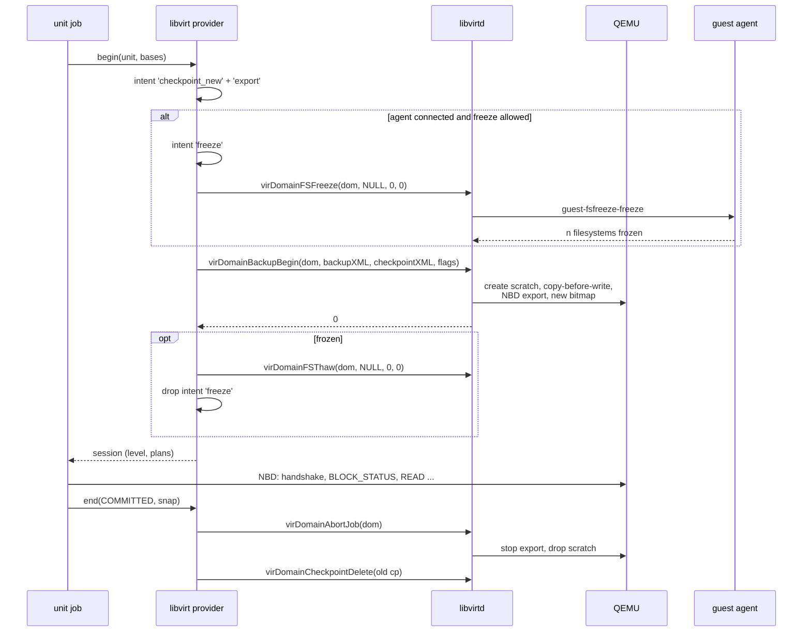
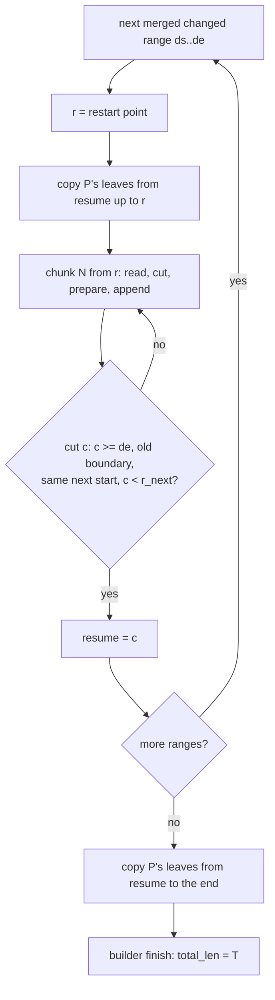

# VM disk backup (libvirt / QEMU)

Design document. Nothing here is built yet. It is the libvirt provider for
the source-provider interface in `source-providers.md`, which defines the
vtable, the consistency levels, the session lifecycle, the repository
representation, retention groups and the common API. This document covers
what is specific to virtual machines.

Host facts are from the read-only survey of FS1 and FS2,
`unraid-infra/fs2/c-backup-uat/SURVEY-sources.md` (2026-11-16), cited as
"survey".

## FORMAT IMPACT

**None.** A VM snapshot is an ordinary format 3 snapshot whose tree holds
`.cbackup-unit/` (`source-providers.md` section 7): each disk is a regular
file of the disk's virtual size whose content is a chunk list (holes are
gaps), and the domain XML, NVRAM and `unit.json` (consistency level, read
modes, checkpoint names) are small files. Incremental reads change how a
chunk list is computed, never what it is: an incremental session produces
the byte-identical list a full read of the same disk state would (5.3), so
readers cannot tell them apart. Checkpoint bindings are daemon-only state in
`state.db`; losing them costs one full read. The one prerequisite is the
`.cbackup-unit` name reservation in file backups, a behaviour change, not a
format change.

## 1. Scope and decisions

| Decision | Choice |
|----------|--------|
| Hypervisor | libvirt with the QEMU driver. Minimum libvirt 7.2 / QEMU 6.0 (pull-mode backup enabled by default); probed at run time. FS1 runs libvirt 12.2.0 / QEMU 10.2.3 with `<backup supported='yes'/>` (survey section 5) |
| Control | `libvirt.so` (user decision), through its public API only. No QMP passthrough (`virDomainQemuMonitorCommand`) ever: it taints the domain and puts state behind libvirt's back |
| Data, running VM | libvirt backup API in **pull** mode; c-backup reads the NBD export with a **native C NBD client** (user decision: no libnbd) |
| Data, shut-off VM | raw: read the file directly (`SEEK_DATA`/`SEEK_HOLE`); qcow2 and anything else: `qemu-nbd --read-only` spawned by the daemon, read by the same NBD client (2.4) |
| Consistency | guest-agent `fsfreeze` around the backup start when the agent is connected, else crash-consistent; the achieved level recorded per snapshot |
| Incremental | libvirt checkpoints (persistent qcow2 dirty bitmaps); changed ranges re-chunked from the previous CDC boundary until the chunker resyncs (5.3) |
| Raw disks | full read every session (libvirt checkpoints are qcow2-only); offline raw with an unchanged file reuses the previous root. An opt-in qcow2 external-data-file wrapper gives raw disks bitmaps without converting the data (5.6) |
| Passthrough disks | excluded by default, recorded as excluded (3.4) |
| Restore | sparse raw natively; qcow2 through `qemu-nbd`; domain re-define with name/UUID/MAC collision handling; read-only NBD export from the daemon for file-level recovery |
| Production VMs | not touched until the user says so; enforced by `units.allow` (`source-providers.md` 8.3) |

## 2. The provider on the interface

### 2.1 Units and items

`list_units`: `virConnectListAllDomains(conn, &doms, 0)`, both active and
inactive, persistent domains only (a transient domain has no inactive XML
to restore; it is listed with `supported: false`).

`describe`: `virDomainGetXMLDesc(dom, VIR_DOMAIN_XML_INACTIVE |
VIR_DOMAIN_XML_SECURE)` parsed with libxml2 (already a libvirt dependency),
plus the live XML for running domains (for the agent channel state and the
effective disk sources). Items:

| Item id | Kind | From |
|---------|------|------|
| `<target dev>` (`vda`, `hdc`) | BLOCK | each `<disk device='disk'>` that is not excluded (3.4) |
| `domain.xml` | BLOB | the inactive XML |
| `nvram` | BLOB | the file named by `<os><nvram>`, if any |
| `tpm` | TREE | the swtpm state directory, if `<tpm><backend type='emulator'>` |

For each disk: virtual size from `virDomainGetBlockInfo(dom, target,
&info, 0)` (`capacity`), allocation for progress estimates, format from the
XML `<driver type>`, source path or device, and `SP_CAP_INCREMENTAL` when
the format is qcow2 and the domain has no external snapshots (libvirt
forbids checkpoints while external snapshots exist).

### 2.2 Format detection

The survey found `runner-firmware/vdisk1.img` and `runner-general/vdisk1.img`
are qcow2 despite the extension. So:

1. The format is the domain XML's `<driver type>`, because that is what
   QEMU actually opens, and because probing a raw image is a known hole: a
   guest can write a qcow2 header into sector 0 of its raw disk, naming a
   backing file on the host, and a prober would then read host files.
2. The daemon also reads the first 4 bytes of the file natively (qcow2
   magic `QFI\xfb`) as a **sanity check only**. XML `qcow2` and no magic, or
   XML `raw` and the magic present, refuses the disk with an error naming
   both, rather than guessing. (A raw disk whose guest wrote the magic is
   reported and needs `formats_trust_xml: true` in the unit's enrolment.)
3. The extension is never consulted.

No `qemu-img` call is needed for detection.

### 2.3 Running VM: pull-mode backup



Backup XML (pull, unix socket, one scratch per disk, incremental where the
plan allows):

```xml
<domainbackup mode='pull'>
  <incremental>cbk-7f3a09c1-4126</incremental>        <!-- omitted for full -->
  <server transport='unix' socket='/run/c-backupd/nbd/cbk-7f3a09c1-4127.sock'/>
  <disks>
    <disk name='vda' backup='yes' type='file' backupmode='incremental'
          exportname='vda' exportbitmap='cbk-vda'>
      <scratch file='/mnt/cache/system/cbackup-scratch/cbk-7f3a09c1-4127-vda.qcow2'/>
    </disk>
    <disk name='vdb' backup='yes' type='file' backupmode='full' exportname='vdb'>
      <scratch file='/mnt/cache/system/cbackup-scratch/cbk-7f3a09c1-4127-vdb.qcow2'/>
    </disk>
    <disk name='hdd' backup='no'/>                      <!-- excluded passthrough -->
  </disks>
</domainbackup>
```

Checkpoint XML, created atomically with the backup by passing it as
`virDomainBackupBegin`'s `checkpointXML` (the bitmap must start at exactly
the instant the export's point in time is taken, or writes in between are
lost to the next incremental):

```xml
<domaincheckpoint>
  <name>cbk-7f3a09c1-4127</name>
  <description>c-backup daemon 7f3a09c1... repo d4011a91 job 4127</description>
  <disks>
    <disk name='vda' checkpoint='bitmap'/>
    <disk name='vdb' checkpoint='no'/>                 <!-- raw: no bitmap possible -->
  </disks>
</domaincheckpoint>
```

Rules:

- **Per-disk mode.** `backupmode` overrides the job-level incremental per
  disk, so one session can read `vda` incrementally and a newly added or
  resized `vdb` in full (5.7).
- **No checkpoint at all** when no disk can carry one (all raw): the
  `checkpointXML` argument is NULL.
- **Scratch** lives in `vm.scratch_dir`, a host path libvirt writes (it is
  QEMU's file, not c-backup's). It holds the old contents of clusters the
  guest overwrites during the session, so it grows with guest writes over
  the session's duration, at worst to the disk's size. Before `begin` the
  provider checks free space there against `vm.scratch_reserve_pct` of the
  disks' allocated size (default 25%) and refuses to begin below it. What
  QEMU does when scratch fills mid-session is the open risk R1 (section 12).
- **Flags.** `VIR_DOMAIN_BACKUP_BEGIN_PRESERVE_SHUTDOWN_DOMAIN` (defined in
  current headers) is passed when the library has it, so a guest that shuts
  down during the session keeps QEMU alive until the export ends instead of
  killing the read. Without it a guest shutdown ends the export: the read
  fails, the session aborts, and the next session runs offline.
- **End.** A pull-mode backup is ended with `virDomainAbortJob(dom)`; libvirt
  then stops the export and deletes scratch files it created. `end` calls it
  in both outcomes, and `sweep` calls it for any domain whose job info
  (`virDomainGetJobInfo`, operation `VIR_DOMAIN_JOB_OPERATION_BACKUP`) shows
  a backup c-backup started (matched through the intent row) and no running
  c-backup job owns.

### 2.4 Shut-off VM

The domain is `VIR_DOMAIN_SHUTOFF`. QEMU is not running, so there is no
export and no checkpoint; the disk is read from the image file.

**raw.** `cdc_store_fd`'s own span walk: `SEEK_DATA`/`SEEK_HOLE`, `pread`,
the read-ahead ring. No new code, no dependency.

**qcow2 (and anything else QEMU reads).** Decided: spawn
`qemu-nbd --read-only --force-share --persistent=off --cache=none
--format=<xml format> --socket=<private socket> --export-name=disk <image>`
and read it with the same NBD client as the online path. Reasons:

| Option | Verdict |
|--------|---------|
| `qemu-nbd` + native client | Chosen. One read path for online and offline, so the two produce identical chunk lists for identical content; full qcow2 fidelity (compressed clusters, backing chains, subclusters, zstd, external data files) from the reference implementation; the dependency is one binary from `qemu-utils` (the image already needs it for qcow2 restore, 7.1). It is present on every libvirt host (FS1 has `/usr/bin/qemu-img`); in the Docker image it adds the `qemu-utils` package |
| Native qcow2 reader | Rejected. A read-only subset is about 1,500 lines, and every unhandled corner (compressed clusters, backing chains, extended L2, external data, encryption) is a silently wrong backup. Not worth it to save one binary |
| libnbd | Excluded by the user |
| `qemu-img convert` to a pipe | Rejected: loses holes, cannot stream raw output to stdout, no block status |
| Starting the domain paused to use the backup API | Rejected: claims passthrough devices, attaches networks, runs firmware; that is touching the VM |

`--force-share` opens the image without QEMU's image locks, so a backup
never stops the user starting the VM. The cost is that the VM could start
mid-read, so the provider detects it instead of preventing it: it records
`virDomainGetState`, and the image's `st_size`, `st_mtime` and `st_ctime`
(after following symlinks; survey: `/mnt/user/domains` is a symlink to
`../cache/domains`) before the read and again after the last byte. Any
change, or a lifecycle event for the domain during the read
(`virConnectDomainEventRegisterAny`, `VIR_DOMAIN_EVENT_ID_LIFECYCLE`), fails
the item with `vm started during offline read`; the job retries the unit
once, online. QEMU opening a qcow2 read-write updates its header (the dirty
flag) even with no guest write, so ctime catches it; a raw file opened but
not written is still identical, which is the only thing that matters.

**Unchanged since the last backup.** If the domain was shut off at both
sessions and the image's `(st_ino, st_size, st_mtime, st_ctime)` equal
what the token row recorded, the item is `SP_READ_UNCHANGED`: the previous
root is reused without opening the file, as the file cache does for files.

Shut-off qcow2 encrypted with LUKS cannot be read without its secret and is
refused with a message saying so (online, QEMU decrypts and the export is
plaintext; that works).

**Other states.** `PAUSED` and `PMSUSPENDED` have a QEMU process and use the
online path (freeze is skipped: a paused or suspended guest cannot run its
agent). A domain with a managed save image (`virDomainHasManagedSaveImage`)
is shut off for this purpose and its disks are read offline; the result is
`crash`, not `offline`, because the disk state belongs with a memory image
c-backup does not capture. The save image is not backed up in 1.0.

### 2.5 Consistency levels achieved

| Situation | Level |
|-----------|-------|
| shut off, no managed save | `offline` |
| shut off with managed save | `crash` |
| running, freeze returned success and thaw happened after `virDomainBackupBegin` returned | `quiesced` (Linux agent) or `application` (Windows agent: qemu-ga freezes through VSS, so VSS-aware applications take part) |
| running, no agent, freeze disabled, freeze failed, or the watchdog thawed before begin returned | `crash` |

### 2.6 Freeze and thaw

**Presence.** The live XML's
`<channel type='unix'><target type='virtio' name='org.qemu.guest_agent.0'
state='connected'/></channel>`. No channel or `state='disconnected'` means
no agent: `crash`, without trying. (All five FS1 domains have a responding
agent, survey section 5.)

**Policy** per unit: `vm.freeze` default `auto` (freeze when connected),
`off`, or `required` (fail the unit if it cannot freeze).

**The window** is only `virDomainBackupBegin`: freeze, begin, thaw. Begin
sets up copy-before-write and the export; it does not copy data, so the
window is typically well under a second. Data is read after the thaw, from
the point-in-time export.

**Timeouts.** libvirt bounds agent calls by the domain's agent response
timeout. c-backup does not change it (`virDomainAgentSetResponseTimeout`
alters the domain's runtime settings, which is touching the VM). Instead:

- the freeze runs with a watchdog at `vm.freeze_timeout_s` (default 10);
- if the freeze call itself has not returned by then, the watchdog issues
  `virDomainFSThaw`. libvirt serialises agent commands, so that thaw queues
  behind the freeze and runs the moment it returns, whatever its result;
- if the freeze returned but `virDomainBackupBegin` is still running at the
  deadline, the watchdog thaws immediately (agent jobs and the backup job
  are separate in libvirt) and the session is recorded `crash` with the
  warning `freeze held past N s; thawed before backup start`;
- the worst-case hold is therefore the agent's own timeout plus the begin,
  and this is stated in the Manual rather than promised away.

**Always thaw.** The thaw is in every path out of `begin`: success, begin
failure, cancellation, a freeze that returned an error (qemu-ga thaws on a
failed freeze, but a partial freeze is possible and a thaw on an unfrozen
guest is harmless). The `freeze` intent row is written before the freeze
and removed after a successful thaw; a daemon that dies in between thaws at
start (`sweep`), and under the host helper option the helper's own watchdog
thaws without waiting for the daemon (`source-providers.md` section 11).

**Partial freeze.** `virDomainFSFreeze` with no mountpoints freezes all or
fails; the returned count is recorded in `consist_flags`.

## 3. Choosing disks

### 3.1 Default inclusion

| Disk | Default |
|------|---------|
| `device='disk'`, `type='file'` | included |
| `device='disk'`, `type='volume'` (libvirt storage pool) | included |
| `device='disk'`, `type='network'` (rbd, iscsi, nbd) | included online only (QEMU reads it); offline refused |
| `device='cdrom'`, `device='floppy'`, `<readonly/>`, `<shareable/>` | excluded: install media and shared disks are not this VM's state |
| `device='lun'`, or `type='block'` | excluded as passthrough (3.4) |

Per-unit enrolment can exclude any disk (`exclude_items`) and include an
excluded one (`include_items`).

### 3.2 Identity of a disk across sessions

A disk is its `target dev` within its domain. The token row also records
the source path, format and virtual size; if any differ from the last
session, the disk is treated as new (`item-source-changed`, full read) even
though its target name is the same.

### 3.3 NVRAM and TPM

The NVRAM file and swtpm state are read from host paths, so they need the
host directories mounted read-only into the daemon's container at the same
paths. On Unraid, NVRAM is under `/etc/libvirt/qemu/nvram/`, which is the
loop-mounted `libvirt.img` (survey: `/mnt/cache/system/libvirt/libvirt.img`
mounted at `/etc/libvirt`). The TPM state location on Unraid 7.4 is to be
confirmed (open question Q6). A missing NVRAM file for a domain that names
one fails the unit: a UEFI VM restored without its variables may not boot.

### 3.4 Passthrough disks

DLBox has a 4 TB whole-disk passthrough
(`/dev/disk/by-id/ata-Samsung_SSD_870_EVO_4TB_...`, survey section 5).
Passthrough disks are **excluded by default** and appear in the unit's
`unit.json` and the UI as `excluded: passthrough`, so the gap is visible on
every snapshot rather than discovered at restore time. Reasons:

- they cannot carry a checkpoint (not qcow2), so every session would read
  every allocated byte: about 2.2 hours per session for 4 TB at SATA speed,
  while copy-before-write slows the guest's writes for the whole time;
- the data is usually better backed up as files from inside the guest, or
  by a file backup of whatever the guest exports;
- a block device has no holes at the host level unless it supports
  discard-zeroes reporting, so the read is the whole device.

Opting in (`include_items: ["hdd"]`) works through the same pull export:
QEMU reads the device. The UI warns with the estimated read time.

## 4. The native NBD client

`src/providers/nbd_client.{c,h}`, used by the online path, the offline
qcow2 path, qcow2 restore (7.1) and the tests.

### 4.1 Protocol subset

- **Transport:** unix socket (TCP is not used in 1.0).
- **Handshake:** fixed newstyle. Client flags `NBD_FLAG_C_FIXED_NEWSTYLE |
  NBD_FLAG_C_NO_ZEROES`.
- **Options**, in order: `NBD_OPT_STRUCTURED_REPLY` (required: refuse a
  server without it), `NBD_OPT_EXTENDED_HEADERS` when offered (64-bit
  lengths; QEMU 9+), `NBD_OPT_SET_META_CONTEXT` with `base:allocation` and,
  for an incremental item, `qemu:dirty-bitmap:<exportbitmap>`, then
  `NBD_OPT_GO` with `NBD_INFO_BLOCK_SIZE` requested.
- **Checks after GO:** export size equals the disk's virtual size from
  `describe`; transmission flags include `NBD_FLAG_READ_ONLY`; every
  requested meta context was acknowledged with an id. A missing
  dirty-bitmap context is not an error: the item falls back to a full read
  (`token-invalid`).
- **Commands:** `NBD_CMD_READ`, `NBD_CMD_BLOCK_STATUS`, `NBD_CMD_DISC`.
  Never a write on a backup connection.
- **Replies:** structured. `OFFSET_DATA` and `OFFSET_HOLE` chunks are placed
  by offset into the request buffer (a hole chunk is zero-filled); `ERROR`
  and `ERROR_OFFSET` chunks fail the request with the server's message;
  `BLOCK_STATUS` (or `BLOCK_STATUS_EXT`) descriptors are delivered per
  context. Every chunk is validated: inside its request, no overlap, the
  request fully covered when `NBD_REPLY_FLAG_DONE` arrives, unknown chunk
  types refused, lengths bounded before any allocation.

### 4.2 Hole semantics

`base:allocation` reports `NBD_STATE_HOLE` (1) and `NBD_STATE_ZERO` (2).
Only `ZERO` means "reads as zeroes"; `HOLE` without `ZERO` (an unallocated
cluster over a backing file, in some configurations) is data. An
`OFFSET_HOLE` reply chunk zero-fills the buffer but never changes the span
structure: spans come from the zero-run rule (5.2) alone, so the chunk list
does not depend on how the server chose to encode a reply.

### 4.3 Request sizing and pipelining

- Reads of `vm.nbd_request_kb` (default 4096) with up to
  `vm.nbd_queue_depth` (default 8) in flight per disk: 32 MiB in flight,
  inside QEMU's 32 MiB maximum request, comfortably above the chunker's
  8 MiB maximum chunk, and large enough that per-request cost is noise on a
  unix socket. The constraints from `NBD_INFO_BLOCK_SIZE` (minimum,
  preferred, maximum) clamp both.
- The NBD source keeps its queue ahead of the chunker the way the read-ahead
  ring does for files: the chunker consumes in order, the client refills.
- When the server sets `NBD_FLAG_CAN_MULTI_CONN`, up to 2 connections per
  disk; otherwise pipelining on one. Measured before it becomes a default.
- Block status is queried in 1 GiB windows, both contexts in one request,
  and consumed forward: no allocation map is ever collected (design
  constraint 3).

### 4.4 Failure handling

| Failure | Handling |
|---------|----------|
| connect refused / socket missing | `begin` succeeded but the export is absent: abort the session, `end(ABORTED)` |
| per-request timeout (`vm.nbd_timeout_s`, default 120) or EOF | reconnect once (QEMU's server accepts reconnects to a live export), re-issue every request still outstanding (reads are idempotent); a second failure fails the item and the session |
| `ERROR` chunk | fail the item with the server message; no retry (QEMU reports real I/O errors this way) |
| malformed reply | fail the item; the connection is not trusted further |
| domain shut down mid-read (without `PRESERVE_SHUTDOWN_DOMAIN`) | EOF on reconnect: fail the session; the unit is retried offline in the same job |
| cancel | `NBD_CMD_DISC`, close, `end(ABORTED)` |

A failed item never produces a partial snapshot: the unit's snapshot is
committed only when every included item stored.

## 5. Incremental

### 5.1 Checkpoints and bitmaps

A libvirt checkpoint creates a persistent dirty bitmap, named after the
checkpoint, in each qcow2 disk it covers. Every checkpoint's bitmap records
from its creation onward, independently of the others (libvirt's
incremental-backup internals document: bitmaps are self-contained), so an
incremental backup "since checkpoint X" uses X's bitmap, and deleting an
older checkpoint does not disturb a newer one. A bitmap is usable only if
it is in the active image, recording, and not marked inconsistent; QEMU
marks a persistent bitmap inconsistent ("in-use") when it was not saved
cleanly, after a QEMU crash or host power loss, and libvirt then refuses
the incremental. Granularity is the qcow2 default, the cluster size,
64 KiB.

c-backup's chain is one checkpoint per (repository, domain): the one
created by the last committed session. Checkpoint names carry the daemon id
and job id (`cbk-<daemon8>-<job>`), and `<description>` names the daemon,
repository and job; `sweep` deletes only checkpoints that pass all three
ownership checks of `source-providers.md` section 6.3.

### 5.2 Spans: holes are maximal zero runs

For VM disks the provider defines the chunker's spans by content, not by
the allocation map:

> A hole is a maximal run of zero bytes at least `CDC_HOLE_MIN` (64 KiB)
> long. Everything else is data, chunked span by span as in format 3.

`base:allocation` `ZERO` extents and `SEEK_HOLE` holes are used only as a
shortcut to know bytes are zero without reading them; the boundaries of a
zero run are found by looking at the bytes on either side. Consequences:

- **Canonical across read paths.** The same guest content gives the same
  chunk list online or offline, raw or qcow2, sparse or preallocated, on
  ZFS or xfs. That is what lets an offline session's list be the base for
  an online incremental and vice versa.
- **The classic CDC zero pathology disappears.** A long zero run inside data
  would otherwise be cut every 8 MiB from wherever its chunk started, so two
  snapshots whose chunk phases differ never resync inside it. As a hole it
  is not chunked at all.
- **Restores are thin.** Zero runs come back as holes.
- It differs from a file backup of the same image file, which uses the
  filesystem's hole map: the same bytes, a different list; their data
  chunks still dedup. Accepted, as `repo-format.md` already accepts it for
  differing hole maps.

The zero scan runs at memory bandwidth over data already in the read
buffer, an order of magnitude above the 4.7 GB/s boundary scan.

`vm.trust_zero_status` (default 1) allows skipping reads of `ZERO`
extents. UAT runs once with it at 0 and a verification mode that reads
every `ZERO` extent and checks it is zero (section 10.4).

### 5.3 The delta algorithm

**Inputs** for one disk:

- `P`: the previous snapshot's chunk list for this disk (the token's
  `item_root`), length `T`. Its leaves are `(o_i, l_i, h_i)`, ascending.
  Because its holes are maximal zero runs of at least 64 KiB, two leaves
  either abut (same span) or are separated by a hole of at least 64 KiB.
- `D`: the changed ranges from the dirty bitmap, ascending, each rounded
  out to the bitmap granularity. Adjacent or overlapping ranges are merged.
- the new disk image `N` (the export), same length `T` (5.7 handles
  resizes: they are full reads).

**Correctness assumption:** every byte of `N` outside `D` equals the byte at
the same offset in the state `P` was read from. Nothing else is assumed. In
particular the algorithm does not assume `P`'s span structure was produced
by the same read path: if it was not, the output is still byte-correct.

**Facts used.**

- F1. Disk writes are in place: no byte ever moves to another offset.
- F2. The chunker's decision to cut at position `x` depends only on the
  bytes from the current chunk's start to `x` and on whether `x` is the end
  of a span. At a chunk start the chunker state is fresh (`cdc_reset`).
- F3. Every leaf start in `P` is a fresh chunker state: either a cut (the
  previous leaf ended there) or a span start.
- F4. A change to bytes in `[ds, de)` can change span structure only at
  positions `>= ds - CDC_HOLE_MIN + 1` on the left: a zero run whose length
  crosses the 64 KiB threshold because of the change must reach `ds`, and
  on the short side it is under 64 KiB, so it starts after
  `ds - CDC_HOLE_MIN`. A zero run of 64 KiB or more on both sides keeps its
  left end, because the bytes before `ds` are unchanged.

**Restart point.** For a merged changed range `[ds, de)`:

```
p0 = max(0, ds - CDC_HOLE_MIN)
r  = start of the leaf of P containing p0;
     if p0 lies in a hole of P: start of the last leaf before that hole;
     if there is none: 0
r  = max(r, resume)              # resume: where the previous resync left off
```

By F3 the chunker is fresh at `r` in `P`; the bytes and spans before `r` are
unchanged (F4), so the new chunker cutting `N` would be fresh at `r` too.
Starting there costs at most one extra leaf read in the uncommon case that
`ds` lies within 64 KiB of a leaf start (about 5.5% of ranges at a 1.16 MiB
mean chunk) or after a hole.

**Re-chunk and resync.** From `r`, run the chunker over `N`: spans from the
zero-run rule (block status and bytes of `N`), data read through the export,
chunks prepared on the workers exactly as a full read would. After each
new cut at position `c`, test for resync:

```
resync at c  iff  c >= de
             and  c == o_j + l_j for some leaf j of P      (an old boundary)
             and  the next data byte of N at or after c
                  == o_{j+1} (or T if j is the last leaf)    (same next start)
             and  c < r_next                                 (r of the next range)
```

The second condition places `c` on an old boundary; the third says both
sides continue from the same position with the same kind of boundary
(content cut or span end), so both chunkers are fresh at the same place
with identical bytes and spans ahead until the next range's influence
begins at `r_next` (F1, F4). If `c >= r_next`, the next range is absorbed and
the re-chunk simply continues. On resync: copy `P`'s leaves from `c` up to
`r_next` verbatim into the list builder, set `resume = c'` where copying
stopped, and repeat for the next range. After the last range, copy the rest
of `P`'s leaves.



**Why the output equals a full read.** By induction over the walk: up to
`r` the leaves equal what a full read of `N` produces (unchanged bytes and
spans, fresh state at `r`); from `r` to `c` they are produced by the same
chunker over the same bytes; at `c` both are fresh with identical input
until `r_next`, so the full read would cut exactly at `P`'s boundaries there
and produce `P`'s leaves, which have the same hashes because the bytes are
the same. The list builder groups leaves into sub-lists from the leaf
sequence alone (`chunklist.c`'s content-defined grouping), so feeding it the
same leaves produces the same sub-lists and the same root. The fake
provider's central test asserts exactly this: incremental root == full root
for the same state, over randomised in-place writes, zero fills, hole
punches, hole fills, writes within 64 KiB of holes and of span ends, and
writes in the last chunk (section 10.1).

**Why resync is bounded, and how fast it is.** There is no deterministic
bound shorter than the span: in a fully allocated disk the only boundary
guaranteed common to both is the end of the span (or the disk). The cost
of not resyncing is reading, never correctness. The expected cost is small,
and F1 is why. The re-chunk starts at an old chunk start with identical
state; after `de` the new chunker sees the same bytes at the same offsets.
It reproduces `P`'s next cut `b` unless (a) a new cut appeared inside the
changed bytes (probability about `m / avg` for `m` changed bytes past the
first `min` of the chunk), or (b) the 63-byte window before `b` lay inside
the change. If either happens, the new chunk starts at some `c'` instead,
and it lands on an old boundary as soon as one satisfies the cut predicate
at distance `>= min` from `c'`: an old cut made under the strict mask
`mask_s` satisfies the loose mask `mask_l` too, because `mask_l`'s bits are
a subset of `mask_s`'s. In practice that is the next or second-next old
boundary. Measured on random data (`test_cdc`): a 1-byte insert costs one
new chunk, a 2% mid-file rewrite four, and an insert is harder than an
in-place write. So an isolated changed range costs about one mean chunk of
reading (1.16 MiB) plus the range, and a long range about the range plus
one or two chunks.

Each session records `resync_bytes` (bytes re-read beyond the changed
ranges) in the job result and `unit.json`; the bench measures its
distribution on real images (section 11).

**The amplification to expect.** Bitmap granularity is 64 KiB and the mean
chunk 1.16 MiB, so an isolated dirty granule costs about one whole chunk of
reading: about 18 times its size. This is inherent to any chunk-granular
dedup (a 4 MiB fixed-block scheme pays 64 times), and it costs reads, not
writes: only the changed chunks are new.

**Worst case against a full read.** Let `F` be the data bytes of the disk
(the sum of `P`'s leaf lengths: everything a full read would read), `L` the
number of leaves, `mu = F / L` the disk's own mean chunk, `g` the bitmap
granularity, and `d` the dirty fraction of `F`. If `n = d F / g` granules
are dirty and scattered uniformly, the fraction of leaves touched is about
`1 - exp(-n / L) = 1 - exp(-d mu / g)`, and an incremental reads about that
fraction of `F` (plus about 5% for granules straddling a boundary and the
64 KiB lookbehind):

| Dirty fraction `d` (scattered 64 KiB granules) | Incremental reads, as a fraction of a full read | Amplification over dirty bytes |
|---:|---:|---:|
| 0.1% | 1.8% | 18x |
| 0.5% | 8.9% | 18x |
| 1% | 17% | 17x |
| 2% | 31% | 16x |
| 5% | 60% | 12x |
| 7.5% | 75% | 10x |
| 10% | 84% | 8x |
| 20% | 98% | 5x |
| 50% | 100% | 2x |

The worst case is one dirty granule in every leaf: the incremental reads
every data byte, exactly what a full read reads, plus the cost of walking
`P` (seconds per TiB) and the lookbehind reads. It is never meaningfully
worse than a full read, and clustered writes (the common case: a database
file, a log, an upgrade) sit far below the scattered curve, at about the
dirty bytes plus one chunk per cluster.

**The fallback rule.** Before reading any data, the provider computes the
incremental's read estimate `E` exactly from `P` and `D`, with no I/O on the
disk:

```
for each merged changed range [ds, de):
    r = restart point (as above)
    e = end of the leaf of P containing byte de - 1,
        or de if that byte lies in a hole of P
clusters = the intervals [r, e), merged where they overlap or touch
E = sum over clusters of (e - r)  minus the bytes of P's holes inside them
F = sum of P's leaf lengths
```

`e` is where the re-chunk resyncs in the common case (the next old boundary
after the change), so `E` is what the incremental reads unless a divergent
cut extends a cluster by a chunk or two; it is a slight underestimate, never
an overestimate. If

```
100 x E > vm.delta_full_pct x F      (default 75)
```

the disk is read in full instead (`read_mode: full`, reason
`delta-too-costly`), still under the new checkpoint, so the chain continues.
At the default this switches at about 7.5% scattered dirty data. The
threshold is below 100% because `E` underestimates, because the full read
avoids the walk and the per-cluster restarts, and because a full read with
a valid bitmap in hand is a free audit (5.4): the provider runs the audit's
checks on it, so an expensive incremental is replaced by a verification.
`0` disables incrementals for the unit; `100` switches only when the
estimate reaches a full read. (A percentage, because the config format
takes whole numbers.)

`E`, `F`, the cluster count and the threshold are recorded per disk in
`unit.json`, so the decision is visible in the history.

**Cost of the walk.** Feeding the builder every leaf of `P` is O(leaves):
about 900,000 per TiB of data, about 220 list objects to load and verify
(about 50 MB), and the builder re-hashing unchanged sub-lists, which dedup
on put. Seconds per TiB. An empty `D` skips it entirely: the new root is
`P`'s root (`SP_READ_UNCHANGED`). Splicing whole unchanged sub-lists without
re-feeding their leaves is a later optimisation; it needs a builder entry
point that appends a known sub-list when the grouping state allows it.

**API.** A new engine entry point next to `cdc_store_source`:

```c
/* Store the content of src as cdc_store_source would, given that it equals
 * the content named by base everywhere outside the ranges changed() yields.
 * Produces the same hash a full cdc_store_source over src would. */
status_t cdc_store_delta(const cdc_params_t *p, store_t *store,
                         const uint8_t base[OBJECT_HASH_SIZE],
                         const cdc_source_t *src,
                         status_t (*changed)(void *ctx, uint64_t from,
                                             uint64_t *s, uint64_t *e, int *done),
                         void *changed_ctx,
                         const obj_sink_t *sink, const cdc_opts_t *opts,
                         cdc_delta_result_t *out);   /* + resync_bytes, ranges */
```

It walks `P` with `chunklist_iter` (memory bounded by nine lists) and needs
a chunker that can be started at an arbitrary fresh position and stopped on
a caller's decision, which is `cdc_scan` plus the span walker already in
`cdc.c`, restructured so the loop is callable per region.

### 5.4 Staleness: never trust a bitmap that might be wrong

An incremental is only as right as the claim "nothing outside `D` changed".
Each layer below catches a different way that claim can be false:

| Layer | Catches |
|-------|---------|
| libvirt refuses `<incremental>` for a missing, non-recording or inconsistent bitmap | QEMU crash, host power loss, image recreated without the bitmap, bitmap removed by hand |
| token row must bind: checkpoint exists, its `<description>` is ours, its snapshot still exists and still names `item_root` at the disk's path | pruned or deleted base snapshot, database restored from an older copy, checkpoint created by someone else under our name |
| identity check: domain UUID, target, source path (resolved), format, virtual size, and the image's `st_ino` | disk swapped for another file, VM redefined onto another image, resize |
| domain has external snapshots | libvirt would refuse the checkpoint anyway; reported as `no-incremental-support` |
| **audit read** every `vm.audit_days` (default 30) and on demand | anything the above cannot see, notably an image overwritten in place by an older copy of itself that still carries a same-named bitmap |

The audit is a full read that also checks the incremental path against
reality. While reading `N` in full, the provider still asks for `D` (the
bitmap since the base). For every leaf of `P` lying wholly outside `D`, the
bytes of `N` at that range must hash to that leaf's name, and every hole of
`P` outside `D` must read as zero in `N`. Hashing a range that is not one
of the full read's own chunks costs one extra SHA-256 pass over it (about
2 GB/s). A mismatch means the bitmap missed a change:

- the audit snapshot itself is correct (it is a full read);
- the job reports `bitmap audit failed: N bytes changed outside the dirty
  bitmap at <first offset>`, the journal records it, a Pushover alert goes
  out, `cbackup_vm_bitmap_audit_failures_total` increments;
- the unit's tokens are dropped and incrementals stay off for that unit
  (`unit_enrolment.incremental_disabled_reason`) until
  `reset-incremental`, because a bitmap that lied once is a configuration
  problem to find, not to retry.

Snapshots taken incrementally since the last good audit are then suspect;
the alert names them. There is no silent path.

### 5.5 Raw disks

libvirt checkpoints are qcow2-only (libvirt's checkpoint format
documentation: "only for qcow2 disks at the active layer"). A raw disk
therefore has no bitmap through any supported API, persistent or not; the
only route to a transient bitmap on raw is QMP passthrough, which is
excluded (section 1). So:

- a running raw disk is read in full every session through the pull export
  (with holes skipped via `ZERO`), `read_mode: full`, reason
  `no-incremental-support`;
- a shut-off raw disk whose file is unchanged is `SP_READ_UNCHANGED`;
- a full read is still a dedup backup: only changed chunks are written.

On FS1 that is Noah MC (256 GiB virtual, 77.6 GiB allocated) and DLBox's
system disk (127 GiB / 32.9 GiB). At 1 GB/s that is about 80 and 35 seconds
of reading per session, during which copy-before-write taxes the guest's
first write to each cluster. Acceptable for a nightly schedule; the bench
measures it on FS1 before UAT conclusions are drawn.

Because raw has no bitmap at all, "a raw image loses its bitmap on VM
restart" does not arise: there is nothing to lose. What does arise for qcow2
is loss through an unclean stop: QEMU killed or the host losing power marks
the bitmap inconsistent, libvirt refuses the incremental, the provider sees
the refusal from `virDomainBackupBegin`, deletes that checkpoint (it is
ours and useless), and repeats `begin` as a full read with a new
checkpoint: `read_mode: full`, reason `token-invalid`. One extra round trip,
no user action.

### 5.6 Opt-in: raw data under a qcow2 metadata file

QEMU can keep a disk's data in a raw file and its metadata, including
persistent bitmaps, in a small qcow2 file (`data_file` with
`data_file_raw=on`). The raw file stays a valid raw image at all times, so
nothing about the data changes, and the domain gains checkpoint support.

Procedure (documented in the Manual as an operator step; **c-backup never
converts anything itself, and nothing here is done without the user's
explicit OK per VM**):

1. Shut the VM down. Take a ZFS snapshot of the dataset holding the image
   (Noah MC has its own dataset, survey section 2) as the rollback point.
2. Create the metadata file over the existing raw file without rewriting it,
   for example
   `qemu-img create -f qcow2 -o data_file=vdisk1.img,data_file_raw=on,preallocation=metadata vdisk1.qcow2 256G`,
   **after verifying on a disposable copy that this QEMU version opens the
   existing data file rather than creating (truncating) it**. This is the
   step with real risk; the procedure must be proven on a scratch copy of
   the same size first, comparing checksums of the raw file before and
   after.
3. Change the domain's disk to `<driver type='qcow2'/>` and
   `<source file='.../vdisk1.qcow2'><dataStore type='file'><format
   type='raw'/><source file='.../vdisk1.img'/></dataStore></source>`
   (libvirt's data-store syntax; confirm support in 12.2.0).
4. Boot, check the guest, take a c-backup session (full, creates the first
   checkpoint), then a second (incremental).
5. Rollback is the ZFS snapshot and the old XML.

Risks: the truncation hazard above; a tool that writes the raw file
directly while the VM is off bypasses the bitmap (the audit catches it);
Unraid's VM manager may rewrite the disk XML when the VM is edited in its
UI, silently reverting the change (to check on a disposable VM); and one
more file per disk that must move with the image. This is presented as an
option for Noah MC and DLBox, not a recommendation; at their sizes a full
read is cheap (5.5).

### 5.7 Disks added, removed, resized, swapped

| Event | Effect |
|-------|--------|
| disk added | no bitmap of the base checkpoint covers it: `backupmode='full'` for that disk, reason `item-new`; the new checkpoint covers it from now on |
| disk removed | absent from the new snapshot's tree; its token row is deleted after commit |
| resize (grow or shrink) | `virDomainBlockResize` resizes the bitmap, but the base list has the old length and its last span's forced end moves: that disk reads in full, reason `item-resized`. Resizes are rare and a full read is the simple safe answer |
| source swapped (same target, other file) | `item-source-changed`, full |
| VM redefined with a new UUID | a different unit; the old unit's history stays |

### 5.8 Checkpoint lifecycle and retention

Per (repository, domain), after each session:

| Outcome | Action |
|---------|--------|
| committed | bind the new checkpoint in `unit_tokens` (with its XML, the new snapshot id and each disk's root), then delete the previous checkpoint and any other `cbk-<daemon8>-*` checkpoint of this repository on this domain. A delete that fails is retried by `sweep` |
| aborted after begin | delete the new checkpoint; keep the old binding |
| begin failed | nothing was created (libvirt creates the checkpoint with the backup, atomically) |

So each repository keeps exactly one checkpoint per domain, and each bitmap
costs QEMU a little write-path work and 2 MiB of bitmap per TiB of disk.
Two repositories backing up one VM keep two.

Retention: every snapshot is a complete chunk list, so pruning any snapshot
breaks nothing except, possibly, the next incremental: if the snapshot the
token names is pruned or deleted, the binding check fails (`base-pruned`),
that session reads in full, and the old checkpoint is deleted when the new
one binds. GFS never prunes a group's head (`source-providers.md` 8.1), and
the head is the token's snapshot in steady state, so scheduled retention
never costs a full read.

**Checkpoint metadata on Unraid.** libvirt keeps checkpoint metadata on the
host (`/var/lib/libvirt/qemu/checkpoint/<domain>/` by default), while the
bitmaps live in the qcow2 files. Unraid's root filesystem is RAM (survey
section 6): if that directory is not on persistent storage, a host reboot
leaves the bitmaps and forgets the checkpoints. The token row keeps the
checkpoint XML for this: when `virDomainCheckpointLookupByName` fails but
the row is otherwise valid, the provider re-creates the metadata with
`virDomainCheckpointCreateXML(dom, xml, VIR_DOMAIN_CHECKPOINT_CREATE_REDEFINE
| VIR_DOMAIN_CHECKPOINT_CREATE_REDEFINE_VALIDATE)`; `REDEFINE_VALIDATE`
makes libvirt check the bitmaps are present and consistent. If it refuses,
full read. Where Unraid 7.4 keeps that directory is open question Q2.

## 6. Representation

Per `source-providers.md` section 7, with:

```
.cbackup-unit/
  unit.json
  config/domain.xml        inactive XML; SECURE only into encrypted repos (below)
  config/nvram.fd
  config/tpm/...           swtpm state, when present
  disks/<target>           one per included disk
```

`VIR_DOMAIN_XML_SECURE` includes passwords (VNC/SPICE) and secret
references. They are written into an encrypted repository; into an
unencrypted one the XML is fetched without `SECURE`, and the snapshot
carries the warning `domain XML stored without secrets (repository is not
encrypted)`. Restore then asks for new graphics passwords if the XML had
them.

## 7. Restore

### 7.1 A disk to an image

- **raw** (default): `content_restore_fd` into a fresh file: leaves
  `pwrite` at their offsets, `ftruncate` to the virtual size, holes stay
  holes. Already exists; the disk is just a file.
- **qcow2**: `qemu-img create -f qcow2 <dest> <size>`, then `qemu-nbd
  --format=qcow2 --cache=writeback` on it, and the NBD client writes each
  leaf with `NBD_CMD_WRITE` (holes are never written, so the qcow2 stays
  thin), then `NBD_CMD_FLUSH` and `NBD_CMD_DISC`. No temporary raw copy,
  same dependency as the offline read.
- **block device**: `pwrite` leaves, and `BLKZEROOUT` for holes unless the
  device reports discard-zeroes; `--no-zero-holes` for a device known to be
  zeroed.
- `--preallocate` falls back to `fallocate` for holes, for users who want
  thick images.

Writes go to `<dest>.cbk-partial`, renamed into place after `fsync`, so a
failed restore never leaves a plausible-looking image.

### 7.2 Re-defining the domain

`POST /repos/<id>/snapshots/<sid>/unit/restore` with
`{"mode":"unit","dest_dir":"/mnt/cache/domains/restored","define":true,...}`:

1. **Preflight** (`restore_preflight`, changes nothing): parses the
   snapshot's `domain.xml`; lists collisions and dangerous settings.

   | Check | Default behaviour |
   |-------|-------------------|
   | a domain with the same UUID exists | new UUID (the `<uuid>` element is removed so libvirt generates one) |
   | a domain with the same name exists | name `<name>-restored-<snapid>`, or `name` from the request |
   | MAC addresses | regenerated (removed, libvirt generates) unless `keep_macs`, because two VMs with one MAC on one bridge break both |
   | disk sources | rewritten to the restored files under `dest_dir` |
   | NVRAM path | restored next to the disks and rewritten |
   | `<hostdev>` (PCI/USB passthrough), `type='block'` disks, `<filesystem>` host directories | listed as privileged; define refused without `accept_privileged` (`source-providers.md` section 11) |
   | excluded disks (passthrough) | removed from the definition, listed |

2. **Data**: every disk restored (7.1), NVRAM and TPM state written.
3. **Define**: `virDomainDefineXML(conn, xml)`. The domain is defined, not
   started; `start: true` in the request starts it.
4. **Replace in place** (`replace: true`): only for a domain that exists
   and is shut off; preflight shows what will be overwritten; disks are
   restored to temporary names beside the originals and renamed over them
   only after every disk restored, then the XML is redefined. Its
   c-backup checkpoints are deleted with `VIR_DOMAIN_CHECKPOINT_DELETE_METADATA_ONLY`
   (the bitmaps belonged to the overwritten images) and its token rows
   dropped, so the next session is full. Never on a running domain.

### 7.3 NBD export for file-level recovery

The daemon serves a snapshot's disk read-only over NBD, so a user can
mount filesystems from it without restoring a whole image.

**Server.** `src/api/nbd_server.c`: fixed newstyle, structured replies,
`NBD_OPT_GO`/`INFO`, `base:allocation` (holes from the chunk list's gaps,
so clients see the disk as sparse), `NBD_FLAG_READ_ONLY |
NBD_FLAG_CAN_MULTI_CONN`, `NBD_CMD_READ`, `NBD_CMD_BLOCK_STATUS`,
`NBD_CMD_DISC`. Writes are refused. One thread per connection; a handful
of clients is the use case.

**Random access.** A reader resolves an offset to a leaf by descending the
list tree (binary search per level, at most nine levels), with a small LRU
of parsed lists (64) and of verified leaves (16, under the read budget).
Every leaf is hash-checked before a byte is served; a leaf that fails
returns an NBD `EIO` error for that request and is logged with its name.

**Concurrency with maintenance.** An export is not a job (it may live for
hours and must not hold the repository lock). Instead it **pins** its
snapshot: prune and delete refuse a pinned snapshot (as a tag protects it
from retention), and gc and pack coalescing defer on a repository with an
open export (the job is requeued, its schedule fires again), because they
move objects between packs under a reader. Backups and other restores run
normally.

**Using it.**

```sh
c-backup vm export 1 4127 vda --ttl 4h
# {"export_id":9,"socket":"/run/c-backupd/exports/9.sock","name":"8f1c...","expires":...}

# on the host:
qemu-nbd --read-only -c /dev/nbd0 \
  --image-opts driver=nbd,server.type=unix,server.path=/run/c-backupd/exports/9.sock,export=8f1c...
mount -o ro,noload /dev/nbd0p1 /mnt/recover     # ext4: noload skips journal replay
# xfs: -o ro,norecovery   btrfs: -o ro,rescue=nologreplay   ntfs: ro (ntfs3)
```

A crash-consistent disk may have an unreplayed journal; the read-only
mount options above avoid replaying it. For a writable view, the client
puts a throwaway overlay on top:
`qemu-img create -f qcow2 -F raw -b 'nbd+unix:///8f1c...?socket=...' /tmp/ov.qcow2`.

Attaching an export to another VM (as a read-only network disk) is a later
phase (`--attach <vm>`), because it modifies that VM's live definition.

**Security.**

| Property | How |
|----------|-----|
| Who can connect | unix socket only in 1.0, mode 0600 root in a 0700 directory (`vm.export_dir`), shared with the host by a bind mount. NBD has no authentication; TCP waits for NBD STARTTLS with PSK, post-1.0 |
| Which export | the export name is 128 random bits, returned once by the API; a wrong name is refused at `NBD_OPT_GO` |
| How long | `vm.export_ttl_s` (default 4 h) and an idle timeout (30 min); `DELETE /exports/<id>` revokes and disconnects |
| What it reveals | plaintext of an encrypted repository: the same authority as a restore, so creating an export needs the same session rights and is journalled with the snapshot, disk and caller |
| What it can change | nothing: read-only at the protocol level, and the reader has no write path |

## 8. Surface

### 8.1 Config

| Key | Default | Meaning |
|-----|---------|---------|
| `vm.enabled` | `0` | Load the libvirt provider |
| `vm.libvirt_uri` | `qemu:///system` | Connection URI; with a socket mounted elsewhere, `qemu+unix:///system?socket=/var/run/libvirt/libvirt-sock` |
| `vm.nbd_dir` | `/run/c-backupd/nbd` | Where export sockets are created. Must be the **same path** on the host and in the container (libvirt creates the socket by host path) |
| `vm.scratch_dir` | empty (libvirt default) | Host path for copy-before-write scratch files. On Unraid, on the cache pool, not in RAM |
| `vm.scratch_reserve_pct` | `25` | Free space required in `scratch_dir`, as a percentage of the session's allocated disk bytes |
| `vm.freeze` | `auto` | `auto`, `off`, `required`; per-unit override in enrolment |
| `vm.freeze_timeout_s` | `10` | Watchdog bound on the freeze window |
| `vm.nbd_request_kb` | `4096` | NBD read size, 64 to 32768 |
| `vm.nbd_queue_depth` | `8` | Reads in flight per disk, 1 to 64 |
| `vm.nbd_timeout_s` | `120` | Per-request timeout |
| `vm.trust_zero_status` | `1` | Skip reading extents reported zero |
| `vm.delta_full_pct` | `75` | Read a disk in full when the incremental's read estimate exceeds this percentage of a full read (5.3); 0 to 100 |
| `vm.audit_days` | `30` | Days between audit reads per unit; 0 disables (not recommended) |
| `vm.qemu_nbd` | `qemu-nbd` | Binary for offline qcow2 reads and qcow2 restore |
| `vm.export_dir` | `/run/c-backupd/exports` | Export sockets; same-path rule as `nbd_dir` |
| `vm.export_ttl_s` | `14400` | Default export lifetime |

Every key is honoured by a test that changes it and observes the change
(CLAUDE.md: "a setting that is accepted and not honoured").

### 8.2 API

Common routes are in `source-providers.md` section 10, with `<p>` =
`libvirt` and `<u>` = the domain UUID (names are accepted and resolved).
VM-specific:

| Route | Purpose |
|-------|---------|
| `POST /repos/<id>/snapshots/<sid>/unit/restore` | modes `files`, `item` (`{"item":"vda","dest":"...","format":"raw"}`), `unit` (7.2) |
| `POST /repos/<id>/snapshots/<sid>/unit/export` | `{"item":"vda","ttl_s":14400}` -> export object |
| `GET /exports`, `GET /exports/<id>`, `DELETE /exports/<id>` | list, show, revoke (ids `AUTOINCREMENT`) |
| `GET /repos/<id>/units/libvirt/<u>/checkpoints` | the token rows and libvirt's view of each, for diagnosis |

### 8.3 CLI

```sh
c-backup vm list                                   # live domains, state, disks, agent, support
c-backup vm show "Home Assistant"
c-backup vm enrol 1 "Home Assistant" --freeze auto
c-backup vm backup 1 "Home Assistant"              # or --all
c-backup vm history 1 "Home Assistant"
c-backup vm restore 1 4127 --dest /mnt/cache/domains/restored --format qcow2 --define [--name N] [--keep-macs] [--replace]
c-backup vm restore 1 4127 --item vda --dest /tmp/vda.raw
c-backup vm export 1 4127 vda --ttl 4h
c-backup vm exports; c-backup vm unexport 9
c-backup vm reset-incremental 1 "Home Assistant"
c-backup schedule add 1 units --provider libvirt --all --every day --at 01:00
```

### 8.4 UI

- **Machines** list: name, state, disks (format, virtual/allocated, a
  passthrough badge), agent, last snapshot with consistency badge, last read
  mode (full / incremental / unchanged) and why, next scheduled run.
- **Machine** page: history timeline coloured by level; per snapshot the
  bytes read, bytes new, resync bytes, freeze time, warnings; audit results.
- **Restore wizard**: snapshot, then disks or whole VM; destination; format;
  define options with the preflight table (collisions, privileged items)
  shown before anything happens; a confirmation that names what `replace`
  will overwrite.
- **Exports** panel: open exports with their expiry, copyable host commands
  (7.3), revoke.
- **Settings** per machine: included/excluded disks, freeze policy,
  required level, schedule, retention.

### 8.5 Metrics

Common ones in `source-providers.md` section 10, plus:

| Metric | Type | Labels |
|--------|------|--------|
| `cbackup_vm_bitmap_audit_failures_total` | counter | none |
| `cbackup_vm_resync_bytes_total` | counter | none |
| `cbackup_vm_exports_open` | gauge | none |
| `cbackup_vm_freeze_seconds_max` | gauge | none (longest freeze in the last job) |

### 8.6 Manual chapter outline

New chapter "Virtual machines", after "Backing up":

1. What is captured, and what is not (managed save images, passthrough disks, host devices)
2. Requirements: libvirt and QEMU versions, the guest agent, qemu-utils, mounts
3. Enabling the provider; `vm list` and what each column means
4. Consistency levels, freeze behaviour, the worst-case freeze, Windows VSS
5. Full, incremental and unchanged reads; checkpoints; why raw disks read in full; the data-file option and its risks
6. Audits and what an audit failure means; `reset-incremental`
7. Schedules and retention per VM
8. Restoring: a disk, a whole VM, define, replace; name, UUID and MAC rules
9. Exports and file-level recovery; mount options for crash-consistent filesystems; security of exports
10. Docker deployment and Unraid specifics
11. Troubleshooting: scratch space, agent timeouts, checkpoint refusals, format mismatches

## 9. Deployment

### 9.1 Where the daemon runs

VM backup runs on the host running libvirt: the NBD export is a unix
socket on that host, and network transport is post-1.0. All VMs are on FS1
(survey section 5); the UAT daemon is on FS2. So VM backup needs a
c-backupd on FS1 (the same instance as container backup,
`container-backup.md` section 9). Its repository:

| Placement | For | Against |
|-----------|-----|---------|
| FS1 cache pool | fastest | the same pool as the VMs: one failure loses both |
| **FS1 array disk, by disk path** (`/mnt/diskN/...`, not `/mnt/user`, which is shfs) | another set of devices on the same host; 53 TB free (survey section 2); xfs, local, real `fsync` and `rename` | parity writes are slower (about 100-200 MB/s), which bounds a first full backup, not incrementals |
| FS2 over NFS | another host | every byte crosses the network; NFS `rename`/`fsync` semantics need a `sync` export |

Recommended: primary repository on an FS1 array disk, then a daily
`replicate` to FS2 (an NFS-mounted path), so one copy is off-host.

### 9.2 Container mounts

```sh
docker run -d --name c-backupd-fs1 --restart unless-stopped \
  -v /mnt/cache/appdata/c-backupd:/var/lib/c-backupd \
  -v /var/run/libvirt/libvirt-sock:/var/run/libvirt/libvirt-sock \
  -v /run/c-backupd:/run/c-backupd \
  -v /mnt/cache/domains:/mnt/cache/domains:ro \
  -v /mnt/user/domains:/mnt/user/domains:ro \
  -v /etc/libvirt/qemu/nvram:/etc/libvirt/qemu/nvram:ro \
  -v /mnt/disk3/cbackup:/mnt/disk3/cbackup \
  -e C_BACKUP_VM_ENABLED=1 -e TZ=America/Chicago \
  <image>
```

- **Same paths inside and out.** Domain XML names host paths (images,
  NVRAM, backing files inside qcow2 headers) and libvirt creates sockets by
  host path. Mounting them at identical paths avoids a path-translation
  layer that would be one more thing to get wrong. `probe` checks every
  path a domain names is visible and reports any that is not, naming the
  `-v` to add.
- `/mnt/user/domains` is a symlink to `../cache/domains` on FS1 (survey
  section 2); mounting both directories keeps both spellings resolvable.
- `/run/c-backupd` is a host directory (on Unraid in RAM, which is right for
  sockets) holding `nbd/` and `exports/`, shared so QEMU can create sockets
  the daemon connects to and the host can reach exports.
- Image mounts are read-only: backup never writes them. A restore to the
  domains share needs a separate read-write mount of the destination.
- Scratch files are QEMU's and never touched by the daemon; `scratch_dir`
  only needs to be mounted (read-only) if `probe` should report its free
  space, which is recommended.

### 9.3 Permissions

| Requirement | Why | Root-equivalent |
|-------------|-----|-----------------|
| libvirt socket, read-write (`root:users 0770` on FS1) | backup, checkpoints, freeze, define | **yes** |
| image paths, read | offline reads, NVRAM, format sanity check | no |
| `/run/c-backupd` read-write | NBD and export sockets | no |
| `qemu-utils` in the image | offline qcow2, qcow2 restore | no |

The read-only socket (`libvirt-sock-ro`) is not enough: backup and
checkpoints are write operations. libvirt also listens on TCP
127.0.0.1:16509 without TLS on FS1 (survey section 6); c-backup does not
use it (it would need host networking and offers no authentication). Under
the host helper option the libvirt socket is held by the helper and the
daemon keeps only the data-plane mounts.

AppArmor and SELinux: neither is active on Unraid (survey section 6). On
other hosts: with SELinux, the container needs `--security-opt
label=disable` (or a policy module) to connect to libvirt's socket and to
let QEMU (`svirt_t`) create sockets in `nbd_dir`, which needs a type QEMU
may write (`svirt_image_t`); with AppArmor, libvirt's per-VM profiles
(`virt-aa-helper`) must allow the socket path and `scratch_dir`, which
libvirt adds for paths it is given in the backup XML on recent versions;
to verify per distribution.

### 9.4 Unraid specifics

- `libvirt.img` (a btrfs loop image at `/mnt/cache/system/libvirt/libvirt.img`,
  mounted at `/etc/libvirt`, survey section 5) holds the persistent domain
  XML and NVRAM. c-backup reads domain XML through the API and NVRAM
  through the mount; it never opens `libvirt.img` itself. Backing up the
  `libvirt.img` file is a file backup's job.
- Checkpoint metadata location and RAM rootfs: 5.8, Q2.
- Unraid's VM manager rewrites domain XML when a VM is edited in its UI. A
  restored, re-defined domain is a normal libvirt domain and appears in the
  UI; Unraid-specific metadata in the XML (`<metadata><vmtemplate .../>`)
  is preserved because the whole XML is.
- `/mnt/user/domains` resolves to the cache pool on FS1; the resolved path
  is what the identity check records.

## 10. Test plan

### 10.1 Unit tests with the fake provider

`tests/test_vm_delta.c` and friends, all through `source-providers.md`
section 13's fake provider:

- **The invariant**: for randomised disks (sizes from 0 to 64 GiB virtual,
  generated, not stored), random sequences of in-place writes of 1 byte to
  32 MiB, zero fills (creating holes), hole fills, writes within 64 KiB of a
  hole edge on either side, writes that merge two spans and that split one,
  writes in the first and last chunk, and writes on exact chunk boundaries:
  `cdc_store_delta` with the true changed set gives the same root as
  `cdc_store_source` over the same state. Thousands of cases per run, seeded
  and reproducible.
- **Over-reporting**: a changed set that includes unchanged ranges gives the
  same root (only cost differs).
- **Under-reporting**: a changed set missing a range gives a different root,
  and the audit (5.4) detects it with the right first offset.
- **Resync statistics**: distribution of `resync_bytes` for isolated small
  writes; asserted below a bound (for example, mean under 2 MiB at the
  default chunk sizes) so a regression in the restart rule shows.
- **Read estimate and fallback**: `E` computed before reading equals or
  slightly undercounts the bytes the delta actually reads, across clustered
  and scattered patterns; above `vm.delta_full_pct` the disk is read in
  full with reason `delta-too-costly`, the audit checks run on that read,
  and the root is the same either way.
- **Zero-run rule**: canonical lists for the same content presented with
  different allocation maps (all data, `ZERO` extents, a mix).
- **Lifecycle faults**: freeze timeout (watchdog thaw before and after begin
  returns, level recorded), begin failure after freeze, thaw failure, NBD
  drop with reconnect and second drop, end failure, cancel at every phase;
  after each, intents empty and the token rows as specified (5.8).
- **Staleness**: token bound to a pruned snapshot, mismatched identity,
  missing checkpoint with redefine success and failure, inconsistent bitmap
  refusal leading to full with a new checkpoint.
- **Retention**: per-unit GFS keeps each head; pruning the token's snapshot
  gives `base-pruned` once.

### 10.2 NBD client and server

- Against **`qemu-nbd`** in CI (`qemu-utils` in the CI image; no KVM, no
  libvirt): raw and qcow2 images with known content, backing chains,
  compressed clusters, holes; `base:allocation` correctness; a qcow2 with a
  persistent bitmap added by `qemu-img bitmap --add` and writes through
  `qemu-io`, exported with `qemu-nbd -B <bitmap>` to exercise the
  `qemu:dirty-bitmap` context without libvirt.
- Against an in-tree **fault server** (`tests/nbd_fault_server.c`) that
  sends malformed handshakes, overlapping and out-of-range chunks, short
  replies, unknown chunk types, errors mid-reply, and stalls: every case
  fails cleanly with a message and no allocation from an untrusted length.
- The daemon's **export server** against real clients: `qemu-img convert`
  from the export compared byte for byte with the source image;
  `qemu-img map` against the chunk list's holes; `qemu-io` random reads.
- Fuzz the reply parser and the server's option parser with the existing
  fuzz harness style.

### 10.3 End to end with real libvirt

A separate CI job on a dedicated runner tag (`libvirt`), nightly and on
demand, because it needs:

- a privileged runner (or a runner VM) with `libvirtd` and
  `qemu-system-x86_64`; `/dev/kvm` makes it fast but is not required: TCG
  boots the test guest in tens of seconds;
- a tiny guest: a kernel plus initramfs with a static `qemu-ga` and a
  script that writes known patterns to `/dev/vda` on command over the
  serial console, and an ext4 data disk for freeze tests;
- no network.

Cases: full online (raw and qcow2), incremental after guest writes (root
equals a full read of the same state, checked by a second full session),
freeze levels with and without the agent, guest shutdown mid-read with and
without `PRESERVE_SHUTDOWN_DOMAIN`, offline raw and qcow2 with the VM
started mid-read (detected), checkpoint redefine after deleting libvirt's
metadata, restore and define with collisions, export and mount.

### 10.4 UAT (disposable VMs only)

On FS1, with `units.allow: cbk-uat-*`, on VMs created for the purpose and
destroyed after, never the five production domains:

| VM | Purpose |
|----|---------|
| `cbk-uat-q` | qcow2, Linux, agent: incrementals, freeze, audit |
| `cbk-uat-r` | raw, Linux, agent: full reads, offline unchanged |
| `cbk-uat-img` | qcow2 named `.img`: format detection |
| `cbk-uat-w` | Windows with qemu-ga (optional): VSS level |
| `cbk-uat-pt` | a passthrough of a spare scratch block device or loop device: exclusion and opt-in |
| `cbk-uat-df` | raw under a qcow2 data-file wrapper: the 5.6 procedure, on a copy |

Scenarios: a week of nightly schedules with a guest workload (fio with a
known write pattern), audits forced daily (`vm.audit_days: 1`), host-side
`virsh destroy` mid-session, a host reboot (checkpoint metadata survival,
Q2), scratch exhaustion with a deliberately small `scratch_dir` (R1),
`vm.trust_zero_status: 0` verification, a full restore and boot of each,
an export mounted on the host. Exit: every restored VM boots and its
content checksums match a guest-side manifest taken at the snapshot time;
no audit failures; no leftover checkpoints, scratch files, sockets or
intents.

Production VMs are enrolled only after the user's explicit OK, by changing
`units.allow`.

## 11. Performance

The core purpose is the fastest free dedup backup, so the numbers that
matter:

| Stage | Expected | Basis |
|-------|----------|-------|
| boundary scan | 4.7 GB/s per stream | `bench_micro` `cdc_scan_16M` |
| chunk prepare (hash, probe, LZ4, AEAD, parity) | 2.7-2.9 GB/s with 4-8 workers | `cdc_store_256M_*workers`; FS1's 5800X has 8 cores (survey) |
| NBD read over a unix socket from QEMU | 1-2 GB/s per export at 4 MiB x 8 in flight | to measure; QEMU's server is the likely limit |
| source device | depends on the pool | FS1 cache is a ZFS 3x2-way mirror; measure |

So a first full backup runs at the slower of the pool and about 1-2 GB/s
per disk. FS1's five VMs hold about 210 GiB allocated (survey section 5):
roughly 2 to 4 minutes at those rates, if the repository can absorb it
(an array disk at about 150 MB/s cannot; the first backup is then bound by
the repository, about 25 minutes, and later ones are not).

Incremental sessions read the changed ranges plus about one chunk per
isolated range (5.3); a qcow2 VM writing a few GB a day reads a few GB.
Raw disks read their allocated size every session.

**Parallelism.** Disks of one VM read in parallel (`units.parallel_items`,
default 4), which shortens the export window and so the time
copy-before-write taxes the guest. VMs of one job are serial by default
(`units.parallel_units: 1`) so only one guest is taxed at a time; raising it
trades guest impact for wall time. Chunk workers are shared, and
`pack_claims_t` stores a chunk two disks meet at once only once.

**Dedup across VMs.** Guest-visible content is chunked with the
repository's keyed gear, independently of image format and placement:

- VMs cloned from one template share their unchanged blocks at identical
  offsets, which CDC chunks identically: the clone costs only what
  diverged;
- independently installed guests of the same OS dedup on large files laid
  out contiguously (a chunk inside a file is found wherever the file sits);
  fragmented files and filesystem metadata do not;
- a disk and a file backup of the same data dedup on data chunks.

Benchmarks (`make bench`, journalled in `PERF.md`): `bench_vm_full`
(qemu-nbd export of a generated image, throughput by request size and queue
depth), `bench_vm_delta` (incremental cost against changed fraction and
write pattern: sequential, clustered, scattered 4 KiB), and an FS1 run on
a UAT VM recording read time, resync bytes and guest write latency during
the session.

## 12. Phasing

| Phase | Delivers | Depends on |
|-------|----------|------------|
| V0 | Interface, fake provider, unit assembler, `.cbackup-unit` reservation, `snapshot_units`, per-group GFS, intents and sweep, `units` schedule action | - |
| V1 | libvirt provider offline: describe, format check, raw direct and qcow2 via qemu-nbd (NBD client read path), full reads, unchanged shortcut; restore raw and `files`; define with collision handling | V0 |
| V2 | Online pull, full: backup XML, scratch checks, freeze/thaw with watchdog, `PRESERVE_SHUTDOWN_DOMAIN`, NBD client pipelining and reconnect, zero-run spans | V1 |
| V3 | Incremental: checkpoints, tokens, `cdc_store_delta`, staleness checks, redefine, audit, resize/hot-plug rules | V2 |
| V4 | NBD export server, pins, gc deferral; qcow2 restore through qemu-nbd | V1 |
| V5 | `--attach` exports, sub-list splicing, multi-conn | V3, V4 |

V1 to V3 are the 1.0 slice for VMs; V4 is wanted for 1.0 (file-level
recovery from a 100 GiB disk without restoring it is the point of an
export); V5 is post-1.0.

## 13. Risks and open questions

Risks:

- **R1. Scratch exhaustion.** QEMU's copy-before-write filter has an
  `on-cbw-error` policy; if libvirt leaves it at `break-guest-write`, a full
  scratch surfaces in the guest as write errors. Mitigated by the free-space
  check; must be verified on a disposable VM with a tiny `scratch_dir`
  before any production VM is enrolled.
- **R2. Freeze hangs** inside the guest (a misbehaving filesystem or VSS
  writer): bounded by libvirt's agent timeout plus begin; documented, and
  `vm.freeze: off` per unit as the escape.
- **R3. The delta algorithm** is new code on the correctness path. The
  invariant tests (10.1) and the audit (5.4) are its defence; incrementals
  should ship behind `vm.incremental: 1` (default on only after UAT).
- **R4. Data-file wrapper** (5.6): truncation hazard during creation; only
  with the user's OK, proven on a copy.

Open questions for the user:

1. **Q1.** Passthrough disks excluded by default with a visible marker
   (proposed), or refuse to back up a VM that has one until the user decides?
2. **Q2.** Where Unraid 7.4 keeps `/var/lib/libvirt/qemu/checkpoint`: if in
   RAM, every host reboot costs a checkpoint redefine (handled), and an
   untested path becomes routine. To check read-only on FS1.
3. **Q3.** Raw VMs (Noah MC, DLBox): accept full reads (about 80 s and 35 s
   of reading per session, proposed), or trial the data-file wrapper on a
   disposable copy?
4. **Q4.** Domain XML secrets into unencrypted repositories: omit them
   (proposed) or store them?
5. **Q5.** Audit cadence: 30 days (proposed) or more often for the first
   months?
6. **Q6.** Unraid's swtpm state location, for Windows 11 VMs with a TPM.
7. **Q7.** Repository for FS1 workloads: FS1 array disk plus replication to
   FS2 (proposed)?
